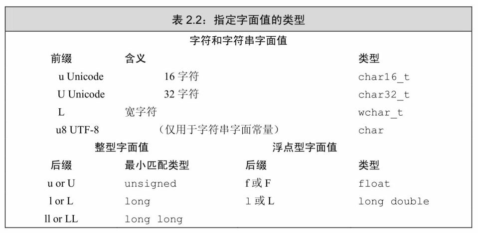
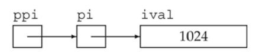

## 第Ⅰ部分  C++ 基础

任何常用的编程语言都具备一组公共的语法特征，不同语言仅在特征的细节上有所区别。要想学习并掌握一种编程语言，理解其语法特征的实现细节是第一步。最基本的特征包括：

- 整型、字符型等内置类型
- 变量，用来为对象命名
- 表达式和语句，用于操纵上述数据类型的具体值
- `if` 或`while`等控制结构，这些结构允许我们有选择地执行一些语句或者重复地执行一些语句函数，用于定义可供随时调用的计算单元。

大多数编程语言通过两种方式来进一步补充其基本特征：一是赋予程序员自定义数据类型的权利，从而实现对语言的扩展；二是将一些有用的功能封装成库函数提供给程序员。

与大多数编程语言一样，`C++`的对象类型决定了能对该对象进行的操作，一条表达式是否合法依赖于其中参与运算的对象的类型。一些语言，如`Smalltalk`和`Python`等，在程序运行时检查数据类型；与之相反，`C++`是一种静态数据类型语言，它的类型检查发生在编译时。因此，编译器必须知道程序中每一个变量对应的数据类型。

`C++`提供了一组内置数据类型、相应的运算符以及为数不多的几种程序流控制语句，这些元素共同构成了`C++`语言的基本形态。以这些元素为基础，我们可以编写出规模庞大、结构复杂、用于解决实际问题的软件系统。仅就`C++`的基本形态来说，它是一种简单的编程语言，其强大的能力显示于它对程序员自定义数据结构的支持。这种支持作用巨大，显而易见的一个事实是，`C++`语言的缔造者无须洞悉所有程序员的要求，而程序员恰好可以通过自主定义新的数据结构来使语言满足他们各自的需求。

`C++`中最重要的语法特征应该就是类了，通过它，程序员可以定义自己的数据类型。为了与`C++`的内置类型区别开来，它们通常被称为“类类型(`class type`)”。在一些编程语言中，程序员自定义的新类型仅能包含数据成员；另外一些语言，比如`C++`，则允许新类型中既包含数据成员，也包含函数成员。`C++`语言主要的一个设计目标就是让程序员自定义的数据类型像内置类型一样好用。基于此，标准`C++`库实现了丰富的类和函数。

本书第`Ⅰ`部分的主题是学习`C++`语言的基础知识，这也是掌握`C++`语言的第一步。第`2`章详述内置类型，并初步介绍了自定义数据类型的方法。第`3`章介绍了两种最基本的数据类型：字符串和向量。`C++`和许多编程语言所共有的一种底层数据结构—— 数组也在本章有所提及。接下来，第`4`～`6`章依次介绍了表达式、语句和函数。作为第`Ⅰ`部分的最后一章，第`7`章描述了如何构建我们自己的类，完成这一任务需要综合运用之前各章所介绍的知识。

# 第2章 变量和基本类型

数据类型是程序的基础：它告诉我们数据的意义以及我们能在数据上执行的操作。

`C++`语言支持广泛的数据类型。它定义了几种基本内置类型(如字符、整型、浮点数等)，同时也为程序员提供了自定义数据类型的机制。基于此，`C++`标准库定义了一些更加复杂的数据类型，比如可变长字符串和向量等。本章将主要讲述内置类型，并带领大家初步了解`C++`语言是如何支持更复杂数据类型的。

数据类型决定了程序中数据和操作的意义。如下所示的语句是一个简单示例：

```cpp
i=i+j;
```

其含义依赖于`i`和`j`的数据类型。如果`i`和`j`都是整型数，那么这条语句执行的就是最普通的加法运算。然而，如果`i`和`j`是`Sales_item`类型的数据(参见`1.5.1`节)，则上述语句把这两个对象的成分相加。

## 2.1 基本内置类型

`C++`定义了一套包括算术类型(`arithmetic type`)和空类型(`void`)在内的基本数据类型。其中算术类型包含了字符、整型数、布尔值和浮点数。空类型不对应具体的值，仅用于一些特殊的场合，例如最常见的是，当函数不返回任何值时使用空类型作为返回类型。

### 2.1.1 算术类型

算术类型分为两类：整型(`integral type` ，包括字符和布尔类型在内)和浮点型。

算术类型的尺寸(也就是该类型数据所占的比特数)在不同机器上有所差别。表`2.1`列出了`C++`标准规定的尺寸的最小值，同时允许编译器赋予这些类型更大的尺寸。某一类型所占的比特数不同，它所能表示的数据范围也不一样。

**表 2.1: C++: 算术类型**

| 类型 | 含义 | 最小尺寸 |
| --- | --- | --- |
| `bool` | 布尔类型 | 未定义 |
| `char` | 字符 | `8` 位 |
| `wchar_t` | 宽字符  | `16` 位 |
| `char16_t` | `Unicode` 字符  | `16` 位 |
| `char32_t` | `Unicode` 字符 | `32` 位 |
| `short` | 短整型  | `16` 位 |
| `int` | 整型 | `16` 位 |
| `long` | 长整型 | `32` 位 |
| `long long` | 长整型 | `64` 位 |
| `float` | 单精度浮点数 | `32` 位； 最少 `6` 位有效数字 |
| `double` | 双精度浮点数 | `64` 位； 最少 `10` 位有效数字  |
| `long double` | 扩展精度浮点数 | `96` 位； 最少 `10` 位有效数字  |

布尔类型(`bool`)的取值是真(`true`)或者假(`false`)。

`C++`提供了几种字符类型，其中多数支持国际化。基本的字符类型是`char`，一个`char`的空间应确保可以存放机器基本字符集中任意字符对应的数字值。也就是说，一个`char`的大小和一个机器字节一样。

其他字符类型用于扩展字符集，如`wchar_t`、`char16_t`、`char32_t`。`wchar_t`类型用于确保可以存放机器最大扩展字符集中的任意一个字符，类型`char16_t`和`char32_t`则为`Unicode`字符集服务(`Unicode`是用于表示所有自然语言中字符的标准)。

除字符和布尔类型之外，其他整型用于表示(可能)不同尺寸的整数。`C++`语言规定一个`int`至少和一个`short`一样大，一个`long`至少和一个`int`一样大，一个`long long` 至少和一个`long`一样大。其中，数据类型`longlong`是在`C++11`中新定义的。

#### 内置类型的机器实现

计算机以比特序列存储数据，每个比特非`0`即`1`，例如：
```cpp
 00011011011100010110010000111011 ...
```

大多数计算机以`2`的整数次幂个比特作为块来处理内存，可寻址的最小内存块称为“字节(`byte`)”，存储的基本单元称为“字(`word`)”，它通常由几个字节组成。在`C++`语言中，一个字节要至少能容纳机器基本字符集中的字符。大多数机器的字节由`8`比特构成，字则由`32`或`64`比特构成，也就是`4`或`8`字节。

大多数计算机将内存中的每个字节与一个数字(被称为“地址(`address`)”)关联起来，在一个字节为`8`比特、字为`32`比特的机器上，我们可能看到一个字的内存区域如下所示：

```text
地址      每个字节的内容（8 位）
736424    0 0 1 1   1 0 1 1
736425    0 0 0 1   1 0 1 1
736426    0 1 1 1   0 0 0 1
736427    0 1 1 0   0 1 0 0
```

其中，左侧是字节的地址，右侧是字节中`8`比特的具体内容。

我们能够使用某个地址来表示从这个地址开始的大小不同的比特串，例如，我们可能会说地址`736424`的那个字或者地址`736427`的那个字节。为了赋予内存中某个地址明确的含义，必须首先知道存储在该地址的数据的类型。类型决定了数据所占的比特数以及该如何解释这些比特的内容。

如果位置`736424`处的对象类型是`float`，并且该机器中`float`以`32`比特存储，那么我们就能知道这个对象的内容占满了整个字。这个`float`数的实际值依赖于该机器是如何存储浮点数的。或者如果位置`736424`处的对象类型是`unsigned char` ，并且该机器使用`ISO-Latin-1`字符集，则该位置处的字节表示一个分号。

浮点型可表示单精度、双精度和扩展精度值。`C++`标准指定了一个浮点数有效位数的最小值，然而大多数编译器都实现了更高的精度。通常，`float`以`1`个字(`32`比特)来表示，`double`以`2`个字(`64`比特)来表示，`long double` 以`3`或`4`个字(`96`或`128`比特)来表示。一般来说，类型`float`和`double`分别有`7`和`16`个有效位；类型`long double` 则常常被用于有特殊浮点需求的硬件，它的具体实现不同，精度也各不相同。

#### 带符号类型和无符号类型

除去布尔型和扩展的字符型之外，其他整型可以划分为带符号的(`signed`)和无符号的(`unsigned`)两种。带符号类型可以表示正数、负数或`0`，无符号类型则仅能表示大于等于`0`的值。

类型`int`、`short`、`long`和`long long` 都是带符号的，通过在这些类型名前添加`unsigned`就可以得到无符号类型，例如`unsigned long`  。类型`unsigned int`可以缩写为`unsigned`。

与其他整型不同，字符型被分为了三种：`char`、`signed char`  和`unsigned char` 。特别需要注意的是：类型`char`和类型`signed char` 并不一样。尽管字符型有三种，但是字符的表现形式却只有两种：带符号的和无符号的。类型`char`实际上会表现为上述两种形式中的一种，具体是哪种由编译器决定。

无符号类型中所有比特都用来存储值，例如，`8`比特的`unsigned char`可以表示`0`至`255`区间内的值。

`C++`标准并没有规定带符号类型应如何表示，但是约定了在表示范围内正值和负值的量应该平衡。因此，`8`比特的`signed char`理论上应该可以表示`-127`至`127`区间内的值，大多数现代计算机将实际的表示范围定为`-128`至`127`。

#### 建议：如何选择类型

和`C`语言一样，`C++`的设计准则之一也是尽可能地接近硬件。`C++`的算术类型必须满足各种硬件特质，所以它们常常显得繁杂而令人不知所措。事实上，大多数程序员能够(也应该)对数据类型的使用做出限定从而简化选择的过程。以下是选择类型的一些经验准则：

- 当明确知晓数值不可能为负时，选用无符号类型。
- 使用`int`执行整数运算。在实际应用中，`short`常常显得太小而`long`一般和`int`有一样的尺寸。如果你的数值超过了`int`的表示范围，选用`long long`。
- 在算术表达式中不要使用`char`或`bool`，只有在存放字符或布尔值时才使用它们。因为类型`char`在一些机器上是有符号的，而在另一些机器上又是无符号的，所以如果使用`char`进行运算特别容易出问题。如果你需要使用一个不大的整数，那么明确指定它的类型是`signed char`或者`unsigned char`。
- 执行浮点数运算选用`double`，这是因为`float`通常精度不够而且双精度浮点数和单精度浮点数的计算代价相差无几。事实上，对于某些机器来说，双精度运算甚至比单精度还快。`long double` 提供的精度在一般情况下是没有必要的，况且它带来的运行时消耗也不容忽视。

#### 小节练习

练习`2.1`：类型`int`、`long`、`long long` 和`short`的区别是什么？无符号类型和带符号类型的区别是什么？`float`和`double`的区别是什么？

练习`2.2`：计算按揭贷款时，对于利率、本金和付款分别应选择何种数据类型？说明你的理由。

### 2.1.2 类型转换

对象的类型定义了对象能包含的数据和能参与的运算，其中一种运算被大多数类型支持，就是将对象从一种给定的类型转换(`convert`)为另一种相关类型。

当在程序的某处我们使用了一种类型而其实对象应该取另一种类型时，程序会自动进行类型转换，在`4.11`节中我们将对类型转换做更详细的介绍。此处，有必要说明当给某种类型的对象强行赋了另一种类型的值时，到底会发生什么。

当我们像下面这样把一种算术类型的值赋给另外一种类型时：

```cpp
bool b = 42;                  // b为真
int i=b;                      // i 的值为 1
i = 3.14;                     // i 的值为 3
double pi = i;                // pi 的值为3.0
unsigned char c = -1;         // 假设 char 占 8 比特，c 的值为255
signed char c2 = 256;         // 假设 char & 8 比特，c2 的值是未定义的
```

类型所能表示的值的范围决定了转换的过程：

- 当我们把一个非布尔类型的算术值赋给布尔类型时，初始值为`0`则结果为`false`，否则结果为`true`。
- 当我们把一个布尔值赋给非布尔类型时，初始值为`false`则结果为`0`，初始值为`true`则结果为`1`。
- 当我们把一个浮点数赋给整数类型时，进行了近似处理。结果值将仅保留浮点数中小数点之前的部分。
- 当我们把一个整数值赋给浮点类型时，小数部分记为`0`。如果该整数所占的空间超过了浮点类型的容量，精度可能有损失。
- 当我们赋给无符号类型一个超出它表示范围的值时，结果是初始值对无符号类型表示数值总数取模后的余数。例如，`8`比特大小的`unsigned char` 可以表示`0`至`255`区间内的值，如果我们赋了一个区间以外的值，则实际的结果是该值对`256`取模后所得的余数。因此，把`-1`赋给`8`比特大小的`unsigned char`所得的结果是`255`。
- 当我们赋给带符号类型一个超出它表示范围的值时，结果是未定义的(`undefined`)。此时，程序可能继续工作、可能崩溃，也可能生成垃圾数据。

#### 建议：避免无法预知和依赖于实现环境的行为

- 无法预知的行为源于编译器无须(有时是不能)检测的错误。即使代码编译通过了，如果程序执行了一条未定义的表达式，仍有可能产生错误。
- 不幸的是，在某些情况和`/`或某些编译器下，含有无法预知行为的程序也能正确执行。但是我们却无法保证同样一个程序在别的编译器下能正常工作，甚至已经编译通过的代码再次执行也可能会出错。此外，也不能认为这样的程序对一组输入有效，对另一组输入就一定有效。
- 程序也应该尽量避免依赖于实现环境的行为。如果我们把`int`的尺寸看成是一个确定不变的已知值，那么这样的程序就称作不可移植的(`nonportable`)。当程序移植到别的机器上后，依赖于实现环境的程序就可能发生错误。要从过去的代码中定位这类错误可不是一件轻松愉快的工作。

当在程序的某处使用了一种算术类型的值而其实所需的是另一种类型的值时，编译器同样会执行上述的类型转换。例如，如果我们使用了一个非布尔值作为条件(参见`1.4.1`节)，那么它会被自动地转换成布尔值，这一做法和把非布尔值赋给布尔变量时的操作完全一样：

```cpp
int i = 42;
if (i)              //if条件的值为true
     i = 0;
```

如果`i`的值为`0`，则条件的值为`false`；`i`的所有其他取值(非`0`)都将使条件为`true`。

以此类推，如果我们把一个布尔值用在算术表达式里，则它的取值非`0`即`1`，所以一般不宜在算术表达式里使用布尔值。

含有无符号类型的表达式

尽管我们不会故意给无符号对象赋一个负值，却可能(特别容易)写出这么做的代码。例如，当一个算术表达式中既有无符号数又有`int`值时，那个`int`值就会转换成无符号数。把`int`转换成无符号数的过程和把`int`直接赋给无符号变量一样：

```cpp
unsigned u = 10;
int i = -42;
std::cout << i+ i << std::endl;    // 输出-84
std::cout << u + i << std::endl;   // 如果int占32位, 输出 4294967264
```

在第一个输出表达式里，两个(负)整数相加并得到了期望的结果。在第二个输出表达式里，相加前首先把整数`-42`转换成无符号数。把负数转换成无符号数类似于直接给无符号数赋一个负值，结果等于这个负数加上无符号数的模。

当从无符号数中减去一个值时，不管这个值是不是无符号数，我们都必须确保结果不能是一个负值：

```cpp
unsigned ul = 42, u2 = 10;
std::cout << ul - u2 << std::endl; // 正确: 输出 32
std::cout << u2 - ul << std::endl; // 正确: 不过，结果是取模后的值 4294967264 (32位)
```

无符号数不会小于`0`这一事实同样关系到循环的写法。例如，在 `4.1`节的练习中需要写一个循环，通过控制变量递减的方式把从`10`到`0`的数字降序输出。这个循环可能类似于下面的形式：

```cpp
for (int i = 10; i >= 0; --i)
     std::cout << i << std::endl;
```

可能你会觉得反正也不打算输出负数，可以用无符号数来重写这个循环。然而，这个不经意的改变却意味着死循环：

```cpp
// 错误: 变量口永远也不会小于0，循环条件一直成立
for (unsigned u = 10; u >= 0; --u)
     std::cout << u << std::endl;
```

来看看当`u`等于`0`时发生了什么，这次迭代输出`0`，然后继续执行`for`语句里的表达式。表达式`--u`从`u`当中减去`1`，得到的结果`-1`并不满足无符号数的要求，此时像所有表示范围之外的其他数字一样，`-1`被自动地转换成一个合法的无符号数。假设`int`类型占`32`位，则当`u`等于`0`时，`--u`的结果将会是`4294967295`。

一种解决的办法是，用`while`语句来代替`for`语句，因为前者让我们能够在输出变量之前(而非之后)先减去`1`：

```cpp
unsigned u = 11;    // 确定要输出的最大数，从比它大 1 的数开始
while (u > 0){
     --u;           // 先减 1，这样最后一次迭代时就会输出 0
     std::cout << u << std::endl;
}
```

改写后的循环先执行对循环控制变量减`1`的操作，这样最后一次迭代时，进入循环的`u`值为`1`。此时将其减`1`，则这次迭代输出的数就是`0`；下一次再检验循环条件时，`u`的值等于`0`而无法再进入循环。因为我们要先做减`1`的操作，所以初始化`u`的值应该比要输出的最大值大`1`。这里，`u`初始化为`11`，输出的最大数是`10`。

提示：切勿混用带符号类型和无符号类型

>如果表达式里既有带符号类型又有无符号类型，当带符号类型取值为负时会出现异常结果，这是因为带符号数会自动地转换成无符号数。例如，在一个形如`a`*`b`的式子中，如果`a = -1` ，`b = 1`  ，而且`a`和`b`都是`int`，则表达式的值显然为`-1`。然而，如果`a`是`int`，而`b`是`unsigned`，则结果须视在当前机器上`int`所占位数而定。在我们的环境里，结果是`4294967295`。

#### 小节练习

练习`2.3`：读程序写结果。

```cpp
unsigned u = 10, u2 = 42;
std::cout << u2 -u << std::endl;
std::cout << u -u2 << std::endl;

int i = 10, i2 = 42;
std::cout << i2 -i<< std::endl;
std::cout << i - i2<< std::endl;
std::cout << i - u<< std::endl;
std::cout << u - i<< std::endl;
```

练习`2.4`：编写程序检查你的估计是否正确，如果不正确，请仔细研读本节直到弄明白问题所在。

### 2.1.3 字面值常量

一个形如`42`的值被称作字面值常量(`literal`)，这样的值一望而知。每个字面值常量都对应一种数据类型，字面值常量的形式和值决定了它的数据类型。

#### 整型和浮点型字面值

我们可以将整型字面值写作十进制数、八进制数或十六进制数的形式。以`0`开头的整数代表八进制数，以`0x`或`0X`开头的代表十六进制数。例如，我们能用下面的任意一种形式来表示数值`20`：

```cpp
20        /* 十进制 */
024       /* 八进制 */
0x14      /* 十六进制 */
```

整型字面值具体的数据类型由它的值和符号决定。默认情况下，十进制字面值是带符号数，八进制和十六进制字面值既可能是带符号的也可能是无符号的。十进制字面值的类型是`int`、`long`和`long long` 中尺寸最小的那个(例如，三者当中最小是`int`)，当然前提是这种类型要能容纳下当前的值。八进制和十六进制字面值的类型是能容纳其数值的`int`、`unsigned int`、`long`、`unsigned long`、`long long`和`unsigned long long` 中的尺寸最小者。如果一个字面值连与之关联的最大的数据类型都放不下，将产生错误。类型`short`没有对应的字面值。在表`2.2`中，我们将以后缀代表相应的字面值类型。

尽管整型字面值可以存储在带符号数据类型中，但严格来说，十进制字面值不会是负数。如果我们使用了一个形如`-42`的负十进制字面值，那个负号并不在字面值之内，它的作用仅仅是对字面值取负值而已。

浮点型字面值表现为一个小数或以科学计数法表示的指数，其中指数部分用`E`或`e`标识：

```cpp
3.14159
3.14159E0
0.
0e0
.001
```

默认的，浮点型字面值是一个`double`，我们可以使用表`2.2`中的后缀来表示其他浮点型。

#### 字符和字符串字面值

由单引号括起来的一个字符称为`char`型字面值，双引号括起来的零个或多个字符则构成字符串型字面值。

```cpp
'a'                 // 字符字面值
"Hello World!"      // 字符串字面值
```

字符串字面值的类型实际上是由常量字符构成的数组(`array`)，该类型将在`3.5.4`节介绍。编译器在每个字符串的结尾处添加一个空字符(′`\0`′)，因此，字符串字面值的实际长度要比它的内容多`1`。例如，字面值`'A'`表示的就是单独的字符`A`，而字符串`"A"`则代表了一个字符的数组，该数组包含两个字符：一个是字母`A`、另一个是空字符。

如果两个字符串字面值位置紧邻且仅由空格、缩进和换行符分隔，则它们实际上是一个整体。当书写的字符串字面值比较长，写在一行里不太合适时，就可以采取分开书写的方式：

```cpp
// 分多行书写的字符串字面值
std::cout << "a really, really long string literal "
              "that spans two lines" << std::endl;
```

#### 转义序列

有两类字符程序员不能直接使用：一类是不可打印(`nonprintable`)的字符，如退格或其他控制字符，因为它们没有可视的图符；另一类是在`C++`语言中有特殊含义的字符(单引号、双引号、问号、反斜线)。在这些情况下需要用到转义序列(`escape sequence`)，转义序列均以反斜线作为开始，`C++`语言规定的转义序列包括：

|名称|转义序列|
|---|---|
|换行符|`\n`|
|横向制表符| `\t`|
|报警(响铃) 符|`\a`|
|纵向制表符| `\v`|
|退格符     | `\b`|
|双引号      | `\"`|
|反斜杠   | `\\`|
|问号      | `\?`|
|单引号      | `\'`|
|回车符     | `\r`|
|进纸符     | `\f`|

在程序中，上述转义序列被当作一个字符使用：

```cpp
std::cout << '\n';            // 转到新一行
std::cout << "\tHi!\n";       // 给出一个制表符，输出"Hilm"，转到新一行
```

我们也可以使用泛化的转义序列，其形式是`\x`后紧跟`1`个或多个十六进制数字，或者`\`后紧跟`1`个、`2`个或`3`个八进制数字，其中数字部分表示的是字符对应的数值。假设使用的是`Latin-1`字符集，以下是一些示例：

```cpp
\7        //响铃
\12       //换行符
\40       //空格
\0        //空字符
\115      //字符M
\x4d      //字符M
```

我们可以像使用普通字符那样使用`C++`语言定义的转义序列：

```cpp
std::cout << "Hi \x4dO\115!\n";    //输出Hi MOM!，转到新一行
std::cout << '\115' << '\n';       // 输出M，转到新一行
```

注意，如果反斜线`\`后面跟着的八进制数字超过`3`个，只有前`3`个数字与`\`构成转义序列。例如，`"\1234"`表示`2`个字符，即八进制数`123`对应的字符以及字符`4`。相反，`\x`要用到后面跟着的所有数字，例如，`"\x1234"`表示一个`16`位的字符，该字符由这`4`个十六进制数所对应的比特唯一确定。因为大多数机器的`char`型数据占`8`位，所以上面这个例子可能会报错。一般来说，超过`8`位的十六进制字符都是与表`2.2`中某个前缀作为开头的扩展字符集一起使用的。

#### 指定字面值的类型

通过添加如表`2.2`中所列的前缀和后缀，可以改变整型、浮点型和字符型字面值的默认类型。

```cpp
L'a'                // 宽字符型字面值，类型是wchar_t
u8"hi!"             // utf-8 字符串字面值(utf-8 用 8 位编码一个Unicode 字符)
42ULL               // 无符号整型字面值，类型是unsigned long long
1E-3F               // 单精度浮点型字面值，类型是FLoat
3.14159L            // 扩展精度浮点型字面值，类型是long double
```

> 当使用一个长整型字面值时，请使用大写字母`L`来标记，因为小写字母`l`和数字`1`太容易混淆了。



对于一个整型字面值来说，我们能分别指定它是否带符号以及占用多少空间。如果后缀中有`U`，则该字面值属于无符号类型，也就是说，以`U`为后缀的十进制数、八进制数或十六进制数都将从`unsigned int`  、`unsigned long` 和`unsigned long long` 中选择能匹配的空间最小的一个作为其数据类型。如果后缀中有`L`，则字面值的类型至少是`long`；如果后缀中有`LL`，则字面值的类型将是`long long`和`unsigned long long` 中的一种。显然我们可以将`U`与`L`或`LL`合在一起使用。例如，以`UL` 为后缀的字面值的数据类型将根据具体数值情况或者取`unsigned long` ，或者取`unsignedlong long`。

#### 布尔字面值和指针字面值

`true`和`false`是布尔类型的字面值：

```cpp
bool test = false;
```

`nullptr`是指针字面值，`2.3.2`节将有更多关于指针和指针字面值的介绍。

#### 小节练习

练习`2.5`：指出下述字面值的数据类型并说明每一组内几种字面值的区别：

```cpp
(a) 'a'; L'a', "a" L"a"
(b) 10, 10u, 10L, 10uL, 012, OxC
(c) 3.14, 3.14f, 3.14L
(d) 10, 10u, 10., 10e-2
```

练习`2.6`：下面两组定义是否有区别，如果有，请叙述之：

```cpp
int month = 9, day = 7;
int month = 09, day = 07;
```

练习`2.7`：下述字面值表示何种含义？它们各自的数据类型是什么？

```cpp
(a) "Who goes with F\145rgus?\012"
(b) 3.14e1L      (c) 1024f      (d) 3.14L
```

练习`2.8`：请利用转义序列编写一段程序，要求先输出`2M` ，然后转到新一行。修改程序使其先输出`2`，然后输出制表符，再输出`M` ，最后转到新一行。

## 2.2 变量

变量提供一个具名的、可供程序操作的存储空间。`C++`中的每个变量都有其数据类型，数据类型决定着变量所占内存空间的大小和布局方式、该空间能存储的值的范围，以及变量能参与的运算。对`C++`程序员来说，“变量(`variable`)”和“对象(`object`)”一般可以互换使用。

### 2.2.1 变量定义

变量定义的基本形式是：首先是类型说明符(`type specifier`)，随后紧跟由一个或多个变量名组成的列表，其中变量名以逗号分隔，最后以分号结束。列表中每个变量名的类型都由类型说明符指定，定义时还可以为一个或多个变量赋初值：

```cpp
int sum = 0, value,      // sum, value和units_sold 都是int
   units_sold = 0;       // sum 和 units_sold初值为0
Sales_item item;         // item 的类型是Sales_item (参见 1.5.1 节 ,第 17 页)
// string是一种库类型，表示一个可变长的字符序列
std::string book("0-201-78345-X");//book通过一个string 字面值初始化
```

book的定义用到了库类型`std::string`，像`iostream`(参见`1.2`节)一样，`string`也是在命名空间`std`中定义的，我们将在第`3`章中对`string`类型做更详细的介绍。眼下，只需了解`string`是一种表示可变长字符序列的数据类型就可以了。`C++`库提供了几种初始化`string`对象的方法，其中一种是把字面值拷贝给`string`对象(参见`2.1.3`节)，因此在上例中，`book`被初始化为`0-201-78345-X`。

#### 术语：何为对象(`object`)？

`C++`程序员们在很多场合都会使用对象(`object`)这个名词。通常情况下，对象是指一块能存储数据并具有某种类型的内存空间。

一些人仅在与类有关的场景下才使用“对象”这个词。另一些人则已把命名的对象和未命名的对象区分开来，他们把命名了的对象叫做变量。还有一些人把对象和值区分开来，其中对象指能被程序修改的数据，而值(`value`)指只读的数据。

本书遵循大多数人的习惯用法，即认为对象是具有某种数据类型的内存空间。我们在使用对象这个词时，并不严格区分是类还是内置类型，也不区分是否命名或是否只读。

#### 初始值

当对象在创建时获得了一个特定的值，我们说这个对象被初始化(`initialized`)了。用于初始化变量的值可以是任意复杂的表达式。当一次定义了两个或多个变量时，对象的名字随着定义也就马上可以使用了。因此在同一条定义语句中，可以用先定义的变量值去初始化后定义的其他变量。

```cpp
// 正确: price 先被定义并赋值，随后被用于初始化discount
double price = 109.99, discount = price * 0.16;
// 正确 : 调用函数 app1yDiscount，然后用函数的返回值初始化 salePrice
double salePrice = applyDiscount (price, discount);
```

在`C++`语言中，初始化是一个**异常复杂**的问题，我们也将反复讨论这个问题。很多程序员对于用等号`=`来初始化变量的方式倍感困惑，这种方式容易让人认为初始化是赋值的一种。事实上在`C++`语言中，初始化和赋值是两个完全不同的操作。然而在很多编程语言中二者的区别几乎可以忽略不计，即使在`C++`语言中有时这种区别也无关紧要，所以人们特别容易把二者混为一谈。需要强调的是，这个概念至关重要，我们也将在后面不止一次提及这一点。

>初始化不是赋值，初始化的含义是创建变量时赋予其一个初始值，而赋值的含义是把对象的当前值擦除，而以一个新值来替代。

#### 列表初始化

`C++`语言定义了初始化的好几种不同形式，这也是初始化问题复杂性的一个体现。例如，要想定义一个名为`units_sold`的`int`变量并初始化为`0`，以下的`4`条语句都可以做到这一点：

```cpp
int units_sold = 0;
int units_sold = {0};
int units_sold{0};
int units_sold(0);
```

作为`C++11`新标准的一部分，用花括号来初始化变量得到了全面应用，而在此之前，这种初始化的形式仅在某些受限的场合下才能使用。出于`3.3.1`节将要介绍的原因，这种初始化的形式被称为列表初始化(`list initialization`)。现在，无论是初始化对象还是某些时候为对象赋新值，都可以使用这样一组由花括号括起来的初始值了。

当用于内置类型的变量时，这种初始化形式有一个重要特点：如果我们使用列表初始化且初始值存在丢失信息的风险，则编译器将报错：

```cpp
long double ld = 3.1415926536;
int a{ld}, b = {1d};     // 错误: 转换未执行，因为存在丢失信息的危险
int c(ld), d = ld;       // 正确: 转换执行，且确实丢失了部分值
```

使用`long double` 的值初始化`int`变量时可能丢失数据，所以编译器拒绝了`a`和`b`的初始化请求。其中，至少`ld`的小数部分会丢失掉，而且`int`也可能存不下`ld`的整数部分。

刚刚所介绍的看起来无关紧要，毕竟我们不会故意用`long double` 的值去初始化`int`变量。然而，像第`16`章介绍的一样，这种初始化有可能在不经意间发生。我们将在`3.2.1`节和`3.3.1`节对列表初始化做更多介绍。

#### 默认初始化

如果定义变量时没有指定初值，则变量被默认初始化(`default initialized`)，此时变量被赋予了“默认值”。默认值到底是什么由变量类型决定，同时定义变量的位置也会对此有影响。

如果是内置类型的变量未被显式初始化，它的值由定义的位置决定。定义于任何函数体之外的变量被初始化为`0`。然而如`6.1.1`节所示，一种例外情况是，定义在函数体内部的内置类型变量将不被初始化(`uninitialized`)。一个未被初始化的内置类型变量的值是未定义的(参见`2.1.2`节)，如果试图拷贝或以其他形式访问此类值将引发错误。

每个类各自决定其初始化对象的方式。而且，是否允许不经初始化就定义对象也由类自己决定。如果类允许这种行为，它将决定对象的初始值到底是什么。

绝大多数类都支持无须显式初始化而定义对象，这样的类提供了一个合适的默认值。例如，以刚刚所见为例，`string`类规定如果没有指定初值则生成一个空串：

```cpp
std::string empty;   // empty 非显式地初始化为一个空串
Sales_item item;     // 被默认初始化的Sales_item 对象
```

一些类要求每个对象都显式初始化，此时如果创建了一个该类的对象而未对其做明确的初始化操作，将引发错误。

>定义于函数体内的内置类型的对象如果没有初始化，则其值未定义。类的对象如果没有显式地初始化，则其值由类确定。

#### 小节练习

练习`2.9`：解释下列定义的含义。对于非法的定义，请说明错在何处并将其改正。

```cpp
(a) std::cin >> int input_value;      (b) int i = { 3.14 };
(c) double salary = wage = 9999.99;   (d) int i = 3.14;
```

练习`2.10`：下列变量的初值分别是什么？

```cpp
#include <iostream>
std::string global_str;
int global_int;
int main()
{
    int local_int;
    std::string local_str;
}
```

提示：未初始化变量引发运行时故障

>未初始化的变量含有一个不确定的值，使用未初始化变量的值是一种错误的编程行为并且很难调试。尽管大多数编译器都能对一部分使用未初始化变量的行为提出警告，但严格来说，编译器并未被要求检查此类错误。
>使用未初始化的变量将带来无法预计的后果。有时我们足够幸运，一访问此类对象程序就崩溃并报错，此时只要找到崩溃的位置就很容易发现变量没被初始化的问题。另外一些时候，程序会一直执行完并产生错误的结果。更糟糕的情况是，程序结果时对时错、无法把握。而且，往无关的位置添加代码还会导致我们误以为程序对了，其实结果仍旧有错。
>建议初始化每一个内置类型的变量。虽然并非必须这么做，但如果我们不能确保初始化后程序安全，那么这么做不失为一种简单可靠的方法。

### 2.2.2 变量声明和定义的关系

为了允许把程序拆分成多个逻辑部分来编写，`C++`语言支持分离式编译(`separate compilation`)机制，该机制允许将程序分割为若干个文件，每个文件可被独立编译。

如果将程序分为多个文件，则需要有在文件间共享代码的方法。例如，一个文件的代码可能需要使用另一个文件中定义的变量。一个实际的例子是`std::cout`和`std::cin`，它们定义于标准库，却能被我们写的程序使用。

为了支持分离式编译，`C++`语言将声明和定义区分开来。声明(`declaration`)使得名字为程序所知，一个文件如果想使用别处定义的名字则必须包含对那个名字的声明。而定义(`definition`)负责创建与名字关联的实体。

变量声明规定了变量的类型和名字，在这一点上定义与之相同。但是除此之外，定义还申请存储空间，也可能会为变量赋一个初始值。

如果想声明一个变量而非定义它，就在变量名前添加关键字`extern`，而且不要显式地初始化变量：

```cpp
extern int i;       // 声明i而非定义i
int j;              // 声明并定义j
```

任何包含了显式初始化的声明即成为定义。我们能给由`extern`关键字标记的变量赋一个初始值，但是这么做也就抵消了`extern`的作用。`extern`语句如果包含初始值就不再是声明，而变成定义了：

```cpp
extern double pi = 3.1416; // 定义
```

在函数体内部，如果试图初始化一个由`extern`关键字标记的变量，将引发错误。

>变量能且只能被定义一次，但是可以被多次声明。

声明和定义的区别看起来也许微不足道，但实际上却非常重要。如果要在多个文件中使用同一个变量，就必须将声明和定义分离。此时，变量的定义必须出现在且只能出现在一个文件中，而其他用到该变量的文件必须对其进行声明，却绝对不能重复定义。

关于`C++`语言对分离式编译的支持我们将在`2.6.3`节和`1.3`节中做更详细的介绍。

#### 小节练习

练习`2.11`：指出下面的语句是声明还是定义：

```cpp
(a) extern int ix = 1024;
(b) int iy;
(c) extern int iz;
```

关键概念：静态类型

`C++`是一种静态类型(`statically typed`)语言，其含义是在编译阶段检查类型。其中，检查类型的过程称为类型检查(`type checking`)。

我们已经知道，对象的类型决定了对象所能参与的运算。在`C++`语言中，编译器负责检查数据类型是否支持要执行的运算，如果试图执行类型不支持的运算，编译器将报错并且不会生成可执行文件。

程序越复杂，静态类型检查越有助于发现问题。然而，前提是编译器必须知道每一个实体对象的类型，这就要求我们在使用某个变量之前必须声明其类型。

### 2.2.3 标识符

`C++`的标识符(`identifier`)由字母、数字和下画线组成，其中必须以字母或下画线开头。标识符的长度没有限制，但是对大小写字母敏感：

```cpp
// 定义4个不同的int 变量
int somename, someName, SomeName, SOMENAME;
```

如表`2.3`和表`2.4`所示，`C++`语言保留了一些名字供语言本身使用，这些名字不能被用作标识符。

同时，`C++`也为标准库保留了一些名字。用户自定义的标识符中不能连续出现两个下画线，也不能以下画线紧连大写字母开头。此外，定义在函数体外的标识符不能以下画线开头。

#### 变量命名规范

变量命名有许多约定俗成的规范，下面的这些规范能有效提高程序的可读性：

- 标识符要能体现实际含义。
- 变量名一般用小写字母，如`index`，不要使用`Index`或`INDEX` 。
- 用户自定义的类名一般以大写字母开头，如`Sales_item`。
- 如果标识符由多个单词组成，则单词间应有明显区分，如`student_loan`或`studentLoan`，不要使用`studentloan`。

>对于命名规范来说，若能坚持，必将有效。

表 `2.3`: `C++` 关键字
```cpp
alignas        continue       friend         register            true
alignof        decltype       goto           reinterpret_cast    try
asm            default        if             return              typedef
auto           delete         inline         short               typeid
bool           do             int            signed              typename
break          double         long           sizeof              union
case           dynamic_cast   mutable        static              unsigned
catch          else           namespace      static_assert       using
char           enum           new            static_cast         virtual
char16_t       explicit       noexcept       struct              void
char32_t       export         nullptr        switch              volatile
class          extern         operator       template            wchar_t
const          false          private        this                while
constexpr      float          protected      thread_local
const_cast     for            public         throw
```

表 `2.4`: `C++` 操作符替代名
```cpp
and            bitand         compl          not_eq              or_eq          xor_eq
and_eq         bitor          not            or                  xor
```

#### 小节练习

练习`2.12`：请指出下面的名字中哪些是非法的？

```cpp
(a) int double = 3.14;        (b) int _;
(c) int catch-22;             (d) int 1_or_2 = 1;
(e) double Double = 3.14;
```

### 2.2.4 名字的作用域

不论是在程序的什么位置，使用到的每个名字都会指向一个特定的实体：变量、函数、类型等。然而，同一个名字如果出现在程序的不同位置，也可能指向的是不同实体。

作用域(`scope`)是程序的一部分，在其中名字有其特定的含义。`C++`语言中大多数作用域都以花括号分隔。

同一个名字在不同的作用域中可能指向不同的实体。名字的有效区域始于名字的声明语句，以声明语句所在的作用域末端为结束。

一个典型的示例来自于`1.4.2`节的程序：

```cpp
#include <iostream>
int main()
{
    int sum = 0;
    // sum 用于存放从 1 到 10 PAFe
    for (int val = 1; val <= 10; ++val)
       sum += val; // 等价于sum = sum + val
          
     std::cout << "Sum of 1 to 10 inclusive is "
                 << sum << std::endl;
     return 0;
}
```

这段程序定义了`3`个名字：`main`、`sum`和`val`，同时使用了命名空间名字`std`，该空间提供了`2`个名字`cout`和`cin`供程序使用。

名字`main`定义于所有花括号之外，它和其他大多数定义在函数体之外的名字一样拥有全局作用域(`global scope`)。一旦声明之后，全局作用域内的名字在整个程序的范围内都可使用。名字`sum`定义于`main`函数所限定的作用域之内，从声明`sum`开始直到`main`函数结束为止都可以访问它，但是出了`main`函数所在的块就无法访问了，因此说变量`sum`拥有块作用域(`block scope`)。名字`val`定义于`for`语句内，在`for`语句之内可以访问`val`，但是在`main`函数的其他部分就不能访问它了。

#### 建议：当你第一次使用变量时再定义它

>一般来说，在对象第一次被使用的地方附近定义它是一种好的选择，因为这样做有助于更容易地找到变量的定义。更重要的是，当变量的定义与它第一次被使用的地方很近时，我们也会赋给它一个比较合理的初始值。

#### 嵌套的作用域

作用域能彼此包含，被包含(或者说被嵌套)的作用域称为内层作用域(`inner scope`)，包含着别的作用域的作用域称为外层作用域(`outer scope`)。

作用域中一旦声明了某个名字，它所嵌套着的所有作用域中都能访问该名字。同时，允许在内层作用域中重新定义外层作用域已有的名字：

```cpp
#include <iostream>
// 该程序仅用于说明 : 函数内部不宜定义与全局变量同名的新变量
int reused = 42; // reused拥有全局作用域
int main()
{
   int unique = 0; // unique 拥有块作用域
   // 输出 #1: 使用全局变量reused;输出 42 0
   std::cout << reused << " " << unique << std::endl;
   int reused = 0; // 新建局部变量 reused, 覆盖了全局变量 reused
   // 输出 #2: 使用局部变量reused; 输出0 0
   std::cout << reused << " " << unique << std::endl;
   // 输出#3: 显式地访问全局变量reused; 输出 42 0
   std::cout << ::reused << " " << unique << std::endl;
   return 0;
}
```

输出`#1`出现在局部变量`reused`定义之前，因此这条语句使用全局作用域中定义的名字`reused`，输出`42 0` 。输出`#2`发生在局部变量`reused`定义之后，此时局部变量`reused`正在作用域内(`in scope`)，因此第二条输出语句使用的是局部变量`reused`而非全局变量，输出`0 0` 。输出`#3`使用作用域操作符(参见`1.2`节)来覆盖默认的作用域规则，因为全局作用域本身并没有名字，所以当作用域操作符的左侧为空时，向全局作用域发出请求获取作用域操作符右侧名字对应的变量。结果是，第三条输出语句使用全局变量`reused`，输出`42 0`。

>如果函数有可能用到某全局变量，则不宜再定义一个同名的局部变量。

#### 小节练习

练习`2.13`：下面程序中`j`的值是多少？

```cpp
int i = 42;
int main()
{
     int i = 100;
     int, j = i;
}
```

练习`2.14`：下面的程序合法吗？如果合法，它将输出什么？

```cpp
int i = 100, sum = 0;
for (int i = 0; i != 10; ++i)
      sum += i;
std::cout << i << "" << sum << std::endl,
```

## 2.3 复合类型

复合类型(`compound type`)是指基于其他类型定义的类型。`C++`语言有几种复合类型，本章将介绍其中的两种：引用和指针。

与我们已经掌握的变量声明相比，定义复合类型的变量要复杂很多。`2.2`节提到，一条简单的声明语句由一个数据类型和紧随其后的一个变量名列表组成。其实更通用的描述是，一条声明语句由一个基本数据类型(`base type`)和紧随其后的一个声明符(`declarator`)列表组成。每个声明符命名了一个变量并指定该变量为与基本数据类型有关的某种类型。

目前为止，我们所接触的声明语句中，声明符其实就是变量名，此时变量的类型也就是声明的基本数据类型。其实还可能有更复杂的声明符，它基于基本数据类型得到更复杂的类型，并把它指定给变量。

### 2.3.1 引用

`C++11`中新增了一种引用：所谓的“右值引用(`rvalue reference`)”，我们将在`13.6.1`节做更详细的介绍。这种引用主要用于内置类。严格来说，当我们使用术语“引用(`reference`)”时，指的其实是“左值引用(`lvalue reference`)”。

引用(`reference`)为对象起了另外一个名字，引用类型引用(`refers to`)另外一种类型。通过将声明符写成`&d`的形式来定义引用类型，其中`d`是声明的变量名：

```cpp
int ival = 1024;
int &refVal = ival;      // refVal 指向 ival (是 ival 的另一个名字 )
int &refVal2;            // 报错: 引用必须被初始化
```

一般在初始化变量时，初始值会被拷贝到新建的对象中。然而定义引用时，程序把引用和它的初始值绑定(`bind`)在一起，而不是将初始值拷贝给引用。一旦初始化完成，引用将和它的初始值对象一直绑定在一起。因为无法令引用重新绑定到另外一个对象，因此引用必须初始化。

**引用即别名**

>引用并非对象，相反的，它只是为一个已经存在的对象所起的另外一个名字。

定义了一个引用之后，对其进行的所有操作都是在与之绑定的对象上进行的：

```cpp
refVal = 2;              // 把 2 赋给 refVal 指向的对象，此处即是赋给了 ival
int ii = refVal;         // 与 ii = ival 执行结果一样
```

为引用赋值，实际上是把值赋给了与引用绑定的对象。获取引用的值，实际上是获取了与引用绑定的对象的值。同理，以引用作为初始值，实际上是以与引用绑定的对象作为初始值：

```cpp
// 正确: refVal3 绑定到了那个与refVal 绑定的对象上，这里就是绑定到 ival 上
int &refVal3 = refVal;
// 利用与refVal 绑定的对象的值初始化变量 i
int i = refVal;     // 正确: 被初始化为ival 的值
```

因为引用本身不是一个对象，所以不能定义引用的引用。

#### 引用的定义

允许在一条语句中定义多个引用，其中每个引用标识符都必须以符号`&` 开头：

```cpp
int i = 1024, i2 = 2048;      // i 和 i2都是int
int &r = i, r2 = i2;          // r是一个引用，与i 绑定在一起，r2 是 int
int i3 = 1024，&ri = i3;      // i3是int，ri 是一个引用，与 i3 绑定在一起
int &r3 = i3，&r4 = i2;       // r3 和 r4 都是引用
```

除了`2.4.1`节和`15.2.3`节将要介绍的两种例外情况，其他所有引用的类型都要和与之绑定的对象严格匹配。而且，引用只能绑定在对象上，而不能与字面值或某个表达式的计算结果绑定在一起，相关原因将在`2.4.1`节详述：

```cpp
int &refVal4 = 10;       // 错误: 引用类型的初始值必须是一个对象
double dval = 3.14;
int &refVal5 = dval;     // 错误: 此处引用类型的初始值必须是 int 型对象
```

#### 小节练习

练习`2.15`：下面的哪个定义是不合法的？为什么？

```cpp
(a) int ival = 1.01;      (b) int &rval1 = 1.01;
(c) int &rval2 = ival;    (d) int &rval3;
```

练习`2.16`：考查下面的所有赋值然后回答：哪些赋值是不合法的？为什么？哪些赋值是合法的？它们执行了什么样的操作？

```cpp
int i= 0, &r1 = i;  double d = 0, &r2 = d;
(a) r2 = 3.14159;   (b)      r2 = r1;
(c) i = r2;         (d)      r1 = d;
```

练习`2.17`：执行下面的代码段将输出什么结果？

```cpp
int i, &ri = i;
i= 5; ri = 10;
std::cout << i << "  " << ri << std::endl;
```

### 2.3.2 指针

指针(`pointer`)是“指向(`point to`)”另外一种类型的复合类型。与引用类似，指针也实现了对其他对象的间接访问。然而指针与引用相比又有很多不同点。其一，指针本身就是一个对象，允许对指针赋值和拷贝，而且在指针的生命周期内它可以先后指向几个不同的对象。其二，指针无须在定义时赋初值。和其他内置类型一样，在块作用域内定义的指针如果没有被初始化，也将拥有一个不确定的值。

>指针通常难以理解，即使是有经验的程序员也常常因为调试指针引发的错误而被备受折磨。

定义指针类型的方法将声明符写成`*d`的形式，其中`d`是变量名。如果在一条语句中定义了几个指针变量，每个变量前面都必须有符号`*`：

```cpp
int *ip1, *ip2;          // ip1 和 ip2 都是指向 int 型对象的指针
double dp, *dp2;         // dp2 是指向 double 型对象的指针，dp 是 double 型对象
```

#### 获取对象的地址

指针存放某个对象的地址，要想获取该地址，需要使用取地址符(操作符`&`)：

```cpp
int ival = 42;
int *p = &ival;          // p 存放变量ival 的地址，或者说 p 是指向变量ival 的指针
```

第二条语句把`p`定义为一个指向`int`的指针，随后初始化`p`令其指向名为`ival`的`int`对象。因为引用不是对象，没有实际地址，所以不能定义指向引用的指针。

除了`2.4.2`节和`15.2.3`节将要介绍的两种例外情况，其他所有指针的类型都要和它所指向的对象严格匹配：

```cpp
double dval;
double *pd = &dval;      // 正确: 初始值是double 型对象的地址
double *pd2 = pd;        // 正确: 初始值是指向double 对象的指针
int *pi = pd;            // 错误: 指针 pi 的类型和pad 的类型不匹配
pi = &dval;              // 错误: 试图把double型对象的地址赋给 int 型指针
```

因为在声明语句中指针的类型实际上被用于指定它所指向对象的类型，所以二者必须匹配。如果指针指向了一个其他类型的对象，对该对象的操作将发生错误。

#### 指针值

指针的值(即地址)应属下列`4`种状态之一：

- 指向一个对象。
- 指向紧邻对象所占空间的下一个位置。
- 空指针，意味着指针没有指向任何对象。
- 无效指针，也就是上述情况之外的其他值。

试图拷贝或以其他方式访问无效指针的值都将引发错误。编译器并不负责检查此类错误，这一点和试图使用未经初始化的变量是一样的。访问无效指针的后果无法预计，因此程序员必须清楚任意给定的指针是否有效。

尽管第`2`种和第`3`种形式的指针是有效的，但其使用同样受到限制。显然这些指针没有指向任何具体对象，所以试图访问此类指针(假定的)对象的行为不被允许。如果这样做了，后果也无法预计。

#### 利用指针访问对象

如果指针指向了一个对象，则允许使用解引用符(操作符`*`)来访问该对象：

```cpp
int ival = 42;
int *p = &ival;     // p 存放着变量ival 的地址，或者说 P 是指向变量 ival 的指针
cout << *p;         // 由符号 *得到指针 p 所指的对象，输出42
```

对指针解引用会得出所指的对象，因此如果给解引用的结果赋值，实际上也就是给指针所指的对象赋值：

```cpp
*p = 0;             // 由符号*得到指针 p 所指的对象，即可经由 P 为变量ival 赋值
cout << *p;         // 输出 0
```

如上述程序所示，为`*p`赋值实际上是为`p`所指的对象赋值。

>解引用操作仅适用于那些确实指向了某个对象的有效指针。

#### 关键概念：某些符号有多重含义

像`&` 和`*`这样的符号，既能用作表达式里的运算符，也能作为声明的一部分出现，符号的上下文决定了符号的意义：

```cpp
int i = 42;
int &r = i;         // & 紧随类型名出现，因此是声明的一部分，r 是一个引用
int *p;             // * 紧随类型名出现，因此是声明的一部分，p 是一个指针
p = &i;             // & 出现在表达式中，是一个取地址符
*p =i;              // * 出现在表达式中，是一个解引用符
int &r2 = *p;       // & 是声明的一部分，*是一个解引用符
```

在声明语句中，`&` 和`*`用于组成复合类型；在表达式中，它们的角色又转变成运算符。在不同场景下出现的虽然是同一个符号，但是由于含义截然不同，所以我们完全可以把它当作不同的符号来看待。

#### 空指针

空指针(`null pointer`)不指向任何对象，在试图使用一个指针之前代码可以首先检查它是否为空。以下列出几个生成空指针的方法：

```cpp
int *p1 = nullptr;       // 等价于int *p1 = 0;
int *p2 = 0;             // 直接将 p2 初始化为字面常量0
// 需要首先#include <cstdlib>
int *p3 = NULL;          // 等价于int *p3 = 0;
```

得到空指针最直接的办法就是用字面值`nullptr`来初始化指针，这也是`C++11`新标准刚刚引入的一种方法。`nullptr`是一种特殊类型的字面值，它可以被转换成(参见`2.1.2`节)任意其他的指针类型。另一种办法就如对`p2`的定义一样，也可以通过将指针初始化为字面值`0`来生成空指针。

过去的程序还会用到一个名为`NULL` 的预处理变量(`preprocessor variable`)来给指针赋值，这个变量在头文件`cstdlib`中定义，它的值就是`0`。

`2.6.3`节将稍微介绍一点关于预处理器的知识，现在只要知道预处理器是运行于编译过程之前的一段程序就可以了。预处理变量不属于命名空间`std`，它由预处理器负责管理，因此我们可以直接使用预处理变量而无须在前面加上`std::`。

当用到一个预处理变量时，预处理器会自动地将它替换为实际值，因此用`NULL` 初始化指针和用`0`初始化指针是一样的。在新标准下，现在的`C++`程序最好使用`nullptr`，同时尽量避免使用`NULL` 。

把`int`变量直接赋给指针是错误的操作，即使`int`变量的值恰好等于`0`也不行。

```cpp
int zero = 0;
pi = zero;          // 错误: 不能把int 变量直接赋给指针
```

#### 建议：初始化所有指针

- 使用未经初始化的指针是引发运行时错误的一大原因。
- 和其他变量一样，访问未经初始化的指针所引发的后果也是无法预计的。通常这一行为将造成程序崩溃，而且一旦崩溃，要想定位到出错位置将是特别棘手的问题。
- 在大多数编译器环境下，如果使用了未经初始化的指针，则该指针所占内存空间的当前内容将被看作一个地址值。访问该指针，相当于去访问一个本不存在的位置上的本不存在的对象。糟糕的是，如果指针所占内存空间中恰好有内容，而这些内容又被当作了某个地址，我们就很难分清它到底是合法的还是非法的了。
- 因此建议初始化所有的指针，并且在可能的情况下，尽量等定义了对象之后再定义指向它的指针。如果实在不清楚指针应该指向何处，就把它初始化为`nullptr`或者`0`，这样程序就能检测并知道它没有指向任何具体的对象了。

#### 赋值和指针

指针和引用都能提供对其他对象的间接访问，然而在具体实现细节上二者有很大不同，其中最重要的一点就是引用本身并非一个对象。一旦定义了引用，就无法令其再绑定到另外的对象，之后每次使用这个引用都是访问它最初绑定的那个对象。

指针和它存放的地址之间就没有这种限制了。和其他任何变量(只要不是引用)一样，给指针赋值就是令它存放一个新的地址，从而指向一个新的对象：

```cpp
int i = 42;
int *pi = 0;        // pi 被初始化，但没有指向任何对象
int *pi2 = &i;      // pi2 被初始化，存有i 的地址
int *pi3;           // 如果pi3 定义于块内，则 pi3 的值是无法确定的
pi3 = pi2;          // pi3 fo pi2 指向同一个对象 i
pi2 = 0;            // 现在 pi2 不指向任何对象了
```

有时候要想搞清楚一条赋值语句到底是改变了指针的值还是改变了指针所指对象的值不太容易，最好的办法就是记住赋值永远改变的是等号左侧的对象。当写出如下语句时，

```cpp
pi = &ival;         // pi 的值被改变，现在Pi 指向了 ival
```

意思是为`pi`赋一个新的值，也就是改变了那个存放在`pi`内的地址值。相反的，如果写出如下语句，

```cpp
*pi = 0;            // ival 的值被改变，指针 pi 并没有改变
```

则`*pi`(也就是指针`pi`指向的那个对象)发生改变。

#### 其他指针操作

只要指针拥有一个合法值，就能将它用在条件表达式中。和采用算术值作为条件(参见`2.1.2`节)遵循的规则类似，如果指针的值是`0`，条件取`false`：

```cpp
int ival = 1024;
int *pi = 0;             //pi 合法，是一个空指针
int *pi2 = &ival;        // pi2 是一个合法的指针，存放着 ival 的地址
if (pi)                  // pi 的值是 0，因此条件的值是false
     //...
if (pi2)                 // pi2 指向 ival，因此它的值不是 0，条件的值是 true
     //...
```

任何非`0`指针对应的条件值都是`true`。

对于两个类型相同的合法指针，可以用相等操作符(`==`)或不相等操作符(`!=`)来比较它们，比较的结果是布尔类型。如果两个指针存放的地址值相同，则它们相等；反之它们不相等。这里两个指针存放的地址值相同(两个指针相等)有三种可能：它们都为空、都指向同一个对象，或者都指向了同一个对象的下一地址。需要注意的是，一个指针指向某对象，同时另一个指针指向另外对象的下一地址，此时也有可能出现这两个指针值相同的情况，即指针相等。

因为上述操作要用到指针的值，所以不论是作为条件出现还是参与比较运算，都必须使用合法指针，使用非法指针作为条件或进行比较都会引发不可预计的后果。

`3.5.3`节将介绍更多关于指针的操作。

#### `void*`指针

`void*`是一种特殊的指针类型，可用于存放任意对象的地址。一个`void*`指针存放着一个地址，这一点和其他指针类似。不同的是，我们对该地址中到底是个什么类型的对象并不了解：

```cpp
double obj = 3.14, *pd = &obj;
                    // 正确: void*能存放任意类型对象的地址
void *pv = &obj;    // obj 可以是任意类型的对象
pv = pd;            // pv 可以存放任意类型的指针
```

利用`void*`指针能做的事儿比较有限：拿它和别的指针比较、作为函数的输入或输出，或者赋给另外一个`void*`指针。不能直接操作`void*`指针所指的对象，因为我们并不知道这个对象到底是什么类型，也就无法确定能在这个对象上做哪些操作。

概括说来，以`void*`的视角来看内存空间也就仅仅是内存空间，没办法访问内存空间中所存的对象，关于这点将在`19.1.1`节有更详细的介绍，`4.11.3`节将讲述获取`void*`指针所存地址的方法。

#### 小节练习

练习`2.18`：编写代码分别更改指针的值以及指针所指对象的值。

练习`2.19`：说明指针和引用的主要区别。

练习`2.20`：请叙述下面这段代码的作用。

```cpp
int i = 42;
int *p1 = &i;
*p1 = *p1 * *p1;
```

练习`2.21`：请解释下述定义。在这些定义中有非法的吗？如果有，为什么？

```cpp
int i = 0;
(a) double* dp = &i; (b) int *ip = i; (c) int *p = &i;
```

练习`2.22`：假设`p`是一个`int`型指针，请说明下述代码的含义。

```cpp
if (p) // ...
if (*p) // ...
```

练习`2.23`：给定指针`p`，你能知道它是否指向了一个合法的对象吗？如果能，叙述判断的思路；如果不能，也请说明原因。

练习`2.24`：在下面这段代码中为什么`p`合法而`lp`非法？
```cpp
int i = 42 ;   void *p = &i;      long *lp = &i;
```

### 2.3.3 理解复合类型的声明

如前所述，变量的定义包括一个基本数据类型(`base type`)和一组声明符。在同一条定义语句中，虽然基本数据类型只有一个，但是声明符的形式却可以不同。也就是说，一条定义语句可能定义出不同类型的变量：

```cpp
// i是一个int 型的数，p 是一个int 型指针，r 是一个int 型引用
int i = 1024, *p = &i, &r = i;
```

>很多程序员容易迷惑于基本数据类型和类型修饰符的关系，其实后者不过是声明符的一部分罢了。

#### 定义多个变量

经常有一种观点会误以为，在定义语句中，类型修饰符(`*`或`&`)作用于本次定义的全部变量。造成这种错误看法的原因有很多，其中之一是我们可以把空格写在类型修饰符和变量名中间：

```cpp
int* p;             // 合法但是容易产生误导
```

我们说这种写法可能产生误导是因为`int*`放在一起好像是这条语句中所有变量共同的类型一样。其实恰恰相反，基本数据类型是`int`而非`int*`。`*`仅仅是修饰了`p`而已，对该声明语句中的其他变量，它并不产生任何作用：

```cpp
int* p1, p2;        // p1 是指向 int 的指针, p2是int
```

涉及指针或引用的声明，一般有两种写法。第一种把修饰符和变量标识符写在一起：

```cpp
int *p1, *p2;       // p1 和p2 都是指向 int 的指针
```

这种形式着重强调变量具有的复合类型。第二种把修饰符和类型名写在一起，并且每条语句只定义一个变量：

```cpp
int* p1;      // p1 是指向 int 的指针
int* p2;      // p2 是指向 int 的指针
```

这种形式着重强调本次声明定义了一种复合类型。

>上述两种定义指针或引用的不同方法没有孰对孰错之分，关键是选择并坚持其中的一种写法，不要总是变来变去。

本书采用第一种写法，将`*`(或是`&`)与变量名连在一起。

#### 指向指针的指针

一般来说，声明符中修饰符的个数并没有限制。当有多个修饰符连写在一起时，按照其逻辑关系详加解释即可。以指针为例，指针是内存中的对象，像其他对象一样也有自己的地址，因此允许把指针的地址再存放到另一个指针当中。

通过`*`的个数可以区分指针的级别。也就是说，`**`表示指向指针的指针，`***`表示指向指针的指针的指针，以此类推：

```cpp
int ival = 1024;
int *pi = &ival; // pi 指向一个int 型的数
int **ppi = &pi; // ppi 指向一个 int 型的指针
```

此处`pi`是指向`int`型数的指针，而`ppi`是指向`int`型指针的指针，下图描述了它们之间的关系。




解引用`int`型指针会得到一个`int`型的数，同样，解引用指向指针的指针会得到一个指针。此时为了访问最原始的那个对象，需要对指针的指针做两次解引用：

```cpp
std::cout << "The value of ival\n"
          << "direct value: " << ival << "\n"
          << "indirect value: " << *pi << "\n"
          << "doubly indirect value: " << **ppi
          << std::endl;
```

该程序使用三种不同的方式输出了变量`ival`的值：第一种直接输出；第二种通过`int`型指针`pi`输出；第三种两次解引用`ppi`，取得`ival`的值。

#### 指向指针的引用

引用本身不是一个对象，因此不能定义指向引用的指针。但指针是对象，所以存在对指针的引用：

```cpp
int i = 42;
int *p;        // p 是一个int 型指针
int *&r = p;   // r是一个对指针 p 的引用
r= &i;         // r引用了一个指针，因此给r赋值&i 就是令p指向i:
*r = 0;        // 解引用r得到i，也就是p 指向的对象，将i的值改为0
```

要理解`r`的类型到底是什么，最简单的办法是从右向左阅读`r`的定义。离变量名最近的符号(此例中是`&r`的符号`&`)对变量的类型有最直接的影响，因此`r`是一个引用。声明符的其余部分用以确定`r`引用的类型是什么，此例中的符号`*`说明`r`引用的是一个指针。最后，声明的基本数据类型部分指出`r`引用的是一个`int`指针。

>面对一条比较复杂的指针或引用的声明语句时，从右向左阅读有助于弄清楚它的真实含义。

#### 小节练习

练习`2.25`：说明下列变量的类型和值。
```cpp
(a) int* ip, i , &r = i;   (b) int i, *ip = 0;    (c)int* ip, ip2;
```

## 2.4 const 限定符

有时我们希望定义这样一种变量，它的值不能被改变。例如，用一个变量来表示缓冲区的大小。使用变量的好处是当我们觉得缓冲区大小不再合适时，很容易对其进行调整。另一方面，也应随时警惕防止程序一不小心改变了这个值。为了满足这一要求，可以用关键字`const`对变量的类型加以限定：

```cpp
const int bufSize = 512;      // 输入缓冲区大小
```

这样就把`bufSize`定义成了一个常量。任何试图为`bufSize`赋值的行为都将引发错误：

```cpp
bufSize = 512;      // 错误: 试图向const 对象写值
```

因为`const`对象一旦创建后其值就不能再改变，所以`const`对象必须初始化。一如既往，初始值可以是任意复杂的表达式：

```cpp
const int i = get_size();     // 正确: 运行时初始化
const int j = 42;             // 正确: 编译时初始化
const int k;                  // 错误: k 是一个未经初始化的常量
```

#### 初始化和`const`

正如之前反复提到的，对象的类型决定了其上的操作。与非`const`类型所能参与的操作相比，`const`类型的对象能完成其中大部分，但也不是所有的操作都适合。主要的限制就是只能在`const`类型的对象上执行不改变其内容的操作。例如，`const int` 和普通的`int`一样都能参与算术运算，也都能转换成一个布尔值，等等。

在不改变`const`对象的操作中还有一种是初始化，如果利用一个对象去初始化另外一个对象，则它们是不是`const`都无关紧要：

```cpp
int i = 42;
const int ci = i;   // 正确: i 的值被拷贝给了ci
int j = ci;         // 正确: ci 的值被拷贝给了j
```

尽管`ci`是整型常量，但无论如何`ci`中的值还是一个整型数。`ci`的常量特征仅仅在执行改变`ci`的操作时才会发挥作用。当用`ci`去初始化`j`时，根本无须在意`ci`是不是一个常量。拷贝一个对象的值并不会改变它，一旦拷贝完成，新的对象就和原来的对象没什么关系了。

默认状态下，`const`对象仅在文件内有效

当以编译时初始化的方式定义一个`const`对象时，就如对`bufSize`的定义一样：

```cpp
const int bufSize = 512; // 输入缓冲区大小
```

编译器将在编译过程中把用到该变量的地方都替换成对应的值。也就是说，编译器会找到代码中所有用到`bufSize`的地方，然后用`512`替换。

为了执行上述替换，编译器必须知道变量的初始值。如果程序包含多个文件，则每个用了`const`对象的文件都必须得能访问到它的初始值才行。要做到这一点，就必须在每一个用到变量的文件中都有对它的定义(参见`2.2.2`节)。为了支持这一用法，同时避免对同一变量的重复定义，默认情况下，`const`对象被设定为仅在文件内有效。当多个文件中出现了同名的`const`变量时，其实等同于在不同文件中分别定义了独立的变量。

某些时候有这样一种`const`变量，它的初始值不是一个常量表达式，但又确实有必要在文件间共享。这种情况下，我们不希望编译器为每个文件分别生成独立的变量。相反，我们想让这类`const`对象像其他(非常量)对象一样工作，也就是说，只在一个文件中定义`const`，而在其他多个文件中声明并使用它。

解决的办法是，对于`const`变量不管是声明还是定义都添加`extern`关键字，这样只需定义一次就可以了：

```cpp
// file_1.cc 定义并初始化了一个常量，该常量能被其他文件访问
extern const int bufSize = fcn()；
// file_1.h 头文件
extern const int bufSize; // 与 file_1.cc 中定义的bufSize 是同一个
```

如上述程序所示，`file_1.cc`定义并初始化了`bufSize`。因为这条语句包含了初始值，所以它(显然)是一次定义。然而，因为`bufSize`是一个常量，必须用`extern`加以限定使其被其他文件使用。

`file_1.h`头文件中的声明也由`extern`做了限定，其作用是指明`bufSize`并非本文件所独有，它的定义将在别处出现。

>如果想在多个文件之间共享`const`对象，必须在变量的定义之前添加`extern`关键字。

#### 小节练习

练习`2.26`：下面哪些句子是合法的？如果有不合法的句子，请说明为什么？

```cpp
(a) const int buf;            (b) int cnt = 0;
(c) const int sz = cnt;       (d) ++cnt; ++sz;
```

### 2.4.1 const的引用

可以把引用绑定到`const`对象上，就像绑定到其他对象上一样，我们称之为对常量的引用(`reference to const`)。与普通引用不同的是，对常量的引用不能被用作修改它所绑定的对象：

```cpp
const int ci = 1024;
const int &r1 = ci;      // 正确: 引用及其对应的对象都是常量
r1 = 42;                 // 错误: r1 是对常量的引用
int &r2 = ci;            // 错误: 试图让一个非常量引用指向一个常量对象
```

因为不允许直接为`ci`赋值，当然也就不能通过引用去改变`ci`。因此，对`r2`的初始化是错误的。假设该初始化合法，则可以通过`r2`来改变它引用对象的值，这显然是不正确的。

术语：常量引用是对 `const`的引用

`C++`程序员们经常把词组“对`const`的引用”简称为“常量引用”，这一简称还是挺靠谱的，不过前提是你得时刻记得这就是个简称而已。

>严格来说，并不存在常量引用。因为引用不是一个对象，所以我们没法让引用本身恒定不变。事实上，由于`C++`语言并不允许随意改变引用所绑定的对象，所以从这层意义上理解所有的引用又都算是常量。引用的对象是常量还是非常量可以决定其所能参与的操作，却无论如何都不会影响到引用和对象的绑定关系本身。

#### 初始化和对`const`的引用

`2.3.1`节提到，引用的类型必须与其所引用对象的类型一致，但是有两个例外。第一种例外情况就是在初始化常量引用时允许用任意表达式作为初始值，只要该表达式的结果能转换成(参见`2.1.2`节)引用的类型即可。尤其，允许为一个常量引用绑定非常量的对象、字面值，甚至是个一般表达式：

```cpp
int i = 42;
const int &r1 = i;       // 允许将const int&绑定到一个普通int 对象上
const int &r2 = 42;      // 正确: r1 是一个常量引用
const int &r3 = r1 * 2;  // 正确: r3 是一个常量引用
int &r4 = r4 * 2;        // 错误: r4 是一个普通的非常量引用
```

要想理解这种例外情况的原因，最简单的办法是弄清楚当一个常量引用被绑定到另外一种类型上时到底发生了什么：

```cpp
double dval = 3.14;
const int &ri = dval;
```

此处`ri`引用了一个`int`型的数。对`ri`的操作应该是整数运算，但`dval`却是一个双精度浮点数而非整数。因此为了确保让`ri`绑定一个整数，编译器把上述代码变成了如下形式：

```cpp
const int temp = dval;    // 由双精度浮点数生成一个临时的整型常量
const int &ri = temp;     // 让 ri 绑定这个临时量
```

在这种情况下，`ri`绑定了一个临时量(`temporary`)对象。所谓临时量对象就是当编译器需要一个空间来暂存表达式的求值结果时临时创建的一个未命名的对象。`C++`程序员们常常把临时量对象简称为临时量。

接下来探讨当`ri`不是常量时，如果执行了类似于上面的初始化过程将带来什么样的后果。如果`ri`不是常量，就允许对`ri`赋值，这样就会改变`ri`所引用对象的值。注意，此时绑定的对象是一个临时量而非`dval`。程序员既然让`ri`引用`dval`，就肯定想通过`ri`改变`dval`的值，否则干什么要给`ri`赋值呢？如此看来，既然大家基本上不会想着把引用绑定到临时量上，`C++`语言也就把这种行为归为非法。

对`const`的引用可能引用一个并非 `const`的对象

必须认识到，常量引用仅对引用可参与的操作做出了限定，对于引用的对象本身是不是一个常量未作限定。因为对象也可能是个非常量，所以允许通过其他途径改变它的值：

```cpp
int i = 42;
int &r1 = i;        // 引用 r1 绑定对象i
const int &r2 = i;  // r2也绑定对象i, 但不允许通过r2修改i的值
r1 = 0;             // r1 并非常量，i的值修改为0
r2 = 0;             // 错误: r2 是一个常量引用
```

`r2`绑定(非常量)整数`i`是合法的行为。然而，不允许通过`r2`修改`i`的值。尽管如此，`i`的值仍然允许通过其他途径修改，既可以直接给`i`赋值，也可以通过像`r1`一样绑定到`i`的其他引用来修改。

### 2.4.2 指针和 const

与引用一样，也可以令指针指向常量或非常量。类似于常量引用(参见`2.4.1`节)，指向常量的指针(`pointer to const`)不能用于改变其所指对象的值。要想存放常量对象的地址，只能使用指向常量的指针：

```cpp
const double pi = 3.14;       // pi 是个常量，它的值不能改变
double *ptr = &pi;            // 错误: ptr 是一个普通指针
const double *cptr = &pi;     // 正确: cptr 可以指向一个双精度常量
*cptr = 42;                   // 错误: 不能给*cptr 赋值
```

`2.3.2`节提到，指针的类型必须与其所指对象的类型一致，但是有两个例外。第一种例外情况是允许令一个指向常量的指针指向一个非常量对象：

```cpp
double dval = 3.14;      // dval 是一个双精度浮点数，它的值可以改变
cptr = &dval;            // 正确: 但是不能通过 cptr 改变 dval 的值
```

和常量引用一样，指向常量的指针也没有规定其所指的对象必须是一个常量。所谓指向常量的指针仅仅要求不能通过该指针改变对象的值，而没有规定那个对象的值不能通过其他途径改变。

>试试这样想吧：所谓指向常量的指针或引用，不过是指针或引用“自以为是”罢了，它们觉得自己指向了常量，所以自觉地不去改变所指对象的值。

#### `const`指针

指针是对象而引用不是，因此就像其他对象类型一样，允许把指针本身定为常量。常量指针(`const pointer`)必须初始化，而且一旦初始化完成，则它的值(也就是存放在指针中的那个地址)就不能再改变了。把`*`放在`const`关键字之前用以说明指针是一个常量，这样的书写形式隐含着一层意味，即不变的是指针本身的值而非指向的那个值：

```cpp
int errNumb = 0;
int *const curErr = &errNumb;      // curErr将一直指向errNumb
const double pi = 3.14159;
const double *const pip = &pi;     // pip 是一个指向常量对象的常量指针
```

如同`2.3.3`节所讲的，要想弄清楚这些声明的含义最行之有效的办法是从右向左阅读。此例中，离`curErr`最近的符号是`const`，意味着`curErr`本身是一个常量对象，对象的类型由声明符的其余部分确定。声明符中的下一个符号是`*`，意思是`curErr`是一个常量指针。最后，该声明语句的基本数据类型部分确定了常量指针指向的是一个`int`对象。与之相似，我们也能推断出，`pip`是一个常量指针，它指向的对象是一个双精度浮点型常量。

指针本身是一个常量并不意味着不能通过指针修改其所指对象的值，能否这样做完全依赖于所指对象的类型。例如，`pip`是一个指向常量的常量指针，则不论是`pip`所指的对象值还是`pip`自己存储的那个地址都不能改变。相反的，`curErr`指向的是一个一般的非常量整数，那么就完全可以用`curErr`去修改`errNumb`的值：

```cpp
*pip = 2.72;             // 错误: pip 是一个指向常量的指针
if (*curErr) {           // 如果curErr 所指的对象 (也就是errNumb) 的值不为 0
    errorHandler();
    *curErr = 0;         // 正确: 把 curErr 所指的对象的值重置
}
```

#### 小节练习

练习`2.27`：下面的哪些初始化是合法的？请说明原因。

```cpp
(a) int i = -1, &r = 0;       (b) int *const p2 = &i2;
(c) const int i = -1, &r = 0; (d) const int *const p3 = &i2;
(e) const int *p1 = &i2;      (f) const int &const r2;
(g) const int i2 = i, &r = i;
```

练习`2.28`：说明下面的这些定义是什么意思，挑出其中不合法的。

```cpp
(a) int i, *const cp;         (b) int *p1, *const p2;
(c) const int ic, &r = ic;    (d) const int *const p3;
(e) const int *p;
```

练习`2.29`：假设已有上一个练习中定义的那些变量，则下面的哪些语句是合法的？请说明原因。

```cpp
(a) i = ic;         (b) p1 = p3;
(c) p1 = &ic;       (d) p3 = &ic;
(e) p2 = p1;        (f) ic = *p3;
```

### 2.4.3 顶层 const

如前所述，指针本身是一个对象，它又可以指向另外一个对象。因此，指针本身是不是常量以及指针所指的是不是一个常量就是两个相互独立的问题。用名词顶层`const`(`top-level const`)表示指针本身是个常量，而用名词底层`const`(`low-level const`)表示指针所指的对象是一个常量。

更一般的，顶层`const`可以表示任意的对象是常量，这一点对任何数据类型都适用，如算术类型、类、指针等。底层`const`则与指针和引用等复合类型的基本类型部分有关。比较特殊的是，指针类型既可以是顶层`const`也可以是底层`const`，这一点和其他类型相比区别明显：

```cpp
int i= 0;
int *const p1 = &i;           // 不能改变 p1 的值，这是一个顶层 const
const int ci = 42;            // 不能改变 ci 的值，这是一个顶层 const
const int *p2 = &ci;          // 允许改变 p2 的值，这是一个底层 const
const int *const p3 = p2;     // 靠右的const 是顶层const，靠左的是底层 const
const int &r = ci;            // 用于声明引用的 const 都是底层 const
```

当执行对象的拷贝操作时，常量是顶层`const`还是底层`const`区别明显。其中，顶层`const`不受什么影响：

```cpp
i = ci;        // 正确: 拷贝 ci 的值，ci 是一个顶层 const，对此操作无影响
p2 = p3;       // 正确:p2和 p3 指向的对象类型相同，p3 顶层 const 的部分不影响
```

执行拷贝操作并不会改变被拷贝对象的值，因此，拷入和拷出的对象是否是常量都没什么影响。

另一方面，底层`const`的限制却不能忽视。当执行对象的拷贝操作时，拷入和拷出的对象必须具有相同的底层`const`资格，或者两个对象的数据类型必须能够转换。一般来说，非常量可以转换成常量，反之则不行：

```cpp
int *p = p3;        // 错误: p3 包含底层const 的定义，而 p没有
p2 = p3;            // 正确: p2 和 p3 都是底层const
p2 = &i;            // 正确: int*能转换成const int*
int &r = ci;        // 错误: 普通的int&不能绑定到int 常量上
const int &r2 = i;  // 正确: const int& 可以绑定到一个普通 int上
```

`p3`既是顶层`const`也是底层`const`，拷贝`p3`时可以不在乎它是一个顶层`const`，但是必须清楚它指向的对象得是一个常量。因此，不能用`p3`去初始化`p`，因为`p`指向的是一个普通的(非常量)整数。另一方面，`p3`的值可以赋给`p2`，是因为这两个指针都是底层`const`，尽管`p3`同时也是一个常量指针(顶层`const`)，仅就这次赋值而言不会有什么影响。

#### 小节练习

练习`2.30`：对于下面的这些语句，请说明对象被声明成了顶层`const`还是底层`const`？

```cpp
const int v2 = 0;
int v1 = v2;
int *p1 = &v1, &r1 = v1;
const int *p2 = &v2, *const p3 = &i, &r2 = v2;
```

练习`2.31`：假设已有上一个练习中所做的那些声明，则下面的哪些语句是合法的？请说明顶层`const`和底层`const`在每个例子中有何体现。

```cpp
r1 = v2;
p1 = p2; p2 = p1;
p1 = p3; p2 = p3;
```

### 2.4.4 constexpr和常量表达式

常量表达式(`const expression`)是指值不会改变并且在编译过程就能得到计算结果的表达式。显然，字面值属于常量表达式，用常量表达式初始化的`const`对象也是常量表达式。后面将会提到，`C++`语言中有几种情况下是要用到常量表达式的。

一个对象(或表达式)是不是常量表达式由它的数据类型和初始值共同决定，例如：

```cpp
const int max_files = 20;          // max_files 是常量表达式
const int limit = max files + 1;   // limit 是常量表达式
int staff_size = 27;               // staff_ size 不是常量表达式
const int sz = get_size();         // sz 不是常量表达式
```

尽管`staff_size`的初始值是个字面值常量，但由于它的数据类型只是一个普通`int`而非`const int` ，所以它不属于常量表达式。另一方面，尽管`sz`本身是一个常量，但它的具体值直到运行时才能获取到，所以也不是常量表达式。

#### `constexpr`变量

在一个复杂系统中，很难(几乎肯定不能)分辨一个初始值到底是不是常量表达式。当然可以定义一个`const`变量并把它的初始值设为我们认为的某个常量表达式，但在实际使用时，尽管要求如此却常常发现初始值并非常量表达式的情况。可以这么说，在此种情况下，对象的定义和使用根本就是两回事儿。

`C++11`新标准规定，允许将变量声明为`constexpr`类型以便由编译器来验证变量的值是否是一个常量表达式。声明为`constexpr`的变量一定是一个常量，而且必须用常量表达式初始化：

```cpp
constexpr int mf = 20;             // 20 是常量表达式
constexpr int limit = mf + 1;      // mi + 1 是常量表达式
constexpr int sz = size();         // 只有当 size 是一个 constexpr 函数时才是一条正确的声明语句
```

尽管不能使用普通函数作为`constexpr`变量的初始值，但是正如`6.5.2`节将要介绍的，新标准允许定义一种特殊的`constexpr`函数。这种函数应该足够简单以使得编译时就可以计算其结果，这样就能用`constexpr`函数去初始化`constexpr`变量了。

>一般来说，如果你认定变量是一个常量表达式，那就把它声明成`constexpr`类型。

#### 字面值类型

常量表达式的值需要在编译时就得到计算，因此对声明`constexpr`时用到的类型必须有所限制。因为这些类型一般比较简单，值也显而易见、容易得到，就把它们称为“字面值类型”(`literal type`)。

到目前为止接触过的数据类型中，算术类型、引用和指针都属于字面值类型。自定义类`Sales_item`、`IO`库、`string`类型则不属于字面值类型，也就不能被定义成`constexpr`。其他一些字面值类型将在`7.5.6`节和`19.3`节介绍。

尽管指针和引用都能定义成`constexpr`，但它们的初始值却受到严格限制。一个`constexpr`指针的初始值必须是`nullptr`或者`0`，或者是存储于某个固定地址中的对象。

`6.1.1`节将要提到，函数体内定义的变量一般来说并非存放在固定地址中，因此`constexpr`指针不能指向这样的变量。相反的，定义于所有函数体之外的对象其地址固定不变，能用来初始化`constexpr`指针。同样是在`6.1.1`节中还将提到，允许函数定义一类有效范围超出函数本身的变量，这类变量和定义在函数体之外的变量一样也有固定地址。因此，`constexpr`引用能绑定到这样的变量上，`constexpr`指针也能指向这样的变量。

#### 指针和`constexpr`

必须明确一点，在`constexpr`声明中如果定义了一个指针，限定符`constexpr`仅对指针有效，与指针所指的对象无关：

```cpp
const int *p = nullptr;      // P 是一个指向整型常量的指针
constexpr int *q = nullptr;   // q 是一个指向整数的常量指针
```

`p`和`q`的类型相差甚远，`p`是一个指向常量的指针，而`q`是一个常量指针，其中的关键在于`constexpr`把它所定义的对象置为了顶层`const`(参见 4.3节)。

与其他常量指针类似，`constexpr`指针既可以指向常量也可以指向一个非常量：

```cpp
constexpr int *np = nullptr;  // np 是一个指向整数的常量指针，其值为空
int j = 0;
constexpr int i = 42;         // i 的类型是整型常量
// i和j都必须定义在函数体之外
constexpr const int *p = &i;  // p 是常量指针，指向整型常量 i
constexpr int *p1 = &j;       // p1 是常量指针，指向整数 j
```

#### 小节练习

练习`2.32`：下面的代码是否合法？如果非法，请设法将其修改正确。

```cpp
int null = 0, *p = null;
```

## 2.5 处理类型

随着程序越来越复杂，程序中用到的类型也越来越复杂，这种复杂性体现在两个方面。一是一些类型难于“拼写”，它们的名字既难记又容易写错，还无法明确体现其真实目的和含义。二是有时候根本搞不清到底需要的类型是什么，程序员不得不回过头去从程序的上下文中寻求帮助。

### 2.5.1 类型别名

类型别名(`type alias`)是一个名字，它是某种类型的同义词。使用类型别名有很多好处，它让复杂的类型名字变得简单明了、易于理解和使用，还有助于程序员清楚地知道使用该类型的真实目的。

有两种方法可用于定义类型别名。传统的方法是使用关键字`typedef`：

```cpp
typedef double wages;     //wages 是 double 的同义词
typedef wages base, *p;   //base 是 double 的同义词，p 是 double* 的同义词
```

其中，关键字`typedef`作为声明语句中的基本数据类型(参见`2.3`节)的一部分出现。含有`typedef`的声明语句定义的不再是变量而是类型别名。和以前的声明语句一样，这里的声明符也可以包含类型修饰，从而也能由基本数据类型构造出复合类型来。

新标准规定了一种新的方法，使用别名声明(`alias declaration`)来定义类型的别名：

```cpp
using SI = Sales_item;    // SI 是 Sales_item 的同义词
```

这种方法用关键字`using`作为别名声明的开始，其后紧跟别名和等号，其作用是把等号左侧的名字规定成等号右侧类型的别名。

类型别名和类型的名字等价，只要是类型的名字能出现的地方，就能使用类型别名：

```cpp
wages hourly, weekly;    // 等价于double hourly, weekly;
SI item;                 // 等价于Sales_item item
```

#### 指针、常量和类型别名

如果某个类型别名指代的是复合类型或常量，那么把它用到声明语句里就会产生意想不到的后果。例如下面的声明语句用到了类型`pstring`，它实际上是类型`char*`的别名：

```cpp
typedef char *pstring;
const pstring cstr = 0;  // cstr 是指向 char 的常量指针
const pstring *ps;       // ps 是一个指针，它的对象是指向 char 的常量指针
```

上述两条声明语句的基本数据类型都是`const pstring`，和过去一样，`const`是对给定类型的修饰。`pstring`实际上是指向`char`的指针，因此，`const pstring`就是指向`char`的常量指针，而非指向常量字符的指针。

遇到一条使用了类型别名的声明语句时，人们往往会错误地尝试把类型别名替换成它本来的样子，以理解该语句的含义：

```cpp
const char *cstr = 0;     // 是对const pstring cstr 的错误理解
```

再强调一遍：这种理解是错误的。声明语句中用到`pstring`时，其基本数据类型是指针。可是用`char`*重写了声明语句后，数据类型就变成了`char`，*成为了声明符的一部分。这样改写的结果是，`const char` 成了基本数据类型。前后两种声明含义截然不同，前者声明了一个指向`char`的常量指针，改写后的形式则声明了一个指向`const char`的指针。

### 2.5.2 auto类型说明符

编程时常常需要把表达式的值赋给变量，这就要求在声明变量的时候清楚地知道表达式的类型。然而要做到这一点并非那么容易，有时甚至根本做不到。为了解决这个问题，`C++11`新标准引入了`auto`类型说明符，用它就能让编译器替我们去分析表达式所属的类型。和原来那些只对应一种特定类型的说明符(比如`double`)不同，`auto`让编译器通过初始值来推算变量的类型。显然，`auto`定义的变量必须有初始值：

```cpp
// 由 val1 和 val2 相加的结果可以推断出item 的类型
auto item = val1 + val2; // item初始化为val1和val2 相加的结果
```

此处编译器将根据`val1`和`val2`相加的结果来推断`item`的类型。如果`val1`和`val2`是类`Sales_item`(参见`1.5`节)的对象，则`item`的类型就是`Sales_item`；如果这两个变量的类型是`double`，则`item`的类型就是`double`，以此类推。

使用`auto`也能在一条语句中声明多个变量。因为一条声明语句只能有一个基本数据类型，所以该语句中所有变量的初始基本数据类型都必须一样：

```cpp
auto i = 0, *p = &i;      // 正确: i 是整数. p 是整型指针
auto sz = 0, pi = 3.14;   // 错误: sz和pi 的类型不一致
```

#### 复合类型、常量和 `auto`

编译器推断出来的`auto`类型有时候和初始值的类型并不完全一样，编译器会适当地改变结果类型使其更符合初始化规则。

首先，正如我们所熟知的，使用引用其实是使用引用的对象，特别是当引用被用作初始值时，真正参与初始化的其实是引用对象的值。此时编译器以引用对象的类型作为`auto`的类型：

```cpp
int i=0，&r= i;
auto a = r;      // a是一个整数，(r是i的别名，i是一个整数)
```

其次，`auto`一般会忽略掉顶层`const`(参见`2.4.3`节)，同时底层`const`则会保留下来，比如当初始值是一个指向常量的指针时：

```cpp
const int ci = i, &cr = ci;
auto b = ci;   // b 是一个整数(ci 的顶层const 特性被忽略掉了 )
auto c = cr;   // c 是一个整数 (cr是ci的别名，ci 本身是一个顶层const)
auto d = &i;   // d 是一个整型指针 ( 整数的地址就是指向整数的指针 )
auto e = &ci;  // e 是一个指向整数常量的指针 ( 对常量对象取地址是一种底层const)
```

如果希望推断出的`auto`类型是一个顶层`const`，需要明确指出：

```cpp
const auto f = ci;      // ci 的推演类型是int，f是一个const int
```

还可以将引用的类型设为`auto`，此时原来的初始化规则仍然适用：

```cpp
auto &g = ci;            // g 是一个整型常量引用，绑定到 ci
auto &h = 42;            // 错误: 不能为非常量引用绑定字面值
const auto &j = 42;      // 正确: 可以为常量引用绑定字面值
```

设置一个类型为`auto`的引用时，初始值中的顶层常量属性仍然保留。和往常一样，如果我们给初始值绑定一个引用，则此时的常量就不是顶层常量了。

要在一条语句中定义多个变量，切记，符号`&` 和*只从属于某个声明符，而非基本数据类型的一部分，因此初始值必须是同一种类型：

```cpp
auto k = ci, &l = i;          // k 是整数，l 是整型引用
auto &m = ci，x*p = &ci;      // m 是对整型常量的引用，p 是指向整型常量的指针
auto &n = i, *p2 = &ci;       // 错误: i的类型是 int 而 &ci 的类型是const int
```

#### 小节练习

练习`2.33`：利用本节定义的变量，判断下列语句的运行结果。

```cpp
a = 42; b = 42; c = 42;
d = 42; e = 42; g = 42;
```

练习`2.34`：基于上一个练习中的变量和语句编写一段程序，输出赋值前后变量的内容，你刚才的推断正确吗？如果不对，请反复研读本节的示例直到你明白错在何处为止。

练习`2.35`：判断下列定义推断出的类型是什么，然后编写程序进行验证。

```cpp
const int i = 42;
auto j = i; const auto &k = i; auto *p = &i;
const auto j2 = i, &k2 = i;
```

### 2.5.3 decltype类型指示符

有时会遇到这种情况：希望从表达式的类型推断出要定义的变量的类型，但是不想用该表达式的值初始化变量。为了满足这一要求，`C++11`新标准引入了第二种类型说明符`decltype`，它的作用是选择并返回操作数的数据类型。在此过程中，编译器分析表达式并得到它的类型，却不实际计算表达式的值：

```cpp
decltype(f()) sum = x;    // sum 的类型就是函数工的返回类型
```

编译器并不实际调用函数`f`，而是使用当调用发生时`f`的返回值类型作为`sum`的类型。换句话说，编译器为`sum`指定的类型是什么呢？就是假如`f`被调用的话将会返回的那个类型。

`decltype`处理顶层`const`和引用的方式与`auto`有些许不同。如果`decltype`使用的表达式是一个变量，则`decltype`返回该变量的类型(包括顶层`const`和引用在内)：

```cpp
const int ci = 0, &cj = ci;
decltype(ci) x = 0;      // x 的类型是const int
decltype(cj) y = x;      // y 的类型是const int引用，y绑定到变量x
decltype(cj) z;          // 错误: z 是一个引用，必须初始化
```

因为`cj`是一个引用，`decltype(cj)`的结果就是引用类型，因此作为引用的`z`必须被初始化。

需要指出的是，引用从来都作为其所指对象的同义词出现，只有用在`decltype`处是一个例外。

#### `decltype`和引用

如果`decltype`使用的表达式不是一个变量，则`decltype`返回表达式结果对应的类型。如`4.1.1`节将要介绍的，有些表达式将向`decltype`返回一个引用类型。一般来说当这种情况发生时，意味着该表达式的结果对象能作为一条赋值语句的左值：

```cpp
// decltype 的结果可以是引用类型
int i = 42, *p = &i, &r = i;
decltype(r + 0) b;       // 正确: 加法的结果是 int，因此 b 是一个(未初始化的 ) int
decltype(*p) c;          // 错误: c 是 int&，必须初始化
```

因为`r`是一个引用，因此`decltype`(`r`)的结果是引用类型。如果想让结果类型是`r`所指的类型，可以把`r`作为表达式的一部分，如`r+0`，显然这个表达式的结果将是一个具体值而非一个引用。

另一方面，如果表达式的内容是解引用操作，则`decltype`将得到引用类型。正如我们所熟悉的那样，解引用指针可以得到指针所指的对象，而且还能给这个对象赋值。因此，`decltype(*p)`的结果类型就是`int&`，而非`int`。

`decltype`和`auto`的另一处重要区别是，`decltype`的结果类型与表达式形式密切相关。有一种情况需要特别注意：对于`decltype`所用的表达式来说，如果变量名加上了一对括号，则得到的类型与不加括号时会有不同。如果`decltype`使用的是一个不加括号的变量，则得到的结果就是该变量的类型；如果给变量加上了一层或多层括号，编译器就会把它当成是一个表达式。变量是一种可以作为赋值语句左值的特殊表达式，所以这样的`decltype`就会得到引用类型：

```cpp
// decltype 的表达式如果是加上了括号的变量，结果将是引用
decltype((i)) d;    // 错误：d是 int&，必须初始化
decltype(i) e;      // 正确: e 是一个(未初始化的) int
```

>切记：`decltype`((`variable`))(注意是双层括号)的结果永远是引用，而`decltype`(`variable`)结果只有当`variable`本身就是一个引用时才是引用。

#### 小节练习

练习`2.36`：关于下面的代码，请指出每一个变量的类型以及程序结束时

它们各自的值。

```cpp
int a =3，b = 4;
decltype(a) c = a;
decltype((b)) d = a;
++c;
++d;
```

练习`2.37`：赋值是会产生引用的一类典型表达式，引用的类型就是左值的类型。也就是说，如果`i`是`int`，则表达式`i=x`的类型是`int&`。根据这一特点，请指出下面的代码中每一个变量的类型和值。

```cpp
int a = 3, b= 4;
decltype(a) c = a;
decltype(a = b) d = a;
```

练习`2.38`：说明由`decltype`指定类型和由`auto`指定类型有何区别。请举出一个例子，`decltype`指定的类型与`auto`指定的类型一样；再举一个例子，`decltype`指定的类型与`auto`指定的类型不一样。

## 2.6 自定义数据结构

从最基本的层面理解，数据结构是把一组相关的数据元素组织起来然后使用它们的策略和方法。举一个例子，我们的`Sales_item`类把书本的`ISBN`编号、售出量及销售收入等数据组织在了一起，并且提供诸如`isbn`函数、`>>`、`<<`、`+`、`+=`等运算在内的一系列操作，`Sales_item`类就是一个数据结构。

`C++`语言允许用户以类的形式自定义数据类型，而库类型`string`、`istream`、`ostream`等也都是以类的形式定义的，就像第`1`章的`Sales_item`类型一样。`C++`语言对类的支持甚多，事实上本书的第`Ⅲ` 部分和第`Ⅳ` 部分都将大篇幅地介绍与类有关的知识。尽管`Sales_item`类非常简单，但是要想给出它的完整定义可在第`14`章介绍自定义运算符之后。

### 2.6.1 定义 Sales_data类型

尽管我们还写不出完整的`Sales_item`类，但是可以尝试着把那些数据元素组织到一起形成一个简单点儿的类。初步的想法是用户能直接访问其中的数据元素，也能实现一些基本的操作。

既然我们筹划的这个数据结构不带有任何运算功能，不妨把它命名为`Sales_data`以示与`Sales_item`的区别。`Sales_data`初步定义如下：

```cpp
struct Sales_data {
    std::string bookNo;
    unsigned units_sold = 0;
    double revenue = 0.0;
};
```

我们的类以关键字`struct`开始，紧跟着类名和类体(其中类体部分可以为空)。类体由花括号包围形成了一个新的作用域(参见`2.2.4`节)。类内部定义的名字必须唯一，但是可以与类外部定义的名字重复。

类体右侧的表示结束的花括号后必须写一个分号，这是因为类体后面可以紧跟变量名以示对该类型对象的定义，所以分号必不可少：

```cpp
struct Sales_data { /* ... */ } accum, trans, *salesptr;
// 与上一条语句等价，但可能更好一些
struct Sales_data { /* ... */ };
Sales_data accum, trans, *salesptr;
```

分号表示声明符(通常为空)的结束。一般来说，最好不要把对象的定义和类的定义放在一起。这么做无异于把两种不同实体的定义混在了一条语句里，一会儿定义类，一会儿又定义变量，显然这是一种不被建议的行为。

>很多新手程序员经常忘了在类定义的最后加上分号。

#### 类数据成员

类体定义了类的成员，我们的类只有数据成员(`data member`)。类的数据成员定义了类的对象的具体内容，每个对象有自己的一份数据成员拷贝。修改一个对象的数据成员，不会影响其他`Sales_data`的对象。

定义数据成员的方法和定义普通变量一样：首先说明一个基本类型，随后紧跟一个或多个声明符。我们的类有`3`个数据成员：一个名为`bookNo`的`string`成员、一个名为`units_sold`的`unsigned`成员和一个名为`revenue`的`double`成员。每个`Sales_data`的对象都将包括这`3`个数据成员。

`C++11`新标准规定，可以为数据成员提供一个类内初始值(`in-classinitializer`)。创建对象时，类内初始值将用于初始化数据成员。没有初始值的成员将被默认初始化(参见`2.2.1`节)。因此当定义`Sales_data`的对象时，`units_sold`和`revenue`都将初始化为`0`，`bookNo`将初始化为空字符串。

对类内初始值的限制与之前(参见`2.2.1`节)介绍的类似：或者放在花括号里，或者放在等号右边，记住不能使用圆括号。

`7.2`节将要介绍，用户可以使用`C++`语言提供的另外一个关键字`class`来定义自己的数据结构，到时也将说明现在我们使用`struct`的原因。在第`7`章学习与`class`有关的知识之前，建议读者继续使用`struct`定义自己的数据类型。

#### 小节练习

练习`2.39`：编译下面的程序观察其运行结果，注意，如果忘记写类定义体后面的分号会发生什么情况？记录下相关信息，以后可能会有用。

```cpp
struct Foo { /* 此处为空 */ } // 注意: 没有分号
int main()
{
     return 0;
}
```

练习`2.40`：根据自己的理解写出`Sales_data`类，最好与书中的例子有所区别。

### 2.6.2 使用 Sales_data类

和`Sales_item`类不同的是，我们自定义的`Sales_data`类没有提供任何操作，`Sales_data`类的使用者如果想执行什么操作就必须自己动手实现。例如，我们将参照`1.5.2`节的例子写一段程序实现求两次交易相加结果的功能。程序的输入是下面这两条交易记录：

`0-201-78345-X 3 20.00`

`0-201-78345-X 2 25.00`

每笔交易记录着图书的`ISBN`编号、售出数量和售出单价。

添加两个`Sales_data`对象

因为`Sales_data`类没有提供任何操作，所以我们必须自己编码实现输入、输出和相加的功能。假设已知`Sales_data`类定义于`Sales_data.h`文件内，`2.6.3`节(第  页)将详细介绍定义头文件的方法。

因为程序比较长，所以接下来分成几部分介绍。总的来说，程序的结构如下：

```cpp
#include <iostream>
#include <string>
#include "Sales_data.h"
int main()
{
     Sales_data data1, data2;
     // 读入data1 和 data2 的代码
     // 检查 data1 和 data2 的 ISBN 是否相同的代码
     // 如果相同，求 data1 和 data2 的总和
}
```

和原来的程序一样，先把所需的头文件包含进来并且定义变量用于接受输入。和`Sales_item`类不同的是，新程序还包含了`string`头文件，因为我们的代码中将用到`string`类型的成员变量`bookNo`。

#### `Sales_data`对象读入数据

第`3`章和第`10`章将详细介绍`string`类型的细节，在此之前，我们先了解一点儿关于`string`的知识以便定义和使用我们的`ISBN`成员。`string`类型其实就是字符的序列，它的操作有`>>`、`<<`和`==`等，功能分别是读入字符串、写出字符串和比较字符串。这样我们就能书写代码读入第一笔交易了：

```cpp
double price = 0; // 书的单价，用于计算销售收入
// 读入第 1 笔交易: ISBN、销售数量、单价
std::cin >> data1.bookNo >> data1.units_sold >> price;
// 计算销售收入
data1.revenue = data1.units_sold * price;
```

交易信息记录的是书售出的单价，而数据结构存储的是一次交易的销售收入，因此需要将单价读入到`double`变量`price`，然后再计算销售收入`revenue`。输入语句

```cpp
std::cin >> data1.bookNo >> data1.units_sold >> price;
```

使用点操作符(参见`1.5.2`节)读入对象`data1`的`bookNo`成员和`units_sold`成员。

最后一条语句把`data1.units_sold`和`price`的乘积赋值给`data1`的`revenue`成员。

接下来程序重复上述过程读入对象`data2`的数据：

```cpp
// BAR 2 笔交易
std::cin >> data2.bookNo >> data2.units_sold >> price;
data2.revenue = data2.units_sold * price;
```

输出两个`Sales_data`对象的和

剩下的工作就是检查两笔交易涉及的`ISBN`编号是否相同了。如果相同输出它们的和，否则输出一条报错信息：

```cpp
if (data1.bookNo == data2.bookNo) {
    unsigned totalCnt = data1.units_sold + data2.units_sold;
    double totalRevenue = data1.revenue + data2.revenue;
    // 输出: ISBN、总销售量、总销售额、平均价格
    std::cout << data1.bookNo << " " << totalCnt
               << " " << totalRevenue << " ";
    if (totalCnt != 0)
        std::cout << totalRevenue/totalCnt << std::endl;
    else
         std::cout << "(no sales)" << std::endl;
    return 0;      // 表示成功
} else {      // 两笔交易的 ISBN 不一样
    std::cerr << "Data must refer to the same ISBN"
               << std::endl;
    return -1;      // 表示失败
}
```

在第一个`if`语句中比较了`data1`和`data2`的`bookNo`成员是否相同。如果相同则执行第一个`if`语句花括号内的操作，首先计算`units_sold`的和并赋给变量`totalCnt`，然后计算`revenue`的和并赋给变量`totalRevenue`，输出这些值。接下来检查是否确实售出了书籍，如果是，计算并输出每本书的平均价格；如果售量为零，输出一条相应的信息。

#### 小节练习

练习`2.41`：使用你自己的`Sales_data`类重写`1.5.1`节、`1.5.2`节和`1.6`节的练习。眼下先把`Sales_data`类的定义和`main`函数放在同一个文件里。

### 2.6.3 编写自己的头文件

尽管如`19.7`节所讲可以在函数体内定义类，但是这样的类毕竟受到了一些限制。所以，类一般都不定义在函数体内。当在函数体外部定义类时，在各个指定的源文件中可能只有一处该类的定义。而且，如果要在不同文件中使用同一个类，类的定义就必须保持一致。

为了确保各个文件中类的定义一致，类通常被定义在头文件中，而且类所在头文件的名字应与类的名字一样。例如，库类型`string`在名为`string`的头文件中定义。又如，我们应该把`Sales_data`类定义在名为`Sales_data.h`的头文件中。

头文件通常包含那些只能被定义一次的实体，如类、`const`和`constexpr`变量(参见`2.4`节)等。头文件也经常用到其他头文件的功能。例如，我们的`Sales_data`类包含有一个`string`成员，所以`Sales_data.h`必须包含`string.h`头文件。同时，使用`Sales_data`类的程序为了能操作`bookNo`成员需要再一次包含`string.h`头文件。这样，事实上使用`Sales_data`类的程序就先后两次包含了`string.h`头文件：一次是直接包含的，另有一次是随着包含`Sales_data.h`被隐式地包含进来的。有必要在书写头文件时做适当处理，使其遇到多次包含的情况也能安全和正常地工作。

>头文件一旦改变，相关的源文件必须重新编译以获取更新过的声明。

#### 预处理器概述

确保头文件多次包含仍能安全工作的常用技术是预处理器(`preprocessor`)，它由`C++`语言从`C`语言继承而来。预处理器是在编译之前执行的一段程序，可以部分地改变我们所写的程序。之前已经用到了一项预处理功能`#include`，当预处理器看到`#include`标记时就会用指定的头文件的内容代替`#include`。

`C++`程序还会用到的一项预处理功能是头文件保护符(`headerguard`)，头文件保护符依赖于预处理变量(参见`2.3.2`节)。预处理变量有两种状态：已定义和未定义。`#define`指令把一个名字设定

为预处理变量，另外两个指令则分别检查某个指定的预处理变量是否已经定义：`#ifdef`当且仅当变量已定义时为真，`#ifndef`当且仅当变量未定义时为真。一旦检查结果为真，则执行后续操作直至遇到`#endif`指令为止。

使用这些功能就能有效地防止重复包含的发生：

```cpp
#ifndef SALES_DATA_H
#define SALES_DATA_H
#include <string>
struct Sales data {
    std::string bookNo;
    unsigned units_sold = 0;
    double revenue = 0.0;
};
#endif
```

第一次包含`Sales_data.h`时，`#ifndef`的检查结果为真，预处理器将顺序执行后面的操作直至遇到`#endif`为止。此时，预处理变量`SALES_DATA_H` 的值将变为已定义，而且`Sales_data.h`也会被拷贝到我们的程序中来。后面如果再一次包含`Sales_data.h`，则`#ifndef`的检查结果将为假，编译器将忽略`#ifndef`到`#endif`之间的部分。

>预处理变量无视`C++`语言中关于作用域的规则。

整个程序中的预处理变量包括头文件保护符必须唯一，通常的做法是基于头文件中类的名字来构建保护符的名字，以确保其唯一性。为了避免与程序中的其他实体发生名字冲突，一般把预处理变量的名字全部大写。

>头文件即使(目前还)没有被包含在任何其他头文件中，也应该设置保护符。头文件保护符很简单，程序员只要习惯性地加上就可以了，没必要太在乎你的程序到底需不需要。

#### 小节练习

练习`2.42`：根据你自己的理解重写一个`Sales_data.h`头文件，并以此为基础重做`2.6.2`节的练习。

## 小结

类型是`C++`编程的基础。

类型规定了其对象的存储要求和所能执行的操作。`C++`语言提供了一套基础内置类型，如`int`和`char`等，这些类型与实现它们的机器硬件密切相关。类型分为非常量和常量，一个常量对象必须初始化，而且一旦初始化其值就不能再改变。此外，还可以定义复合类型，如指针和引用等。复合类型的定义以其他类型为基础。

`C++`语言允许用户以类的形式自定义类型。`C++`库通过类提供了一套高级抽象类型，如输入输出和`string`等。

## 术语表

地址(`address`)是一个数字，根据它可以找到内存中的一个字节。

别名声明(`alias declaration`)为另外一种类型定义一个同义词：使用“名字`=`类型”的格式将名字作为该类型的同义词。

算术类型(`arithmetic type`)布尔值、字符、整数、浮点数等内置类型。

数组(`array`)是一种数据结构，存放着一组未命名的对象，可以通过索引来访问这些对象。`3.5`节将详细介绍数组的知识。

`auto`是一个类型说明符，通过变量的初始值来推断变量的类型。

基本类型(`base type`)是类型说明符，可用`const`修饰，在声明语句中位于声明符之前。基本类型提供了最常见的数据类型，以此为基础构建声明符。

绑定(`bind`)令某个名字与给定的实体关联在一起，使用该名字也就是使用该实体。例如，引用就是将某个名字与某个对象绑定在一起。

字节(`byte`)内存中可寻址的最小单元，大多数机器的字节占`8`位。

类成员(`class member`)类的组成部分。

复合类型(`compound type`)是一种类型，它的定义以其他类型为基础。

`const`是一种类型修饰符，用于说明永不改变的对象。`const`对象一旦定义就无法再赋新值，所以必须初始化。

常量指针(`const pointer`)是一种指针，它的值永不改变。

常量引用(`const reference`)是一种习惯叫法，含义是指向常量的引用。

常量表达式(`const expression`)能在编译时计算并获取结果的表达式。

`constexpr`是一种函数，用于代表一条常量表达式。`6.5.2`节将介绍`constexpr`函数。

转换(`conversion`)一种类型的值转变成另外一种类型值的过程。`C++`语言支持内置类型之间的转换。

数据成员(`data member`)组成对象的数据元素，类的每个对象都有类的数据成员的一份拷贝。数据成员可以在类内部声明的同时初始化。

声明(`declaration`)声称存在一个变量、函数或是别处定义的类型。名字必须在定义或声明之后才能使用。

声明符(`declarator`)是声明的一部分，包括被定义的名字和类型修饰符，其中类型修饰符可以有也可以没有。

`decltype`是一个类型说明符，从变量或表达式推断得到类型。

默认初始化(`default initialization`)当对象未被显式地赋予初始值时执行的初始化行为。由类本身负责执行的类对象的初始化行为。全局作用域的内置类型对象初始化为`0`；局部作用域的对象未被初始化即拥有未定义的值。

定义(`definition`)为某一特定类型的变量申请存储空间，可以选择初始化该变量。名字必须在定义或声明之后才能使用。

转义序列(`escape sequence`)字符特别是那些不可打印字符的替代形式。转义以反斜线开头，后面紧跟一个字符，或者不多于`3`个八进制数字，或者字母`x`加上`1`个十六进制数。

全局作用域(`global scope`)位于其他所有作用域之外的作用域。

头文件保护符(`header guard`)使用预处理变量以防止头文件被某个文件重复包含。

标识符(`identifier`)组成名字的字符序列，标识符对大小写敏感。

类内初始值(`in-class initializer`)在声明类的数据成员时同时提供的初始值，必须置于等号右侧或花括号内。

在作用域内(`in scope`)名字在当前作用域内可见。

被初始化(`initialized`)变量在定义的同时被赋予初始值，变量一般都应该被初始化。

内层作用域(`inner scope`)嵌套在其他作用域之内的作用域。

整型(`integral type`)参见算术类型。

列表初始化(`list initialization`)利用花括号把一个或多个初始值放在一起的初始化形式。

字面值(`literal`)是一个不能改变的值，如数字、字符、字符串等。单引号内的是字符字面值，双引号内的是字符串字面值。

局部作用域(`local scope`)是块作用域的习惯叫法。

底层`const`(`low-level const`)一个不属于顶层的`const`，类型如果由底层常量定义，则不能被忽略。

成员(`member`)类的组成部分。

不可打印字符(`nonprintable character`)不具有可见形式的字符，如控制符、退格、换行符等。

空指针(`null pointer`)值为`0`的指针，空指针合法但是不指向任何对象。

`nullptr`是表示空指针的字面值常量。

对象(`object`)是内存的一块区域，具有某种类型，变量是命名了的对象。

外层作用域(`outer scope`)嵌套着别的作用域的作用域。

指针(`pointer`)是一个对象，存放着某个对象的地址，或者某个对象存储区域之后的下一地址，或者`0`。

指向常量的指针(`pointer to const`)是一个指针，存放着某个常量对象的地址。指向常量的指针不能用来改变它所指对象的值。

预处理器(`preprocessor`)在`C++`编译过程中执行的一段程序。

预处理变量(`preprocessor variable`)由预处理器管理的变量。在

程序编译之前，预处理器负责将程序中的预处理变量替换成它的真实值。

引用(`reference`)是某个对象的别名。

对常量的引用(`reference to const`)是一个引用，不能用来改变它所绑定对象的值。对常量的引用可以绑定常量对象，或者非常量对象，或者表达式的结果。

作用域(`scope`)是程序的一部分，在其中某些名字有意义。`C++`有几级作用域：

全局(`global`)—— 名字定义在所有其他作用域之外。

类(`class`)—— 名字定义在类内部。

命名空间(`namespace`)—— 名字定义在命名空间内部。

块(`block`)—— 名字定义在块内部。名字从声明位置开始直至声明语句所在的作用域末端为止都是可用的。

分离式编译(`separate compilation`)把程序分割为多个单独文件的能力。

带符号类型(`signed`)保存正数、负数或`0`的整型。

字符串(`string`)是一种库类型，表示可变长字符序列。

`struct`是一个关键字，用于定义类。

临时值(`temporary`)编译器在计算表达式结果时创建的无名对象。为某表达式创建了一个临时值，则此临时值将一直存在直到包含有该表达式的最大的表达式计算完成为止。

顶层`const`(`top-level const`)是一个`const`，规定某对象的值不能改变。

类型别名(`type alias`)是一个名字，是另外一个类型的同义词，通过关键字`typedef`或别名声明语句来定义。

类型检查(`type checking`)是一个过程，编译器检查程序使用某给定类型对象的方式与该类型的定义是否一致。

类型说明符(`type specifier`)类型的名字。

`typedef`为某类型定义一个别名。当关键字`typedef`作为声明的基本类型出现时，声明中定义的名字就是类型名。

未定义(`undefined`)即`C++`语言没有明确规定的情况。不论是否有意为之，未定义行为都可能引发难以追踪的运行时错误、安全问题和可移植性问题。

未初始化(`uninitialized`)变量已定义但未被赋予初始值。一般来说，试图访问未初始化变量的值将引发未定义行为

无符号类型(`unsigned`)保存大于等于`0`的整型。

变量(`variable`)命名的对象或引用。`C++`语言要求变量要先声明后使用。

`void*`可以指向任意非常量的指针类型，不能执行解引用操作。

`void`类型是一种有特殊用处的类型，既无操作也无值。不能定义一个`void`类型的变量。

字(`word`)在指定机器上进行整数运算的自然单位。一般来说，字的空间足够存放地址。`32`位机器上的字通常占据`4`个字节。

`&` 运算符(`&operator`)取地址运算符。

`*`运算符(`*operator`)解引用运算符。解引用一个指针将返回该指针所指的对象，为解引用的结果赋值也就是为指针所指的对象赋值。

`#define`是一条预处理指令，用于定义一个预处理变量。

`#endif`是一条预处理指令，用于结束一个`#ifdef`或`#ifndef`区域。

`#ifdef`是一条预处理指令，用于判断给定的变量是否已经定义。

`#ifndef`是一条预处理指令，用于判断给定的变量是否尚未定义。
