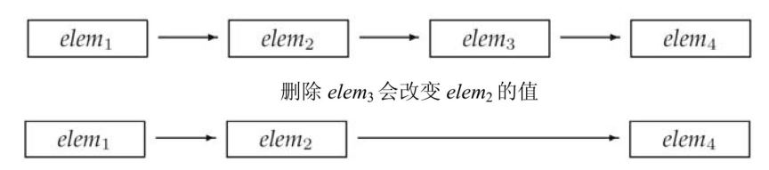

# 第9章 顺序容器

本章是第`3`章内容的扩展，完成本章的学习后，对标准库顺序容器知识的掌握就完整了。元素在顺序容器中的顺序与其加入容器时的位置相对应。标准库还定义了几种关联容器，关联容器中元素的位置由元素相关联的关键字值决定。我们将在第`11`章中介绍关联容器特有的操作。

所有容器类都共享公共的接口，不同容器按不同方式对其进行扩展。这个公共接口使容器的学习更加容易—— 我们基于某种容器所学习的内容也都适用于其他容器。每种容器都提供了不同的性能和功能的权衡。

一个容器就是一些特定类型对象的集合。顺序容器(`sequential container`)为程序员提供了控制元素存储和访问顺序的能力。这种顺序不依赖于元素的值，而是与元素加入容器时的位置相对应。与之相对的，我们将在第`11`章介绍的有序和无序关联容器，则根据关键字的值来存储元素。

标准库还提供了三种容器适配器，分别为容器操作定义了不同的接口，来与容器类型适配。我们将在本章末尾介绍适配器。

>本章的内容基于`3.2`节、`3.3`节和`3.4`节中已经介绍的有关容器的知识，我们假定读者已经熟悉了这几节的内容。

## 9.1 顺序容器概述

表`9.1`列出了标准库中的顺序容器，所有顺序容器都提供了快速顺序访问元素的能力。但是，这些容器在以下方面都有不同的性能折中：

- 向容器添加或从容器中删除元素的代价
- 非顺序访问容器中元素的代价

表 `9.1`: 顺序容器类型

| 类型 | 说明 |
| --- | --- |
| `vector` | 可变大小数组。支持快速随机访问。在尾部之外的位置插入或删除元素可能很慢 |
| `deque` | 双端队列。支持快速随机访问。在头尾位置插入/删除速度很快 |
| `list` | 双向链表。只支持双向顺序访问。在`list`中任何位置进行插入/删除操作速度都很快 |
| `forward_list` | 单向链表。只支持单向顺序访问。在链表任何位置进行插入/删除操作速度都很快 |
| `array` | 固定大小数组。支持快速随机访问。不能添加或删除元素 |
| `string` | 与`vector`相似的容器，但专门用于保存字符。随机访问快。在尾部插入/删除速度快 |

除了固定大小的`array`外，其他容器都提供高效、灵活的内存管理。我们可以添加和删除元素，扩张和收缩容器的大小。容器保存元素的策略对容器操作的效率有着固有的，有时是重大的影响。在某些情况下，存储策略还会影响特定容器是否支持特定操作。

例如，`string`和`vector`将元素保存在连续的内存空间中。由于元素是连续存储的，由元素的下标来计算其地址是非常快速的。但是，在这两种容器的中间位置添加或删除元素就会非常耗时：在一次插入或删除操作后，需要移动插入`/`删除位置之后的所有元素，来保持连续存储。而且，添加一个元素有时可能还需要分配额外的存储空间。在这种情况下，每个元素都必须移动到新的存储空间中。

`list`和`forward_list`两个容器的设计目的是令容器任何位置的添加和删

除操作都很快速。作为代价，这两个容器不支持元素的随机访问：为了访问一个元素，我们只能遍历整个容器。而且，与`vector`、`deque`和`array`相比，这两个容器的额外内存开销也很大。

`deque`是一个更为复杂的数据结构。与`string`和`vector`类似，`deque`支持快速的随机访问。与`string`和`vector`一样，在`deque`的中间位置添加或删除元素的代价(可能)很高。但是，在`deque`的两端添加或删除元素都是很快的，与`list`或`forward_list`添加删除元素的速度相当。

`forward_list`和`array`是新`C++`标准增加的类型。与内置数组相比，`array`是一种更安全、更容易使用的数组类型。与内置数组类似，`array`对象的大小是固定的。因此，`array`不支持添加和删除元素以及改变容器大小的操作。`forward_list`的设计目标是达到与最好的手写的单向链表数据结构相当的性能。因此，`forward_list`没有`size`操作，因为保存或计算其大小就会比手写链表多出额外的开销。对其他容器而言，`size`保证是一个快速的常量时间的操作。

>新标准库的容器比旧版本快得多，原因我们将在`13.6`节解释。新标准库容器的性能几乎肯定与最精心优化过的同类数据结构一样好(通常会更好)。现代`C++`程序应该使用标准库容器，而不是更原始的数据结构，如内置数组。

#### 确定使用哪种顺序容器

>通常，使用`vector`是最好的选择，除非你有很好的理由选择其他容器。

以下是一些选择容器的基本原则：

- 除非你有很好的理由选择其他容器，否则应使用`vector`。
- 如果你的程序有很多小的元素，且空间的额外开销很重要，则不要使用`list`或`forward_list`。
- 如果程序要求随机访问元素，应使用`vector`或`deque`。
- 如果程序要求在容器的中间插入或删除元素，应使用`list`或`forward_list`。
- 如果程序需要在头尾位置插入或删除元素，但不会在中间位置进行插入或删除操作，则使用`deque`。
- 如果程序只有在读取输入时才需要在容器中间位置插入元素，随后需要随机访问元素，则 首先，确定是否真的需要在容器中间位置添加元素。当处理输入数据时，通常可以很容易地向`vector`追加数据，然后再调用标准库的`sort`函数(我们将在`10.2.3`节介绍`sort`)来重排容器中的元素，从而避免在中间位置添加元素。如果必须在中间位置插入元素，考虑在输入阶段使用`list`，一旦输入完成，将`list`中的内容拷贝到一个`vector`中。

如果程序既需要随机访问元素，又需要在容器中间位置插入元素，那该怎么办？答案取决于在`list`或`forward_list`中访问元素与`vector`或`deque`中插入`/`删除元素的相对性能。一般来说，应用中占主导地位的操作(执行的访问操作更多还是插入`/`删除更多)决定了容器类型的选择。在此情况下，对两种容器分别测试应用的性能可能就是必要的了。

如果你不确定应该使用哪种容器，那么可以在程序中只使用`vector`和`list`公共的操作：使用迭代器，不使用下标操作，避免随机访问。这样，在必要时选择使用`vector`或`list`都很方便。

#### 小节练习

练习`9.1`：对于下面的程序任务，`vector`、`deque`和`list`哪种容器最为适合？解释你的选择的理由。如果没有哪一种容器优于其他容器，也请解释理由。

(`a`)读取固定数量的单词，将它们按字典序插入到容器中。我们将在下一章中看到，关联容器更适合这个问题。

(`b`)读取未知数量的单词，总是将新单词插入到末尾。删除操作在头部进行。

(`c`)从一个文件读取未知数量的整数。将这些数排序，然后将它们打印到标准输出。

## 9.2 容器库概览

容器类型上的操作形成了一种层次：

- 某些操作是所有容器类型都提供的(参见表`9.2`)。
- 另外一些操作仅针对顺序容器(参见表`9.3`)、关联容器(参见表`11.7`)或无序容器(参见表`11.8`)。
- 还有一些操作只适用于一小部分容器。

在本节中，我们将介绍对所有容器都适用的操作。本章剩余部分将聚焦于仅适用于顺序容器的操作。关联容器特有的操作将在第`11`章介绍。

一般来说，每个容器都定义在一个头文件中，文件名与类型名相同。即，`deque`定义在头文件`deque`中，`list`定义在头文件`list`中，以此类推。容器均定义为模板类(参见`3.3`节)。例如对`vector`，我们必须提供额外信息来生成特定的容器类型。对大多数，但不是所有容器，我们还需要额外提供元素类型信息：

```cpp
list<Sales_data>      // 保存 Sales_data 对象的 list
deque<double>      // 保存 double 的 deque
```

#### 对容器可以保存的元素类型的限制

顺序容器几乎可以保存任意类型的元素。特别是，我们可以定义一个容器，其元素的类型是另一个容器。这种容器的定义与任何其他容器类型完全一样：在尖括号中指定元素类型(此种情况下，是另一种容器类型)：

```cpp
vector<vector<string>> lines; // vector的vector
```

此处`lines`是一个`vector`，其元素类型是`string`的`vector`。

>较旧的编译器可能需要在两个尖括号之间键入空格，例如，`vector<vector<string>>`。

虽然我们可以在容器中保存几乎任何类型，但某些容器操作对元素类型有其自己的特殊要求。我们可以为不支持特定操作需求的类型定义容器，但这种情况下就只能使用那些没有特殊要求的容器操作了。

例如，顺序容器构造函数的一个版本接受容器大小参数(参见`3.3.1`节)，它使用了元素类型的默认构造函数。但某些类没有默认构造函数。我们可以定义一个保存这种类型对象的容器，但我们在构造这种容器时不能只传递给它一个元素数目参数：

```cpp
// 假定 NoDefault 是一个没有默认构造函数的类型
vector<NoDefault> v1(10, init);      // 正确: 提供了元素初始化器
vector<NoDefault> v2(10);      // 错误: 必须提供一个元素初始化器
```

当后面介绍容器操作时，我们还会注意到每个容器操作对元素类型的其他限制。

表 `9.2`: 反向容器的额外成员(不支持`forward_list`)

| 操作 | 说明 |
| --- | --- |
| `reverse_iterator` | 按逆序寻址元素的迭代器 |
| `const_reverse_iterator` | 不能修改元素的逆序迭代器 |
| `c.rbegin()`, `c.rend()` | 返回指向`c`的尾元素和首元素之前位置的迭代器 |
| `c.crbegin()`, `c.crend()` | 返回`const_reverse_iterator` |

#### 小节练习

练习`9.2`：定义一个`list`对象，其元素类型是`int`的`deque`。

### 9.2.1 迭代器

与容器一样，迭代器有着公共的接口：如果一个迭代器提供某个操作，那么所有提供相同操作的迭代器对这个操作的实现方式都是相同的。例如，标准容器类型上的所有迭代器都允许我们访问容器中的元素，而所有迭代器都是通过解引用运算符来实现这个操作的。类似的，标准库容器的所有迭代器都定义了递增运算符，从当前元素移动到下一个元素。

表`3.6`列出了容器迭代器支持的所有操作，其中有一个例外不符合公共接口特点——`forward_list`迭代器不支持递减运算符(`--`)。表`3.7`列出了迭代器支持的算术运算，这些运算只能应用于`string`、`vector`、`deque`和`array`的迭代器。我们不能将它们用于其他任何容器类型的迭代器。

#### 迭代器范围

>迭代器范围的概念是标准库的基础。

一个迭代器范围(`iterator range`)由一对迭代器表示，两个迭代器分别指向同一个容器中的元素或者是尾元素之后的位置(`one past thelast element`)。这两个迭代器通常被称为`begin`和`end`，或者是`first`和`last`(可能有些误导)，它们标记了容器中元素的一个范围。

虽然第二个迭代器常常被称为`last`，但这种叫法有些误导，因为第二个迭代器从来都不会指向范围中的最后一个元素，而是指向尾元素之后的位置。迭代器范围中的元素包含`first`所表示的元素以及从`first`开始直至`last`(但不包含`last`)之间的所有元素。

这种元素范围被称为左闭合区间(`left-inclusive interval`)，其标准数学描述为

```cpp
[begin, end)
```

表示范围自`begin`开始，于`end`之前结束。迭代器`begin`和`end`必须指向相同的容器。`end`可以与`begin`指向相同的位置，但不能指向`begin`之前的位置。

#### 对构成范围的迭代器的要求

>如果满足如下条件，两个迭代器`begin`和`end`构成一个迭代器范围：

>· 它们指向同一个容器中的元素，或者是容器最后一个元素之后的位置，且

>· 我们可以通过反复递增`begin`来到达`end`。换句话说，`end`不在`begin`之前。

>编译器不会强制这些要求。确保程序符合这些约定是程序员的责任。

#### 使用左闭合范围蕴含的编程假定

标准库使用左闭合范围是因为这种范围有三种方便的性质。假定`begin`和`end`构成一个合法的迭代器范围，则

- 如果`begin`与`end`相等，则范围为空
- 如果`begin`与`end`不等，则范围至少包含一个元素，且`begin`指向该范围中的第一个元素
- 我们可以对`begin`递增若干次，使得`begin==end`

这些性质意味着我们可以像下面的代码一样用一个循环来处理一个元素范围，而这是安全的：

```cpp
while (begin != end) {
    *begin = val;      // 正确: 范围非空，因此 begin 指向一个元素
    ++begin;      // 移动迭代器，获取下一个元素
}
```

给定构成一个合法范围的迭代器`begin`和`end`，若`begin==end`，则范围为空。在此情况下，我们应该退出循环。如果范围不为空，`begin`指向此非空范围的一个元素。因此，在`while`循环体中，可以安全地解引用`begin`，因为`begin`必然指向一个元素。最后，由于每次循环对`begin`递增一次，我们确定循环最终会结束。

#### 小节练习

练习`9.3`：构成迭代器范围的迭代器有何限制？

练习`9.4`：编写函数，接受一对指向`vector<int>`的迭代器和一个`int`值。在两个迭代器指定的范围中查找给定的值，返回一个布尔值来指出是否找到。

练习`9.5`：重写上一题的函数，返回一个迭代器指向找到的元素。注意，程序必须处理未找到给定值的情况。

练习`9.6`：下面程序有何错误？你应该如何修改它？

```cpp
list<int> lst1;
list<int>::iterator iter1 = lst1.begin(),
                     iter2 = lst1.end();
while (iter1 < iter2) /* ... */
```

### 9.2.2 容器类型成员

每个容器都定义了多个类型，如表`9.2`所示。我们已经使用过其中三种：`size_type`(参见`3.2.2`节)、`iterator`和`const_iterator`(参见`3.4.1`节)。

除了已经使用过的迭代器类型，大多数容器还提供反向迭代器。简单地说，反向迭代器就是一种反向遍历容器的迭代器，与正向迭代器相比，各种操作的含义也都发生了颠倒。例如，对一个反向迭代器执行

例如，对一个反向迭代器执行++操作，会得到上一个元素。我们将在`10.4.3`节介绍更多关于反向迭代器的内容。

为了使用这些类型，我们必须显式使用其类名：

```cpp
// iter 是通过 list<string> 定义的一个迭代器类型
list<string>::iterator iter;
// count 是通过 vector<int> 定义的一个 difference_type 类型
vector<int>::difference_type count;
```

这些声明语句使用了作用域运算符(参见`1.2`节)来说明我们希望使用`list<string>`类的`iterator`成员及`vector<int>`类定义的`difference_type`。

`difference_type`。

#### 小节练习

练习`9.7`：为了索引`int`的`vector`中的元素，应该使用什么类型？

练习`9.8`：为了读取`string`的`list`中的元素，应该使用什么类型？如果写入`list`，又该使用什么类型？

### 9.2.3 begin和end成员

`begin`和`end`操作(参见`3.4.1`节)生成指向容器中第一个元素和尾元素之后位置的迭代器。这两个迭代器最常见的用途是形成一个包含容器中所有元素的迭代器范围。

如表`9.2`所示，`begin`和`end`有多个版本：带`r`的版本返回反向迭代器(我们将在`10.4.3`节中介绍相关内容)；以`c`开头的版本则返回`const`迭代器：

```cpp
list<string> a = {"Milton", "Shakespeare", "Austen"};
auto it1 = a.begin();      // list<string>::iterator
auto it2 = a.rbegin();      // list<string>::reverse_iterator
auto it3 = a.cbegin();      // list<string>::const_iterator
auto it4 = a.crbegin();      // list<string>::const_reverse_iterator
```

不以`c`开头的函数都是被重载过的。也就是说，实际上有两个名为`begin`的成员。一个是`const`成员(参见`7.1.2`节)，返回容器的`const_iterator`类型。另一个是非常量成员，返回容器的`iterator`类型。`rbegin`、`end`和`rend`的情况类似。当我们对一个非常量对象调用这些成员时，得到的是返回`iterator`的版本。只有在对一个`const`对象调用这些函数时，才会得到一个`const`版本。与`const`指针和引用类似，可以将一个普通的`iterator`转换为对应的`const_iterator`，但反之不行。

以`c`开头的版本是`C++`新标准引入的，用以支持`auto`(参见`2.5.2`节)与`begin`和`end`函数结合使用。过去，没有其他选择，只能显式声明希望使用哪种类型的迭代器：

```cpp
// 显式指定类型
list<string>::iterator it5 = a.begin();
```

```cpp
list<string>::const_iterator it6 = a.begin();
// 是 iterator 还是 const_iterator 依赖于 a 的类型
auto it7 = a.begin();      // 仅当 a 是 const 时，it7 是 const_iterator
auto it8 = a.cbegin();      // it8 是 const_iterator
```

当`auto`与`begin`或`end`结合使用时，获得的迭代器类型依赖于容器类型，与我们想要如何使用迭代器毫不相干。但以`c`开头的版本还是可以获得`const_iterator`的，而不管容器的类型是什么。

>当不需要写访问时，应使用`cbegin`和`cend`。

#### 小节练习

练习`9.9`：`begin`和`cbegin`两个函数有什么不同？

练习`9.10`：下面`4`个对象分别是什么类型？

```cpp
vector<int> v1;
const vector<int> v2;
auto it1 = v1.begin(), it2 = v2.begin();
auto it3 = v1.cbegin(), it4 = v2.cbegin();
```

### 9.2.4 容器定义和初始化

每个容器类型都定义了一个默认构造函数(参见`7.1.4`节)。除`array`之外，其他容器的默认构造函数都会创建一个指定类型的空容器，且都可以接受指定容器大小和元素初始值的参数。

表 `9.3`: 容器定义和初始化

| 操作 | 说明 |
| --- | --- |
| `C c;` | 默认构造函数。如果`c`是一个`array`，则`c`中元素按默认方式初始化；否则`c`为空 |
| `C c1(c2);` / `C c1 = c2;` | `c1`初始化为`c2`的拷贝。`c1`和`c2`必须是相同类型(即，它们必须是相同的容器类型，且保存的是相同的元素类型。对于`array`类型，两者还必须具有相同大小) |
| `C c{a,b,c...};` / `C c = {a,b,c...};` | `c`初始化为初始化列表中元素的拷贝。列表中元素的类型必须与`c`的元素类型相容。对于`array`类型，列表中元素数目必须等于或小于`array`的大小，任何遗漏的元素都进行值初始化(参见`3.3.1`节，第`88`页) |
| `C c(b,e);` | `c`初始化为迭代器`b`和`e`指定范围中的元素的拷贝。范围中元素的类型必须与`c`的元素类型相容(`array`不适用) |
| | 只有顺序容器(不包括`array`)的构造函数才能接受大小参数 |
| `C seq(n);` | `seq`包含`n`个元素，这些元素进行了值初始化；此构造函数是`explicit`的(参见`7.5.4`节，第`265`页)。(`string`不适用) |
| `C seq(n,t);` | `seq`包含`n`个初始化为值`t`的元素 |

#### 将一个容器初始化为另一个容器的拷贝

将一个新容器创建为另一个容器的拷贝的方法有两种：可以直接拷贝整个容器，或者(`array`除外)拷贝由一个迭代器对指定的元素范围。

为了创建一个容器为另一个容器的拷贝，两个容器的类型及其元素类型必须匹配。不过，当传递迭代器参数来拷贝一个范围时，就不要求容器类型是相同的了。而且，新容器和原容器中的元素类型也可以不同，只要能将要拷贝的元素转换为要初始化的容器的元素类型即可。

```cpp
// 每个容器有三个元素，用给定的初始化器进行初始化
list<string> authors = {"Milton", "Shakespeare", "Austen"};
vector<const char*> articles = {"a", "an", "the"};
list<string> list2(authors);      // 正确: 类型匹配
deque<string> authList(authors);      // 错误: 容器类型不匹配
vector<string> words(articles);      // 错误: 容器类型必须匹配
// 正确: 可以将 const char* 元素转换为 string
forward_list<string> words(articles.begin(), articles.end());
```

>当将一个容器初始化为另一个容器的拷贝时，两个容器的容器类型和元素类型都必须相同。

接受两个迭代器参数的构造函数用这两个迭代器表示我们想要拷贝的一个元素范围。与以往一样，两个迭代器分别标记想要拷贝的第一个元素和尾元素之后的位置。新容器的大小与范围中元素的数目相同。新容器中的每个元素都用范围中对应元素的值进行初始化。

由于两个迭代器表示一个范围，因此可以使用这种构造函数来拷贝一个容器中的子序列。例如，假定迭代器`it`表示`authors`中的一个元素，我们可以编写如下代码

```cpp
// 拷贝元素，直到(但不包括)it 指向的元素
deque<string> authList(authors.begin(), it);
```

#### 列表初始化

在新标准中，我们可以对一个容器进行列表初始化(参见`3.3.1`节)

```cpp
// 每个容器有三个元素，用给定的初始化器进行初始化
list<string> authors = {"Milton", "Shakespeare", "Austen"};
vector<const char*> articles = {"a", "an", "the"};
```

当这样做时，我们就显式地指定了容器中每个元素的值。对于除`array`之外的容器类型，初始化列表还隐含地指定了容器的大小：容器将包含与初始值一样多的元素。

#### 与顺序容器大小相关的构造函数

除了与关联容器相同的构造函数外，顺序容器(`array`除外)还提供另一个构造函数，它接受一个容器大小和一个(可选的)元素初始值。如果我们不提供元素初始值，则标准库会创建一个值初始化器(参见`3.1`节)：

```cpp
vector<int> ivec(10, -1);      // 10 个 int 元素，每个都初始化为 -1
list<string> svec(10, "hi!");      // 10 个 strings; 每个都初始化为 "hi!"
forward_list<int> ivec(10);      // 10 个元素，每个都初始化为 0
deque<string> svec(10);      // 10 个元素，每个都是空 string
```

如果元素类型是内置类型或者是具有默认构造函数(参见`9.2`节)的类类型，可以只为构造函数提供一个容器大小参数。如果元素类型没有默认构造函数，除了大小参数外，还必须指定一个显式的元素初始值。

>只有顺序容器的构造函数才接受大小参数，关联容器并不支持。

#### 标准库`array`具有固定大小

与内置数组一样，标准库`array`的大小也是类型的一部分。当定义一个`array`时，除了指定元素类型，还要指定容器大小：

```cpp
array<int, 42>      // 类型为: 保存 42 个 int 的数组
array<string, 10>      // 类型为: 保存 10 个 string 的数组
```

为了使用`array`类型，我们必须同时指定元素类型和大小：

```cpp
array<int, 10>::size_type i;     // 数组类型包括元素类型和大小
array<int>::size_type j;      // 错误: array<int>不是一个类型
```

由于大小是`array`类型的一部分，`array`不支持普通的容器构造函数。这些构造函数都会确定容器的大小，要么隐式地，要么显式地。而允许用户向一个`array`构造函数传递大小参数，最好情况下也是多余的，而且容易出错。

`array`大小固定的特性也影响了它所定义的构造函数的行为。与其他容器不同，一个默认构造的`array`是非空的：它包含了与其大小一样多的元素。这些元素都被默认初始化(参见`2.2.1`节)，就像一个内置数组(参见`3.5.1`节)中的元素那样。如果我们对`array`进行列表初始化，初始值的数目必须等于或小于`array`的大小。如果初始值数目小于`array`的大小，则它们被用来初始化`array`中靠前的元素，所有剩余元素都会进行值初始化(参见`3.3.1`节)。在这两种情况下，如果元素类型是一个类类型，那么该类必须有一个默认构造函数，以使值初始化能够进行：

```cpp
array<int, 10> ia1;      // 10 个默认初始化的 int
array<int, 10> ia2 = {0,1,2,3,4,5,6,7,8,9};      // 列表初始化
array<int, 10> ia3 = {42};      // ia3[0] 为 42，剩余元素为 0
```

值得注意的是，虽然我们不能对内置数组类型进行拷贝或对象赋值操作(参见`3.5.1`节)，但`array`并无此限制：

```cpp
int digs[10] = {0,1,2,3,4,5,6,7,8,9};
int cpy[10] = digs;      // 错误: 内置数组不支持拷贝或赋值
array<int, 10> digits = {0,1,2,3,4,5,6,7,8,9};
array<int, 10> copy = digits;      // 正确: 只要数组类型匹配即合法
```

与其他容器一样，`array`也要求初始值的类型必须与要创建的容器类型相同。此外，`array`还要求元素类型和大小也都一样，因为大小是`array`类型的一部分。

#### 小节练习

练习`9.11`：对`6`种创建和初始化`vector`对象的方法，每一种都给出一个实

例。解释每个`vector`包含什么值。

练习`9.12`：对于接受一个容器创建其拷贝的构造函数，和接受两个迭代器创建拷贝的构造函数，解释它们的不同。

练习`9.13`：如何从一个`list<int>`初始化一个`vector<double>`？从一个`vector<int>`又该如何创建？编写代码验证你的答案。

### 9.2.5 赋值和 swap

表`9.4`中列出的与赋值相关的运算符可用于所有容器。赋值运算符将其左边容器中的全部元素替换为右边容器中元素的拷贝：

```cpp
c1 = c2;      // 将 c1 的内容替换为 c2 中元素的拷贝
c1 = {a,b,c};      // 赋值后，c1 大小为 3
```

第一个赋值运算后，左边容器将与右边容器相等。如果两个容器原来大小不同，赋值运算后两者的大小都与右边容器的原大小相同。第二个赋值运算后，`c1`的`size`变为`3`，即花括号列表中值的数目。

与内置数组不同，标准库`array`类型允许赋值。赋值号左右两边的运算对象必须具有相同的类型：

```cpp
array<int, 10> a1 = {0,1,2,3,4,5,6,7,8,9};
array<int, 10> a2 = {0};      // 所有元素值均为 0
a1 = a2;      // 替换 a1 中的元素
a2 = {0};      // 错误: 不能将一个花括号列表赋予数组
```

由于右边运算对象的大小可能与左边运算对象的大小不同，因此`array`类型不支持`assign`，也不允许用花括号包围的值列表进行赋值。

表 `9.4`: 容器赋值运算

| 操作 | 说明 |
| --- | --- |
| `c1 = c2;` | 将`c1`中的元素替换为`c2`中元素的拷贝。`c1`和`c2`必须具有相同的类型 |
| `c = {a,b,c...};` | 将`c1`中元素替换为初始化列表中元素的拷贝(`array`不适用) |
| `swap(c1,c2);` | 交换`c1`和`c2`中的元素。`c1`和`c2`必须具有相同的类型。`swap`通常比从`c2`向`c1`拷贝元素快得多 |
| `c1.swap(c2);` | 交换`c1`和`c2`中的元素。`c1`和`c2`必须具有相同的类型 |
| | `assign`操作不适用于关联容器和`array` |
| `seq.assign(b,e);` | 将`seq`中的元素替换为迭代器`b`和`e`所表示的范围中的元素。迭代器`b`和`e`不能指向`seq`中的元素 |
| `seq.assign(il);` | 将`seq`中的元素替换为初始化列表`il`中的元素 |
| `seq.assign(n,t);` | `seq`中的元素替换为`n`个值为`t`的元素 |

>赋值相关运算会导致指向左边容器内部的迭代器、引用和指针失效。而`swap`操作将容器内容交换不会导致指向容器的迭代器、引用和指针失效(容器类型为`array`和`string`的情况除外)。

#### 使用`assign`(仅顺序容器)

赋值运算符要求左边和右边的运算对象具有相同的类型。它将右边运算对象中所有元素拷贝到左边运算对象中。顺序容器(`array`除外)还定义了一个名为`assign`的成员，允许我们从一个不同但相容的类型赋值，或者从容器的一个子序列赋值。`assign`操作用参数所指定的元素(的拷贝)替换左边容器中的所有元素。例如，我们可以用`assgin`实现将一个`vector`中的一段`char *`值赋予一个`list`中的`string`：

```cpp
list<string> names;
vector<const char*> oldstyle;
names = oldstyle;      // 错误: 容器类型不匹配
// 正确: 可以将 const char* 转换为 string
names.assign(oldstyle.cbegin(), oldstyle.cend());
```

这段代码中对`assign`的调用将`names`中的元素替换为迭代器指定的范围中的元素的拷贝。`assign`的参数决定了容器中将有多少个元素以及它们的值都是什么。

>由于其旧元素被替换，因此传递给`assign`的迭代器不能指向调用`assign`的容器。

`assign`的第二个版本接受一个整型值和一个元素值。它用指定数目且具有相同给定值的元素替换容器中原有的元素：

```cpp
// 等价于 slist1.clear();
// 后跟 slist1.insert(slist1.begin(), 10, "Hiya!");
list<string> slist1(1);      // 1 个元素，为空 string
slist1.assign(10, "Hiya!");      // 10 个元素，每个都是 "Hiya!"
```

#### 使用`swap`

`swap`操作交换两个相同类型容器的内容。调用`swap`之后，两个容器中的元素将会交换：

```cpp
vector<string> svec1(10);      // 10 个元素的 vector
vector<string> svec2(24);      // 24 个元素的 vector
swap(svec1, svec2);
```

调用`swap`后，`svec1`将包含`24`个`string`元素，`svec2`将包含`10`个`string`。除`array`外，交换两个容器内容的操作保证会很快—— 元素本身并未交换，`swap`只是交换了两个容器的内部数据结构。

>除`array`外，`swap`不对任何元素进行拷贝、删除或插入操作，因此可以保证在常数时间内完成。

元素不会被移动的事实意味着，除`string`外，指向容器的迭代器、引用和指针在`swap`操作之后都不会失效。它们仍指向`swap`操作之前所指向的那些元素。但是，在`swap`之后，这些元素已经属于不同的容器了。例如，假定`iter`在`swap`之前指向`svec1[3]`的`string`，那么在`swap`之后它指向`svec2[3]`的元素。与其他容器不同，对一个`string`调用`swap`会导致迭代器、引用和指针失效。

与其他容器不同，`swap`两个`array`会真正交换它们的元素。因此，交换两个`array`所需的时间与`array`中元素的数目成正比。

因此，对于`array`，在`swap`操作之后，指针、引用和迭代器所绑定的元素保持不变，但元素值已经与另一个`array`中对应元素的值进行了交换。

在新标准库中，容器既提供成员函数版本的`swap`，也提供非成员版本的`swap`。而早期标准库版本只提供成员函数版本的`swap`。非成员版本的`swap`在泛型编程中是非常重要的。统一使用非成员版本的`swap`是一个好习惯。

#### 小节练习

练习`9.14`：编写程序，将一个`list`中的`char *`指针(指向`C`风格字符串)元素赋值给一个`vector`中的`string`。

### 9.2.6 容器大小操作

除了一个例外，每个容器类型都有三个与大小相关的操作。成员函数`size`(参见`3.2.2`节)返回容器中元素的数目；`empty`当`size`为`0`时返回布尔值`true`，否则返回`false`；`max_size`返回一个大于或等于该类型容器所能容纳的最大元素数的值。`forward_list`支持`max_size`和`empty`，但不支持`size`，原因我们将在下一节解释。

### 9.2.7 关系运算符

每个容器类型都支持相等运算符(`==`和`!=`)；除了无序关联容器外的所有容器都支持关系运算符(`>`、`>=`、`<`、`<=`)。关系运算符左右两边的运算对象必须是相同类型的容器，且必须保存相同类型的元素。即，我们只能将一个`vector<int>`与另一个`vector<int>`进行比较，而不能将一个`vector<int>`与一个`list<int>`或一个`vector<double>`进行比较。

比较两个容器实际上是进行元素的逐对比较。这些运算符的工作方式与`string`的关系运算(参见`3.2.2`节)类似：

- 如果两个容器具有相同大小且所有元素都两两对应相等，则这两个容器相等；否则两个容器不等。
- 如果两个容器大小不同，但较小容器中每个元素都等于较大容器中的对应元素，则较小容器小于较大容器。
- 如果两个容器都不是另一个容器的前缀子序列，则它们的比较结果取决于第一个不相等的元素的比较结果。

下面的例子展示了这些关系运算符是如何工作的：

```cpp
vector<int> v1 = { 1, 3, 5, 7, 9, 12 };
vector<int> v2 = { 1, 3, 9 };
vector<int> v3 = { 1, 3, 5, 7 };
vector<int> v4 = { 1, 3, 5, 7, 9, 12 };
v1 < v2      // true; v1 和 v2 在元素[2] 处不同: v1[2] 小于 v2[2]
v1 < v3      // false; 所有元素都相等，但 v3 中元素数目更少
v1 == v4      // true; 每个元素都相等，且 v1 和 v4 大小相同
v1 == v2      // false; v2 元素数目比 v1 少
```

#### 容器的关系运算符使用元素的关系运算符完成比较

>只有当其元素类型也定义了相应的比较运算符时，我们才可以使用关系运算符来比较两个容器。

容器的相等运算符实际上是使用元素的`==`运算符实现比较的，而其他关系运算符是使用元素的`<`运算符。如果元素类型不支持所需运算符，那么保存这种元素的容器就不能使用相应的关系运算。例如，我们在第`7`章中定义的`Sales_data`类型并未定义`==`和`<`运算。因此，就不能比较两个保存`Sales_data`元素的容器：

```cpp
vector<Sales_data> storeA, storeB;
if (storeA < storeB)  // 错误：Sales_data 没有 < 运算符
```

#### 小节练习

练习`9.15`：编写程序，判定两个`vector<int>`是否相等。

练习`9.16`：重写上一题的程序，比较一个`list<int>`中的元素和一个`vector<int>`中的元素。

练习`9.17`：假定`c1`和`c2`是两个容器，下面的比较操作有何限制(如果有的话)？

```cpp
if (c1 < c2)
```

## 9.3 顺序容器操作

顺序容器和关联容器的不同之处在于两者组织元素的方式。这些不同之处直接关系到了元素如何存储、访问、添加以及删除。上一节介绍了所有容器都支持的操作(罗列于表`9.2`)。本章剩余部分将介绍顺序容器所特有的操作。

### 9.3.1 向顺序容器添加元素

除`array`外，所有标准库容器都提供灵活的内存管理。在运行时可以动态添加或删除元素来改变容器大小。表`9.5`列出了向顺序容器(非`array`)添加元素的操作。

表 `9.5`: 向顺序容器添加元素的操作

| 操作 | 说明 |
| --- | --- |
| | 这些操作会改变容器的大小；`array`不支持这些操作 |
| | `forward_list`有自己专有版本的`insert`和`emplace`；参见`9.3.4`节(第`312`页) |
| | `forward_list`不支持`push_back`和`emplace_back` |
| | `vector`和`string`不支持`push_front`和`emplace_front` |
| `c.push_back(t)` / `c.emplace_back(args)` | 在`c`的尾部创建一个值为`t`或由`args`创建的元素。返回`void` |
| `c.push_front(t)` / `c.emplace_front(args)` | 在`c`的头部创建一个值为`t`或由`args`创建的元素。返回`void` |
| `c.insert(p,t)` / `c.emplace(p,args)` | 在迭代器`p`指向的元素之前创建一个值为`t`或由`args`创建的元素。返回指向新添加的元素的迭代器 |
| `c.insert(p,n,t)` | 在迭代器`p`指向的元素之前插入`n`个值为`t`的元素。返回指向新添加的第一个元素的迭代器；若`n`为`0`，则返回`p` |
| `c.insert(p,b,e)` | 将迭代器`b`和`e`指定的范围内的元素插入到迭代器`p`指向的元素之前。`b`和`e`不能指向`c`中的元素。返回指向新添加的第一个元素的迭代器；若范围为空，则返回`p` |
| `c.insert(p,il)` | `il`是一个花括号包围的元素值列表。将这些给定值插入到迭代器`p`指向的元素之前。返回指向新添加的第一个元素的迭代器；若列表为空，则返回`p` |

>向一个`vector`、`string`或`deque`插入元素会使所有指向容器的迭代器、引用和指针失效。

当我们使用这些操作时，必须记得不同容器使用不同的策略来分配元素空间，而这些策略直接影响性能。在一个`vector`或`string`的尾部之外的任何位置，或是一个`deque`的首尾之外的任何位置添加元素，都需要移动元素。而且，向一个`vector`或`string`添加元素可能引起整个对象存储空间的重新分配。重新分配一个对象的存储空间需要分配新的内存，并将元素从旧的空间移动到新的空间中。

#### 使用`push_back`

在`3.3.2`节中，我们看到`push_back`将一个元素追加到一个`vector`的尾部。除`array`和`forward_list`之外，每个顺序容器(包括`string`类型)都支持`push_back`。

例如，下面的循环每次读取一个`string`到`word`中，然后追加到容器尾部：

```cpp
// 从标准输入读取数据，将每个单词放到容器末尾
string word;
while (cin >> word)
    container.push_back(word);
```

对`push_back`的调用在`container`尾部创建了一个新的元素，将`container`的`size`增大了`1`。该元素的值为`word`的一个拷贝。`container`的类型可以是`list`、`vector`或`deque`。

由于`string`是一个字符容器，我们也可以用`push_back`在`string`末尾添加字符：

```cpp
void pluralize(size_t cnt, string &word)
{
    if (cnt > 1)
        word.push_back('s');      // 等价于 word += 's'
}
```

#### 关键概念：容器元素是拷贝

>当我们用一个对象来初始化容器时，或将一个对象插入到容器中时，实际上放入到容器中的是对象值的一个拷贝，而不是对象本身。就像我们将一个对象传递给非引用参数(参见`3.2.2`节)一样，容器中的元素与提供值的对象之间没有任何关联。随后对容器中元素的任何改变都不会影响到原始对象，反之亦然。

#### 使用`push_front`

除了`push_back`，`list`、`forward_list`和`deque`容器还支持名为`push_front`的类似操作。此操作将元素插入到容器头部：

```cpp
list<int> ilist;
// 将元素添加到 ilist 开头
for (size_t ix = 0; ix != 10; ++ix)
    ilist.push_front(ix);
```

在`0`之前，`2`被放置在`1`之前，依此类推。因此，在循环中以这种方式将元素添加到容器中，最终会形成逆序。在循环执行完毕后，`ilist`保存序列`3`、`2`、`1`、`0`。

注意，`deque`像`vector`一样提供了随机访问元素的能力，但它提供了`vector`所不支持的`push_front`。`deque`保证在容器首尾进行插入和删除元素的操作都只花费常数时间。与`vector`一样，在`deque`首尾之外的位置插入元素会很耗时。

#### 在容器中的特定位置添加元素

`push_back`和`push_front`操作提供了一种方便地在顺序容器尾部或头部插入单个元素的方法。`insert`成员提供了更一般的添加功能，它允许我们在容器中任意位置插入`0`个或多个元素。`vector`、`deque`、`list`和`string`都支持`insert`成员。`forward_list`提供了特殊版本的`insert`成员，我们将在`3.4`节中介绍。

每个`insert`函数都接受一个迭代器作为其第一个参数。迭代器指出了在容器中什么位置放置新元素。它可以指向容器中任何位置，包括容器尾部之后的下一个位置。由于迭代器可能指向容器尾部之后不存在的元素的位置，而且在容器开始位置插入元素是很有用的功能，所以`insert`函数将元素插入到迭代器所指定的位置之前。例如，下面的语句

```cpp
slist.insert(iter, "Hello!");      // 将 "Hello!" 添加到 iter 之前的位置
```

将一个值为`"Hello"`的`string`插入到`iter`指向的元素之前的位置。

虽然某些容器不支持`push_front`操作，但它们对于`insert`操作并无类似的限制(插入开始位置)。因此我们可以将元素插入到容器的开始位置，而不必担心容器是否支持`push_front`：

```cpp
vector<string> svec;
list<string> slist;
// 等价于调用 slist.push_front ("Hello!");
slist.insert(slist.begin(), "Hello!");
// vector 不支持push_front，但我们可以插入到begin () 之前
// 警告:插入到vector 末尾之外的任何位置都可能很慢
svec.insert (svec.begin(), "Hello!");
```

>将元素插入到`vector`、`deque`和`string`中的任何位置都是合法的。然而，这样做可能很耗时。

#### 插入范围内元素

除了第一个迭代器参数之外，`insert`函数还可以接受更多的参数，这与容器构造函数类似。其中一个版本接受一个元素数目和一个值，它将指定数量的元素添加到指定位置之前，这些元素都按给定值初始化：

```cpp
svec.insert(svec.end(), 10, "Anna");
```

这行代码将`10`个元素插入到`svec`的末尾，并将所有元素都初始化为`string "Anna"`。

接受一对迭代器或一个初始化列表的`insert`版本将给定范围中的元素插入到指定位置之前：

```cpp
vector<string> v = {"quasi", "simba", "frollo", "scar"};
// 将 v 的最后两个元素添加到 slist 的开始位置
slist.insert(slist.begin(), v.end() - 2, v.end());
slist.insert(slist.end(), {"these", "words", "will",
                           "go", "at", "the", "end"});
```

```cpp
// 运行时错误: 迭代器表示要拷贝的范围，不能指向与目的位置相同的容器
slist.insert(slist.begin(), slist.begin(), slist.end());
```

如果我们传递给`insert`一对迭代器，它们不能指向添加元素的目标容器。

在新标准下，接受元素个数或范围的`insert`版本返回指向第一个新加入元素的迭代器。(在旧版本的标准库中，这些操作返回`void`。)如果范围为空，不插入任何元素，`insert`操作会将第一个参数返回。

#### 使用`insert`的返回值

通过使用`insert`的返回值，可以在容器中一个特定位置反复插入元素：

```cpp
list<string> lst;
auto iter = lst.begin();
while (cin >> word)
    iter = lst.insert(iter, word);      // 等价于调用 push_front
```

>理解这个循环是如何工作的非常重要，特别是理解这个循环为什么等价于调用`push_front`尤为重要。

在循环之前，我们将`iter`初始化为`lst.begin`()。第一次调用`insert`会将我们刚刚读入的`string`插入到`iter`所指向的元素之前的位置。`insert`返回的迭代器恰好指向这个新元素。我们将此迭代器赋予`iter`并重复循环，读取下一个单词。只要继续有单词读入，每步`while`循环就会将一个新元素插入到`iter`之前，并将`iter`改变为新加入元素的位置。此元素为(新的)首元素。因此，每步循环将一个新元素插入到`list`首元素之前的位置。

#### 使用`emplace`操作

新标准引入了三个新成员——`emplace_front`、`emplace`和`emplace_back`，这些操作构造而不是拷贝元素。这些操作分别对应`push_front`、`insert`和`push_back`，允许我们将元素放置在容器头部、一个指定位置之前或容器尾部。

当调用`push`或`insert`成员函数时，我们将元素类型的对象传递给它们，这些对象被拷贝到容器中。而当我们调用一个`emplace`成员函数时，则是将参数传递给元素类型的构造函数。`emplace`成员使用这些参数在容器管理的内存空间中直接构造元素。例如，假定`c`保存`Sales_data`(参见`7.1.4`节)元素：

```cpp
// 在 c 的末尾构造一个 Sales_data 对象
// 使用三个参数的 Sales_data 构造函数
c.emplace_back("978-0590353403", 25, 15.99);
// 错误: 没有接受三个参数的 push_back 版本
c.push_back("978-0590353403", 25, 15.99);
// 正确: 创建一个临时的 Sales_data 对象传递给 push_back
c.push_back(Sales_data("978-0590353403", 25, 15.99));
```

其中对`emplace_back`的调用和第二个`push_back`调用都会创建新的`Sales_data`对象。在调用`emplace_back`时，会在容器管理的内存空间中直接创建对象。而调用`push_back`则会创建一个局部临时对象，并将其压入容器中。

`emplace`函数的参数根据元素类型而变化，参数必须与元素类型的构造函数相匹配：

```cpp
// iter 指向 c 中一个元素，其中保存了 Sales_data 元素
c.emplace_back();      // 使用 Sales_data 的默认构造函数
c.emplace(iter, "999-999999999");      // 使用 Sales_data(string)
// 使用 Sales_data 的接受一个 ISBN、一个 count 和一个 price 的构造函数
c.emplace_front("978-0590353403", 25, 15.99);
```

```cpp
c.emplace_back(); // 使用Sales_data 的黑认构造函数
c.emplace (iter，"999-999999999"); // 使用Sales_data(string)
// 使用Sales_data 的接受一个ISBN、一个count 和一个Price Hie HH
c.emplace_front ("978-0590353403", 25, 15.99);
```

`> emplace`函数在容器中直接构造元素。传递给`emplace`函数的参数必须与元素类型的构造函数相匹配。

#### 小节练习

练习`9.18`：编写程序，从标准输入读取`string`序列，存入一个`deque`中。编写一个循环，用迭代器打印`deque`中的元素。

练习`9.19`：重写上题的程序，用`list`替代`deque`。列出程序要做出哪些改变。

练习`9.20`：编写程序，从一个`list<int>`拷贝元素到两个`deque`中。值为偶数的所有元素都拷贝到一个`deque`中，而奇数值元素都拷贝到另一个`deque`中。

练习`9.21`：如果我们将第`308`页中使用`insert`返回值将元素添加到`list`中的循环程序改写为将元素插入到`vector`中，分析循环将如何工作。

练习`9.22`：假定`iv`是一个`int`的`vector`，下面的程序存在什么错误？你将如何修改？

```cpp
vector<int>::iterator iter = iv.begin(),
                       mid = iv.begin() + iv.size()/2;
while (iter != mid)
    if (*iter == some_val)
        iv.insert(iter, 2 * some_val);
```

### 9.3.2 访问元素

表`9.6`列出了我们可以用来在顺序容器中访问元素的操作。如果容器中没有元素，访问操作的结果是未定义的。

包括`array`在内的每个顺序容器都有一个`front`成员函数，而除`forward_list`之外的所有顺序容器都有一个`back`成员函数。这两个操作分别返回首元素和尾元素的引用：

```cpp
// 在解引用一个迭代器或调用 front 或 back 之前检查是否有元素
if (!c.empty()) {
    // val 和 val2 是 c 中第一个元素值的拷贝
    auto val = *c.begin(), val2 = c.front();
    // val3 和 val4 是 c 中最后一个元素值的拷贝
    auto last = c.end();
    auto val3 = *(--last);      // 不能递减 forward_list 迭代器
    auto val4 = c.back();      // forward_list 不支持
}
```

此程序用两种不同方式来获取`c`中的首元素和尾元素的引用。直接的方法是调用`front`和`back`。而间接的方法是通过解引用`begin`返回的迭代器来获得首元素的引用，以及通过递减然后解引用`end`返回的迭代器来获得尾元素的引用。

是容器尾元素之后的(不存在的)元素。为了获取尾元素，必须首先递减此迭代器。另一个重要之处是，在调用`front`和`back`(或解引用`begin`和`end`返回的迭代器)之前，要确保`c`非空。

表 `9.6`: 在顺序容器中访问元素的操作

| 操作 | 说明 |
| --- | --- |
| | `at`和下标操作只适用于`string`、`vector`、`deque`和`array` |
| | `back`不适用于`forward_list` |
| `c.back()` | 返回`c`中尾元素的引用。若`c`为空，函数行为未定义 |
| `c.front()` | 返回`c`中首元素的引用。若`c`为空，函数行为未定义 |
| `c[n]` | 返回`c`中下标为`n`的元素的引用，`n`是一个无符号整数。若`n>=c.size()`，则函数行为未定义 |
| `c.at(n)` | 返回下标为`n`的元素的引用。如果下标越界，则抛出一个`out_of_range`异常 |

>对一个空容器调用`front`和`back`，就像使用一个越界的下标一样，是一种严重的程序设计错误。

#### 访问成员函数返回的是引用

在容器中访问元素的成员函数(即，`front`、`back`、下标和`at`)返回的都是引用。如果容器是一个`const`对象，则返回值是`const`的引用。如果容器不是`const`的，则返回值是普通引用，我们可以用来改变元素的值：

```cpp
if (!c.empty()) {
    c.front() = 42;      // 将 42 赋予 c 中的第一个元素
    auto &v = c.back();      // 获得指向最后一个元素的引用
    v = 1024;      // 改变 c 中的元素
    auto v2 = c.back();      // v2 不是一个引用，它是 c.back() 的一个拷贝
    v2 = 0;      // 未改变 c 中的元素
}
```

与往常一样，如果我们使用`auto`变量来保存这些函数的返回值，并且希望使用此变量来改变元素的值，必须记得将变量定义为引用类型。

#### 下标操作和安全的随机访问

提供快速随机访问的容器(`string`、`vector`、`deque`和`array`)也都提供下标运算符(参见`3.3.3`节)。就像我们已经看到的那样，下标运算符接受一个下标参数，返回容器中该位置的元素的引用。

如果我们希望确保下标是合法的，可以使用`at`成员函数。`at`成员函数类似下标运算符，但如果下标越界，`at`会抛出一个`out_of_range`异常(参见`5.6`节)：

```cpp
vector<string> svec;      // 空 vector
cout << svec[0];      // 运行时错误: svec 中没有元素!
cout << svec.at(0);      // 抛出一个 out_of_range 异常
```

#### 小节练习

练习`9.23`：在本节第一个程序中，若`c.size`()为`1`，则`val`、`val2`、`val3`和`val4`的值会是什么？

练习`9.24`：编写程序，分别使用`at`、下标运算符、`front`和`begin`提取一个`vector`中的第一个元素。在一个空`vector`上测试你的程序。

### 9.3.3 删除元素

与添加元素的多种方式类似，(非`array`)容器也有多种删除元素的方式。表`9.7`列出了这些成员函数。

表 `9.7`: 顺序容器的删除操作

| 操作 | 说明 |
| --- | --- |
| | 这些操作会改变容器的大小，所以不适用于`array` |
| | `forward_list`有特殊版本的`erase`，参见`9.3.4`节(第`312`页) |
| | `forward_list`不支持`pop_back`；`vector`和`string`不支持`pop_front` |
| `c.pop_back()` | 删除`c`中尾元素。若`c`为空，则函数行为未定义。函数返回`void` |
| `c.pop_front()` | 删除`c`中首元素。若`c`为空，则函数行为未定义。函数返回`void` |
| `c.erase(p)` | 删除迭代器`p`所指定的元素，返回一个指向被删元素之后元素的迭代器，若`p`指向尾元素，则返回尾后(`off-the-end`)迭代器。若`p`是尾后迭代器，则函数行为未定义 |
| `c.erase(b,e)` | 删除迭代器`b`和`e`所指定范围内的元素。返回一个指向最后一个被删元素之后元素的迭代器，若`e`本身就是尾后迭代器，则函数也返回尾后迭代器 |
| `c.clear()` | 删除`c`中的所有元素。返回`void` |

>删除`deque`中除首尾位置之外的任何元素都会使所有迭代器、引用和指针失效。指向`vector`或`string`中删除点之后位置的迭代器、引用和指针都会失效。

>删除元素的成员函数并不检查其参数。在删除元素之前，程序员必须确保它(们)是存在的。

#### `pop_front`和`pop_back`成员函数

`pop_front`和`pop_back`成员函数分别删除首元素和尾元素。与`vector`和`string`不支持`push_front`一样，这些类型也不支持`pop_front`。类似的，`forward_list`不支持`pop_back`。与元素访问成员函数类似，不能对一个空容器执行弹出操作。

这些操作返回`void`。如果你需要弹出的元素的值，就必须在执行弹出操作之前保存它：

```cpp
while (!ilist.empty()) {
    process(ilist.front());      // 对 ilist 的首元素进行一些处理
    ilist.pop_front();      // 完成处理后删除首元素
}
```

#### 从容器内部删除一个元素

成员函数`erase`从容器中指定位置删除元素。我们可以删除由一个迭代器指定的单个元素，也可以删除由一对迭代器指定的范围内的所有元素。两种形式的`erase`都返回指向删除的(最后一个)元素之后位置的迭代器。即，若`j`是`i`之后的元素，那么`erase`(`i`)将返回指向`j`的迭代器。

例如，下面的循环删除一个`list`中的所有奇数元素：

```cpp
list<int> lst = {0,1,2,3,4,5,6,7,8,9};
auto it = lst.begin();
while (it != lst.end()) {
    if (*it % 2)      // 若元素为奇数
        it = lst.erase(it);      // 删除此元素
    else
        ++it;
}
```

每个循环步中，首先检查当前元素是否是奇数。如果是，就删除该元素，并将`it`设置为我们所删除的元素之后的元素。如果`*it`为偶数，我们将`it`递增，从而在下一步循环检查下一个元素。

#### 删除多个元素

接受一对迭代器的`erase`版本允许我们删除一个范围内的元素：

```cpp
// 删除两个迭代器表示的范围内的元素
// 返回指向最后一个被删元素之后位置的迭代器
elem1 = slist.erase(elem1, elem2);      // 调用后，elem1 == elem2
```

迭代器`elem1`指向我们要删除的第一个元素，`elem2`指向我们要删除的最后一个元素之后的位置。

为了删除一个容器中的所有元素，我们既可以调用`clear`，也可以用`begin`和`end`获得的迭代器作为参数调用`erase`：

```cpp
slist.clear(); // 删除容器中所有元素
slist.erase(slist.begin(), slist.end()); // 等价调用
```

#### 小节练习

练习`9.25`：对于第`312`页中删除一个范围内的元素的程序，如果`elem1`与`elem2`相等会发生什么？如果`elem2`是尾后迭代器，或者`elem1`和`elem2`皆为尾后迭代器，又会发生什么？

练习`9.26`：使用下面代码定义的`ia`，将`ia`拷贝到一个`vector`和一个`list`中。使用单迭代器版本的`erase`从`list`中删除奇数元素，从`vector`中删除偶数元素。

```cpp
int ia[] = { 0, 1, 1, 2, 3, 5, 8, 13, 21, 55, 89 };
```

### 9.3.4 特殊的 forward_list操作

为了理解`forward_list`为什么有特殊版本的添加和删除操作，考虑当我们从一个单向链表中删除一个元素时会发生什么。如图`9.1`所示，删除一个元素会改变序列中的链接。在此情况下，删除`elem3`会改变`elem2`，`elem2`原来指向`elem3`，但删除`elem3`后，`elem2`指向了`elem4`。



>图`9.1`：`forward_list`的特殊操作

当添加或删除一个元素时，删除或添加的元素之前的那个元素的后继会发生改变。为了添加或删除一个元素，我们需要访问其前驱，以便改变前驱的链接。但是，`forward_list`是单向链表。在一个单向链表中，没有简单的方法来获取一个元素的前驱。出于这个原因，在一个`forward_list`中添加或删除元素的操作是通过改变给定元素之后的元素来完成的。这样，我们总是可以访问到被添加或删除操作所影响的元素。

由于这些操作与其他容器上的操作的实现方式不同，`forward_list`并未定义`insert`、`emplace`和`erase`，而是定义了名为`insert_after`、`emplace_after`和`erase_after`的操作(参见表`9.8`)。例如，在我们的例子中，为了删除`elem3`，应该用指向`elem2`的迭代器调用`erase_after`。为了支持这些操作，`forward_list`也定义了`before_begin`，它返回一个首前(`off-the-beginning`)迭代器。这个迭代器允许我们在链表首元素之前并不存在的元素“之后”添加或删除元素(亦即在链表首元素之前添加删除元素)。

表 `9.8`: 在`forward_list`中插入或删除元素的操作

| 操作 | 说明 |
| --- | --- |
| `lst.before_begin()` | 返回指向链表首元素之前不存在的元素的迭代器。此迭代器不能解引用 |
| `lst.cbefore_begin()` | 返回一个`const_iterator`，指向首元素之前不存在的元素。此迭代器不能解引用 |
| `lst.insert_after(p,t)` / `lst.insert_after(p,n,t)` / `lst.insert_after(p,b,e)` / `lst.insert_after(p,il)` | 在迭代器`p`之后的位置插入元素。`t`是一个对象，`n`是数量，`b`和`e`是表示范围的一对迭代器(`b`和`e`不能指向`lst`内)，`il`是一个花括号列表。返回一个指向最后一个插入元素的迭代器。如果范围为空，则返回`p`。若`p`为尾后迭代器，则函数行为未定义 |
| `emplace_after(p,args)` | 使用`args`在`p`之后的位置创建一个元素。返回一个指向这个新元素的迭代器。若`p`为尾后迭代器，则函数行为未定义 |
| `lst.erase_after(p)` / `lst.erase_after(b,e)` | 删除`p`指向的位置之后的元素，或删除从`b`之后直到(但不包含)`e`之间的元素。返回一个指向被删元素之后元素的迭代器，若不存在这样的元素，则返回尾后迭代器。如果`p`指向`lst`的尾元素或者是一个尾后迭代器，则函数行为未定义 |

当在`forward_list`中添加或删除元素时，我们必须关注两个迭代器—— 一个指向我们要处理的元素，另一个指向其前驱。例如，可以改写第`312`页中从`list`中删除奇数元素的循环程序，将其改为从`forward_list`中删除元素：

```cpp
forward_list<int> flst = {0,1,2,3,4,5,6,7,8,9};
auto prev = flst.before_begin();      // 表示 flst 的"首前元素"
auto curr = flst.begin();      // 表示 flst 中的第一个元素
while (curr != flst.end()) {      // 仍有元素要处理
    if (*curr % 2)      // 若元素为奇数
        curr = flst.erase_after(prev);      // 删除它并移动 curr
    else {
        prev = curr;      // 移动 curr，指向下一个元素，prev 指向
        ++curr;      // curr 之前的元素
    }
}
```

此例中，`curr`表示我们要处理的元素，`prev`表示`curr`的前驱。调用`begin`来初始化`curr`，这样第一步循环就会检查第一个元素是否是奇数。我们用`before_begin`来初始化`prev`，它返回指向`curr`之前不存在的元素的迭代器。

当找到奇数元素后，我们将`prev`传递给`erase_after`。此调用将`prev`之后的元素删除，即，删除`curr`指向的元素。然后我们将`curr`重置为`erase_after`的返回值，使得`curr`指向序列中下一个元素，`prev`保持不变，仍指向(新)`curr`之前的元素。如果`curr`指向的元素不是奇数，在`else`中我们将两个迭代器都向前移动。

#### 小节练习

练习`9.27`：编写程序，查找并删除`forward_list<int>`中的奇数元素。

练习`9.28`：编写函数，接受一个`forward_list<string>`和两个`string`共三个参数。函数应在链表中查找第一个`string`，并将第二个`string`插入到紧接着第一个`string`之后的位置。若第一个`string`未在链表中，则将第二个`string`插入到链表末尾。

### 9.3.5 改变容器大小

如表`9.9`所描述，我们可以用`resize`来增大或缩小容器，与往常一样，`array`不支持`resize`。如果当前大小大于所要求的大小，容器后部的元素会被删除；如果当前大小小于新大小，会将新元素添加到容器后部：

```cpp
list<int> ilist(10, 42);      // 10 个 int: 每个的值都是 42
ilist.resize(15);      // 将 5 个值为 0 的元素添加到 ilist 的末尾
ilist.resize(25, -1);      // 将 10 个值为 -1 的元素添加到 ilist 的末尾
ilist.resize(5);      // 从 ilist 末尾删除 20 个元素
```

`resize`操作接受一个可选的元素值参数，用来初始化添加到容器中的元素。如果调用者未提供此参数，新元素进行值初始化(参见`3.3.1`节)。如果容器保存的是类类型元素，且`resize`向容器添加新元素，则我们必须提供初始值，或者元素类型必须提供一个默认构造函数。

表 `9.9`: 顺序容器大小操作

| 操作 | 说明 |
| --- | --- |
| | `resize`不适用于`array` |
| `c.resize(n)` | 调整`c`的大小为`n`个元素。若`n<c.size()`，则多出的元素被丢弃。若必须添加新元素，对新元素进行值初始化 |
| `c.resize(n,t)` | 调整`c`的大小为`n`个元素。任何新添加的元素都初始化为值`t` |

>若`resize`缩小容器，则指向被删除元素的迭代器、引用和指针都会失效；对`vector`、`string`或`deque`进行`resize`可能导致迭代器、指针和引用失效。

#### 小节练习

练习`9.29`：假定`vec`包含`25`个元素，那么`vec.resize`(`100`)会做什么？如果接下来调用`vec.resize`(`10`)会做什么？

练习`9.30`：接受单个参数的`resize`版本对元素类型有什么限制(如果有的话)？

### 9.3.6 容器操作可能使迭代器失效

向容器中添加元素和从容器中删除元素的操作可能会使指向容器元素的指针、引用或迭代器失效。一个失效的指针、引用或迭代器将不再表示任何元素。使用失效的指针、引用或迭代器是一种严重的程序设计错误，很可能引起与使用未初始化指针一样的问题(参见`2.3.2`节)

在向容器添加元素后：

- 如果容器是`vector`或`string`，且存储空间被重新分配，则指向容器的迭代器、指针和引用都会失效。如果存储空间未重新分配，指向插入位置之前的元素的迭代器、指针和引用仍有效，但指向插入位置之后元素的迭代器、指针和引用将会失效。
- 对于`deque`，插入到除首尾位置之外的任何位置都会导致迭代器、指针和引用失效。如果在首尾位置添加元素，迭代器会失效，但指向存在的元素的引用和指针不会失效。
- 对于`list`和`forward_list`，指向容器的迭代器(包括尾后迭代器和首前迭代器)、指针和引用仍有效。当我们从一个容器中删除元素后，指向被删除元素的迭代器、指针和引用会失效，这应该不会令人惊讶。毕竟，这些元素都已经被销毁了。当我们删除一个元素后：
- 对于`list`和`forward_list`，指向容器其他位置的迭代器(包括尾后迭代器和首前迭代器)、引用和指针仍有效。
- 对于`deque`，如果在首尾之外的任何位置删除元素，那么指向被删除元素外其他元素的迭代器、引用或指针也会失效。如果是删除`deque`的尾元素，则尾后迭代器也会失效，但其他迭代器、引用和指针不受影响；如果是删除首元素，这些也不会受影响。
- 对于`vector`和`string`，指向被删元素之前元素的迭代器、引用和指针仍有效。注意：当我们删除元素时，尾后迭代器总是会失效。

>使用失效的迭代器、指针或引用是严重的运行时错误。

#### 建议：管理迭代器

>当你使用迭代器(或指向容器元素的引用或指针)时，最小化要求迭代器必须保持有效的程序片段是一个好的方法。

>由于向迭代器添加元素和从迭代器删除元素的代码可能会使迭代器失效，因此必须保证每次改变容器的操作之后都正确地重新定位迭代器。这个建议对`vector`、`string`和`deque`尤为重要。

#### 编写改变容器的循环程序

添加`/`删除`vector`、`string`或`deque`元素的循环程序必须考虑迭代器、引用和指针可能失效的问题。程序必须保证每个循环步中都更新迭代器、引用或指针。如果循环中调用的是`insert`或`erase`，那么更新迭代器很容易。这些操作都返回迭代器，我们可以用来更新：

```cpp
// 傻瓜循环，删除偶数元素，复制每个奇数元素
vector<int> vi = {0,1,2,3,4,5,6,7,8,9};
auto iter = vi.begin();      // 使用 begin 而不是 cbegin，因为我们要改变 vi
while (iter != vi.end()) {
    if (*iter % 2) {
        iter = vi.insert(iter, *iter);      // 复制当前元素
        iter += 2;      // 向前移动迭代器，跳过当前元素以及插入到它之前的元素
    } else
        iter = vi.erase(iter);      // 删除偶数元素
    // 不应向前移动迭代器，iter 指向我们删除的元素之后的元素
}
```

此程序删除`vector`中的偶数值元素，并复制每个奇数值元素。我们在调用`insert`和`erase`后都更新迭代器，因为两者都会使迭代器失效。

在调用`erase`后，不必递增迭代器，因为`erase`返回的迭代器已经指向序列中下一个元素。调用`insert`后，需要递增迭代器两次。记住，`insert`在给定位置之前插入新元素，然后返回指向新插入元素的迭代器。因此，在调用`insert`后，`iter`指向新插入元素，位于我们正在处理的元素之前。我们将迭代器递增两次，恰好越过了新添加的元素和正在处理的元素，指向下一个未处理的元素。

#### 不要保存`end`返回的迭代器

当我们添加`/`删除`vector`或`string`的元素后，或在`deque`中首元素之外任何位置添加`/`删除元素后，原来`end`返回的迭代器总是会失效。因此，添加或删除元素的循环程序必须反复调用`end`，而不能在循环之前保存`end`返回的迭代器，一直当作容器末尾使用。通常`C++`标准库的实现中`end`()操作都很快，部分就是因为这个原因。

例如，考虑这样一个循环，它处理容器中的每个元素，在其后添加一个新元素。我们希望循环能跳过新添加的元素，只处理原有元素。在每步循环之后，我们将定位迭代器，使其指向下一个原有元素。如果我们试图“优化”这个循环，在循环之前保存`end`()返回的迭代器，一直用作容器末尾，就会导致一场灾难：

```cpp
// 灾难: 此循环的行为是未定义的
auto begin = v.begin(),
     end = v.end();      // 保存尾迭代器的值是一个坏主意
while (begin != end) {
    // 做一些处理
    // 插入新值，对 begin 重新赋值，否则的话它就会失效
    ++begin;      // 向前移动 begin，因为我们想在此元素之后插入元素
    begin = v.insert(begin, 42);      // 插入新值
    ++begin;      // 向前移动 begin，跳过我们刚刚加入的元素
}
```

此代码的行为是未定义的。在很多标准库实现上，此代码会导致无限循环。问题在于我们将`end`操作返回的迭代器保存在一个名为`end`的局部变量中。在循环体中，我们向容器中添加了一个元素，这个操作使保存在`end`中的迭代器失效了。这个迭代器不再指向`v`中任何元素，或是`v`中尾元素之后的位置。

>如果在一个循环中插入`/`删除`deque`、`string`或`vector`中的元素，不要缓存`end`返回的迭代器。

必须在每次插入操作后重新调用`end`()，而不能在循环开始前保存它返回的迭代器：

```cpp
// 更安全的方法: 在每个循环步添加/删除元素后都重新计算 end
while (begin != v.end()) {
    // 做一些处理
    ++begin;      // 向前移动 begin，因为我们想在此元素之后插入元素
    begin = v.insert(begin, 42);      // 插入新值
    ++begin;      // 向前移动 begin，跳过我们刚刚加入的元素
}
```

#### 小节练习

练习`9.31`：第`316`页中删除偶数值元素并复制奇数值元素的程序不能用于`list`或`forward_list`。为什么？修改程序，使之也能用于这些类型。

练习`9.32`：在第`316`页的程序中，向下面语句这样调用`insert`是否合法？

如果不合法，为什么？

```cpp
iter = vi.insert(iter, *iter++);
```

练习`9.33`：在本节最后一个例子中，如果不将`insert`的结果赋予`begin`，将会发生什么？编写程序，去掉此赋值语句，验证你的答案。

练习`9.34`：假定`vi`是一个保存`int`的容器，其中有偶数值也有奇数值，分析下面循环的行为，然后编写程序验证你的分析是否正确。

```cpp
iter = vi.begin();
while (iter != vi.end())
    if (*iter % 2)
        iter = vi.insert(iter, *iter);
    ++iter;
```

## 9.4 vector对象是如何增长的

为了支持快速随机访问，`vector`将元素连续存储—— 每个元素紧挨着前一个元素存储。通常情况下，我们不必关心一个标准库类型是如何实现的，而只需关心它如何使用。然而，对于`vector`和`string`，其部分实现渗透到了接口中。

假定容器中元素是连续存储的，且容器的大小是可变的，考虑向`vector`或`string`中添加元素会发生什么：如果没有空间容纳新元素，容器不可能简单地将它添加到内存中其他位置—— 因为元素必须连续存储。容器必须分配新的内存空间来保存已有元素和新元素，将已有元素从旧位置移动到新空间中，然后添加新元素，释放旧存储空间。如果我们每添加一个新元素，`vector`就执行一次这样的内存分配和释放操作，性能会慢到不可接受。

为了避免这种代价，标准库实现者采用了可以减少容器空间重新分配次数的策略。当不得不获取新的内存空间时，`vector`和`string`的实现通常会分配比新的空间需求更大的内存空间。容器预留这些空间作为备用，可用来保存更多的新元素。这样，就不需要每次添加新元素都重新分配容器的内存空间了。

这种分配策略比每次添加新元素时都重新分配容器内存空间的策略要高效得多。其实际性能也表现得足够好—— 虽然`vector`在每次重新分配内存空间时都要移动所有元素，但使用此策略后，其扩张操作通常比`list`和`deque`还要快。

#### 管理容量的成员函数

如表`9.10`所示，`vector`和`string`类型提供了一些成员函数，允许我们与它的实现中内存分配部分互动。`capacity`操作告诉我们容器在不扩张内存空间的情况下可以容纳多少个元素。`reserve`操作允许我们通知容器它应该准备保存多少个元素。

表 `9.10`: 容器大小管理操作

| 操作 | 说明 |
| --- | --- |
| | `shrink_to_fit`只适用于`vector`、`string`和`deque` |
| | `capacity`和`reserve`只适用于`vector`和`string` |
| `c.shrink_to_fit()` | 请求将`capacity()`减少为与`size()`相同大小 |
| `c.capacity()` | 不重新分配内存空间的话，`c`可以保存多少元素 |
| `c.reserve(n)` | 分配至少能容纳`n`个元素的内存空间 |

`> reserve`并不改变容器中元素的数量，它仅影响`vector`预先分配多大的内存空间。

只有当需要的内存空间超过当前容量时，`reserve`调用才会改变`vector`的容量。如果需求大小大于当前容量，`reserve`至少分配与需求一样大的内存空间(可能更大)。

如果需求大小小于或等于当前容量，`reserve`什么也不做。特别是，当需求大小小于当前容量时，容器不会退回内存空间。因此，在调用`reserve`之后，`capacity`将会大于或等于传递给`reserve`的参数。

这样，调用`reserve`永远也不会减少容器占用的内存空间。类似的，`resize`成员函数(参见`9.3.5`节)只改变容器中元素的数目，而不是容器的容量。我们同样不能使用`resize`来减少容器预留的内存空间。

在新标准库中，我们可以调用`shrink_to_fit`来要求`deque`、`vector`或`string`退回不需要的内存空间。此函数指出我们不再需要任何多余的内存空间。但是，具体的实现可以选择忽略此请求。也就是说，调用`shrink_to_fit`也并不保证一定退回内存空间。

#### `capacity`和`size`

理解`capacity`和`size`的区别非常重要。容器的`size`是指它已经保存的元素的数目；而`capacity`则是在不分配新的内存空间的前提下它最多可以保存多少元素。

下面的代码展示了`size`和`capacity`之间的相互作用：

```cpp
vector<int> ivec;
// size 应该为 0; capacity 的值依赖于具体实现
cout << "ivec: size: " << ivec.size()
     << " capacity: " << ivec.capacity() << endl;
// 向 ivec 添加 24 个元素
for (vector<int>::size_type ix = 0; ix != 24; ++ix)
    ivec.push_back(ix);
// size 应该为 24; capacity 应该大于等于 24，具体值依赖于标准库实现
cout << "ivec: size: " << ivec.size()
     << " capacity: " << ivec.capacity() << endl;
```

当在我们的系统上运行时，这段程序得到如下输出：

`ivec: size: 0 capacity: 0`

`ivec: size: 24 capacity: 32`

我们知道一个空`vector`的`size`为`0`，显然在我们的标准库实现中一个空`vector`的`capacity`也为`0`。当向`vector`中添加元素时，我们知道`size`与添加的元素数目相等。而`capacity`至少与`size`一样大，具体会分配多少额外空间则视标准库具体实现而定。在我们的标准库实现中，每次添加`1`个元素，共添加`24`个元素，会使`capacity`变为`32`。

可以想象`ivec`的当前状态如下图所示：

```
23     保留空间
0
    1
                1
                |
                ivec.capacity()
                ivec.size()
```

现在可以预分配一些额外空间：

```cpp
ivec.reserve(50); // 将 capacity 至少设定为50，可能会更大
// size 应该为24; capacity 应该大于等于50，具体值依赖于标准库实现
cout << "ivec: size: " << ivec.size()
      << " capacity: " << ivec.capacity() << endl;
```

程序的输出表明`reserve`严格按照我们需求的大小分配了新的空间：

`ivec: size: 24 capacity: 50`

接下来可以用光这些预留空间：

```cpp
// 添加元素用光多余容量
while (ivec.size() != ivec.capacity())
    ivec.push_back(0);
// capacity 应该未改变，size 和 capacity 不相等
cout << "ivec: size: " << ivec.size()
     << " capacity: " << ivec.capacity() << endl;
```

程序输出表明此时我们确实用光了预留空间，`size`和`capacity`相等：

`ivec: size: 50 capacity: 50`

由于我们只使用了预留空间，因此没有必要为`vector`分配新的空间。实际上，只要没有操作需求超出`vector`的容量，`vector`就不能重新分配内存空间。

如果我们现在再添加一个新元素，`vector`就不得不重新分配空间：

```cpp
ivec.push_back(42); // 再添加一个元素
// size 应该为 51; capacity应该大于等于51，具体值依赖于标准库实现
cout << "ivec: size: " << ivec.size()
     << "capacity: "   << ivec.capacity() << endl;
```

这段程序的输出为

`ivec: size: 51 capacity: 100`

这表明`vector`的实现采用的策略似乎是在每次需要分配新内存空间时将当前容量翻倍。

可以调用`shrink_to_fit`来要求`vector`将超出当前大小的多余内存退回给系统：

```cpp
ivec.shrink_to_fit();      // 要求归还内存
// size 应该未改变; capacity 的值依赖于具体实现
cout << "ivec: size: " << ivec.size()
     << " capacity: " << ivec.capacity() << endl;
```

调用`shrink_to_fit`只是一个请求，标准库并不保证退还内存。

>每个`vector`实现都可以选择自己的内存分配策略。但是必须遵守的一条原则是：只有当迫不得已时才可以分配新的内存空间。

只有在执行`insert`操作时`size`与`capacity`相等，或者调用`resize`或`reserve`时给定的大小超过当前`capacity`，`vector`才可能重新分配内存空间。会分配多少超过给定容量的额外空间，取决于具体实现。

虽然不同的实现可以采用不同的分配策略，但所有实现都应遵循一个原则：确保用`push_back`向`vector`添加元素的操作有高效率。从技术角度说，就是通过在一个初始为空的`vector`上调用`n`次`push_back`来创建一个`n`个元素的`vector`，所花费的时间不能超过`n`的常数倍。

#### 小节练习

练习`9.35`：解释一个`vector`的`capacity`和`size`有何区别。练习`9.36`：一个容器的`capacity`可能小于它的`size`吗？练习`9.37`：为什么`list`或`array`没有`capacity`成员函数？练习`9.38`：编写程序，探究在你的标准库实现中，`vector`是如何增长的。练习`9.39`：解释下面程序片段做了什么：

```cpp
vector<string> svec;
svec.reserve(1024);
string word;
while (cin >> word)
    svec.push_back(word);
svec.resize(svec.size()+svec.size()/2);
```

练习`9.40`：如果上一题中的程序读入了`256`个词，在`resize`之后容器的`capacity`可能是多少？如果读入了`512`个、`1000`个或`1048`个词呢？

## 9.5 额外的 string操作

除了顺序容器共同的操作之外，`string`类型还提供了一些额外的操作。这些操作中的大部分要么是提供`string`类和`C`风格字符数组之间的相互转换，要么是增加了允许我们用下标代替迭代器的版本。

标准库`string`类型定义了大量函数。幸运的是，这些函数使用了重复的模式。由于函数过多，本节初次阅读可能令人心烦，因此读者可能希望快速浏览本节。当你了解`string`支持哪些类型的操作后，就可以在需要使用一个特定操作时回过头来仔细阅读。

### 9.5.1 构造 string的其他方法

除了我们在`3.2.1`节已经介绍过的构造函数，以及与其他顺序容器相同的构造函数(参见表`9.3`)外，`string`类型还支持另外三个构造函数，如表`9.11`所示。

表 `9.11`: 构造`string`的其他方法

| 操作 | 说明 |
| --- | --- |
| | `n`、`len2`和`pos2`都是无符号值 |
| `string s(cp,n)` | `s`是`cp`指向的数组中前`n`个字符的拷贝。此数组至少应该包含`n`个字符 |
| `string s(s2,pos2)` | `s`是`string s2`从下标`pos2`开始的字符的拷贝。若`pos2>s2.size()`，构造函数的行为未定义 |
| `string s(s2,pos2,len2)` | `s`是`string s2`从下标`pos2`开始`len2`个字符的拷贝。若`pos2>s2.size()`，构造函数的行为未定义。不管`len2`的值是多少，构造函数至多拷贝`s2.size()-pos2`个字符 |

这些构造函数接受一个`string`或一个`const char*` 参数，还接受(可选的)指定拷贝多少个字符的参数。当我们传递给它们的是一个`string`时，还可以给定一个下标来指出从哪里开始拷贝：

```cpp
const char *cp = "Hello World!!!";      // 以空字符结束的数组
char noNull[] = {'H', 'i'};      // 不是以空字符结束
string s1(cp);      // 拷贝 cp 中的字符直到遇到空字符; s1 == "Hello World!!!"
string s2(noNull, 2);      // 从 noNull 拷贝两个字符; s2 == "Hi"
string s3(noNull);      // 未定义: noNull 不是以空字符结束
string s4(cp + 6, 5);      // 从 cp[6] 开始拷贝 5 个字符; s4 == "World"
string s5(s1, 6, 5);      // 从 s1[6] 开始拷贝 5 个字符; s5 == "World"
string s6(s1, 6);      // 从 s1[6] 开始拷贝，直到 s1 末尾; s6 == "World!!!"
string s7(s1, 6, 20);      // 正确，只拷贝到 s1 末尾; s7 == "World!!!"
string s8(s1, 16);      // 抛出一个 out_of_range 异常
```

通常当我们从一个`const char*` 创建`string`时，指针指向的数组必须以空字符结尾，拷贝操作遇到空字符时停止。如果我们还传递给构造函数一个计数值，数组就不必以空字符结尾。如果我们未传递计数值且数组也未以空字符结尾，或者给定计数值大于数组大小，则构造函数的行为是未定义的。

当从一个`string`拷贝字符时，我们可以提供一个可选的开始位置和一个计数值。开始位置必须小于或等于给定的`string`的大小。如果位置大于`size`，则构造函数抛出一个`out_of_range`异常(参见`5.6`节)。如果我们传递了一个计数值，则从给定位置开始拷贝这么多个字符。不管我们要求拷贝多少个字符，标准库最多拷贝到`string`结尾，不会更多。

#### `substr`操作

`substr`操作(参见表`9.12`)返回一个`string`，它是原始`string`的一部分或全部的拷贝。可以传递给`substr`一个可选的开始位置和计数值：

```cpp
string s("hello world");
string s2 = s.substr(0, 5);      // s2 = hello
string s3 = s.substr(6);      // s3 = world
string s4 = s.substr(6, 11);      // s4 = world
string s5 = s.substr(12);      // 抛出一个 out_of_range 异常
```

如果开始位置超过了`string`的大小，则`substr`函数抛出一个`out_of_range`异常(参见`5.6`节)。如果开始位置加上计数值大于`string`的大小，则`substr`会调整计数值，只拷贝到`string`的末尾。

表 `9.12`: 子字符串操作

| 操作 | 说明 |
| --- | --- |
| `s.substr(pos,n)` | 返回一个`string`，包含`s`中从`pos`开始的`n`个字符的拷贝。`pos`的默认值为`0`。`n`的默认值为`s.size()-pos`，即拷贝从`pos`开始的所有字符 |

#### 小节练习

练习`9.41`：编写程序，从一个`vector<char>`初始化一个`string`。

练习`9.42`：假定你希望每次读取一个字符存入一个`string`中，而且知道最少需要读取`100`个字符，应该如何提高程序的性能？

### 9.5.2 改变 string的其他方法

`string`类型支持顺序容器的赋值运算符以及`assign`、`insert`和`erase`操作(参见`9.2.5`节；`9.3.1`节；`9.3.3`节)。除此之外，它还定义了额外的`insert`和`erase`版本。

除了接受迭代器的`insert`和`erase`版本外，`string`还提供了接受下标的版本。下标指出了开始删除的位置，或是`insert`到给定值之前的位置：

```cpp
s.insert(s.size(), 5, '!');      // 在 s 末尾插入 5 个感叹号
s.erase(s.size() - 5, 5);      // 从 s 删除最后 5 个字符
```

标准库`string`类型还提供了接受`C`风格字符数组的`insert`和`assign`版本。例如，我们可以将以空字符结尾的字符数组`insert`到或`assign`给一个`string`：

```cpp
const char *cp = "Stately, plump Buck";
s.assign(cp, 7);      // s == "Stately"
s.insert(s.size(), cp + 7);   // s == "Stately, plump Buck"
```

此处我们首先通过调用`assign`替换`s`的内容。我们赋予`s`的是从`cp`指向的地址开始的`7`个字符。要求赋值的字符数必须小于或等于`cp`指向的数组中的字符数(不包括结尾的空字符)。

接下来在`s`上调用`insert`，我们的意图是将字符插入到`s[size()]`处(不存在的)元素之前的位置。在此例中，我们将`cp`开始的`7`个字符(至多到结尾空字符之前)拷贝到`s`中。

我们也可以指定将来自其他`string`或子字符串的字符插入到当前`string`中或赋予当前`string`：

```cpp
string s = "some string", s2 = "some other string";
s.insert(0, s2); // 在s中位置0 之前插入 s2 的拷贝
```

```cpp
// 在 s[0]之前插入 s2 中 s2[0]开始的s2.size()个字符
s.insert(0, s2, 0, s2.size());
```

#### `append`和`replace`函数

`string`类定义了两个额外的成员函数：`append`和`replace`，这两个函数可以改变`string`的内容。表`9.13`描述了这两个函数的功能。`append`操作是在`string`末尾进行插入操作的一种简写形式：

```cpp
string s("C++ Primer"), s2 = s;      // 将 s 和 s2 初始化为 "C++ Primer"
s.insert(s.size(), " 4th Ed.");      // s == "C++ Primer 4th Ed."
s2.append(" 4th Ed.");      // 等价方法: 将 " 4th Ed." 追加到 s2; s == s2
```

`replace`操作是调用`erase`和`insert`的一种简写形式：

```cpp
// 将 "4th" 替换为 "5th" 的等价方法
s.erase(11, 3);      // s == "C++ Primer Ed."
s.insert(11, "5th");      // s == "C++ Primer 5th Ed."
// 从位置 11 开始，删除 3 个字符并插入 "5th"
s2.replace(11, 3, "5th");      // 等价方法: s == s2
```

此例中调用`replace`时，插入的文本恰好与删除的文本一样长。这不是必须的，可以插入一个更长或更短的`string`：

```cpp
s.replace(11, 3, "Fifth");    // s == "C++ Primer Fifth Ed."
```

在此调用中，删除了`3`个字符，但在其位置插入了`5`个新字符。

表 `9.13`: 修改`string`的操作

| 操作 | 说明 |
| --- | --- |
| `s.insert(pos,args)` | 在`pos`之前插入`args`指定的字符。`pos`可以是一个下标或一个迭代器。接受下标的版本返回一个指向`s`的引用，接受迭代器的版本返回指向第一个插入字符的迭代器 |
| `s.erase(pos,len)` | 删除从位置`pos`开始的`len`个字符。如果`len`被省略，则删除从`pos`开始直至`s`末尾的所有字符。返回一个指向`s`的引用 |
| `s.assign(args)` | 将`s`中的字符替换为`args`指定的字符。返回一个指向`s`的引用 |
| `s.append(args)` | 将`args`追加到`s`。返回一个指向`s`的引用 |
| `s.replace(range,args)` | 删除`s`中范围`range`内的字符，替换为`args`指定的字符。`range`或者是一个下标和一个长度，或者是一对指向`s`的迭代器。返回一个指向`s`的引用 |

表 `9.13`: 修改`string`的操作(续)

| | `replace(pos,len,args)` | `replace(b,e,args)` | `insert(pos,args)` | `insert(iter,args)` | `args`可以是 |
| --- | --- | --- | --- | --- | --- |
| `str` | 是 | 是 | 是 | 否 | 字符串`str` |
| `str,pos,len` | 是 | 是 | 是 | 否 | `str`中从`pos`开始最多`len`个字符 |
| `cp,len` | 是 | 是 | 是 | 否 | 从`cp`指向的字符数组的前(最多)`len`个字符 |
| `cp` | 是 | 是 | 否 | 否 | `cp`指向的以空字符结尾的字符数组 |
| `n,c` | 是 | 是 | 是 | 是 | `n`个字符`c` |
| `b2,e2` | 否 | 是 | 否 | 是 | 迭代器`b2`和`e2`指定的范围内的字符 |
| 初始化列表 | 否 | 是 | 否 | 是 | 花括号包围的，以逗号分隔的字符列表 |

>`append`和`assign`可以使用所有形式。`str`不能与`s`相同，迭代器`b`和`e`不能指向`s`。

#### 改变`string`的多种重载函数

表`9.13`列出的`append`、`assign`、`insert`和`replace`函数有多个重载版本。根据我们如何指定要添加的字符和`string`中被替换的部分，这些函数的参数有不同版本。幸运的是，这些函数有共同的接口。

`assign`和`append`函数无须指定要替换`string`中哪个部分：`assign`总是替换`string`中的所有内容，`append`总是将新字符追加到`string`末尾。

`replace`函数提供了两种指定删除元素范围的方式。可以通过一个位置和一个长度来指定范围，也可以通过一个迭代器范围来指定。`insert`函数允许我们用两种方式指定插入点：用一个下标或一个迭代器。在两种情况下，新元素都会插入到给定下标(或迭代器)之前的位置。

可以用好几种方式来指定要添加到`string`中的字符。新字符可以来自于另一个`string`，来自于一个字符指针(指向的字符数组)，来自于一个花括号包围的字符列表，或者是一个字符和一个计数值。当字符来自于一个`string`或一个字符指针时，我们可以传递一个额外的参数来控制是拷贝部分还是全部字符。

并不是每个函数都支持所有形式的参数。例如，`insert`就不支持下标和初始化列表参数。类似的，如果我们希望用迭代器指定插入点，就不能用字符指针指定新字符的来源。

#### 小节练习

练习`9.43`：编写一个函数，接受三个`string`参数`s`、`oldVal`和`newVal`。使用迭代器及`insert`和`erase`函数将`s`中所有`oldVal`替换为`newVal`。测试你的程序，用它替换通用的简写形式，如，将`"tho"`替换为`"though"`，将`"thru"`替换为`"through"`。

练习`9.44`：重写上一题的函数，这次使用一个下标和`replace`。

练习`9.45`：编写一个函数，接受一个表示名字的`string`参数和两个分别表示前缀(如`"Mr."`或`"Ms."`)和后缀(如`"Jr."`或`"III"`)的字符串。使用迭代器及`insert`和`append`函数将前缀和后缀添加到给定的名字中，将生成的新`string`返回。

练习`9.46`：重写上一题的函数，这次使用位置和长度来管理`string`，并只使用`insert`。

### 9.5.3 string搜索操作

`string`类提供了`6`个不同的搜索函数，每个函数都有`4`个重载版本。表`9.14`描述了这些搜索成员函数及其参数。每个搜索操作都返回一个`string`::`size_type`值，表示匹配发生位置的下标。如果搜索失败，则返回一个名为`string`::`npos`的`static`成员(参见`7.6`节)。标准库将`npos`定义为一个`const string::size_type`类型，并初始化为值`-1`。由于`npos`是一个`unsigned`类型，此初始值意味着`npos`等于任何`string`最大的可能大小(参见`2.1.2`节)。

>`string`搜索函数返回`string`::`size_type`值，该类型是一个`unsigned`类型。因此，用一个`int`或其他带符号类型来保存这些函数的返回值不是一个好主意(参见`2.1.2`节)。

`find`函数完成最简单的搜索。它查找参数指定的字符串，若找到，则返回第一个匹配位置的下标，否则返回`npos`：

```cpp
string name ("AnnaBelle") ;
auto posl = name.find("Anna"); // posl == 0
```

这段程序返回`0`，即子字符串`"Anna"`在`"AnnaBelle"`中第一次出现的下标。

搜索(以及其他`string`操作)是大小写敏感的。当在`string`中查找子字符串时，要注意大小写：

```cpp
string lowercase ("annabelle");
posl = lowercase.find("Anna"); // posl == npos
```

这段代码会将`pos1`置为`npos`，因为`Anna`与`anna`不匹配。

一个更复杂一些的问题是查找与给定字符串中任何一个字符匹配的位置。例如，下面代码定位`name`中的第一个数字：

```cpp
string numbers("0123456789"), name("z2d2");
// 返回 1，即，name 中第一个数字的下标
auto pos = name.find_first_of(numbers);
```

如果是要搜索第一个不在参数中的字符，我们应该调用`find_first_not_of`。例如，为了搜索一个`string`中第一个非数字字符，可以这样做：

```cpp
string dept("03714p3");
// 返回 5 —— 字符 'p' 的下标
auto pos = dept.find_first_not_of(numbers);
```

表 `9.14`: `string`搜索操作

| 操作 | 说明 |
| --- | --- |
| | 搜索操作返回指定字符出现的下标，如果未找到则返回`npos` |
| `s.find(args)` | 查找`s`中`args`第一次出现的位置 |
| `s.rfind(args)` | 查找`s`中`args`最后一次出现的位置 |
| `s.find_first_of(args)` | 在`s`中查找`args`中任何一个字符第一次出现的位置 |
| `s.find_last_of(args)` | 在`s`中查找`args`中任何一个字符最后一次出现的位置 |
| `s.find_first_not_of(args)` | 在`s`中查找第一个不在`args`中的字符 |
| `s.find_last_not_of(args)` | 在`s`中查找最后一个不在`args`中的字符 |

表 `9.14`: `string`搜索操作(续)

| `args` | 说明 |
| --- | --- |
| `c,pos` | 从`s`中位置`pos`开始查找字符`c`。`pos`默认为`0` |
| `s2,pos` | 从`s`中位置`pos`开始查找字符串`s2`。`pos`默认为`0` |
| `cp,pos` | 从`s`中位置`pos`开始查找指针`cp`指向的以空字符结尾的`C`风格字符串。`pos`默认为`0` |
| `cp,pos,n` | 从`s`中位置`pos`开始查找指针`cp`指向的数组的前`n`个字符。`pos`和`n`无默认值 |

#### 指定在哪里开始搜索

我们可以传递给`find`操作一个可选的开始位置。这个可选的参数指出从哪个位置开始进行搜索。默认情况下，此位置被置为`0`。一种常见的程序设计模式是用这个可选参数在字符串中循环地搜索子字符串出现的所有位置：

```cpp
string::size_type pos = 0;
// 每步循环查找 name 中下一个数
while ((pos = name.find_first_of(numbers, pos))
                != string::npos) {
    cout << "found number at index: " << pos
         << " element is " << name[pos] << endl;
    ++pos;      // 移动到下一个字符
}
```

`while`的循环条件将`pos`重置为从`pos`开始遇到的第一个数字的下标。只要`find_first_of`返回一个合法下标，我们就打印当前结果并递增`pos`。

如果我们忽略了递增`pos`，循环就永远也不会终止。为了搞清楚原因，考虑如果不做递增运算会发生什么。在第二步循环中，我们从`pos`指向的字符开始搜索。这个字符是一个数字，因此`find_first_of`会(重复地)返回`pos`！

#### 逆向搜索

到现在为止，我们已经用过的`find`操作都是由左至右搜索。标准库还提供了类似的，但由右至左搜索的操作。`rfind`成员函数搜索最后一个匹配，即子字符串最靠右的出现位置：

```cpp
string river("Mississippi");
auto first_pos = river.find("is"); // 返回1
auto last_pos = river.rfind("is"); // 返回4
```

`find`返回下标`1`，表示第一个`"is"`的位置，而`rfind`返回下标`4`，表示最后一个`"is"`的位置。

类似的，`find_last`函数的功能与`find_first`函数相似，只是它们返回最后一个而不是第一个匹配：

- `find_last_of`搜索与给定`string`中任何一个字符匹配的最后一个字符。

- `find_last_not_of`搜索最后一个不出现在给定`string`中的字符。

每个操作都接受一个可选的第二参数，可用来指出从什么位置开始搜索。

#### 小节练习

练习`9.47`：编写程序，首先查找`string "ab2c3d7R4E6"` 中的每个数字字符，然后查找其中每个字母字符。编写两个版本的程序，第一个要使用`find_first_of`，第二个要使用`find_first_not_of`。

练习`9.48`：假定`name`和`numbers`的定义如`325`页所示，`numbers.find`(`name`)返回什么？

练习`9.49`：如果一个字母延伸到中线之上，如`d`或`f`，则称其有上出头部分(`ascender`)。如果一个字母延伸到中线之下，如`p`或`g`，则称其有下出头部分(`descender`)。编写程序，读入一个单词文件，输出最长的既不包含上出头部分，也不包含下出头部分的单词。

### 9.5.4 compare函数

除了关系运算符外(参见`3.2.2`节)，标准库`string`类型还提供了一组`compare`函数，这些函数与`C`标准库的`strcmp`函数(参见`3.5.4`节)很相似。类似`strcmp`，根据`s`是等于、大于还是小于参数指定的字符串，`s.compare`返回`0`、正数或负数。

如表`9.15`所示，`compare`有`6`个版本。根据我们是要比较两个`string`还是一个`string`与一个字符数组，参数各有不同。在这两种情况下，都可以比较整个或一部分字符串。

表 `9.15`: `s.compare`的几种参数形式

| 参数形式 | 说明 |
| --- | --- |
| `s2` | 比较`s`和`s2` |
| `pos1,n1,s2` | 将`s`中从`pos1`开始的`n1`个字符与`s2`进行比较 |
| `pos1,n1,s2,pos2,n2` | 将`s`中从`pos1`开始的`n1`个字符与`s2`中从`pos2`开始的`n2`个字符进行比较 |
| `cp` | 比较`s`与`cp`指向的以空字符结尾的字符数组 |
| `pos1,n1,cp` | 将`s`中从`pos1`开始的`n1`个字符与`cp`指向的以空字符结尾的字符数组进行比较 |
| `pos1,n1,cp,n2` | 将`s`中从`pos1`开始的`n1`个字符与`cp`指向的地址开始的`n2`个字符进行比较 |

### 9.5.5 数值转换

字符串中常常包含表示数值的字符。例如，我们用两个字符的`string`表示数值`15`—— 字符`'1'`后跟字符`'5'`。一般情况，一个数的字符表示不同于其数值。数值`15`如果保存为`16`位的`short`类型，则其二进制位模式为`0000000000001111`，而字符串`"15"`存为两个`Latin-1`编码的`char`，二进制位模式为`0011000100110101`。第一个字节表示字符`'1'`，其八进制值为`061`，第二个字节表示`'5'`，其`Latin-1`编码为八进制值`065`。

新标准引入了多个函数，可以实现数值数据与标准库`string`之间的转换：

```cpp
int i = 42;
string s = to_string(i); // 将整数转换为字符表示形式
double d = stod(s);      // 将字符串 s 转换为浮点数
```

此例中我们调用`to_string`将`42`转换为其对应的`string`表示，然后调用`stod`将此`string`转换为浮点值。

要转换为数值的`string`中第一个非空白符必须是数值中可能出现的字符：

```cpp
string s2 = "pi = 3.14";
// 转换 s 中以数字开始的第一个子串，结果 d = 3.14
d = stod(s2.substr(s2.find_first_of("+-.0123456789")));
```

在这个`stod`调用中，我们调用了`find_first_of`(参见`9.5.3`节)来获得`s`中第一个可能是数值的一部分的字符的位置。我们将`s`中从此位置开始的子串传递给`stod`。`stod`函数读取此参数，处理其中的字符，直至遇到不可能是数值的一部分的字符。然后它就将找到的这个数值的字符串表示形式转换为对应的双精度浮点值。

`string`参数中第一个非空白符必须是符号(`+`  或 `-`)或数字。它可以以`0x`或`0X`开头来表示十六进制数。对那些将字符串转换为浮点值的函数，`string`参数也可以以小数点(`.`)开头，并可以包含`e`或`E`来表示指数部分。对于那些将字符串转换为整型值的函数，根据基数不同，`string`

参数可以包含字母字符，对应大于数字`9`的数。

>如果`string`不能转换为一个数值，这些函数抛出一个`invalid_argument`异常(参见`5.6`节)。如果转换得到的数值无法用任何类型来表示，则抛出一个`out_of_range`异常。

表 `9.16`: `string`和数值之间的转换

| 操作 | 说明 |
| --- | --- |
| `to_string(val)` | 一组重载函数，返回数值`val`的`string`表示。`val`可以是任何算术类型(参见`2.1.1`节，第`30`页)。对每个浮点类型和`int`或更大的整型，都有相应版本的`to_string`。与往常一样，小整型会被提升(参见`4.11.1`节，第`142`页) |
| `stoi(s,p,b)` / `stol(s,p,b)` / `stoul(s,p,b)` / `stoll(s,p,b)` / `stoull(s,p,b)` | 返回`s`的起始子串(表示整数内容)的数值，返回值类型分别是`int`、`long`、`unsigned long`、`long long`、`unsigned long long`。`b`表示转换所用的基数，默认值为`10`。`p`是`size_t`指针，用来保存`s`中第一个非数值字符的下标，`p`默认为`0`，即，函数不保存下标 |
| `stof(s,p)` / `stod(s,p)` / `stold(s,p)` | 返回`s`的起始子串(表示浮点数内容)的数值，返回值类型分别是`float`、`double`和`long double`。参数`p`的作用与整数转换函数中一样 |

#### 小节练习

练习`9.50`：编写程序处理一个`vector<string>`，其元素都表示整型值。计算`vector`中所有元素之和。修改程序，使之计算表示浮点值的`string`之和。

练习`9.51`：设计一个类，它有三个`unsigned`成员，分别表示年、月和日。为其编写构造函数，接受一个表示日期的`string`参数。你的构造函数应该能处理不同数据格式，如`January 1` ，`1900`、`1/1/1990`、`Jan 1 1900`等。

## 9.6 容器适配器

除了顺序容器外，标准库还定义了三个顺序容器适配器：`stack`、`queue`和`priority_queue`。适配器(`adaptor`)是标准库中的一个通用概念。容器、迭代器和函数都有适配器。本质上，一个适配器是一种机制，能使某种事物的行为看起来像另外一种事物一样。一个容器适配器接受一种已有的容器类型，使其行为看起来像一种不同的类型。例如，`stack`适配器接受一个顺序容器(除`array`或`forward_list`外)，并使其操作起来像一个`stack`一样。表`9.17`列出了所有容器适配器都支持的操作和类型。

表 `9.17`: 所有容器适配器都支持的操作和类型

| 操作/类型 | 说明 |
| --- | --- |
| `size_type` | 一种足以保存当前类型的最大对象的大小的类型 |
| `value_type` | 元素类型 |
| `container_type` | 实现适配器的底层容器类型 |
| `A a;` | 创建一个名为`a`的空适配器 |
| `A a(c);` | 创建一个名为`a`的适配器，带有容器`c`的一个拷贝 |
| 关系运算符 | 每个适配器都支持所有关系运算符:`==`、`!=`、`<`、`<=`、`>`和`>=`。这些运算符返回底层容器的比较结果 |
| `a.empty()` | 若`a`包含任何元素，返回`false`，否则返回`true` |
| `a.size()` | 返回`a`中的元素数目 |
| `swap(a,b)` / `a.swap(b)` | 交换`a`和`b`的内容，`a`和`b`必须有相同类型，包括底层容器类型也必须相同 |

#### 定义一个适配器

每个适配器都定义两个构造函数：默认构造函数创建一个空对象，接受一个容器的构造函数拷贝该容器来初始化适配器。例如，假定`deq`是一个`deque<int>`，我们可以用`deq`来初始化一个新的`stack`，如下所示：

```cpp
stack<int> stk(deq); // 从 deq持贝元素到stk
```

默认情况下，`stack`和`queue`是基于`deque`实现的，`priority_queue`是在`vector`之上实现的。我们可以在创建一个适配器时将一个命名的顺序容器作为第二个类型参数，来重载默认容器类型。

```cpp
// 在 vector 上实现的空栈
stack<string, vector<string>> str_stk;
// str_stk2 在 vector 上实现，初始化时保存 svec HAM
stack<string, vector<string>> str_stk2(svec);
```

对于一个给定的适配器，可以使用哪些容器是有限制的。所有适配器都要求容器具有添加和删除元素的能力。因此，适配器不能构造在`array`之上。类似的，我们也不能用`forward_list`来构造适配器，因为所有适配器都要求容器具有添加、删除以及访问尾元素的能力。`stack`只要求`push_back`、`pop_back`和`back`操作，因此可以使用除`array`和`forward_list`之外的任何容器类型来构造`stack`。`queue`适配器要求`back`、`push_back`、`front`和`push_front`，因此它可以构造于`list`或`deque`之上，但不能基于`vector`构造。`priority_queue`除了`front`、`push_back`和`pop_back`操作之外还要求随机访问能力，因此它可以构造于`vector`或`deque`之上，但不能基于`list`构造。

#### 栈适配器

`stack`类型定义在`stack`头文件中。表`9.18`列出了`stack`所支持的操作。下面的程序展示了如何使用`stack`：

```cpp
stack<int> intStack;      // 空栈
// 填满栈
for (size_t ix = 0; ix != 10; ++ix)
    intStack.push(ix);      // intStack 保存 0 到 9 十个数
while (!intStack.empty()) {      // intStack 中有值就继续循环
    int value = intStack.top();
    // 使用栈顶值的代码
    intStack.pop();      // 弹出栈顶元素，继续循环
}
```

其中，声明语句

```cpp
stack<int> intStack; // 空栈
```

定义了一个保存整型元素的栈`intStack`，初始时为空。`for`循环将`10`个元素添加到栈中，这些元素被初始化为从`0`开始连续的整数。`while`循环遍历整个`stack`，获取`top`值，将其从栈中弹出，直至栈空。

表 `9.18`: 表`9.17`未列出的栈操作

| 操作 | 说明 |
| --- | --- |
| | `stack`默认基于`deque`实现，也可以在`list`或`vector`之上实现 |
| `s.pop()` | 删除栈顶元素，但不返回该元素值 |
| `s.push(item)` / `s.emplace(args)` | 创建一个新元素压入栈顶，该元素通过拷贝或移动`item`而来，或者由`args`构造 |
| `s.top()` | 返回栈顶元素，但不将元素弹出栈 |

每个容器适配器都基于底层容器类型的操作定义了自己的特殊操作。我们只可以使用适配器操作，而不能使用底层容器类型的操作。例如，

```cpp
intStack.push(ix); // intStack 保存 0 到 9 十个数
```

此语句试图在`intStack`的底层`deque`对象上调用`push_back`。虽然`stack`是基于`deque`实现的，但我们不能直接使用`deque`操作。不能在一个`stack`上调用`push_back`，而必须使用`stack`自己的操作——`push` 。

#### 队列适配器

`queue`和`priority_queue`适配器定义在`queue`头文件中。表`9.19`列出了它们所支持的操作。

表 `9.19`: 表`9.17`未列出的`queue`和`priority_queue`操作

| 操作 | 说明 |
| --- | --- |
| | `queue`默认基于`deque`实现，`priority_queue`默认基于`vector`实现；`queue`也可以用`list`或`vector`实现，`priority_queue`也可以用`deque`实现 |
| `q.pop()` | 返回`queue`的首元素或`priority_queue`的最高优先级的元素，但不删除此元素 |
| `q.front()` | 返回首元素或尾元素，但不删除此元素 |
| `q.back()` | 只适用于`queue` |
| `q.top()` | 只适用于`priority_queue`，返回最高优先级元素，但不删除该元素 |
| `q.push(item)` / `q.emplace(args)` | 在末尾插入元素，或为`priority_queue`在基于优先级的适当位置插入新元素 |

标准库`queue`使用一种先进先出(`first-in`，`first-out`，`FIFO`)的存储和访问策略。进入队列的对象被放置到队尾，而离开队列的对象则从队首删除。饭店按客人到达的顺序来为他们安排座位，就是一个先进先出队列的例子。

`priority_queue`允许我们为队列中的元素建立优先级。新加入的元素会排在所有优先级比它低的已有元素之前。饭店按照客人预定时间而不是到来时间的早晚来为他们安排座位，就是一个优先队列的例子。默认情况下，标准库在元素类型上使用`<`运算符来确定相对优先级。我们将在`11.2.2`节学习如何重载这个默认设置。

#### 小节练习

练习`9.52`：使用`stack`处理括号化的表达式。当你看到一个左括号，将其记录下来。当你在一个左括号之后看到一个右括号，从`stack`中`pop`对象，直至遇到左括号，将左括号也一起弹出栈。然后将一个值(括号内的运算结果)`push`到栈中，表示一个括号化的(子)表达式已经处理完毕，被其运算结果所替代。

## 小结

标准库容器是模板类型，用来保存给定类型的对象。在一个顺序容器中，元素是按顺序存放的，通过位置来访问。顺序容器有公共的标准接口：如果两个顺序容器都提供一个特定的操作，那么这个操作在两个容器中具有相同的接口和含义。

所有容器(除`array`外)都提供高效的动态内存管理。我们可以向容器中添加元素，而不必担心元素存储在哪里。容器负责管理自身的存储。`vector`和`string`都提供更细致的内存管理控制，这是通过它们的`reserve`和`capacity`成员函数来实现的。

很大程度上，容器只定义了极少的操作。每个容器都定义了构造函数、添加和删除元素的操作、确定容器大小的操作以及返回指向特定元素的迭代器的操作。其他一些有用的操作，如排序或搜索，并不是由容器类型定义的，而是由标准库算法实现的，我们将在第`10`章介绍这些内容。

当我们使用添加和删除元素的容器操作时，必须注意这些操作可能使指向容器中元素的迭代器、指针或引用失效。很多会使迭代器失效的操作，如`insert`和`erase`，都会返回一个新的迭代器，来帮助程序员维护容器中的位置。如果循环程序中使用了改变容器大小的操作，就要尤其小心其中迭代器、指针和引用的使用。

## 术语表

适配器(`adaptor`)标准库类型、函数或迭代器，它们接受一个类型、函数或迭代器，使其行为像另外一个类型、函数或迭代器一样。标准库提供了三种顺序容器适配器：`stack`、`queue`和`priority_queue`。每个适配器都在其底层顺序容器类型之上定义了一个新的接口。

数组(`array`)固定大小的顺序容器。为了定义一个`array`，除了元素类型之外还必须给定大小。`array`中的元素可以用其位置下标来访问。`array`支持快速的随机访问。

`begin`  容器操作，返回一个指向容器首元素的迭代器，如果容器为空，则返回尾后迭代器。是否返回`const`迭代器依赖于容器的类型。

`cbegin` 容器操作，返回一个指向容器首元素的`const_iterator`，如果容器为空，则返回尾后迭代器。

`cend`  容器操作，返回一个指向容器尾元素之后(不存在的)的`const_iterator`。

容器(`container`)保存一组给定类型对象的类型。每个标准库容器类型都是一个模板类型。为了定义一个容器，我们必须指定保存在容器中的元素的类型。除了`array`之外，标准库容器都是大小可变的。

`deque` 顺序容器。`deque`中的元素可以通过位置下标来访问。支持快速的随机访问。`deque`各方面都与`vector`类似，唯一的差别是，`deque`支持在容器头尾位置的快速插入和删除，而且在两端插入或删除元素都不会导致重新分配空间。

`end`  容器操作，返回一个指向容器尾元素之后(不存在的)元素的迭代器。是否返回`const`迭代器依赖于容器的类型。

`forward_list` 顺序容器，表示一个单向链表。`forward_list`中的元素只能顺序访问。从一个给定元素开始，为了访问另一个元素，我们只能遍历两者之间的所有元素。`forward_list`上的迭代器不支持递减运算(`--`)。`forward_list`支持任意位置的快速插入(或删除)操作。与其他容器不同，插入和删除发生在一个给定的迭代器之后的位置。因此，除了通常的尾后迭代器之外，`forward_list`还有一个“首前”迭代器。在添加新元素后，原有的指向`forward_list`的迭代器仍有效。在删除元素后，只有原来指向被删元素的迭代器才会失效。

迭代器范围(`iterator range`)由一对迭代器指定的元素范围。第一个迭代器表示序列中第一个元素，第二个迭代器指向最后一个元素之后的位置。如果范围为空，则两个迭代器是相等的(反之亦然，如果两个迭代器不等，则它们表示一个非空范围)。如果范围非空，则必须保证，通过反复递增第一个迭代器，可以到达第二个迭代器。通过递增迭代器，序列中每个元素都能被访问到。

左闭合区间(`left-inclusive interval`)值范围，包含首元素，但不包含尾元素。通常表示为`[i, j)`，表示序列从`i`开始(包含)直至`j`结束(不包含)。

`list` 顺序容器，表示一个双向链表。`list`中的元素只能顺序访问。从一个给定元素开始，为了访问另一个元素，我们只能遍历两者之间的所有元素。`list`上的迭代器既支持递增运算(`++`)，也支持递减运算(`--`)。`list`支持任意位置的快速插入(或删除)操作。当加入新元素后，迭代器仍然有效。当删除元素后，只有原来指向被删除元素的迭代器才会失效。

首前迭代器(`off-the-beginning iterator`)表示一个`forward_list`开始位置之前(不存在的)元素的迭代器。是`forward_list`的成员函数`before_begin`的返回值。与`end`()迭代器类似，不能被解引用。

尾后迭代器(`off-the-end iterator`)表示范围中尾元素之后位置的迭代器。通常被称为“末尾迭代器”(`end iterator`)。

`priority_queue` 顺序容器适配器，生成一个队列，插入其中的元素不放在末尾，而是根据特定的优先级排列。默认情况下，优先级用元素类型上的小于运算符确定。

`queue` 顺序容器适配器，生成一个类型，使我们能将新元素添加到末尾，从头部删除元素。

顺序容器(`sequential container`)保存相同类型对象有序集合的类型。顺序容器中的元素通过位置来访问。

`stack` 顺序容器适配器，生成一个类型，使我们只能在其一端添加和删除元素。

`vector`  顺序容器。`vector`中的元素可以通过位置下标访问。支持快速的随机访问。我们只能在`vector`末尾实现高效的元素添加`/`删除。向`vector`添加元素可能导致内存空间的重新分配，从而使所有指向`vector`的迭代器失效。在`vector`内部添加(或删除)元素会使所有指向插入(删除)点之后元素的迭代器失效。
