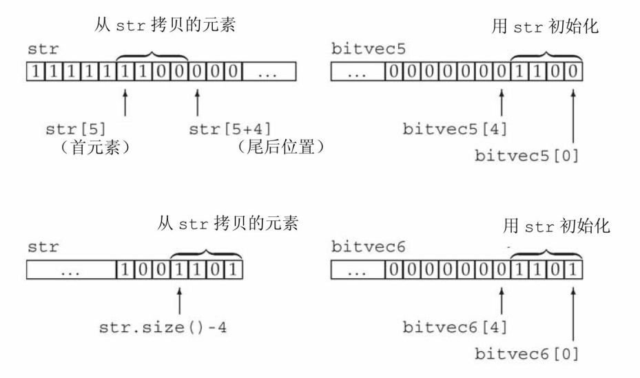
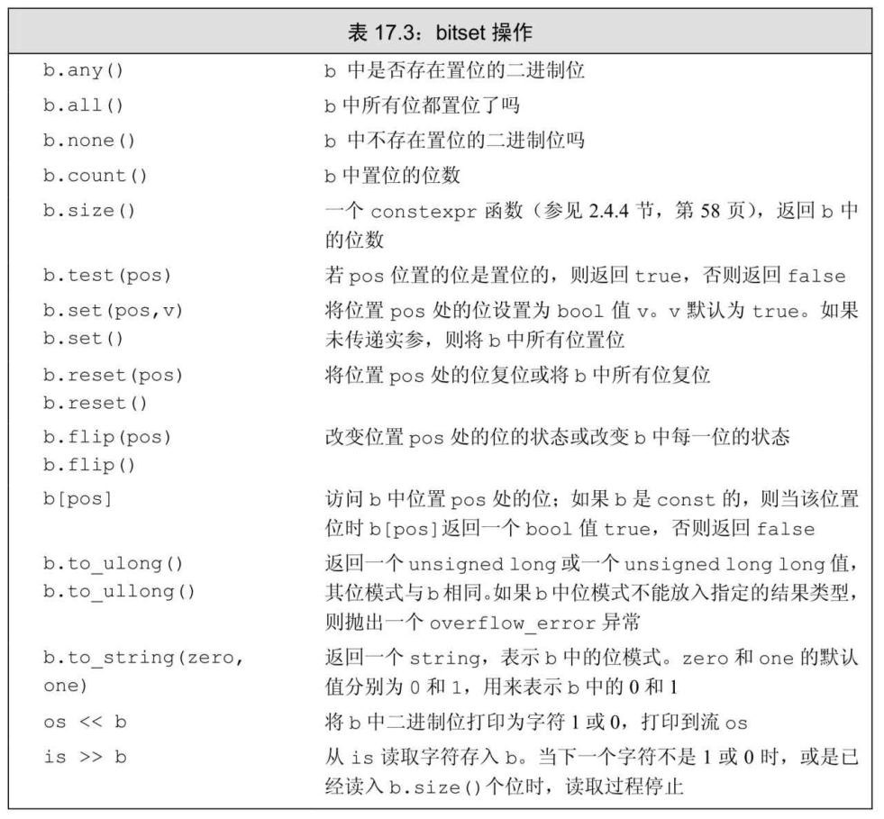
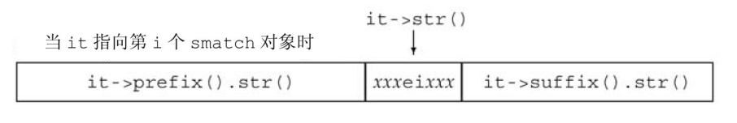

## 第Ⅳ 部分 高级主题

第`Ⅳ` 部分将介绍`C++`和标准库的一些附加特性，虽然这些特性在特定的情况下很有用，但并非每个`C++`程序员都需要它们。这些特性分为两类：一类对于求解大规模的问题很有用；另一类适用于特殊问题而非通用问题。针对特殊问题的特性既有属于`C++`语言的(将在第`19`章介绍)，也有属于标准库的(将在第`17`章进行介绍)。

在第`17`章中我们介绍四个具有特殊目的的标准库设施：`bitset`类和三个新标准库设施(`tuple`、正则表达式和随机数)。我们还将介绍`IO`库中某些不常用的部分。

第`18`章介绍异常处理、命名空间和多重继承。这些特性在设计大型程序时是最有用的。

即使是一个程序员就能编写的足够简单的程序，也能从异常处理机制受益，这也是为什么我们在第`5`章介绍了异常处理的基本知识的原因。但是，对于需要大型团队才能完成的程序设计问题，运行时错误处理才显得更为重要也更难于管理。在第`18`章中，我们会额外介绍一些有用的异常处理设施。我们还将详细讨论异常是如何处理的，并展示如何定义和使用自己的异常类。这一章还会介绍新标准中异常处理方面的改进—— 如何指出一个特定函数不会抛出异常。

大型应用程序通常会使用来自多个提供商的代码。如果提供商不得不将他们定义的名字放置在单一的命名空间中，那么将多个独立开发的库组合起来是很困难的(如果能组合的话)。独立开发的库几乎必然会使用与其他库相同的名字；对于某个库中定义的名字，如果另一个库中使用了相同的名字，就会引起冲突。为了避免名字冲突，我们可以在一个`namespace`中定义名字。

无论何时我们使用一个来自标准库的名字，实际上都是在使用名为`std`的命名空间中的名字。第`18`章将会展示如何定义我们自己的命名空间。

第`18`章最后介绍一个很重要但不太常用的语言特性：多重继承。多重继承对非常复杂的继承层次很有用。

第`19`章介绍几种用于特定类别问题的特殊工具和技术，包括如何重定义内存分配机制；`C++`对运行时类型识别(`run-time typeidentification`，`RTTI`)的支持—— 允许我们在运行时才确定一个表达式的实际类型；以及如何定义和使用指向类成员的指针。类成员指针不同于普通数据或函数指针。普通指针仅根据对象或函数的类型而变化，而类成员指针还必须反映成员所属的类。我们还将介绍三种附加的聚合类型：联合、嵌套类和局部类。这一章最后将简要介绍一组本质上不可移植的语言特性：`volatile`修饰符、位域以及链接指令。

# 第17章 标准库特殊设施

最新的`C++`标准极大地扩充了标准库的规模和范围。实际上，从`1998`年的第一版标准到`2011`年的最新标准，标准库部分的篇幅增加了两倍以上。因此，介绍所有`C++`标准库类的知识大大超出了本书范围。但是，有`4`个标准库设施，虽然它们比我们已经介绍的其他标准库设施更特殊，但也足够通用，应该放在一本入门书籍中进行介绍。这`4`个标准库设施是：`tuple`、`bitset`、随机数生成及正则表达式。此外，我们还将介绍`IO`库中一些具有特殊目的的部分。

标准库占据了新标准文本将近三分之二的篇幅。虽然我们不能详细介绍所有标准库设施，但仍有一些标准库设施在很多应用中都是有用的：`tuple`、`bitset`、正则表达式以及随机数。我们还将介绍一些附加的`IO`库功能：格式控制、未格式化`IO`和随机访问。

## 17.1 tuple类型

`tuple`是类似`pair`(参见`11.2.3`节)的模板。每个`pair`的成员类型都不相同，但每个`pair`都恰好有两个成员。不同`tuple`类型的成员类型也不相同，但一个`tuple`可以有任意数量的成员。每个确定的`tuple`类型的成员数目是固定的，但一个`tuple`类型的成员数目可以与另一个`tuple`类型不同。

当我们希望将一些数据组合成单一对象，但又不想麻烦地定义一个新数据结构来表示这些数据时，`tuple`是非常有用的。表`17.1`列出了`tuple`支持的操作。`tuple`类型及其伴随类型和函数都定义在`tuple`头文件中。

表 `17.1`: `tuple`支持的操作

| 操作 | 含义 |
| --- | --- |
| `tuple<T1, T2, ..., Tn> t;` | `t`是一个`tuple`，成员数为`n`，第`i`个成员的类型为`Ti`。所有成员都进行值初始化(参见`3.3.1`节) |
| `tuple<T1, T2, ..., Tn> t(v1, v2, ..., vn);` | `t`是一个`tuple`，成员类型为`T1`...`Tn`，每个成员用对应的初始值`vi`进行初始化。此构造函数是`explicit`的(参见`7.5.4`节) |
| `make_tuple(v1, v2, ..., vn)` | 返回一个用给定初始值初始化的`tuple`。`tuple`的类型从初始值的类型推断 |
| `t1 == t2`、`t1 != t2` | 当两个`tuple`具有相同数量的成员且成员对应相等时，两个`tuple`相等。这两个操作使用成员的`==`运算符来完成。一旦发现某对成员不等，接下来的成员就不用比较了 |
| `t1 relop t2` | `tuple`的关系运算使用字典序(参见`9.2.7`节)。两个`tuple`必须具有相同数量的成员。使用`<`运算符比较`t1`的成员和`t2`中的对应成员 |
| `get<i>(t)` | 返回`t`的第`i`个数据成员的引用：如果`t`是一个左值，结果是一个左值引用；否则，结果是一个右值引用。`tuple`的所有成员都是`public`的 |
| `tuple_size<tupleType>::value` | 一个类模板，可以通过一个`tuple`类型来初始化。它有一个名为`value`的`public constexpr static`数据成员，类型为`size_t`，表示给定`tuple`类型中成员的数量 |
| `tuple_element<i, tupleType>::type` | 一个类模板，可以通过一个整型常量和一个`tuple`类型来初始化。它有一个名为`type`的`public`成员，表示给定`tuple`类型中指定成员的类型 |

>我们可以将`tuple`看作一个“快速而随意”的数据结构。

### 17.1.1 定义和初始化 tuple

当我们定义一个`tuple`时，需要指出每个成员的类型：

```cpp
tuple<size_t, size_t, size_t> threeD; // 三个成员都设置为0
tuple<string, vector<double>, int, list<int>>
    someVal("constants", {3.14, 2.718}, 42, {0,1,2,3,4,5});
```

当我们创建一个`tuple`对象时，可以使用`tuple`的默认构造函数，它会对每个成员进行值初始化(参见`3.3.1`节)；也可以像本例中初始化`someVal`一样，为每个成员提供一个初始值。`tuple`的这个构造函数是`explicit`的(参见`7.5.4`节)，因此我们必须使用直接初始化语法：

```cpp
tuple<size_t, size_t, size_t> threeD = {1,2,3};    // 错误
tuple<size_t, size_t, size_t> threeD{1,2,3};      // 正确
```

类似`make_pair`函数(参见`11.2.3`节)，标准库定义了`make_tuple`函数，我们还可以用它来生成`tuple`对象：

```cpp
// 表示书店交易记录的 tuple，三个成员分别是 ISBN、销售数量和价格
auto item = make_tuple("0-999-78345-x", 3, 20.00);
```

类似`make_pair`，`make_tuple`函数使用初始值的类型来推断`tuple`的类型。在本例中，`item`是一个`tuple`，类型为`tuple<const char`  *，`int`，`double>`。

#### 访问`tuple`的成员

一个`pair`总是有两个成员，这样，标准库就可以为它们命名(如，`first`和`second`)。但这种命名方式对`tuple`是不可能的，因为一个`tuple`类型的成员数目是没有限制的。因此，`tuple`的成员都是未命名的。要访问一个`tuple`的成员，就要使用一个名为`get`的标准库函数模板。为了使用`get`，我们必须指定一个显式模板实参(参见`16.2.2`节)，它指出我们想要访问第几个成员。我们传递给`get`一个`tuple`对象，它返回指定成员的引用：

```cpp
auto book = get<0>(item);           // 返回 item 的第一个成员
auto cnt = get<1>(item);            // 返回 item 的第二个成员
auto price = get<2>(item) / cnt;    // 返回 item 的最后一个成员
get<2>(item) *= 0.8;                // 打折 20%
```

尖括号中的值必须是一个整型常量表达式(参见`2.4.4`节)。与往常一样，我们从`0`开始计数，意味着`get<0>`是第一个成员。

如果不知道一个`tuple`准确的类型细节信息，可以用两个辅助类模板来查询`tuple`成员的数量和类型：

```cpp
typedef decltype(item) trans; // trans是 item 的类型
// 返回 trans 类型对象中成员的数量
size_t sz = tuple_size<trans>::value;   // 返回 3
// cnt 的类型与item 中第二个成员相同
tuple_element<1, trans>::type cnt = get<1>(item); // cnt 是一个int
```

为了使用`tuple_size`或`tuple_element`，我们需要知道一个`tuple`对象的类型。与往常一样，确定一个对象的类型的最简单方法就是使用`decltype`(参见`2.5.3`节)。在本例中，我们使用`decltype`来为`item`类型定义一个类型别名，用它来实例化两个模板。

`tuple_size`有一个名为`value`的`public static`数据成员，它表示给定`tuple`中成员的数量。`tuple_element`模板除了一个`tuple`类型外，还接受一个索引值。它有一个名为`type`的`public`类型成员，表示给定`tuple`类型中指定成员的类型。类似`get`，`tuple_element`所使用的索引也是从`0`开始计数的。

#### 关系和相等运算符

`tuple`的关系和相等运算符的行为类似容器的对应操作(参见`9.2.7`节)。这些运算符逐对比较左侧`tuple`和右侧`tuple`的成员。只有两个`tuple`具有相同数量的成员时，我们才可以比较它们。而且，为了使用`tuple`的相等或不等运算符，对每对成员使用`==`运算符必须都是合法的；为了使用关系运算符，对每对成员使用`<`必须都是合法的。例如：

```cpp
tuple<string, string> duo("1", "2");
tuple<size_t, size_t> twoD(1, 2);
bool b = (duo == twoD);   // 错误: 不能比较 size_t 和 string
tuple<size_t, size_t, size_t> threeD(1, 2, 3);
b = (twoD < threeD);      // 错误: 成员数量不同
tuple<size_t, size_t> origin(0, 0);
b = (origin < twoD);      // 正确: b 为 true
```

>由于`tuple`定义了`<`和`==`运算符，我们可以将`tuple`序列传递给算法，并且可以在无序容器中将`tuple`作为关键字类型。

#### 小节练习

练习`17.1`：定义一个保存三个`int`值的`tuple`，并将其成员分别初始化为 20和30。

练习`17.2`：定义一个`tuple`，保存一个`string`、一个`vector<string>`和一个`pair<string，int>`。

练习`17.3`：重写`12.3`节中的`TextQuery`程序，使用`tuple`代替`QueryResult`类。你认为哪种设计更好？为什么？

### 17.1.2 使用 tuple 返回多个值

`tuple`的一个常见用途是从一个函数返回多个值。例如，我们的书店可能是多家连锁书店中的一家。每家书店都有一个销售记录文件，保存每本书近期的销售数据。我们可能希望在所有书店中查询某本书的销售情况。

假定每家书店都有一个销售记录文件。每个文件都将每本书的所有销售记录存放在一起。进一步假定已有一个函数可以读取这些销售记录文件，为每个书店创建一个`vector<Sales_data>`，并将这些`vector`保存在`vector`的`vector`中：

```cpp
// files 中的每个元素保存一家书店的销售记录
vector<vector<Sales_data>> files;
```

我们将编写一个函数，对于一本给定的书，在`files`中搜索出售过这本书的书店。对每家有匹配销售记录的书店，我们将创建一个`tuple`来保存这家书店的索引和两个迭代器。索引指出了书店在`files`中的位置，而两个迭代器则标记了给定书籍在此书店的`vector<Sales_data>`中第一条销售记录和最后一条销售记录之后的位置。

#### 返回`tuple`的函数

我们首先编写查找给定书籍的函数。此函数的参数是刚刚提到的`vector`的`vector`以及一个表示书籍`ISBN`的`string`。我们的函数将返回一个`tuple`的`vector`，凡是销售了给定书籍的书店，都在`vector`中有对应的一项：

```cpp
// matches 有三个成员: 一家书店的索引和两个指向书店 vector 中元素的迭代器
typedef tuple<vector<Sales_data>::size_type,
              vector<Sales_data>::const_iterator,
              vector<Sales_data>::const_iterator> matches;
// files 保存每家书店的销售记录
// findBook 返回一个 vector，每家销售了给定书籍的书店在其中都有一项
vector<matches>
findBook(const vector<vector<Sales_data>> &files,
         const string &book)
{
    vector<matches> ret;    // 初始化为空 vector
    // 对每家书店，查找与给定书籍匹配的记录范围(如果存在的话)
    for (auto it = files.cbegin(); it != files.cend(); ++it) {
        // 查找具有相同 ISBN 的 Sales_data 范围
        auto found = equal_range(it->cbegin(), it->cend(),
                                 book, compareIsbn);
        if (found.first != found.second)    // 此书店销售了给定书籍
            // 记住此书店的索引及匹配的范围
            ret.push_back(make_tuple(it - files.cbegin(),
                                     found.first, found.second));
    }
    return ret;    // 如果未找到匹配记录的话，ret 为空
}
```

`for`循环遍历`files`中的元素，每个元素都是一个`vector`。在`for`循环内，我们调用了一个名为`equal_range`的标准库算法，它的功能与关联容器的同名成员类似(参见`11.3.5`节)。`equal_range`的前两个实参是表示输入序列的迭代器(参见`10.1`节)，第三个参数是一个值。默认情况下，`equal_range`使用`<`运算符来比较元素。由于`Sales_data`没有`<`运算符，因此我们传递给它一个指向`compareIsbn`函数的指针(参见`11.2.2`节)。

`equal_range`算法返回一个迭代器`pair`，表示元素的范围。如果未找到`book`，则两个迭代器相等，表示空范围。否则，返回的`pair`的`first`成员将表示第一条匹配的记录，`second`则表示匹配的尾后位置。

#### 使用函数返回的`tuple`

一旦我们创建了`vector`保存包含匹配的销售记录的书店，就需要处理这些记录了。在此程序中，对每家包含匹配销售记录的书店，我们将打印其汇总销售信息：

```cpp
void reportResults(istream &in, ostream &os,
                   const vector<vector<Sales_data>> &files)
{
    string s;    // 要查找的书
    while (in >> s) {
        auto trans = findBook(files, s);    // 销售了这本书的书店
        if (trans.empty()) {
            cout << s << " not found in any stores" << endl;
            continue;    // 获得下一本要查找的书
        }
        for (const auto &store : trans)    // 对每家销售了给定书籍的书店
            // get<n>返回 store 中 tuple 的指定的成员
            os << "store " << get<0>(store) << " sales: "
               << accumulate(get<1>(store), get<2>(store),
                             Sales_data(s))
               << endl;
    }
}
```

`while`循环反复读取名为`in`的`istream`来获得下一本要处理的书。我们调用`findBook`来检查`s`是否存在，并将结果赋予`trans`。我们使用`auto`来简化`trans`类型的代码编写，它是一个`tuple`的`vector`。

如果`trans`为空，表示没有关于`s`的销售记录。在此情况下，我们打印一条信息并返回，执行下一步`while`循环来获取下一本要查找的书。

`for`循环将`store`绑定到`trans`中的每个元素。由于不希望改变`trans`中的元素，我们将`store`声明为`const`的引用。我们使用`get`来打印相关数据：`get<0>`表示对应书店的索引、`get<1>`表示第一条交易记录的迭代器、`get<2>`表示尾后位置的迭代器。

由于`Sales_data`定义了加法运算符(参见`14.3`节)，因此我们可以用标准库的`accumulate`算法(参见`10.2.1`节)来累加销售记录。我们用`Sales_data`的接受一个`string`参数的构造函数(参见`1.4节`)来初始化一个`Sales_data`对象，将此对象传递给`accumulate`作为求和的起点。此构造函数用给定的`string`初始化`bookNo`，并将`units_sold`和`revenue`成员置为`0`。

#### 小节练习

练习`17.4`：编写并测试你自己版本的`findBook`函数。

练习`17.5`：重写`findBook`，令其返回一个`pair`，包含一个索引和一个迭代器`pair`。

练习`17.6`：重写`findBook`，不使用`tuple`或`pair`。

练习`17.7`：解释你更倾向于哪个版本的`findBook`，为什么。

练习`17.8`：在本节最后一段代码中，如果我们将`Sales_data`()作为第三个参数传递给`accumulate`，会发生什么？

## 17.2 bitset类型

在`4.8`节中我们介绍了将整型运算对象当作二进制位集合处理的一些内置运算符。标准库还定义了`bitset`类，使得位运算的使用更为容易，并且能够处理超过最长整型类型大小的位集合。`bitset`类定义在头文件`bitset`中。

### 17.2.1 定义和初始化 bitset

表`17.2`列出了`bitset`的构造函数。`bitset`类是一个类模板，它类似`array`类，具有固定的大小(参见`9.2.4`节)。当我们定义一个`bitset`时，需要声明它包含多少个二进制位：

```cpp
bitset<32> bitvec(1U); // 32 位; 低位为 1，其他位为0
```

大小必须是一个常量表达式(参见`2.4.4`节)。这条语句定义`bitvec`为一个包含`32`位的`bitset`。就像`vector`包含未命名的元素一样，`bitset`中的二进制位也是未命名的，我们通过位置来访问它们。二进制位的位置是从`0`开始编号的。因此，`bitvec`包含编号从`0`到`31`的`32`个二进制位。编号从`0`开始的二进制位被称为低位(`low-order`)，编号到`31`结束的二进制位被称为高位(`high-order`)。

表 `17.2`: 初始化`bitset`的方法

| 操作 | 含义 |
| --- | --- |
| `bitset<n> b;` | `b`有`n`位；每一位均为`0`。此构造函数是一个`constexpr`(参见`7.5.6`节) |
| `bitset<n> b(u);` | `b`是`unsigned long long`值`u`的低`n`位的拷贝。如果`n`大于`unsigned long long`的大小，则`b`中超出`unsigned long long`的高位被置为`0`。此构造函数是一个`constexpr`(参见`7.5.6`节) |
| `bitset<n> b(s, pos, m, zero, one);` | `b`是`string s`从位置`pos`开始`m`个字符的拷贝。`s`只能包含字符`zero`或`one`；如果`s`包含任何其他字符，构造函数会抛出`invalid_argument`异常。字符在`b`中分别保存为`zero`和`one`。`pos`默认为`0`，`m`默认为`string::npos`，`zero`默认为`'0'`，`one`默认为`'1'` |
| `bitset<n> b(cp, pos, m, zero, one);` | 与上一个构造函数相同，但从`cp`指向的字符数组中拷贝字符。如果未提供`m`，则`cp`必须指向一个`C`风格字符串。如果提供了`m`，则从`cp`开始必须至少有`m`个`zero`或`one`字符 |

接受一个`string`或一个字符指针的构造函数是`explicit`的(参见`7.5.4`节)。在新标准中增加了为`0`和`1`指定其他字符的功能。

#### 用`unsigned`值初始化`bitset`

当我们使用一个整型值来初始化`bitset`时，此值将被转换为`unsignedlong long` 类型并被当作位模式来处理。`bitset`中的二进制位将是此模式的一个副本。如果`bitset`的大小大于一个`unsigned long long` 中的二进制位数，则剩余的高位被置为`0`。如果`bitset`的大小小于一个`unsigned longlong`中的二进制位数，则只使用给定值中的低位，超出`bitset`大小的高位被丢弃：

```cpp
// bitvec1 比初始值小; 初始值中的高位被丢弃
bitset<13> bitvec1(0xbeef);     // 二进制位序列为 1111011101111
// bitvec2 比初始值大; 它的高位被置为 0
bitset<20> bitvec2(0xbeef);     // 二进制位序列为 00001011111011101111
// 在 64 位机器中，unsigned long long 是 64 位，因此 ~0ULL 是 64 个 1 比特
bitset<128> bitvec3(~0ULL);     // 0~63 位为 1; 63~127 位为 0
```

#### 从一个`string`初始化`bitset`

我们可以从一个`string`或一个字符数组指针来初始化`bitset`。两种情况下，字符都直接表示位模式。与往常一样，当我们使用字符串表示数时，字符串中下标最小的字符对应高位，反之亦然：

```cpp
bitset<32> bitvec4("1100"); // 2、3 两位为1，剩余两位为0
```

如果`string`包含的字符数比`bitset`少，则`bitset`的高位被置为`0`。

> `string`的下标编号习惯与`bitset`恰好相反：`string`中下标最大的字符(最右字符)用来初始化`bitset`中的低位(下标为`0`的二进制位)。当你用一个`string`初始化一个`bitset`时，要记住这个差别。

我们不必使用整个`string`来作为`bitset`的初始值，可以只用一个子串作为初始值：

```cpp
string str("1111111000000011001101");
bitset<32> bitvec5(str, 5, 4);    // 从 str[5] 开始的四个二进制位，1100
bitset<32> bitvec6(str, str.size()-4);    // 使用最后四个字符
```

此处，`bitvec5`用`str`中从`str[5]`开始的长度为`4`的子串进行初始化。与往常一样，子串的最右字符表示最低位。因此，`bitvec5`中第`3`位到第`0`位被设置为`1100`，剩余位被设置为`0`。传递给`bitvec6`的初始值是一个`string`和一个开始位置，因此`bitvec6`用`str`中倒数第四个字符开始的子串进行初始化。`bitvec6`中剩余二进制位被初始化为`0`。下图说明了这两个初始化过程



#### 小节练习

练习`17.9`：解释下列每个`bitset`对象所包含的位模式：

```cpp
(a) bitset<64> bitvec(32);
(b) bitset<32> bv(1010101);
(c) string bstr; cin >> bstr; bitset<8>bv(bstr);
```

### 17.2.2 bitset操作

`bitset`操作(参见表`17.3`)定义了多种检测或设置一个或多个二进制位的方法。`bitset`类还支持我们在`4.8`节中介绍过的位运算符。这些运算符用于`bitset`对象的含义与内置运算符用于`unsigned`运算对象相同。



`count`、`size`、`all`、`any`和`none`等几个操作都不接受参数，返回整个`bitset`的状态。其他操作——`set` 、`reset`和`flip`则改变`bitset`的状态。改变`bitset`状态的成员函数都是重载的。对每个函数，不接受参数的版本对整个集合执行给定的操作；接受一个位置参数的版本则对指定位执行操作：

```cpp
bitset<32> bitvec(1U);      // 32 位; 低位为 1，剩余位为 0
bool is_set = bitvec.any();      // true，因为有 1 位置位了
bool is_not_set = bitvec.none();      // false，因为有 1 位置位了
bool all_set = bitvec.all();      // false，因为只有 1 位置位
size_t onBits = bitvec.count();      // 返回 1
size_t sz = bitvec.size();      // 返回 32
bitvec.flip();      // 翻转 bitvec 中的所有位
bitvec.reset();      // 将所有位复位
bitvec.set();      // 将所有位置位
```

当`bitset`对象的一个或多个位置位(即，等于`1`)时，操作`any`返回`true`。相反，当所有位复位时，`none`返回`true`。新标准引入了`all`操作，当所有位置位时返回`true`。操作`count`和`size`返回`size_t`类型的值(参见`3.5.2`节)，分别表示对象中置位的位数或总位数。函数`size`是一个`constexpr`函数，因此可以用在要求常量表达式的地方(参见`2.4.4`节)。

成员`flip`、`set`、`reset`及`test`允许我们读写指定位置的位：

```cpp
bitvec.flip(0);      // 翻转第一位
bitvec.set (bitvec.size() - 1); // 置位最后一位
bitvec.set(0, 0);     // 复位第一位
bitvec.reset(i);      // 复位第 i 位
bitvec.test (0);      // 返回 false，因为第一位是复位的
```

下标运算符对`const`属性进行了重载。`const`版本的下标运算符在指定位置位时返回`true`，否则返回`false`。非`const`版本返回`bitset`定义的一个特殊类型，它允许我们操纵指定位的值：

```cpp
bitvec[0] = 0;      // 将第一位复位
bitvec[31] = bitvec[0]; // 将最后一位设置为与第一位一样
bitvec[0].flip();      // 翻转第一位
~bitvec[0];      // 等价操作，也是翻转第一位
bool b = bitvec[0];      // 将 bitvec[0]的值转换为bool 类型
```

#### 提取`bitset`的值

`to_ulong`和`to_ullong`操作都返回一个值，保存了与`bitset`对象相同的位模式。只有当`bitset`的大小小于等于对应的大小(`to_ulong`为`unsignedlong`，`to_ullong`为`unsigned long long`)时，我们才能使用这两个操作：

```cpp
unsigned long ulong = bitvec3.to_ulong();
cout << "ulong = " << ulong << endl;
```

>如果`bitset`中的值不能放入给定类型中，则这两个操作会抛出一个`overflow_error`异常(参见`5.6`节)。

#### `bitset`的`IO`运算符

输入运算符从一个输入流读取字符，保存到一个临时的`string`对象中。直到读取的字符数达到对应`bitset`的大小时，或是遇到不是`1`或`0`的字符时，或是遇到文件尾或输入错误时，读取过程才停止。随即用临时`string`对象来初始化`bitset`(参见`17.2.1`节)。如果读取的字符数小于`bitset`的大小，则与往常一样，高位将被置为`0`。

输出运算符打印一个`bitset`对象中的位模式：

```cpp
bitset<16> bits;
cin >> bits; // 从 cin读取最多16个0或1
cout << "bits: " << bits << endl; // 打印刚刚读取的内容
```

#### 使用`bitset`

为了说明如何使用`bitset`，我们重新实现`4.8`节中的评分程序，用`bitset`代替`unsigned long` 表示`30`个学生的测验结果——“ 通过`/`失败”：

```cpp
bool status;
// 使用位运算符的版本
unsigned long quizA = 0;      // 此值被当作位集合使用
quizA |= 1UL << 27;      // 指出第 27 个学生通过了测验
status = quizA & (1UL << 27);      // 检查第 27 个学生是否通过了测验
quizA &= ~(1UL << 27);      // 第 27 个学生未通过测验
// 使用标准库类 bitset 完成等价的工作
bitset<30> quizB;      // 每个学生分配一位，所有位都被初始化为 0
quizB.set(27);      // 指出第 27 个学生通过了测验
status = quizB[27];      // 检查第 27 个学生是否通过了测验
quizB.reset(27);      // 第 27 个学生未通过测验
```

#### 小节练习

练习`17.10`：使用序列`1`、`2`、`3`、`5`、`8`、`13`、`21`初始化一个`bitset`，将这些位置置位。对另一个`bitset`进行默认初始化，并编写一小段程序将其恰当的位置位。

练习`17.11`：定义一个数据结构，包含一个整型对象，记录一个包含`10`个问题的真`/`假测验的解答。如果测验包含`100`道题，你需要对数据结构做出什么改变(如果需要的话)？

练习`17.12`：使用前一题中的数据结构，编写一个函数，它接受一个问题编号和一个表示真`/`假解答的值，函数根据这两个参数更新测验的解答。

练习`17.13`：编写一个整型对象，包含真`/`假测验的正确答案。使用它来为前两题中的数据结构生成测验成绩。

## 17.3 正则表达式

正则表达式(`regular expression`)是一种描述字符序列的方法，是一种极其强大的计算工具。但是，用于定义正则表达式的描述语言已经大大超出了本书的范围。因此，我们重点介绍如何使用`C++`正则表达式库(`RE`库)，它是新标准库的一部分。`RE`库定义在头文件`regex`中，它包含多个组件，列于表`17.4`中。

表 `17.4`: 正则表达式库组件

| 组件 | 含义 |
| --- | --- |
| `regex` | 表示有一个正则表达式的类 |
| `regex_match` | 将一个字符序列与一个正则表达式匹配 |
| `regex_search` | 寻找第一个与正则表达式匹配的子序列 |
| `regex_replace` | 使用给定格式替换一个正则表达式 |
| `sregex_iterator` | 迭代器适配器，调用`regex_search`来遍历一个`string`中所有出现的匹配的子串 |
| `smatch` | 容器类，保存在`string`中搜索的结果 |
| `ssub_match` | `string`中匹配的子表达式的结果 |

>如果你还不熟悉正则表达式的使用，你应该浏览这一节，以获得正则表达式可以做什么的一些概念。

`regex`类表示一个正则表达式。除了初始化和赋值之外，`regex`还支持其他一些操作。表`17.6`列出了`regex`支持的操作。

函数`regex_match`和`regex_search`确定一个给定字符序列与一个给定`regex`是否匹配。如果整个输入序列与表达式匹配，则`regex_match`函数返回`true`；如果输入序列中一个子串与表达式匹配，则`regex_search`函数返回`true`。还有一个`regex_replace`函数，我们将在`17.3.4`节中介绍。

表`17.5`列出了`regex`的函数的参数。这些函数都返回`bool`值，且都被重载了：其中一个版本接受一个类型为`smatch`的附加参数。如果匹配成功，这些函数将成功匹配的相关信息保存在给定的`smatch`对象中。

表 `17.5`: `regex_search`和`regex_match`的参数

注意：这些操作返回`bool`值，指出是否找到匹配。`m`是一个`match`对象，用来保存匹配结果的相关细节。`m`和`seq`必须具有兼容的类型(参见`17.3.1`节)。`mf`是一个可选的`regex_constants::match_flag_type`值，表`17.13`描述了这些值，它们会影响匹配过程。

| 操作 | 含义 |
| --- | --- |
| `(seq, m, r, mft)` | 在字符序列`seq`中查找`regex`对象`r`中的正则表达式。`seq`可以是一个`string`、表示范围的一对迭代器以及一个指向空字符结尾的字符数组的指针 |
| `(seq, r, mft)` | 在字符序列`seq`中查找`regex`对象`r`中的正则表达式 |

### 17.3.1 使用正则表达式库

我们从一个非常简单的例子开始—— 查找违反众所周知的拼写规则“`i`除非在`c`之后，否则必须在`e`之前”的单词：

```cpp
// 查找不在字符 c 之后的字符串 ei
string pattern("[^c]ei");
// 我们需要包含 pattern 的整个单词
pattern = "[[:alpha:]]*" + pattern + "[[:alpha:]]*";
regex r(pattern);     // 构造一个用于查找模式的 regex
smatch results;      // 定义一个对象保存搜索结果
// 定义一个 string 保存与模式匹配和不匹配的文本
string test_str = "receipt freind theif receive";
// 我们将查找 test_str 中与 pattern 匹配的子串
if (regex_search(test_str, results, r))   // 如果有匹配子串
    cout << results.str() << endl;      // 打印匹配的单词
```

我们首先定义了一个`string`来保存希望查找的正则表达式。正则表达式`[^c]`表明我们希望匹配任意不是`'c'`的字符，而`[^c]ei`指出我们想要匹配这种字符后接`ei`的字符串。此模式描述的字符串恰好包含三个字符。我们想要包含此模式的单词的完整内容。为了与整个单词匹配，我们还需要一个正则表达式与这个三字母模式之前和之后的字母匹配。

这个正则表达式包含零个或多个字母后接我们的三字母的模式，然后再接零个或多个额外的字母。默认情况下，`regex`使用的正则表达式语言是`ECMAScript`。在`ECMAScript`中，模式`[[:alpha:]]`匹配任意字母，符号`+`和`*`分别表示我们希望“一个或多个”或“零个或多个”匹配。因此`[[:alpha:]]*`将匹配零个或多个字母。

将正则表达式存入`pattern`后，我们用它来初始化一个名为`r`的`regex`对象。接下来我们定义了一个`string`，用来测试正则表达式。我们将`test_str`初始化为与模式匹配的单词(如`"freind"`和`"thief"`)和不匹配的单词(如`"recepit"`和`"receive"`)。我们还定义了一个名为`results`的`smatch`对象，它将被传递给`regex_search`。如果找到匹配子串，`results`将会保存匹配位置的细节信息。

接下来我们调用了`regex_search`。如果它找到匹配子串，就返回`true`。我们用`results`的`str`成员来打印`test_str`中与模式匹配的部分。函数`regex_search`在输入序列中只要找到一个匹配子串就会停止查找。因此，程序的输出将是

`freind`

`17.3.2`节将会介绍如何查找输入序列中所有的匹配子串。

#### 指定`regex`对象的选项

当我们定义一个`regex`或是对一个`regex`调用`assign`为其赋予新值时，可以指定一些标志来影响`regex`如何操作。这些标志控制`regex`对象的处理过程。表`17.6`列出的最后`6`个标志指出编写正则表达式所用的语言。对这`6`个标志，我们必须设置其中之一，且只能设置一个。默认情况下，`ECMAScript`标志被设置，从而`regex`会使用`ECMA-262` 规范，这也是很多`Web` 浏览器所使用的正则表达式语言。

表 `17.6`: `regex`(和`wregex`)选项

注意：构造函数和赋值操作可能抛出类型为`regex_error`的异常。

| 操作 | 含义 |
| --- | --- |
| `regex r(re)`、`regex r(re, f)` | `re`表示一个正则表达式，它可以是一个`string`、一个表示字符范围的迭代器对、一个指向空字符结尾的字符数组的指针、一个字符指针和一个计数器或是一个花括号包围的字符列表。`f`是指出对象如何处理的标志。`f`通过下面列出的值来设置。如果未指定`f`，其默认值为`ECMAScript` |
| `r1 = re` | 将`r1`中的正则表达式替换为`re`。`re`表示一个正则表达式，它可以是另一个`regex`对象、一个`string`、一个指向空字符结尾的字符数组的指针或是一个花括号包围的字符列表 |
| `r1.assign(re, f)` | 与使用赋值运算符(`=`)效果相同，可选的标志`f`也与`regex`的构造函数中对应的参数含义相同 |
| `r.mark_count()` | `r`中子表达式的数目(参见`17.3.3`节) |
| `r.flags()` | 返回`r`的标志集 |

定义`regex`时指定的标志(定义在`regex`和`regex_constants::syntax_option_type`中)：

| 标志 | 含义 |
| --- | --- |
| `icase` | 在匹配过程中忽略大小写 |
| `nosubs` | 不保存匹配的子表达式 |
| `optimize` | 执行速度优先于构造速度 |
| `ECMAScript` | 使用`ECMA-262`指定的语法 |
| `basic` | 使用`POSIX`基本的正则表达式语法 |
| `extended` | 使用`POSIX`扩展的正则表达式语法 |
| `awk` | 使用`POSIX`版本的`awk`语言的语法 |
| `grep` | 使用`POSIX`版本的`grep`的语法 |
| `egrep` | 使用`POSIX`版本的`egrep`的语法 |

其他`3`个标志允许我们指定正则表达式处理过程中与语言无关的方面。例如，我们可以指出希望正则表达式以大小写无关的方式进行匹配。

作为一个例子，我们可以用`icase`标志查找具有特定扩展名的文件名。大多数操作系统都是按大小写无关的方式来识别扩展名的—— 可以将一个`C++`程序保存在`.cc`结尾的文件中，也可以保存在`.Cc`、`.cC`或是`.CC`结尾的文件中，效果是一样的。如下所示，我们可以编写一个正则表达式来识别上述任何一种扩展名以及其他普通文件扩展名：

```cpp
// 一个或多个字母或数字字符后接一个 . 再接 cpp 或 cxx 或 cc
regex r("([[:alnum:]]+)\\.(cpp|cxx|cc)$", regex::icase);
smatch results;
string filename;
while (cin >> filename)
     if (regex_search(filename, results, r))
         cout << results.str() << endl; // 打印匹配结果
```

此表达式将匹配这样的字符串：一个或多个字母或数字后接一个句点再接三个文件扩展名之一。这样，此正则表达式将会匹配指定的文件扩展名而不理会大小写。

就像`C++`语言中有特殊字符一样(参见`2.1.3`节)，正则表达式语言通常也有特殊字符。例如，字符点(`.`)通常匹配任意字符。与`C++`一样，我们可以在字符之前放置一个反斜线来去掉其特殊含义。由于反斜线也是`C++`中的一个特殊字符，我们在字符串字面常量中必须连续使用两个反斜线来告诉`C++`我们想要一个普通反斜线字符。因此，为了表示与句点字符匹配的正则表达式，必须写成`\\.`(第一个反斜线去掉`C++`语言中反斜线的特殊含义，即，正则表达式字符串为`\.`，第二个反斜线则表示在正则表达式中去掉`.`的特殊含义)。

#### 指定或使用正则表达式时的错误

我们可以将正则表达式本身看作用一种简单程序设计语言编写的“程序”。这种语言不是由`C++`编译器解释的。正则表达式是在运行时，当一个`regex`对象被初始化或被赋予一个新模式时，才被“编译”的。与任何其他程序设计语言一样，我们用这种语言编写的正则表达式也可能有错误。

>需要意识到的非常重要的一点是，一个正则表达式的语法是否正确是在运行时解析的。

如果我们编写的正则表达式存在错误，则在运行时标准库会抛出一个类型为`regex_error`的异常(参见`5.6`节)。类似标准异常类型，`regex_error`有一个`what`操作来描述发生了什么错误(参见`5.6.2`节)。`regex_error`还有一个名为`code`的成员，用来返回某个错误类型对应的数值编码。`code`返回的值是由具体实现定义的。`RE`库能抛出的标准错误如表`17.7`所示。

例如，我们可能在模式中意外遇到一个方括号：

```cpp
try {
     // 错误: alnum 漏掉了右括号，构造函数会抛出异常
    regex r("[[:alnum:]+\\.(cpp|cxx|cc)$", regex::icase);
} catch (regex_error e)
  { cout << e.what() << "\ncode: " << e.code() << endl; }
```

当这段程序在我们的系统上运行时，程序会生成：

`regex_error(error_brack):`

`The expression contained mismatched [ and ].`

`code: 4`

表 `17.7`: 正则表达式错误类型

定义在`regex`和`regex_constants::error_type`中：

| 错误类型 | 含义 |
| --- | --- |
| `error_collate` | 无效的元素校对请求 |
| `error_ctype` | 无效的字符类 |
| `error_escape` | 无效的转义字符或无效的尾置转义 |
| `error_backref` | 无效的向后引用 |
| `error_brack` | 不匹配的方括号(`[`或`]`) |
| `error_paren` | 不匹配的小括号(`(`或`)`) |
| `error_brace` | 不匹配的花括号(`{`或`}`) |
| `error_badbrace` | `{}`中无效的范围 |
| `error_range` | 无效的字符范围(如`[z-a]`) |
| `error_space` | 内存不足，无法处理此正则表达式 |
| `error_badrepeat` | 重复字符(`*`、`?`、`+`或`{`)之前没有有效的正则表达式 |
| `error_complexity` | 要求的匹配过于复杂 |
| `error_stack` | 栈空间不足，无法处理匹配 |

我们的编译器定义了`code`成员，返回表`17.7`列出的错误类型的编号，与往常一样，编号从`0`开始。

#### 建议：避免创建不必要的正则表达式

>如我们所见，一个正则表达式所表示的“程序”是在运行时而非编译时编译的。正则表达式的编译是一个非常慢的操作，特别是在你使用了扩展的正则表达式语法或是复杂的正则表达式时。因此，构造一个`regex`对象以及向一个已存在的`regex`赋予一个新的正则表达式可能是非常耗时的。为了最小化这种开销，你应该努力避免创建很多不必要的`regex`。特别是，如果你在一个循环中使用正则表达式，应该在循环外创建它，而不是在每步迭代时都编译它。

#### 正则表达式类和输入序列类型

我们可以搜索多种类型的输入序列。输入可以是普通`char`数据或`wchar_t`数据，字符可以保存在标准库`string`中或是`char`数组中(或是宽字符版本，`wstring`或`wchar_t`数组中)。`RE`为这些不同的输入序列类型都定义了对应的类型。

例如，`regex`类保存类型`char`的正则表达式。标准库还定义了一个`wregex`类保存类型`wachar_t`，其操作与`regex`完全相同。两者唯一的差别是`wregex`的初始值必须使用`wchar_t`而不是`char`。

匹配和迭代器类型(我们将在下面小节中介绍)更为特殊。这些类型的差异不仅在于字符类型，还在于序列是在标准库`string`中还是在数组中：`smatch`表示`string`类型的输入序列；`cmatch`表示字符数组序列；`wsmatch`表示宽字符串(`wstring`)输入；而`wcmatch`表示宽字符数组。

重点在于我们使用的`RE`库类型必须与输入序列类型匹配。表`17.8`指出了`RE`库类型与输入序列类型的对应关系。例如：

```cpp
regex r("[[:alnum:]]+\\.(cpp|cxx|cc)$", regex::icase);
smatch results; // 将匹配 string 输入序列，而不是 char*
if (regex_search("myfile.cc", results, r)) // 错误: 参数是 char*
    cout << results.str() << endl;
```

这段代码会编译失败，因为`match`参数的类型与输入序列的类型不匹配。如果我们希望搜索一个字符数组，就必须使用`cmatch`对象：

```cpp
cmatch results; // 将匹配字符数组输入序列
if (regex_search("myfile.cc", results, r))
    cout << results.str() << endl; // 打印当前匹配
```

本书程序一般会使用`string`输入序列和对应的`string`版本的`RE`库组件。

表 `17.8`: 正则表达式库类

| 输入序列类型 | 使用的正则表达式类 |
| --- | --- |
| `string` | `regex`、`smatch`、`ssub_match`和`sregex_iterator` |
| `const char*` | `regex`、`cmatch`、`csub_match`和`cregex_iterator` |
| `wstring` | `wregex`、`wsmatch`、`wssub_match`和`wsregex_iterator` |
| `const wchar_t*` | `wregex`、`wcmatch`、`wcsub_match`和`wcregex_iterator` |

#### 小节练习

练习`17.14`：编写几个正则表达式，分别触发不同错误。运行你的程序，观察编译器对每个错误的输出。

练习`17.15`：编写程序，使用模式查找违反“`i`在`e`之前，除非在`c`之后”规则的单词。你的程序应该提示用户输入一个单词，然后指出此单词是否符合要求。用一些违反和未违反规则的单词测试你的程序。

练习`17.16`：如果前一题程序中的`regex`对象用`"[^c]ei"`进行初始化，将会发生什么？用此模式测试你的程序，检查你的答案是否正确。

### 17.3.2 匹配与 Regex迭代器类型

第`646`页中的程序查找违反“`i`在`e`之前，除非在`c`之后”规则的单词，它只打印输入序列中第一个匹配的单词。我们可以使用`sregex_iterator`来获得所有匹配。`regex`迭代器是一种迭代器适配器(参见`9.6`节)，被绑定到一个输入序列和一个`regex`对象上。如表`17.8`所述，每种不同输入序列类型都有对应的特殊`regex`迭代器类型。迭代器操作如表17.9所述。

表 `17.9`: `sregex_iterator`操作

这些操作也适用于`cregex_iterator`、`wsregex_iterator`和`wcregex_iterator`。

| 操作 | 含义 |
| --- | --- |
| `sregex_iterator it(b, e, r);` | 一个`sregex_iterator`，遍历迭代器`b`和`e`表示的`string`。它调用`regex_search(b, e, r)`将`it`定位到输入中第一个匹配的位置 |
| `sregex_iterator end;` | `sregex_iterator`的尾后迭代器 |
| `*it`、`it->` | 根据最后一个调用`regex_search`的结果，返回一个`smatch`对象的引用或一个指向`smatch`对象的指针 |
| `++it`、`it++` | 从输入序列当前匹配位置开始调用`regex_search`。前置版本返回递增后迭代器，后置版本返回旧值 |
| `it1 == it2`、`it1 != it2` | 如果两个`sregex_iterator`都是尾后迭代器，则它们相等。两个非尾后迭代器是从相同的输入序列和`regex`对象构造，则它们相等 |

当我们将一个`sregex_iterator`绑定到一个`string`和一个`regex`对象时，迭代器自动定位到给定`string`中第一个匹配位置。即，`sregex_iterator`构造函数对给定`string`和`regex`调用`regex_search`。当我们解引用迭代器时，会得到一个对应最近一次搜索结果的`smatch`对象。当我们递增迭代器时，它调用`regex_search`在输入`string`中查找下一个匹配。

#### 使用`sregex_iterator`

作为一个例子，我们将扩展之前的程序，在一个文本文件中查找所有违反“`i`在`e`之前，除非在`c`之后”规则的单词。我们假定名为`file`的`string`保存了我们要搜索的输入文件的全部内容。这个版本的程序将使用与前一个版本一样的`pattern`，但会使用一个`sregex_iterator`来进行搜索：

```cpp
// 查找前一个字符不是 c 的字符串 ei
string pattern("[^c]ei");
// 我们想要包含 pattern 的单词的全部内容
pattern = "[[:alpha:]]*" + pattern + "[[:alpha:]]*";
regex r(pattern, regex::icase); // 在进行匹配时将忽略大小写
// 它将反复调用 regex_search 来寻找文件中的所有匹配
for (sregex_iterator it(file.begin(), file.end(), r), end_it;
          it != end_it; ++it)
         cout << it->str() << endl; // 匹配的单词
```

`for`循环遍历`file`中每个与`r`匹配的子串。`for`语句中的初始值定义了`it`和`end_it`。当我们定义`it`时，`sregex_iterator`的构造函数调用`regex_search`将`it`定位到`file`中第一个与`r`匹配的位置。而`end_it`是一个空`sregex_iterator`，起到尾后迭代器的作用。`for`语句中的递增运算通过`regex_search`来“推进”迭代器。当我们解引用迭代器时，会得到一个表示当前匹配结果的`smatch`对象。我们调用它的`str`成员来打印匹配的单词。

我们可以将此循环想象为不断从一个匹配位置跳到下一个匹配位置，如图`17.1`所示。

```text
sregex_iterator it(file.begin(), file.end(), r)
        将 it 初始化为第一个匹配位置
|      |      |      |      |      |      |      |      |
file.begin()                                     file.end()
```

>图`17.1`：使用`sregex_iterator`

#### 使用匹配数据

如果我们对最初版本程序中的`test_str`运行此循环，则输出将是

`freind`

`theif`

但是，仅获得与我们的正则表达式匹配的单词还不是那么有用。如果我们在一个更大的输入序列—— 例如，在本章英文版的文本上运行此程序—— 可能希望看到匹配单词出现的上下文，如

```text
hey read or write according to the type
        >>> being <<<
handled. The input operators ignore whi
```

除了允许打印输入字符串中匹配的部分之外，匹配结果类还提供了有关匹配结果的更多细节信息。表`17.10`和表`17.11`列出了这些类型支持的操作。

我们将在下一节中介绍更多有关`smatch`和`ssub_match`类型的内容。目前，我们只需知道它们允许我们获得匹配的上下文即可。匹配类型有两个名为`prefix`和`suffix`的成员，分别返回表示输入序列中当前匹配之前和之后部分的`ssub_match`对象。一个`ssub_match`对象有两个名为`str`和`length`的成员，分别返回匹配的`string`和该`string`的大小。我们可以用这些操作重写语法程序的循环。

```cpp
// 循环头与之前一样
for (sregex_iterator it(file.begin(), file.end(), r), end_it;
          it != end_it; ++it) {
    auto pos = it->prefix().length();      // 前缀部分的长度
    pos = pos > 40 ? pos - 40 : 0;      // 我们想要最多 40 个字符
    cout << it->prefix().str().substr(pos)     // 前缀的最后一部分
          << "\n\t\t>>> " << it->str() << " <<<\n" // 匹配的单词
          << it->suffix().str().substr(0, 40)      // 后缀的第一部分
          << endl;
}
```

循环本身的工作方式与前一个程序相同。改变的是循环内部，如图17-2所示。



图`17.2`：`smatch`对象表示一个特定匹配

我们调用`prefix`，返回一个`ssub_match`对象，表示`file`中当前匹配之前的部分。我们对此`ssub_match`对象调用`length`，获得前缀部分的字符数目。接下来调整`pos`，使之指向前缀部分末尾向前`40`个字符的位置。如果前缀部分的长度小于`40`个字符，我们将`pos`置为`0`，表示要打印整个前缀部分。我们用`substr`(参见`9.5.1`节)来打印指定位置到前缀部分末尾的内容。

打印了当前匹配之前的字符之后，我们接下来用特殊格式打印匹配的单词本身，使得它在输出中能突出显示出来。打印匹配单词之后，我们打印`file`中匹配部分之后的前(最多)`40`个字符。

表 `17.10`: `smatch`操作

这些操作也适用于`cmatch`、`wsmatch`、`wcmatch`和对应的`csub_match`、`wssub_match`和`wcsub_match`。

| 操作 | 含义 |
| --- | --- |
| `m.ready()` | 如果已经通过调用`regex_search`或`regex_match`设置了`m`，则返回`true`；否则返回`false`。如果`ready`返回`false`，则对`m`进行操作是未定义的 |
| `m.size()` | 如果匹配失败，则返回`0`；否则返回最近一次匹配的正则表达式中子表达式的数目 |
| `m.empty()` | 若`m.size()`为`0`，则返回`true` |
| `m.prefix()` | 一个`ssub_match`对象，表示当前匹配之前的序列 |
| `m.suffix()` | 一个`ssub_match`对象，表示当前匹配之后的部分 |
| `m.format(...)` | 见表`17.12`。在接受一个索引的操作中，`n`的默认值为`0`且必须小于`m.size()`。第一个子匹配(索引为`0`)表示整个匹配 |
| `m.length(n)` | 第`n`个匹配的子表达式的大小 |
| `m.position(n)` | 第`n`个子表达式距序列开始的距离 |
| `m.str(n)` | 第`n`个子表达式匹配的`string` |
| `m[n]` | 对应第`n`个子表达式的`ssub_match`对象 |
| `m.begin(), m.end()`、`m.cbegin(), m.cend()` | 表示`m`中`sub_match`元素范围的迭代器。与往常一样，`cbegin`和`cend`返回`const_iterator` |

#### 小节练习

练习`17.17`：更新你的程序，令它查找输入序列中所有违反“`ei`”语法规则的单词。

练习`17.18`：修改你的程序，忽略包含“`ei`”但并非拼写错误的单词，如“`albeit`”和“`neighbor`”。

### 17.3.3 使用子表达式

正则表达式中的模式通常包含一个或多个子表达式(`subexpression`)。一个子表达式是模式的一部分，本身也具有意义。正则表达式语法通常用括号表示子表达式。

例如，我们用来匹配`C++`文件的模式(参见`17.3.1`节)就是用括号来分组可能的文件扩展名。每当我们用括号分组多个可行选项时，同时也就声明了这些选项形成子表达式。我们可以重写扩展名表达式，以使得模式中点之前表示文件名的部分也形成子表达式，如下所示：

```cpp
// 上有两个子表达式: 第一个是点之前表示文件名的部分，第二个表示文件扩展名
regex r("([[:alnum:]]+)\\.(cpp|cxx|cc)$", regex::icase);
```

现在我们的模式包含两个括号括起来的子表达式：

- `([[：alnum：]]+)`，匹配一个或多个字符的序列
- `(cpp|cxx|cc)`，匹配文件扩展名

我们还可以重写`17.3.1`节中的程序，通过修改输出语句使之只打印文件名。

```cpp
if (regex_search(filename, results, r))
     cout << results.str(1) << endl; // 打印第一个子表达式
```

与最初的程序一样，我们还是调用`regex_search`在名为`filename`的`string`中查找模式`r`，并且传递`smatch`对象`results`来保存匹配结果。如果调用成功，我们打印结果。但是，在此版本中，我们打印的是`str`(`1`)，即，与第一个子表达式匹配的部分。

匹配对象除了提供匹配整体的相关信息外，还提供访问模式中每个子表达式的能力。子匹配是按位置来访问的。第一个子匹配位置为`0`，表示整个模式对应的匹配，随后是每个子表达式对应的匹配。因此，本例模式中第一个子表达式，即表示文件名的子表达式，其位置为`1`，而文件扩展名对应的子表达式位置为`2`。

例如，如果文件名为`foo.cpp`，则`results.str`(`0`)将保存`foo.cpp`；`results.str`(`1`)将保存`foo`；而`results.str`(`2`)将保存`cpp`。在此程序中，我们想要点之前的那部分名字，即第一个子表达式，因此我们打印`results.str`(`1`)。

#### 子表达式用于数据验证

子表达式的一个常见用途是验证必须匹配特定格式的数据。例如，美国的电话号码有十位数字，包含一个区号和一个七位的本地号码。区号通常放在括号里，但这并不是必需的。剩余七位数字可以用一个短横线、一个点或是一个空格分隔，但也可以完全不用分隔符。我们可能希望接受任何这种格式的数据而拒绝任何其他格式的数。我们将分两步来实现这一目标：首先，我们将用一个正则表达式找到可能是电话号码的序列，然后再调用一个函数来完成数据验证。

在编写电话号码模式之前，我们需要介绍一下`ECMAScript`正则表达式语言的一些特性：

- `\{d}`  表示单个数字而`\{d}{n}`则表示一个`n`个数字的序列。(如，`\{d}{3}`匹配三个数字的序列。)

- 在方括号中的字符集合表示匹配这些字符中任意一个。(如，`[-.]`匹配一个短横线或一个点或一个空格。注意，点在括号中没有特殊含义。)
- 后接'`？`'的组件是可选的。(如，`\{d}{3}[-.]？\{d}{4}`匹配这样的序列：开始是三个数字，后接一个可选的短横线或点或空格，然后是四个数字。此模式可以匹配`555-0132`或`555.0132`或`555 0132`或`5550132`。)
- 类似`C++`，`ECMAScript`使用反斜线表示一个字符本身而不是其特殊含义。由于我们的模式包含括号，而括号是`ECMAScript`中的特殊字符，因此我们必须用`\`(和`\`)来表示括号是我们的模式的一部分而不是特殊字符。

由于反斜线是`C++`中的特殊字符，在模式中每次出现`\`的地方，我们都必须用一个额外的反斜线来告知`C++`我们需要一个反斜线字符而不是一个特殊符号。因此，我们用`\\{d}{3}`来表示正则表达式`\{d}{3}`。

为了验证电话号码，我们需要访问模式的组成部分。例如，我们希望验证区号部分的数字如果用了左括号，那么它是否也在区号后面用了右括号。即，我们不希望出现(`908.555.1800`这样的号码。

为了获得匹配的组成部分，我们需要在定义正则表达式时使用子表达式。每个子表达式用一对括号包围：

```cpp
// 整个正则表达式包含七个子表达式：( ddd ) 分隔符 ddd 分隔符 dddd
// 子表达式 1、3、4 和 6 是可选的；2、5 和 7 保存号码
"(\\()?(\\d{3})(\\))?([-. ])?(\\d{3})([-. ]?)(\\d{4})";
```

由于我们的模式使用了括号，而且必须去除反斜线的特殊含义，因此这个模式很难读(也很难写！)。理解此模式的最简单的方法是逐个剥离(括号包围的)子表达式：

- `(\\()？`表示区号部分可选的左括号
- `(\\d{3})`表示区号
- `(\\))？`表示区号部分可选的右括号
- `([-.])？`表示区号部分可选的分隔符
- `(\\d{3})`表示号码的下三位数字
- `([-.])？`表示可选的分隔符
- `(\\d{4})`表示号码的最后四位数字

下面的代码读取一个文件，并用此模式查找与完整的电话号码模式匹配的数据。它会调用一个名为`valid`的函数来检查号码格式是否合法：

```cpp
string phone =
    "(\\()?(\\d{3})(\\))?([-. ])?(\\d{3})([-. ]?)(\\d{4})";
regex r(phone); // regex 对象，用于查找我们的模式
smatch m;
string s;
// 从输入文件中读取每条记录
while (getline(cin, s)) {
    // 对每个匹配的电话号码
    for (sregex_iterator it(s.begin(), s.end(), r), end_it;
               it != end_it; ++it)
        // 检查号码的格式是否合法
        if (valid(*it))
            cout << "valid: " << it->str() << endl;
        else
            cout << "not valid: " << it->str() << endl;
}
```

#### 使用子匹配操作

我们将使用表`17.11`中描述的子匹配操作来编写`valid`函数。需要记住的重要一点是，我们的`pattern`有七个子表达式。与往常一样，每个`smatch`对象会包含八个`ssub_match`元素。位置`[0]`的元素表示整个匹配；元素`[1]`…`[7]`表示每个对应的子表达式。

当调用`valid`时，我们知道已经有一个完整的匹配，但不知道每个可选的子表达式是否是匹配的一部分。如果一个子表达式是完整匹配的一部分，则其对应的`ssub_match`对象的`matched`成员为`true`。

表 `17.11`: 子匹配操作

注意：这些操作适用于`ssub_match`、`csub_match`、`wssub_match`、`wcsub_match`。

| 操作 | 含义 |
| --- | --- |
| `matched` | `public bool`数据成员，指出此`ssub_match`是否匹配了 |
| `first`、`second` | `public`数据成员，指向匹配序列首元素和尾后位置的迭代器。如果未匹配，则`first`和`second`是相等的 |
| `length()` | 匹配的大小。如果`matched`为`false`，则返回`0` |
| `str()` | 返回一个包含输入中匹配部分的`string`。如果`matched`为`false`，则返回空`string` |
| `s = ssub` | 将`ssub_match`对象`ssub`转化为`string`对象`s`。等价于`s = ssub.str()`。转换运算符不是`explicit`的(参见`14.9.1`节) |

在一个合法的电话号码中，区号要么是完整括号包围的，要么完全没有括号。因此，`valid`要做什么工作依赖于号码是否以一个括号开始：

```cpp
bool valid(const smatch& m)
{
    // 如果区号前有一个左括号
    if (m[1].matched)
        // 则区号后必须有一个右括号，之后紧跟剩余号码或一个空格
        return m[3].matched
               && (m[4].matched == 0 || m[4].str() == " ");
    else
        // 否则，区号后不能有右括号
        // 另两个组成部分间的分隔符必须匹配
        return !m[3].matched
               && m[4].str() == m[6].str();
}
```

我们首先检查第一个子表达式(即，左括号)是否匹配了。这个子表达式在`m[1]`中。如果匹配了，则号码是以左括号开始的。在此情况下，如果区号后的子表达式也匹配了(意味着区号后有右括号)则整个号码是合法的。而且，如果号码正确使用了括号，则下一个字符必须是一个空格或下一部分的第一个数字。

如果`m[1]`未匹配，(即，没有左括号)，则区号后的子表达式也不应该匹配。如果它为空，则整个号码是合法的。

#### 小节练习

练习`17.19`：为什么可以不先检查`m[4]`是否匹配了就直接调用`m[4].str`()？

练习`17.20`：编写你自己版本的验证电话号码的程序。

练习`17.21`：使用本节中定义的`valid`函数重写`8.3.2`节中的电话号码程序。

练习`17.22`：重写你的电话号码程序，使之允许在号码的三个部分之间放置任意多个空白符。

练习`17.23`：编写查找邮政编码的正则表达式。一个美国邮政编码可以由五位或九位数字组成。前五位数字和后四位数字之间可以用一个短横线分隔。

### 17.3.4 使用 regex_replace

正则表达式不仅用在我们希望查找一个给定序列的时候，还用在当我们想将找到的序列替换为另一个序列的时候。例如，我们可能希望将美国的电话号码转换为“`ddd.ddd.dddd`”的形式，即，区号和后面三位数字用一个点分隔。

当我们希望在输入序列中查找并替换一个正则表达式时，可以调用`regex_replace`。表`17.12`描述了`regex_replace`，类似搜索函数，它接受一个输入字符序列和一个`regex`对象，不同的是，它还接受一个描述我们想要的输出形式的字符串。

表 `17.12`: 正则表达式替换操作

| 操作 | 含义 |
| --- | --- |
| `m.format(dest, fmt, mft)`、`m.format(fmt, mft)` | 使用格式字符串`fmt`生成格式化输出，匹配在`m`中，可选的`match_flag_type`标志在`mft`中。第一个版本写入迭代器`dest`指向的目的位置(参见`10.5.1`节)并接受`fmt`参数，可以是一个`string`，也可以是表示字符数组中范围的一对指针。第二个版本返回一个`string`，保存输出，并接受`fmt`参数，可以是一个`string`，也可以是一个指向空字符结尾的字符数组的指针。`mft`的默认值为`format_default` |
| `regex_replace(dest, seq, r, fmt, mft)`、`regex_replace(seq, r, fmt, mft)` | 遍历`seq`，用`regex_search`查找与`regex`对象`r`匹配的子串。使用格式字符串`fmt`和可选的`match_flag_type`标志来生成输出。第一个版本将输出写入到迭代器`dest`指定的位置，并接受一对迭代器`seq`表示范围。第二个版本返回一个`string`，保存输出，且`seq`既可以是一个`string`也可以是一个指向空字符结尾的字符数组的指针。在所有情况下，`fmt`既可以是一个`string`也可以是一个指向空字符结尾的字符数组的指针，且`mft`的默认值为`match_default` |

替换字符串由我们想要的字符组合与匹配的子串对应的子表达式而组成。在本例中，我们希望在替换字符串中使用第二个、第五个和第七个子表达式。而忽略第一个、第三个、第四个和第六个子表达式，因为这些子表达式用来形成号码的原格式而非新格式中的一部分。我们用一个符号`$`后跟子表达式的索引号来表示一个特定的子表达式：

```cpp
string fmt = "$2.$5.$7"; // 将号码格式改为 ddd.ddd.dddd
```

可以像下面这样使用我们的正则表达式模式和替换字符串：

```cpp
regex r(phone); // 用来寻找模式的regex 对象
string number = "(908) 555-1800";
cout << regex_replace(number, r, fmt) << endl;
```

此程序的输出为：

`555.1800`

#### 只替换输入序列的一部分

正则表达式更有意思的一个用处是替换一个大文件中的电话号码。例如，我们有一个保存人名及其电话号码的文件：

`morgan (201) 555-2368 862-555-0123`

`drew (973)555.0130`

`lee (609) 555-0132 2015550175 800.555-0000`

我们希望将数据转换为下面这样：

`morgan 201.555.2368 862.555.0123`

`drew 973.555.0130`

`lee 609.555.0132 201.555.0175 800.555.0000`

可以用下面的程序完成这种转换：

```cpp
int main()
{
    string phone =
        "(\\()?(\\d{3})(\\))?([-. ])?(\\d{3})([-. ]?)(\\d{4})";
    regex r(phone); // 寻找模式所用的 regex 对象
    smatch m;
    string s;
    string fmt = "$2.$5.$7"; // 将号码格式改为 ddd.ddd.dddd
    // 从输入文件中读取每条记录
    while (getline(cin, s))
        cout << regex_replace(s, r, fmt) << endl;
    return 0;
}
```

我们读取每条记录，保存到`s`中，并将其传递给`regex_replace`。此函数在输入序列中查找并转换所有匹配子串。

#### 用来控制匹配和格式的标志

就像标准库定义标志来指导如何处理正则表达式一样，标准库还定义了用来在替换过程中控制匹配或格式的标志。表`17.13`列出了这些值。这些标志可以传递给函数`regex_search`或`regex_match`或是类`smatch`

的`format`成员。

匹配和格式化标志的类型为`match_flag_type`。这些值都定义在名为`regex_constants`的命名空间中。类似用于`bind`的`placeholders`(参见`10.3.4`节)，`regex_constants`也是定义在命名空间`std`中的命名空间。为了使用`regex_constants`中的名字，我们必须在名字前同时加上两个命名空间的限定符：

```cpp
using std::regex_constants::format_no_copy;
```

此声明指出，如果代码中使用了`format_no_copy`，则表示我们想要使用命名空间`std::constants`中的这个名字。如下所示，我们也可以用另一种形式的`using`来代替上面的代码，我们将在`18.2.2`节中介绍这种形式：

```cpp
using namespace std::regex_constants;
```

表 `17.13`: 匹配标志

定义在`regex_constants::match_flag_type`中：

| 标志 | 含义 |
| --- | --- |
| `match_default` | 等价于`format_default` |
| `match_not_bol` | 不将首字符作为行首处理 |
| `match_not_eol` | 不将尾字符作为行尾处理 |
| `match_not_bow` | 不将首字符作为单词首处理 |
| `match_not_eow` | 不将尾字符作为单词尾处理 |
| `match_any` | 如果存在多于一个匹配，则可返回任意一个匹配 |
| `match_not_null` | 不匹配任何空序列 |
| `match_continuous` | 匹配必须从输入的首字符开始 |
| `match_prev_avail` | 输入序列包含第一个匹配之前的内容 |
| `format_default` | 用`ECMAScript`规则替换字符串 |
| `format_sed` | 用`POSIX sed`规则替换字符串 |
| `format_no_copy` | 不输出输入序列中未匹配的部分 |
| `format_first_only` | 只替换子表达式的第一次出现 |

#### 使用格式标志

默认情况下，`regex_replace`输出整个输入序列。未与正则表达式匹配的部分会原样输出；匹配的部分按格式字符串指定的格式输出。我们可以通过在`regex_replace`调用中指定`format_no_copy`来改变这种默认行为：

```cpp
// 只生成电话号码: 使用新的格式字符串
string fmt2 = "$2.$5.$7 "; // 在最后一部分号码后放置空格作为分隔符
// 通知 regex_replace 只拷贝它替换的文本
cout << regex_replace(s, r, fmt2, format_no_copy) << endl;
```

给定相同的输入，此版本的程序生成

- 555.2368 862.555.0123
- 555.0130
- 555.0132 201.555.0175 800.555.0000

#### 小节练习

练习`17.24`：编写你自己版本的重排电话号码格式的程序。

练习`17.25`：重写你的电话号码程序，使之只输出每个人的第一个电话号码。

练习`17.26`：重写你的电话号码程序，使之对多于一个电话号码的人只输出第二个和后续电话号码。

练习`17.27`：编写程序，将九位数字邮政编码的格式转换为`ddddd-dddd`。

## 17.4 随机数

程序通常需要一个随机数源。在新标准出现之前，`C`和`C++`都依赖于一个简单的`C`库函数`rand`来生成随机数。此函数生成均匀分布的伪随机整数，每个随机数的范围在`0`和一个系统相关的最大值(至少为`32767`)之间。

`rand`函数有一些问题：即使不是大多数，也有很多程序需要不同范围的随机数。一些应用需要随机浮点数。一些程序需要非均匀分布的数。而程序员为了解决这些问题而试图转换`rand`生成的随机数的范围、类型或分布时，常常会引入非随机性。

定义在头文件`random`中的随机数库通过一组协作的类来解决这些问题：随机数引擎类(`random-number engines`)和随机数分布类(`random-number distribution`)。表`17.14`描述了这些类。一个引擎类可以生成`unsigned`随机数序列，一个分布类使用一个引擎类生成指定类型的、在给定范围内的、服从特定概率分布的随机数。

表 `17.14`: 随机数库的组成

| 组件 | 含义 |
| --- | --- |
| 引擎 | 类型，生成随机`unsigned`整数序列 |
| 分布 | 类型，使用引擎返回服从特定概率分布的随机数 |

`C++`程序不应该使用库函数`rand`，而应使用`default_random_engine`类和恰当的分布类对象。

### 17.4.1 随机数引擎和分布

随机数引擎是函数对象类(参见`14.8`节)，它们定义了一个调用运算符，该运算符不接受参数并返回一个随机`unsigned`整数。我们可以通过调用一个随机数引擎对象来生成原始随机数：

```cpp
default_random_engine e;    // 生成随机无符号数
for (size_t i = 0; i < 10; ++i)
    // e()“调用”对象来生成下一个随机数
    cout << e() << " ";
```

在我们的系统中，此程序生成：

`16807 282475249 1622650073 984943658 1144108930 470211272 ...`

在本例中，我们定义了一个名为`e`的`default_random_engine`对象。在`for`循环内，我们调用对象`e`来获得下一个随机数。

标准库定义了多个随机数引擎类，区别在于性能和随机性质量不同。每个编译器都会指定其中一个作为`default_random_engine`类型。此类型一般具有最常用的特性。表`17.15`列出了随机数引擎操作，标准库定义的引擎类型列在附录`A.3.2`中。

表 `17.15`: 随机数引擎操作

| 操作 | 含义 |
| --- | --- |
| `Engine e;` | 默认构造函数，使用该引擎类型默认的种子 |
| `Engine e(s);` | 使用整型值`s`作为种子 |
| `e.seed(s)` | 使用种子`s`重置引擎的状态 |
| `e.min()`、`e.max()` | 此引擎可生成的最小值和最大值 |
| `Engine::result_type` | 此引擎生成的`unsigned`整型类型 |
| `e.discard(u)` | 将引擎推进`u`步；`u`的类型为`unsigned long long` |

对于大多数场合，随机数引擎的输出是不能直接使用的，这也是为什么早先我们称之为原始随机数。问题出在生成的随机数的值范围通常与我们需要的不符，而正确转换随机数的范围是极其困难的。

#### 分布类型和引擎

为了得到在一个指定范围内的数，我们使用一个分布类型的对象：

```cpp
// 生成 0到 9 之间 (包含) 均匀分布的随机数
uniform_int_distribution<unsigned> u(0,9);
default_random_engine e; // 生成无符号随机整数
for (size_t i = 0; i < 10; ++i)
    // 将 u 作为随机数源
    // 每个调用返回在指定范围内并服从均匀分布的值
    cout << u(e) << " ";
```

此代码生成下面这样的输出

`0 1 7 4 5 2 0 6 6 9`

此处我们将`u`定义为`uniform_int_distribution<unsigned>`。此类型生成均匀分布的`unsigned`值。当我们定义一个这种类型的对象时，可以提供想要的最小值和最大值。在此程序中，`u`(`0`，`9`)表示我们希望得到`0`到`9`之间(包含)的数。随机数分布类会使用包含的范围，从而我们可以得到给定整型类型的每个可能值。

类似引擎类型，分布类型也是函数对象类。分布类型定义了一个调用运算符，它接受一个随机数引擎作为参数。分布对象使用它的引擎参数生成随机数，并将其映射到指定的分布。

注意，我们传递给分布对象的是引擎对象本身，即`u`(`e`)。如果我们将调用写成`u`(`e`())，含义就变为将`e`生成的下一个值传递给`u`，会导致一个编译错误。我们传递的是引擎本身，而不是它生成的下一个值，原因是某些分布可能需要调用引擎多次才能得到一个值。

>当我们说随机数发生器时，是指分布对象和引擎对象的组合。

#### 比较随机数引擎和`rand`函数

对熟悉`C`库函数`rand`的读者，值得注意的是：调用一个`default_random_engine`对象的输出类似`rand`的输出。随机数引擎生成的`unsigned`整数在一个系统定义的范围内，而`rand`生成的数的范围在`0`到`RAND_MAX` 之间。一个引擎类型的范围可以通过调用该类型对象的`min`和`max`成员来获得：

```cpp
cout << "min: " << e.min() << " max: " << e.max() << endl;
```

在我们的系统中，此程序生成下面的输出：

`min: 1 max: 2147483646`

#### 引擎生成一个数值序列

随机数发生器有一个特性经常会使新手迷惑：即使生成的数看起来是随机的，但对一个给定的发生器，每次运行程序它都会返回相同的数值序列。序列不变这一事实在调试时非常有用。但另一方面，使用随机数发生器的程序也必须考虑这一特性。

作为一个例子，假定我们需要一个函数生成一个`vector`，包含`100`个均匀分布在`0`到`9`之间的随机数。我们可能认为应该这样编写此函数：

```cpp
// 几乎肯定是生成随机整数 vector 的错误方法
// 每次调用这个函数都会生成相同的100 个数!
vector<unsigned> bad_randVec()
{
    default_random_engine e;
    uniform_int_distribution<unsigned> u(0,9);
    vector<unsigned> ret;
    for (size_t i = 0; i < 100; ++i)
        ret.push_back(u(e));
    return ret;
}
```

但是，每次调用这个函数都会返回相同的`vector`：

```cpp
vector<unsigned> v1 (bad_randVec());
vector<unsigned> v2 (bad_randVec());
// 将打印"equal"
cout << ((v1 == v2) ? "equal" : "not equal") << endl;
```

此代码会打印`equal`，因为`vector v1`和`v2`具有相同的值。

编写此函数的正确方法是将引擎和关联的分布对象定义为`static`的(参见`6.1.1`节)：

```cpp
// 返回一个vector，包含 100 个均匀分布的随机数
vector<unsigned> good_randVec ()
{
    // 由于我们希望引擎和分布对象保持状态，因此应该将它们
    // 定义为 static 的，从而每次调用都生成新的数
    static default_random_engine e;
    static uniform_int_distribution<unsigned> u(0,9);
    vector<unsigned> ret;
    for (size_t i = 0; i < 100; ++i)
        ret.push_back(u(e));
    return ret;
}
```

由于`e`和`u`是`static`的，因此它们在函数调用之间会保持住状态。第一次调用会使用`u`(`e`)生成的序列中的前`100`个随机数，第二次调用会获得接下来`100`个，依此类推。

>一个给定的随机数发生器一直会生成相同的随机数序列。一个函数如果定义了局部的随机数发生器，应该将其(包括引擎和分布对象)定义为`static`的。否则，每次调用函数都会生成相同的序列。

#### 设置随机数发生器种子

随机数发生器会生成相同的随机数序列这一特性在调试中很有用。但是，一旦我们的程序调试完毕，我们通常希望每次运行程序都会生成不同的随机结果，可以通过提供一个种子(`seed`)来达到这一目的。种子就是一个数值，引擎可以利用它从序列中一个新位置重新开始生成随机数。

为引擎设置种子有两种方式：在创建引擎对象时提供种子，或者调用引擎的`seed`成员：

```cpp
default_random_engine e1;      // 使用默认种子
default_random_engine e2(2147483646);      // 使用给定的种子值
// e3 和 e4 将生成相同的序列，因为它们使用了相同的种子
default_random_engine e3;      // 使用默认种子值
e3.seed(32767);      // 调用 seed 设置一个新种子值
default_random_engine e4(32767);      // 将种子值设置为 32767
for (size_t i = 0; i != 100; ++i) {
    if (e1() == e2())
        cout << "unseeded match at iteration: " << i << endl;
    if (e3() != e4())
        cout << "seeded differs at iteration: " << i << endl;
}
```

本例中我们定义了四个引擎。前两个引擎`e1`和`e2`的种子不同，因此应该生成不同的序列。后两个引擎`e3`和`e4`有相同的种子，它们将生成相同的序列。

选择一个好的种子，与生成好的随机数所涉及的其他大多数事情相同，是极其困难的。可能最常用的方法是调用系统函数`time`。这个函数定义在头文件`ctime`中，它返回从一个特定时刻到当前经过了多少秒。函数`time`接受单个指针参数，它指向用于写入时间的数据结构。如果此指针为空，则函数简单地返回时间：

```cpp
default_random_engine e1(time(0)); // 稍微随机些的种子
```

由于`time`返回以秒计的时间，因此这种方式只适用于生成种子的间隔为秒级或更长的应用。

>如果程序作为一个自动过程的一部分反复运行，将`time`的返回值作为种子的方式就无效了；它可能多次使用的都是相同的种子。

#### 小节练习

练习`17.28`：编写函数，每次调用生成并返回一个均匀分布的随机`unsigned int`。

练习`17.29`：修改上一题中编写的函数，允许用户提供一个种子作为可选参数。

练习`17.30`：再次修改你的程序，此次再增加两个参数，表示函数允许返回的最小值和最大值。

### 17.4.2 其他随机数分布

随机数引擎生成`unsigned`数，范围内的每个数被生成的概率都是相同的。而应用程序常常需要不同类型或不同分布的随机数。标准库通过定义不同随机数分布对象来满足这两方面的要求，分布对象和引擎对象协同工作，生成要求的结果。表`17.16`列出了分布类型所支持的操作。

#### 生成随机实数

程序常需要一个随机浮点数的源。特别是，程序经常需要`0`到`1`之间的随机数。

最常用但不正确的从`rand`获得一个随机浮点数的方法是用`rand`()的结果除以`RAND_MAX` ，即，系统定义的`rand`可以生成的最大随机数的上界。这种方法不正确的原因是随机整数的精度通常低于随机浮点数，这样，有一些浮点值就永远不会被生成了。

使用新标准库设施，可以很容易地获得随机浮点数。我们可以定义一个`uniform_real_distribution`类型的对象，并让标准库来处理从随机整数到随机浮点数的映射。与处理`uniform_int_distribution`一样，在定义对象时，我们指定最小值和最大值：

```cpp
default_random_engine e; // 生成无符号随机整数
// 0到1 (包含) 的均匀分布
uniform_real_distribution<double> u(0,1);
for (size_t i = 0; i < 10; ++i)
    cout << u(e) << " ";
```

这段代码与之前生成`unsigned`值的程序几乎相同。但是，由于我们使用了一个不同的分布类型，此版本会生成不同的结果：

- 131538 0.45865 0.218959 0.678865 0.934693 0.519416 ...

表 `17.16`: 分布类型的操作

| 操作 | 含义 |
| --- | --- |
| `Dist d;` | 默认构造函数；使`d`准备好被使用。其他构造函数依赖于`Dist`的类型，参见附录`A.3`。分布类型的构造函数是`explicit`的(参见`7.5.4`节) |
| `d(e)` | 用相同的`e`连续调用`d`的话，会根据`d`的分布类型生成一个随机数序列。`e`是一个随机数引擎对象 |
| `d.min()`、`d.max()` | 返回`d(e)`能生成的最小值和最大值 |
| `d.reset()` | 重建`d`的状态，使得随后对`d`的使用不依赖于`d`已经生成的值 |

#### 使用分布的默认结果类型

分布类型都是模板，具有单一的模板类型参数，表示分布生成的随机数的类型，对此有一个例外，我们将在`17.4.2`节中进行介绍。这些分布类型要么生成浮点类型，要么生成整数类型。

每个分布模板都有一个默认模板实参(参见`16.1.3`节)。生成浮点值的分布类型默认生成`double`值，而生成整型值的分布默认生成`int`值。由于分布类型只有一个模板参数，因此当我们希望使用默认随机数类型时要记得在模板名之后使用空尖括号(参见`16.1.3`节)：

```cpp
// 空<> 表示我们希望使用默认结果类型
uniform_real_distribution<> u(0,1); // 默认生成 double
```

#### 生成非均匀分布的随机数

除了正确生成在指定范围内的数之外，新标准库的另一个优势是可以生成非均匀分布的随机数。实际上，新标准库定义了`20`种分布类型，这些类型列在附录`A.3`(第`781`)中。

作为一个例子，我们将生成一个正态分布的值的序列，并画出值的分布。由于`normal_distribution`生成浮点值，我们的程序使用头文件`cmath`中的`lround`函数将每个随机数舍入到最接近的整数。我们将生成`200`个数，它们以均值`4`为中心，标准差为`1.5`。由于使用的是正态分布，我们期望生成的数中大约`99%` 都在`0`到`8`之间(包含)。我们的程序会对这个范围内的每个整数统计有多少个生成的数映射到它：

```cpp
default_random_engine e;      // 生成随机整数
normal_distribution<> n(4,1.5);      // 均值 4，标准差 1.5
vector<unsigned> vals(9);      // 9 个元素均为 0
for (size_t i = 0; i != 200; ++i) {
    unsigned v = lround(n(e));      // 舍入到最接近的整数
    if (v < vals.size())      // 如果结果在范围内
        ++vals[v];      // 统计每个数出现了多少次
}
for (size_t j = 0; j != vals.size(); ++j)
    cout << j << ": " << string(vals[j], '*') << endl;
```

我们首先定义了随机数发生器对象和一个名为`vals`的`vector`。我们用`vals`来统计范围`0`…`8` 中的每个数出现了多少次。与我们使用`vector`的大多数程序不同，此程序按需求大小为`vals`分配空间，每个元素都被初始化为`0`。

在`for`循环中，我们调用`lround`(`n`(`e`))来将`n`(`e`)返回的值舍入到最接近的整数。获得浮点随机数对应的整数后，我们将它作为计数器`vector`的下标。由于`n`(`e`)可能生成范围`0`到`8`之外的数，所以我们首先检查生成的数是否在范围内，然后再将其作为`vals`的下标。如果结果确实在范围内，我们递增对应的计数器。

当循环结束时，我们打印`vals`的内容，可能会打印出像下面这样的结果：

`0:` ***

`1:` ********

`2:` ********************

`3:`  **************************************

`4:`  **********************************************************

`5:`  ******************************************

`6:` ***********************

`7:` *******

`8:` *

本例中我们打印一个由星号组成的`string`，有多少随机数等于此下标我们就打印多少个星号。注意，此图并不是完美对称的。如果打印出的图是完美对称的，我们反倒有理由怀疑随机数发生器的质量了。

#### `bernoulli_distribution`类

我们注意到有一个分布不接受模板参数，即`bernoulli_distribution`，因为它是一个普通类，而非模板。此分布总是返回一个`bool`值。它返回`true`的概率是一个常数，此概率的默认值是`0.5`。

作为一个这种分布的例子，我们可以编写一个程序，这个程序与用户玩一个游戏。为了进行这个游戏，其中一个游戏者—— 用户或是程序—— 必须先行。我们可以用一个值范围是`0`到`1`的`uniform_int_distribution`来选择先行的游戏者，但也可以用伯努利分布来完成这个选择。假定已有一个名为`play`的函数来进行游戏，我们可以编写像下面这样的循环来与用户交互：

```cpp
string resp;
default_random_engine e;    // e 应保持状态，所以必须在循环外定义!
bernoulli_distribution b;   // 默认是 50/50 的机会
do {
    bool first = b(e);      // 如果为 true，则程序先行
    cout << (first ? "We go first"
                   : "You get to go first") << endl;
    // 传递谁先行的指示，进行游戏
    cout << ((play(first)) ? "sorry, you lost"
                           : "congrats, you won") << endl;
    cout << "play again? Enter 'yes' or 'no'" << endl;
} while (cin >> resp && resp[0] == 'y');
```

我们用一个`do while` 循环(参见`5.4.4`节)来反复提示用户进行游戏。

>由于引擎返回相同的随机数序列(参见`17.4.1`节)，所以我们必须在循环外声明引擎对象。否则，每步循环都会创建一个新引擎，从而每步循环都会生成相同的值。类似的，分布对象也要保持状态，因此也应该在循环外定义。

在此程序中使用`bernoulli_distribution`的一个原因是它允许我们调整选择先行一方的概率：

```cpp
bernoulli_distribution b(.55); // 给程序一个微小的优势
```

如果`b`定义如上，则程序有`55/45`的机会先行。

#### 小节练习

练习`17.31`：对于本节中的游戏程序，如果在`do`循环内定义`b`和`e`，会发生什么？

练习`17.32`：如果我们在循环内定义`resp`，会发生什么？

练习`17.33`：修改`11.3.6`节中的单词转换程序，允许对一个给定单词有多种转换方式，每次随机选择一种进行实际转换。

## 17.5 IO库再探

在第`8`章中我们介绍了`IO`库的基本结构及其最常用的部分。在本节中，我们将介绍三个更特殊的`IO`库特性：格式控制、未格式化`IO`和随机访问。

### 17.5.1 格式化输入与输出

除了条件状态外(参见`8.1.2`节)，每个`iostream`对象还维护一个格式状态来控制`IO`如何格式化的细节。格式状态控制格式化的某些方面，如整型值是几进制、浮点值的精度、一个输出元素的宽度等。

标准库定义了一组操纵符(`manipulator`)(参见`1.2`节)来修改流的格式状态，如表`17.7`和表`17.8`所示。一个操纵符是一个函数或是一个对象，会影响流的状态，并能用作输入或输出运算符的运算对象。类似输入和输出运算符，操纵符也返回它所处理的流对象，因此我们可以在一条语句中组合操纵符和数据。

我们已经在程序中使用过一个操纵符——`endl` ，我们将它“写”到输出流，就像它是一个值一样。但`endl`不是一个普通值，而是一个操作：它输出一个换行符并刷新缓冲区。

#### 很多操纵符改变格式状态

操纵符用于两大类输出控制：控制数值的输出形式以及控制补白的数量和位置。大多数改变格式状态的操纵符都是设置`/`复原成对的；一个操纵符用来将格式状态设置为一个新值，而另一个用来将其复原，恢复为正常的默认格式。

>当操纵符改变流的格式状态时，通常改变后的状态对所有后续`IO`都生效。

当我们有一组`IO`操作希望使用相同的格式时，操纵符对格式状态的改变是持久的这一特性很有用。实际上，一些程序会利用操纵符的这一特性对其所有输入或输出重置一个或多个格式规则的行为。在这种情况下，操纵符会改变流这一特性就是满足要求的了。

但是，很多程序(而且更重要的是，很多程序员)期望流的状态符合标准库正常的默认设置。在这些情况下，将流的状态置于一个非标准状态可能会导致错误。因此，通常最好在不再需要特殊格式时尽快将流恢复到默认状态。

#### 控制布尔值的格式

操纵符改变对象的格式状态的一个例子是`boolalpha`操纵符。默认情况下，`bool`值打印为`1`或`0`。一个`true`值输出为整数`1`，而`false`输出为`0`。我们可以通过对流使用`boolalpha`操纵符来覆盖这种格式：

```cpp
cout << "default bool values: " << true << " "<< false
     << "\nalpha bool values: " << boolalpha
     << true << " " << false << endl;
```

执行这段程序会得到下面的结果：

`default bool values: 1 0`

`alpha bool values: true false`

一旦向`cout`“写入”了`boolalpha`，我们就改变了`cout`打印`bool`值的方式。后续打印`bool`值的操作都会打印`true`或`false`而非`1`或`0`。

为了取消`cout`格式状态的改变，我们使用`noboolalpha`：

```cpp
bool bool_val = get_status();
cout << boolalpha    // 设置 cout 的内部状态
<< bool_val
<< noboolalpha;      // 将内部状态恢复为默认格式
```

本例中我们改变了`bool`值的格式，但只对`bool_val`的输出有效。一旦完成此值的打印，我们立即将流恢复到初始状态。

#### 指定整型值的进制

默认情况下，整型值的输入输出使用十进制。我们可以使用操纵符`hex`、`oct`和`dec`将其改为十六进制、八进制或是改回十进制：

```cpp
cout << "default: " << 20 <<" " << 1024 << endl;
cout << "octal: " << oct << 20 << " " << 1024 << endl;
cout << "hex: " << hex << 20 << " " << 1024 << endl;
cout << "decimal: " << dec << 20 << " " << 1024 << endl;
```

当编译并执行这段程序时，会得到如下输出：

`default: 20 1024`

`octal: 24 2000`

`hex: 14 400`

`decimal: 20 1024`

注意，类似`boolalpha`，这些操纵符也会改变格式状态。它们会影响下一个和随后所有的整型输出，直至另一个操纵符又改变了格式为止。

>操纵符`hex`、`oct`和`dec`只影响整型运算对象，浮点值的表示形式不受影响。

#### 在输出中指出进制

默认情况下，当我们打印出数值时，没有可见的线索指出使用的是几进制。例如，`20`是十进制的`20`还是`16`的八进制表示？当我们按十进制打印数值时，打印结果会符合我们的期望。如果需要打印八进制值或十六进制值，应该使用`showbase`操纵符。当对流应用`showbase`操纵符时，会在输出结果中显示进制，它遵循与整型常量中指定进制相同的规范：

- 前导`0x`表示十六进制。
- 前导`0`表示八进制。
- 无前导字符串表示十进制。

我们可以使用`showbase`修改前一个程序：

```cpp
cout << showbase; // 当打印整型值时显示进制
cout << "default: " << 20 << " "<< 1024 << endl;
cout << "in octal: " << oct << 20 <<" " << 1024 << endl;
cout << "in hex: " << hex << 20 << " " << 1024 << endl;
cout << "in decimal: " << dec << 20 << " " << 1024 << endl;
cout << noshowbase; // 恢复默认的进制前缀设置
```

修改后的程序的输出会更清楚地表明底层值到底是什么：

`default: 20 1024`

`in octal: 024 02000`

`in hex: 0x14 0x400`

`in decimal: 20 1024`

操纵符`noshowbase`恢复`cout`的状态，从而不再显示整型值的进制。

默认情况下，十六进制值会以小写打印，前导字符也是小写的`x`。我们可以通过使用`uppercase`操纵符来输出大写的`X`并将十六进制数字`a-f`以大写输出：

```cpp
cout << uppercase << showbase << hex
      << "printed in hexadecimal: " << 20 << " " << 1024
      << nouppercase << noshowbase << dec << endl;
```

这条语句生成如下输出：

`printed in hexadecimal: 0X14 0X400`

我们使用了操纵符`nouppercase`、`noshowbase`和`dec`来重置流的状态。

#### 控制浮点数格式

我们可以控制浮点数输出三个种格式：

- 以多高精度(多少个数字)打印浮点值
- 数值是打印为十六进制、定点十进制还是科学记数法形式
- 对于没有小数部分的浮点值是否打印小数点

默认情况下，浮点值按六位数字精度打印；如果浮点值没有小数部分，则不打印小数点；根据浮点数的值选择打印成定点十进制或科学记数法形式。标准库会选择一种可读性更好的格式：非常大和非常小的值打印为科学记数法形式，其他值打印为定点十进制形式。

#### 指定打印精度

默认情况下，精度会控制打印的数字的总数。当打印时，浮点值按当前精度舍入而非截断。因此，如果当前精度为四位数字，则`3.14159`将打印为`3.142`；如果精度为三位数字，则打印为`3.14`。

我们可以通过调用`IO`对象的`precision`成员或使用`setprecision`操纵符来改变精度。`precision`成员是重载的(参见`6.4`节)。一个版本接受一个`int`值，将精度设置为此值，并返回旧精度值。另一个版本不接受参数，返回当前精度值。`setprecision`操纵符接受一个参数，用来设置精度。

>操纵符`setprecision`和其他接受参数的操纵符都定义在头文件`iomanip`中。

下面的程序展示了控制浮点值打印精度的不同方法：

```cpp
// cout.precision 返回当前精度值
cout << "Precision: " << cout.precision()
     <<", Value: "    << sqrt (2.0) << endl;
// 将打印精度设置为 12 位数字
cout.precision(12);
cout << "Precision: " << cout.precision()
     << ", Value: "    << sqrt(2.0) << endl;
// 另一种实现方式: 使用 setprecision 操纵符
cout << setprecision(3);
cout << "Precision: " << cout.precision()
     <<", Value: "    << sqrt(2.0) << endl;
```

编译并执行这段程序，会得到如下输出：

`Precision: 6,Value: 1.41421`

`Precision: 12,Value: 1.41421356237`

`Precision: 3,Value: 1.41`

此程序调用标准库`sqrt`函数，它定义在头文件`cmath`中。`sqrt`函数是重载的，不同版本分别接受一个`float`、`double`或`long double`参数，返回实参的平方根。

表 `17.17`: 定义在`iostream`中的操纵符

| 操纵符 | 含义 |
| --- | --- |
| `boolalpha` | 将`true`和`false`输出为字符串 |
| * `noboolalpha` | 将`true`和`false`输出为`1`，`0` |
| `showbase` | 对整型值输出表示进制的前缀 |
| * `noshowbase` | 不生成表示进制的前缀 |
| `showpoint` | 对浮点值总是显示小数点 |
| * `noshowpoint` | 只有当浮点值包含小数部分时才显示小数点 |
| `showpos` | 对非负数显示`+` |
| * `noshowpos` | 对非负数不显示`+` |
| `uppercase` | 在十六进制值中打印`0X`，在科学记数法中打印`E` |
| * `nouppercase` | 在十六进制值中打印`0x`，在科学记数法中打印`e` |
| * `dec` | 整型值显示为十进制 |
| `hex` | 整型值显示为十六进制 |
| `oct` | 整型值显示为八进制 |
| `left` | 在值的右侧添加填充字符 |
| `right` | 在值的左侧添加填充字符 |
| `internal` | 在符号和值之间添加填充字符 |
| `fixed` | 浮点值显示为定点十进制 |
| `scientific` | 浮点值显示为科学记数法 |
| `hexfloat` | 浮点值显示为十六进制(`C++11`新特性) |
| `defaultfloat` | 重置浮点数格式为十进制(`C++11`新特性) |
| `unitbuf` | 每次输出操作后都刷新缓冲区 |
| * `nounitbuf` | 恢复正常的缓冲区刷新方式 |
| * `skipws` | 输入运算符跳过空白符 |
| `noskipws` | 输入运算符不跳过空白符 |
| `flush` | 刷新`ostream`缓冲区 |
| `ends` | 插入空字符，然后刷新`ostream`缓冲区 |
| `endl` | 插入换行，然后刷新`ostream`缓冲区 |

`*`表示默认流状态

#### 指定浮点数记数法

>除非你需要控制浮点数的表示形式(如，按列打印数据或打印表示金额或百分比的数据)，否则由标准库选择记数法是最好的方式。

通过使用恰当的操纵符，我们可以强制一个流使用科学记数法、定点十进制或是十六进制记数法。操纵符`scientific`改变流的状态来使用科学记数法。操纵符`fixed`改变流的状态来使用定点十进制。

在新标准库中，通过使用`hexfloat`也可以强制浮点数使用十六进制格式。新标准库还提供另一个名为`defaultfloat`的操纵符，它将流恢复到默认状态—— 根据要打印的值选择记数法。

这些操纵符也会改变流的精度的默认含义。在执行`scientific`、`fixed`或`hexfloat`后，精度值控制的是小数点后面的数字位数，而默认情况下精度值指定的是数字的总位数—— 既包括小数点之后的数字也包括小数点之前的数字。使用`fixed`或`scientific`令我们可以按列打印数值，因为小数点距小数部分的距离是固定的：

```cpp
cout << "default format: " << 100 * sqrt(2.0) << '\n'
     << "scientific: " << scientific << 100 * sqrt(2.0) << '\n'
     << "fixed decimal: " << fixed << 100 * sqrt(2.0) << '\n'
     << "hexadecimal: " << hexfloat << 100 * sqrt(2.0) << '\n'
     << "use defaults: " << defaultfloat << 100 * sqrt(2.0)
     << "\n\n";
```

此程序会生成下面的输出：

`default format: 141.421`

`scientific: 1.414214e+002`

`fixed decimal: 141.421356`

`hexadecimal: 0x1.1ad7bcp+7`

`use defaults: 141.421`

默认情况下，十六进制数字和科学记数法中的`e`都打印成小写形式。我们可以用`uppercase`操纵符打印这些字母的大写形式。

#### 打印小数点

默认情况下，当一个浮点值的小数部分为`0`时，不显示小数点。`showpoint`操纵符强制打印小数点：

```cpp
cout << 10.0 << endl;      // 打印 10
cout << showpoint << 10.0     // 打印 10.0000
     << noshowpoint << endl; // 恢复小数点的默认格式
```

操纵符`noshowpoint`恢复默认行为。下一个输出表达式将有默认行为，即，当浮点值的小数部分为`0`时不输出小数点。

#### 输出补白

当按列打印数据时，我们常常需要非常精细地控制数据格式。标准库提供了一些操纵符帮助我们完成所需的控制：

- `setw`指定下一个数字或字符串值的最小空间。
- `left`表示左对齐输出。
- `right`表示右对齐输出，右对齐是默认格式。
- `internal` 控制负数的符号的位置，它左对齐符号，右对齐值，用空格填满所有中间空间。
- `setfill`允许指定一个字符代替默认的空格来补白输出。

> `setw`类似`endl`，不改变输出流的内部状态。它只决定下一个输出的大小。

下面程序展示了如何使用这些操纵符：

```cpp
int i = -16;
double d = 3.14159;
// 补白第一列，使用输出中最小 12 个位置
cout << "i: " << setw(12) << i << "next col" << '\n'
     << "d: " << setw(12) << d << "next col" << '\n';
// 补白第一列，左对齐所有列
cout << left
     << "i: " << setw(12) << i << "next col" << '\n'
     << "d: " << setw(12) << d << "next col" << '\n'
     << right;      // 恢复正常对齐
// 补白第一列，右对齐所有列
cout << right
     << "i: " << setw(12) << i << "next col" << '\n'
     << "d: " << setw(12) << d << "next col" << '\n';
// 补白第一列，但补在域的内部
cout << internal
     << "i: " << setw(12) << i << "next col" << '\n'
     << "d: " << setw(12) << d << "next col" << '\n';
// 补白第一列，用 # 作为补白字符
cout << setfill('#')
     << "i: " << setw(12) << i << "next col" << '\n'
     << "d: " << setw(12) << d << "next col" << '\n'
     << setfill(' ');      // 恢复正常的补白字符
```

执行这段程序，会得到下面的输出：

```text
i:           -16next col
d:         3.14159next col
i:  -16             next col
d:  3.14159         next col
i:           -16next col
d:         3.14159next col
i:  -                16next col
d:         3.14159next col
i:  -##########16next col
d:  #####3.14159next col
```

表 `17.18`: 定义在`iomanip`中的操纵符

| 操纵符 | 含义 |
| --- | --- |
| `setfill(ch)` | 用`ch`填充空白 |
| `setprecision(n)` | 将浮点精度设置为`n` |
| `setw(w)` | 读或写值的宽度为`w`个字符 |
| `setbase(b)` | 将整数输出为`b`进制 |

#### 控制输入格式

默认情况下，输入运算符会忽略空白符(空格符、制表符、换行符、换纸符和回车符)。下面的循环

```cpp
char ch;
while (cin >> ch)
    cout << ch;
```

当给定下面输入序列时

```text
ab      c
d
```

循环会执行`4`次，读取字符`a`到`d`，跳过中间的空格以及可能的制表符和换行符。此程序的输出是

```text
abcd
```

操纵符`noskipws`会令输入运算符读取空白符，而不是跳过它们。为了恢复默认行为，我们可以使用`skipws`操纵符：

```cpp
cin >> noskipws; // 设置 cin 读取空白符
while (cin >> ch)
    cout << ch;
```

```cpp
cin >> skipws; // 将 cin 恢复到默认状态，从而丢弃空白符
```

给定与前一个程序相同的输入，此循环会执行`7`次，从输入中既读取普通字符又读取空白符。此循环的输出为

```text
ab      c
d
```

#### 小节练习

练习`17.34`：编写一个程序，展示如何使用表`17.17`和表`17.18`中的每个操纵符。

练习`17.35`：修改第`670`页中的程序，打印`2`的平方根，但这次打印十六进制数字的大写形式。

练习`17.36`：修改上一题中的程序，打印不同的浮点数，使它们排成一列。

### 17.5.2 未格式化的输入/输出操作

到目前为止，我们的程序只使用过格式化`IO`(`formatted IO`)操作。输入和输出运算符(`<<`和`>>`)根据读取或写入的数据类型来格式化它们。输入运算符忽略空白符，输出运算符应用补白、精度等规则。

标准库还提供了一组低层操作，支持未格式化`IO`(`unformattedIO`)。这些操作允许我们将一个流当作一个无解释的字节序列来处理。

#### 单字节操作

有几个未格式化操作每次一个字节地处理流。这些操作列在表`17.19`中，它们会读取而不是忽略空白符。例如，我们可以使用未格式化`IO`操作`get`和`put`来读取和写入一个字符：

```cpp
char ch;
while (cin.get(ch))
    cout.put(ch);
```

此程序保留输入中的空白符，其输出与输入完全相同。它的执行过程与前一个使用`noskipws`的程序完全相同。

表 `17.19`: 单字节低层`IO`操作

| 操作 | 含义 |
| --- | --- |
| `is.get(ch)` | 从`istream is`读取下一个字节存入字符`ch`中。返回`is` |
| `os.put(ch)` | 将字符`ch`输出到`ostream os`。返回`os` |
| `is.get()` | 将`is`的下一个字节作为`int`返回 |
| `is.putback(ch)` | 将字符`ch`放回`is`。返回`is` |
| `is.unget()` | 将`is`向后移动一个字节。返回`is` |
| `is.peek()` | 将下一个字节作为`int`返回，但不从流中删除它 |

#### 将字符放回输入流

有时我们需要读取一个字符才能知道还未准备好处理它。在这种情况下，我们希望将字符放回流中。标准库提供了三种方法退回字符，它们有着细微的差别：

- `peek` 返回输入流中下一个字符的副本，但不会将它从流中删除，`peek`返回的值仍然留在流中。

- `unget` 使得输入流向后移动，从而最后读取的值又回到流中。即使我们不知道最后从流中读取什么值，仍然可以调用`unget`。

- `putback` 是更特殊版本的`unget`：它退回从流中读取的最后一个值，但它接受一个参数，此参数必须与最后读取的值相同。

一般情况下，在读取下一个值之前，标准库保证我们可以退回最多一个值。即，标准库不保证在中间不进行读取操作的情况下能连续调用`putback`或`unget`。

#### 从输入操作返回的`int`值

函数`peek`和无参的`get`版本都以`int`类型从输入流返回一个字符。这有些令人吃惊，可能这些函数返回一个`char`看起来会更自然。

这些函数返回一个`int`的原因是：可以返回文件尾标记。我们使用`char`范围中的每个值来表示一个真实字符，因此，取值范围中没有额外的值可以用来表示文件尾。

返回`int`的函数将它们要返回的字符先转换为`unsigned char`，然后再将结果提升到`int`。因此，即使字符集中有字符映射到负值，这些操作返回的`int`也是正值(参见`2.1.2`节)。而标准库使用负值表示文件尾，这样就可以保证与任何合法字符的值都不同。头文件`cstdio`定义了一个名为`EOF` 的`const`，我们可以用它来检测从`get`返回的值是否是文件尾，而不必记忆表示文件尾的实际数值。对我们来说重要的是，用一个`int`来保存从这些函数返回的值：

```cpp
int ch; // 使用一个 int，而不是一个 char 来保存 get() 的返回值
// 循环读取并输出输入中的所有数据
while ((ch = cin.get()) != EOF)
    cout.put(ch);
```

此程序与第`673`页中的程序完成相同的工作，唯一的不同是用来读取输入的`get`版本不同。

#### 多字节操作

一些未格式化`IO`操作一次处理大块数据。如果速度是要考虑的重点问题的话，这些操作是很重要的，但类似其他低层操作，这些操作也容易出错。特别是，这些操作要求我们自己分配并管理用来保存和提取数据的字符数组(参见`12.2`节)。表`17.20`列出了多字节操作。

表 `17.20`: 多字节底层`IO`操作

| 操作 | 含义 |
| --- | --- |
| `is.get(sink, size, delim)` | 从`is`中读取最多`size`个字节，并保存在字符数组中，字符数组的起始地址由`sink`给出。读取过程直至遇到字符`delim`或读取了`size`个字节或遇到文件尾时停止。如果遇到了`delim`，则将其留在输入流中，不读取出来存入`sink` |
| `is.getline(sink, size, delim)` | 与接受三个参数的`get`版本类似，但会读取并丢弃`delim` |
| `is.read(sink, size)` | 读取最多`size`个字节，存入字符数组`sink`中。返回`is` |
| `is.gcount()` | 返回上一个未格式化读取操作从`is`读取的字节数 |
| `os.write(source, size)` | 将字符数组`source`中的`size`个字节写入`os`。返回`os` |
| `is.ignore(size, delim)` | 读取并忽略最多`size`个字符，包括`delim`。与其他未格式化函数不同，`ignore`有默认参数：`size`的默认值为`1`，`delim`的默认值为文件尾 |


`get`和`getline`函数接受相同的参数，它们的行为类似但不相同。在两个函数中，`sink`都是一个`char`数组，用来保存数据。两个函数都一直读取数据，直至下面条件之一发生：

- 已读取了`size-1`个字符
- 遇到了文件尾
- 遇到了分隔符

两个函数的差别是处理分隔符的方式：`get`将分隔符留作`istream`中的下一个字符，而`getline`则读取并丢弃分隔符。无论哪个函数都不会将分隔符保存在`sink`中。

>一个常见的错误是本想从流中删除分隔符，但却忘了做。

#### 确定读取了多少个字符

某些操作从输入读取未知个数的字节。我们可以调用`gcount`来确定最后一个未格式化输入操作读取了多少个字符。应该在任何后续未格式化输入操作之前调用`gcount`。特别是，将字符退回流的单字符操作也属于未格式化输入操作。如果在调用`gcount`之前调用了`peek`、`unget`或`putback`，则`gcount`的返回值为`0`。

小心：低层函数容易出错

>一般情况下，我们主张使用标准库提供的高层抽象。返回`int`的`IO`操作很好地解释了原因。

>一个常见的编程错误是将`get`或`peek`的返回值赋予一个`char`而不是一个`int`。这样做是错误的，但编译器却不能发现这个错误。最终会发生什么依赖于程序运行于哪台机器以及输入数据是什么。例如，在一台`char`被实现为`unsigned char`的机器上，下面的循环永远不会停止：

```cpp
char ch; // 此处使用char 就是引入灾难!
// 从 cin.get 返回的值被转换为char，然后与一个 int 比较
while ((ch = cin.get()) != EOF)
         cout.put (ch);
```

>问题出在当`get`返回`EOF` 时，此值会被转换为一个`unsigned char` 。转换得到的值与`EOF` 的`int`值不再相等，因此循环永远也不会停止。这种错误很可能在调试时发现。

>在一台`char`被实现为`signed char` 的机器上，我们不能确定循环的行为。当一个越界的值被赋予一个`signed`变量时会发生什么完全取决于编译器。在很多机器上，这个循环可以正常工作，除非输入序列中有一个字符与`EOF` 值匹配。虽然在普通数据中这种字符不太可能出现，但低层`IO`通常用于读取二进制值的场合，而这些二进制值不能直接映射到普通字符和数值。例如，在我们的机器上，如果输入中包含有一个值为`'\377'`的字符，则循环会提前终止。因为在我们的机器上，将`-1`转换为一个`signedchar`，就会得到`'\377'`。如果输入中有这个值，则它会被(过早)当作文件尾指示符。

>当我们读写有类型的值时，这种错误就不会发生。如果你可以使用标准库提供的类型更加安全、更高层的操作，就应该使用它们。

#### 小节练习

练习`17.37`：用未格式化版本的`getline`逐行读取一个文件。测试你的程序，给它一个文件，既包含空行又包含长度超过你传递给`getline`的字符数组大小的行。

练习`17.38`：扩展上一题中你的程序，将读入的每个单词打印到它所在的行。

### 17.5.3 流随机访问

各种流类型通常都支持对流中数据的随机访问。我们可以重定位流，使之跳过一些数据，首先读取最后一行，然后读取第一行，依此类推。标准库提供了一对函数，来定位(`seek`)到流中给定的位置，以及告诉(`tell`)我们当前位置。

>随机`IO`本质上是依赖于系统的。为了理解如何使用这些特性，你必须查询系统文档。

虽然标准库为所有流类型都定义了`seek`和`tell`函数，但它们是否会做有意义的事情依赖于流绑定到哪个设备。在大多数系统中，绑定到`cin`、`cout`、`cerr`和`clog`的流不支持随机访问—— 毕竟，当我们向`cout`直接输出数据时，类似向回跳十个位置这种操作是没有意义的。对这些流我们可以调用`seek`和`tell`函数，但在运行时会出错，将流置于一个无效状态。

>由于`istream`和`ostream`类型通常不支持随机访问，所以本节剩余内容只适用于`fstream`和`sstream`类型。

#### `seek`和`tell`函数

为了支持随机访问，`IO`类型维护一个标记来确定下一个读写操作要在哪里进行。它们还提供了两个函数：一个函数通过将标记`seek`到一个给定位置来重定位它；另一个函数`tell`我们标记的当前位置。标准库实际上定义了两对`seek`和`tell`函数，如表`17.21`所示。一对用于输入流，另一对用于输出流。输入和输出版本的差别在于名字的后缀是`g`还是`p`。`g`版本表示我们正在“获得”(读取)数据，而`p`版本表示我们正在“放置”(写入)数据。

表 `17.21`: `seek`和`tell`函数

| 操作 | 含义 |
| --- | --- |
| `tellg()`、`tellp()` | 返回一个输入流中(`tellg`)或输出流中(`tellp`)标记的当前位置 |
| `seekg(pos)`、`seekp(pos)` | 在一个输入流或输出流中将标记重定位到给定的绝对地址。`pos`通常是前一个`tellg`或`tellp`返回的值 |
| `seekg(off, from)`、`seekp(off, from)` | 在一个输入流或输出流中将标记定位到`from`之前或之后`off`个字符，`from`可以是下列值之一：`beg`，偏移量相对于流开始位置；`cur`，偏移量相对于流当前位置；`end`，偏移量相对于流结尾位置 |

从逻辑上讲，我们只能对`istream`和派生自`istream`的类型`ifstream`和`istringstream`(参见`8.1`节)使用`g`版本，同样只能对`ostream`和派生自`ostream`的类型`ofstream`和`ostringstream`使用`p`版本。一个`iostream`、`fstream`或`stringstream`既能读又能写关联的流，因此对这些类型的对象既能使用`g`版本又能使用`p`版本。

#### 只有一个标记

标准库区分`seek`和`tell`函数的“放置”和“获得”版本这一特性可能会导致误解。即使标准库进行了区分，但它在一个流中只维护单一的标记—— 并不存在独立的读标记和写标记。

当我们处理一个只读或只写的流时，两种版本的区别甚至是不明显的。我们可以对这些流只使用`g`或只使用`p`版本。如果我们试图对一个`ifstream`流调用`tellp`，编译器会报告错误。类似的，编译器也不允许我们对一个`ostringstream`调用`seekg`。

`fstream`和`stringstream`类型可以读写同一个流。在这些类型中，有单一的缓冲区用于保存读写的数据，同样，标记也只有一个，表示缓冲区中的当前位置。标准库将`g`和`p`版本的读写位置都映射到这个单一的标记。

>由于只有单一的标记，因此只要我们在读写操作间切换，就必须进行`seek`操作来重定位标记。

#### 重定位标记

`seek`函数有两个版本：一个移动到文件中的“绝对”地址；另一个移动到一个给定位置的指定偏移量：

```cpp
// 将标记移动到一个固定位置
seekg(new_position);    // 将读标记移动到指定的 pos_type 类型的位置
seekp(new_position);    // 将写标记移动到指定的 pos_type 类型的位置
// 移动到给定起始点之前或之后指定的偏移位置
seekg(offset, from);    // 将读标记移动到距 from 偏移 offset 的位置
seekp(offset, from);    // 将写标记移动到距 from 偏移量为 offset 的位置
```

`from`的可能值如表`17.21`所示。

参数`new_position`和`offset`的类型分别是`pos_type`和`off_type`，这两个类型都是机器相关的，它们定义在头文件`istream`和`ostream`中。`pos_type`表示一个文件位置，而`off_type`表示距当前位置的一个偏移量。一个`off_type`类型的值可以是正的也可以是负的，即，我们可以在文件中向前移动或向后移动。

#### 访问标记

函数`tellg`和`tellp`返回一个`pos_type`值，表示流的当前位置。`tell`函数通常用来记住一个位置，以便稍后再定位回来：

```cpp
// 记住当前写位置
ostringstream writeStr; // 输出 stringstream
ostringstream::pos_type mark = writeStr.tellp();
if (cancelEntry)
    // 回到刚才记住的位置
    writeStr.seekp(mark);
```

#### 读写同一个文件

我们来考察一个编程实例。假定已经给定了一个要读取的文件，我们要在此文件的末尾写入新的一行，这一行包含文件中每行的相对起始位置。例如，给定下面文件：

`abcd`

`efg`

`hi`

`j`

程序应该生成如下修改过的文件：

`abcd`

`efg`

`hi`

`j`

`5 9 12 14`

注意，我们的程序不必输出第一行的偏移—— 它总是从位置`0`开始。还要注意，统计偏移量时必须包含每行末尾不可见的换行符。最后，注意输出的最后一个数是我们的输出开始那行的偏移量。在输出中包含了这些偏移量后，我们的输出就与文件的原始内容区分开来了。我们可以读取结果文件中最后一个数，定位到对应偏移量，即可得到我们的输出的起始地址。

我们的程序将逐行读取文件。对每一行，我们将递增计数器，将刚刚读取的一行的长度加到计数器上，则此计数器即为下一行的起始地址：

```cpp
int main()
{
    // 以读写方式打开文件，并定位到文件尾
    // 文件模式参数参见 8.2.2 节
    fstream inOut("copyOut",
                  fstream::ate | fstream::in | fstream::out);
    if (!inOut) {
        cerr << "Unable to open file!" << endl;
        return EXIT_FAILURE;    // EXIT_FAILURE 参见 6.3.2 节
    }
    // inOut 以 ate 模式打开，因此一开始就定义到其文件尾
    auto end_mark = inOut.tellg();      // 记住原文件尾位置
    inOut.seekg(0, fstream::beg);      // 重定位到文件开始
    size_t cnt = 0;      // 字节数累加器
    string line;      // 保存输入中的每行
    // 继续读取的条件: 还未遇到错误且还在读取原数据
    while (inOut && inOut.tellg() != end_mark
           && getline(inOut, line)) {      // 且还可获取一行输入
        cnt += line.size() + 1;      // 累加字节数
        auto mark = inOut.tellg();      // 记住读取位置
        inOut.seekp(0, fstream::end);      // 将写标记移动到文件尾
        inOut << cnt;      // 输出累计的长度
        // 如果不是最后一行，打印一个分隔符
        if (mark != end_mark) inOut << " ";
        inOut.seekg(mark);      // 恢复读位置
    }
    inOut.seekp(0, fstream::end);      // 定位到文件尾
    inOut << "\n";      // 在文件尾输出一个换行符
    return 0;
}
```

我们的程序用`in`、`out`和`ate`模式(参见`8.2.2`节)打开`fstream`。前两个模式指出我们想读写同一个文件。指定`ate`会将读写标记定位到文件尾。与往常一样，我们检查文件是否成功打开，如果失败就退出(参见`6.3.2`节)。

由于我们的程序向输入文件写入数据，因此不能通过文件尾来判断是否停止读取，而是应该在达到原数据的末尾时停止。因此，我们必须首先记住原文件尾的位置。由于我们是以`ate`模式打开文件的，因此`inOut`已经定位到文件尾了。我们将当前位置(即，原文件尾)保存在`end_mark`中。记住文件尾位置之后，我们`seek`到距文件起始位置偏移量为`0`的地方，即，将读标记重定位到文件起始位置。

`while`循环的条件由三部分组成：首先检查流是否合法；如果合法，通过比较当前读位置(由`tellg`返回)和记录在`end_mark`中的位置来检查是否读完了原数据；最后，假定前两个检查都已成功，我们调用`getline`读取输入的下一行，如果`getline`成功，则执行`while`循环体。

循环体首先将当前位置记录在`mark`中。我们保存当前位置是为了在输出下一个偏移量后再退回来。接下来调用`seekp`将写标记重定位到文件尾。我们输出计数器的值，然后调用`seekg`回到记录在`mark`中的位置。回退到原位置后，我们就准备好继续检查循环条件了。

每步循环都会输出下一行的偏移量。因此，最后一步循环负责输出最后一行的偏移量。但是，我们还需要在文件尾输出一个换行符。与其他写操作一样，在输出换行符之前我们调用`seekp`来定位到文件尾。

#### 小节练习

练习`17.39`：对本节给出的`seek`程序，编写你自己的版本。

## 小结

本章介绍了一些特殊`IO`操作和四个标准库类型：`tuple`、`bitset`、正则表达式和随机数。

`tuple`是一个模板，允许我们将多个不同类型的成员捆绑成单一对象。每个`tuple`包含指定数量的成员，但对一个给定的`tuple`类型，标准库并未限制我们可以定义的成员数量上限。

`bitset`允许我们定义指定大小的二进制位集合。标准库不限制一个`bitset`的大小必须与整型类型的大小匹配，`bitset`的大小可以更大。除了支持普通的位运算符(参见`4.8`节)外，`bitset`还定义了一些命名的操作，允许我们操纵`bitset`中特定位的状态。

正则表达式库提供了一组类和函数：`regex`类管理用某种正则表达式语言编写的正则表达式。匹配类保存了某个特定匹配的相关信息。这些类被函数`regex_search`和`regex_match`所用。这两个函数接受一个`regex`对象和一个字符序列，检查`regex`中的正则表达式是否匹配给定的字符序列。`regex`迭代器类型是迭代器适配器，它们使用`regex_search`遍历输入序列，返回每个匹配的子序列。标准库还定义了一个`regex_replace`函数，允许我们用指定内容替换输入序列中与正则表达式匹配的部分。

随机数库由一组随机数引擎类和分布类组成。随机数引擎返回一个均匀分布的整型值序列。标准库定义了多个引擎，它们具有不同的性能特点。`default_random_engine`是适合于大多数普通情况的引擎。标准库还定义了`20`个分布类型。这些分布类型使用一个引擎来生成指定类型的随机数，这些随机数的值都在给定范围内，且分布满足指定的概率分布。

## 术语表

`bitset`标准库类，保存二进制位集合，大小在编译时已知，并提供检测和设置集合中二进制位的操作。

`cmatch` `csub_match`对象的容器，保存一个`regex`与一个`const char`*输入序列匹配的相关信息。容器首元素描述了整个匹配结果。后续元素描述了子表达式的匹配结果。

`cregex_iterator`类似`sregex_iterator`，唯一的差别是此迭代器遍历一个`char`数组。

`csub_match` 保存一个正则表达式与一个`const char`*匹配结果的类型。可以表示整个匹配或子表达式的匹配。

默认随机数引擎(`default random engine`)用于普通用途的随机数引擎的类型别名。

格式化`IO`(`formatted IO`)读写操作，利用要读写的对象的类型来定义操作的行为。格式化输入操作执行适合要读取的类型的转换操作，如将`ASCII`码字符串转换为算术类型以及(默认地)忽略空白符。格式化输出操作将类型转换为可打印的字符表示形式、补白输出，还可能执行其他与输出类型相关的转换。

`get`模板函数，返回给定`tuple`的指定成员。例如，`get<0>(t)`返回`tuple t`的第一个成员。

高位(`high-order`)`bitset`中下标最大的那些位。

低位(`low-order`) `bitset`中下标最小的那些位。

操纵符(`manipulator`)“操纵”流的类函数对象。操纵符可用作重载的`IO`运算符`<<`和`>>`的右侧运算对象。大多数操纵符会改变流对象的内部状态。这种操纵符通常是成对的—— 一个改变状态，另一个恢复到流的默认状态。

随机数分布(`random-number distribution`)标准库类型，根据其名字所指出的概率分布转换随机数引擎的输出值。例如，`uniform_int_distribution<T>`生成类型为`T`的均匀分布的整数，而`normal_distribution<T>`生成正态分布的值，依此类推。

随机数引擎(`random-number engine`)标准库类型，生成随机的无符号数。引擎的设计意图是只用作随机数分布的输入。

随机数发生器(`random-number generator`)一个随机数引擎类型和一个分布类型的组合。

`regex`管理正则表达式的类。

`regex_error` 异常类型，当正则表达式中存在语法错误时抛出此异常。

`regex_match`确定整个输入序列是否与给定`regex`对象匹配的函数。

`regex_replace`使用一个`regex`对象来匹配输入序列并用给定格式替换匹配的子表达式的函数。

`regex_search`使用一个`regex`对象在给定输入序列中查找匹配的子序列的函数。

正则表达式(`regular expression`)一种描述字符序列的方式。

种子(`seed`)提供给随机数引擎的值，使引擎移动到生成的随机数序列中一个新的点。

`smatch` `ssub_match`对象的容器，提供一个`regex`与一个`string`输入序列匹配的相关信息。容器首元素描述了整个匹配结果。后续元素描述了子表达式的匹配结果。

`sregex_iterator` 迭代器，使用给定的`regex`对象遍历一个`string`来查找匹配子串。其构造函数通过调用`regex_search`将迭代器定位到第一个匹配。递增迭代器的操作会调用`regex_search`，从给定`string`中当前匹配之后的位置开始查找匹配。解引用迭代器返回一个描述当前匹配的`smatch`对象。

`ssub_match`保存正则表达式与`string`匹配结果的类型。可以描述整个匹配或子表达式的匹配。

子表达式(`subexpression`)正则表达式模式中用括号包围的组成部分。

`tuple` 模板，生成的类型保存指定类型的未命名成员。标准库没有限制一个`tuple`最多可以包含多少个成员。

未格式化`IO`(`unformatted IO`)将流当作无差别的字节流来处理的操作。未格式化操作给用户增加了很多管理`IO`的负担。
