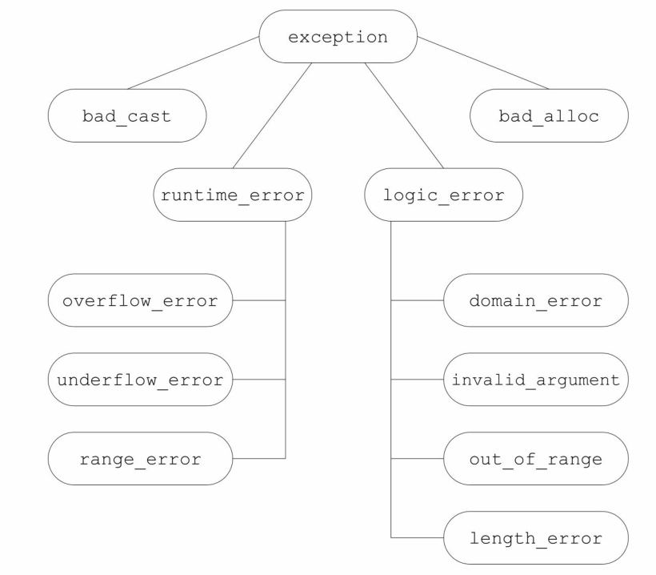
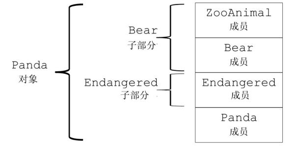
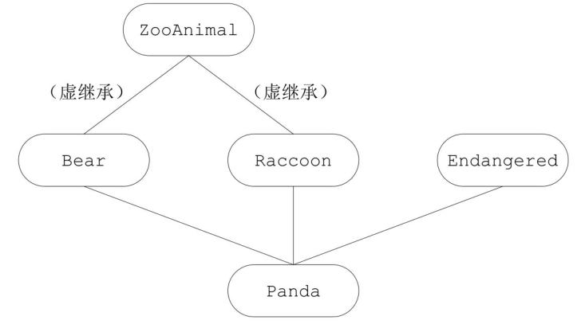

# 第18章 用于大型程序的工具

`C++`语言能解决的问题规模千变万化，有的小到一个程序员几小时就能完成，有的则是含有几千几万行代码的庞大系统，需要几百个程序员协同工作好几年。本书之前介绍的内容对各种规模的编程问题都适用。

除此之外，`C++`语言还包含其他一些特征，当我们编写比较复杂的、小组和个人难以管理的系统时，这些特征最为有用。本章的主题即是向读者介绍这些特征，它们包括异常处理、命名空间和多重继承。

与仅需几个程序员就能开发完成的系统相比，大规模编程对程序设计语言的要求更高。大规模应用程序的特殊要求包括：

- 在独立开发的子系统之间协同处理错误的能力。
- 使用各种库(可能包含独立开发的库)进行协同开发的能力。
- 对比较复杂的应用概念建模的能力。

本章介绍的三种`C++`语言特性正好能满足上述要求，它们是：异常处理、命名空间和多重继承。

## 18.1 异常处理

异常处理(`exception handling`)机制允许程序中独立开发的部分能够在运行时就出现的问题进行通信并做出相应的处理。异常使得我们能够将问题的检测与解决过程分离开来。程序的一部分负责检测问题的出现，然后解决该问题的任务传递给程序的另一部分。检测环节无须知道问题处理模块的所有细节，反之亦然。

在`5.6`节我们曾介绍过一些有关异常处理的基本概念和机理，本节将继续扩展这些知识。对于程序员来说，要想有效地使用异常处理，必须首先了解当抛出异常时发生了什么，捕获异常时发生了什么，以及用来传递错误的对象的意义。

### 18.1.1 抛出异常

在`C++`语言中，我们通过抛出(`throwing`)一条表达式来引发(`raised`)一个异常。被抛出的表达式的类型以及当前的调用链共同决定了哪段处理代码(`handler`)将被用来处理该异常。被选中的处理代码是在调用链中与抛出对象类型匹配的最近的处理代码。其中，根据抛出对象的类型和内容，程序的异常抛出部分将会告知异常处理部分到底发生了什么错误。

当执行一个`throw`时，跟在`throw`后面的语句将不再被执行。相反，程序的控制权从`throw`转移到与之匹配的`catch`模块。该`catch`可能是同一个函数中的局部`catch`，也可能位于直接或间接调用了发生异常的函数的另一个函数中。控制权从一处转移到另一处，这有两个重要的含义：

- 沿着调用链的函数可能会提早退出。
- 一旦程序开始执行异常处理代码，则沿着调用链创建的对象将被

销毁。

因为跟在`throw`后面的语句将不再被执行，所以`throw`语句的用法有点类似于`return`语句：它通常作为条件语句的一部分或者作为某个函数的最后(或者唯一)一条语句。

#### 栈展开

当抛出一个异常后，程序暂停当前函数的执行过程并立即开始寻找与异常匹配的`catch`子句。当`throw`出现在一个`try`语句块(`try block`)内时，检查与该`try`块关联的`catch`子句。如果找到了匹配的`catch`，就使用该`catch`处理异常。如果这一步没找到匹配的`catch`且该`try`语句嵌套在其他`try`块中，则继续检查与外层`try`匹配的`catch`子句。如果还是找不到匹配的`catch`，则退出当前的函数，在调用当前函数的外层函数中继续寻找。

如果对抛出异常的函数的调用语句位于一个`try`语句块内，则检查与该`try`块关联的`catch`子句。如果找到了匹配的`catch`，就使用该`catch`处理异常。否则，如果该`try`语句嵌套在其他`try`块中，则继续检查与外层`try`匹配的`catch`子句。如果仍然没有找到匹配的`catch`，则退出当前这个主调函数，继续在调用了刚刚退出的这个函数的其他函数中寻找，以此类推。

上述过程被称为栈展开(`stack unwinding`)过程。栈展开过程沿着嵌套函数的调用链不断查找，直到找到了与异常匹配的`catch`子句为止；或者也可能一直没找到匹配的`catch`，则退出主函数后查找过程终止。

假设找到了一个匹配的`catch`子句，则程序进入该子句并执行其中的代码。当执行完这个`catch`子句后，找到与`try`块关联的最后一个`catch`子句之后的点，并从这里继续执行。

如果没找到匹配的`catch`子句，程序将退出。因为异常通常被认为是妨碍程序正常执行的事件，所以一旦引发了某个异常，就不能对它置之不理。当找不到匹配的`catch`时，程序将调用标准库函数`terminate`，顾名思义，`terminate`负责终止程序的执行过程。

>一个异常如果没有被捕获，则它将终止当前的程序。

#### 栈展开过程中对象被自动销毁

在栈展开过程中，位于调用链上的语句块可能会提前退出。通常情况下，程序在这些块中创建了一些局部对象。我们已经知道，块退出后它的局部对象也将随之销毁，这条规则对于栈展开过程同样适用。如果在栈展开过程中退出了某个块，编译器将负责确保在这个块中创建的对象能被正确地销毁。如果某个局部对象的类型是类类型，则该对象的析构函数将被自动调用。与往常一样，编译器在销毁内置类型的对象时不需要做任何事情。

如果异常发生在构造函数中，则当前的对象可能只构造了一部分。有的成员已经初始化了，而另外一些成员在异常发生前也许还没有初始化。即使某个对象只构造了一部分，我们也要确保已构造的成员能被正确地销毁。

类似的，异常也可能发生在数组或标准库容器的元素初始化过程中。与之前类似，如果在异常发生前已经构造了一部分元素，则我们应该确保这部分元素被正确地销毁。

#### 析构函数与异常

析构函数总是会被执行的，但是函数中负责释放资源的代码却可能被跳过，这一特点对于我们如何组织程序结构有重要影响。如我们在`1.4`节介绍过的，如果一个块分配了资源，并且在负责释放这些资源的代码前面发生了异常，则释放资源的代码将不会被执行。另一方面，类对象分配的资源将由类的析构函数负责释放。因此，如果我们使用类来控制资源的分配，就能确保无论函数正常结束还是遭遇异常，资源都能被正确地释放。

析构函数在栈展开的过程中执行，这一事实影响着我们编写析构函数的方式。在栈展开的过程中，已经引发了异常但是我们还没有处理它。如果异常抛出后没有被正确捕获，则系统将调用`terminate`函数。因此，出于栈展开可能使用析构函数的考虑，析构函数不应该抛出不能被它自身处理的异常。换句话说，如果析构函数需要执行某个可能抛出异常的操作，则该操作应该被放置在一个`try`语句块当中，并且在析构函数内部得到处理。

在实际的编程过程中，因为析构函数仅仅是释放资源，所以它不太可能抛出异常。所有标准库类型都能确保它们的析构函数不会引发异常。

>在栈展开的过程中，运行类类型的局部对象的析构函数。因为这些析构函数是自动执行的，所以它们不应该抛出异常。一旦在栈展开的过程中析构函数抛出了异常，并且析构函数自身没能捕获到该异常，则程序将被终止。

#### 异常对象

异常对象(`exception object`)是一种特殊的对象，编译器使用异常抛出表达式来对异常对象进行拷贝初始化(参见`13.1.1`节)。因此，`throw`语句中的表达式必须拥有完全类型(参见`7.3.3`节)。而且如果该表达式是类类型的话，则相应的类必须含有一个可访问的析构函数和一个可访问的拷贝或移动构造函数。如果该表达式是数组类型或函数类型，则表达式将被转换成与之对应的指针类型。

异常对象位于由编译器管理的空间中，编译器确保无论最终调用的是哪个`catch`子句都能访问该空间。当异常处理完毕后，异常对象被销毁。

如我们所知，当一个异常被抛出时，沿着调用链的块将依次退出直至找到与异常匹配的处理代码。如果退出了某个块，则同时释放块中局部对象使用的内存。因此，抛出一个指向局部对象的指针几乎肯定是一种错误的行为。出于同样的原因，从函数中返回指向局部对象的指针也是错误的(参见`6.3.2`节)。如果指针所指的对象位于某个块中，而该块在`catch`语句之前就已经退出了，则意味着在执行`catch`语句之前局部对象已经被销毁了。

当我们抛出一条表达式时，该表达式的静态编译时类型(参见`2.3`节)决定了异常对象的类型。读者必须牢记这一点，因为很多情况下程序抛出的表达式类型来自于某个继承体系。如果一条`throw`表达式解引用一个基类指针，而该指针实际指向的是派生类对象，则抛出的对象将被切掉一部分(参见`15.2.3`节)，只有基类部分被抛出。

>抛出指针要求在任何对应的处理代码存在的地方，指针所指的对象都必须存在。

#### 小节练习

练习`18.1`：在下列`throw`语句中异常对象的类型是什么？

```cpp
(a) range_error r("error");      (b) exception *p = &r;
    throw r;                          throw *p;
```

如果将(`b`)中的`throw`语句写成了`throw p`将发生什么情况？

练习`18.2`：当在指定的位置发生了异常时将出现什么情况？

```cpp
void exercise(int *b, int *e)
{
     vector<int> v(b, e);
     int *p = new int[v.size()];
     ifstream in("ints");
     // 此处发生异常
}
```

练习`18.3`：要想让上面的代码在发生异常时能正常工作，有两种解决方案。请描述这两种方法并实现它们。

### 18.1.2 捕获异常

`catch`子句(`catch clause`)中的异常声明(`exception declaration`)看起来像是只包含一个形参的函数形参列表。像在形参列表中一样，如果`catch`无须访问抛出的表达式的话，则我们可以忽略捕获形参的名字。

声明的类型决定了处理代码所能捕获的异常类型。这个类型必须是完全类型(参见`7.3.3`节)，它可以是左值引用，但不能是右值引用(参见`13.6.1`节)。

当进入一个`catch`语句后，通过异常对象初始化异常声明中的参数。和函数的参数类似，如果`catch`的参数类型是非引用类型，则该参数是异常对象的一个副本，在`catch`语句内改变该参数实际上改变的是局部副本而非异常对象本身；相反，如果参数是引用类型，则和其他引用参数一样，该参数是异常对象的一个别名，此时改变参数也就是改变异常对象。

`catch`的参数还有一个特性也与函数的参数非常类似：如果`catch`的参数是基类类型，则我们可以使用其派生类类型的异常对象对其进行初始化。此时，如果`catch`的参数是非引用类型，则异常对象将被切掉一部分(参见`15.2.3`节)，这与将派生类对象以值传递的方式传给一个普通函数差不多。另一方面，如果`catch`的参数是基类的引用，则该参数将以常规方式绑定到异常对象上。

最后一点需要注意的是，异常声明的静态类型将决定`catch`语句所能执行的操作。如果`catch`的参数是基类类型，则`catch`无法使用派生类特有的任何成员。

>通常情况下，如果`catch`接受的异常与某个继承体系有关，则最好将该`catch`的参数定义成引用类型。

#### 查找匹配的处理代码

在搜寻`catch`语句的过程中，我们最终找到的`catch`未必是异常的最佳匹配。相反，挑选出来的应该是第一个与异常匹配的`catch`语句。因此，越是专门的`catch`越应该置于整个`catch`列表的前端。

因为`catch`语句是按照其出现的顺序逐一进行匹配的，所以当程序使用具有继承关系的多个异常时必须对`catch`语句的顺序进行组织和管理，使得派生类异常的处理代码出现在基类异常的处理代码之前。

与实参和形参的匹配规则相比，异常和`catch`异常声明的匹配规则受到更多限制。此时，绝大多数类型转换都不被允许，除了一些极细小的差别之外，要求异常的类型和`catch`声明的类型是精确匹配的：

- 允许从非常量向常量的类型转换，也就是说，一条非常量对象的`throw`语句可以匹配一个接受常量引用的`catch`语句。
- 允许从派生类向基类的类型转换。
- 数组被转换成指向数组(元素)类型的指针，函数被转换成指向该函数类型的指针。

除此之外，包括标准算术类型转换和类类型转换在内，其他所有转换规则都不能在匹配`catch`的过程中使用。

如果在多个`catch`语句的类型之间存在着继承关系，则我们应该把继承链最底端的类(`most derived type`)放在前面，而将继承链最顶端的类(`least derived type`)放在后面。

#### 重新抛出

有时，一个单独的`catch`语句不能完整地处理某个异常。在执行了某些校正操作之后，当前的`catch`可能会决定由调用链更上一层的函数接着处理异常。一条`catch`语句通过重新抛出(`rethrowing`)的操作将异常传递给另外一个`catch`语句。这里的重新抛出仍然是一条`throw`语句，只不过不包含任何表达式：

```cpp
throw;
```

空的`throw`语句只能出现在`catch`语句或`catch`语句直接或间接调用的函数之内。如果在处理代码之外的区域遇到了空`throw`语句，编译器将调用`terminate`。

一个重新抛出语句并不指定新的表达式，而是将当前的异常对象沿着调用链向上传递。

很多时候，`catch`语句会改变其参数的内容。如果在改变了参数的内容后`catch`语句重新抛出异常，则只有当`catch`异常声明是引用类型时我们对参数所做的改变才会被保留并继续传播：

```cpp
catch (my_error &eObj) {      // 引用类型
    eObj.status = errCodes::severeErr;      // 修改了异常对象
    throw;      // 异常对象的 status 成员是 severeErr
} catch (other_error eobj) {      // 非引用类型
    eobj.status = errCodes::badErr;      // 只修改了异常对象的局部副本
    throw;      // 异常对象的 status 成员没有改变
}
```

#### 捕获所有异常的处理代码

有时我们希望不论抛出的异常是什么类型，程序都能统一捕获它们。要想捕获所有可能的异常是比较有难度的，毕竟有些情况下我们也不知道异常的类型到底是什么。即使我们知道所有的异常类型，也很难为所有类型提供唯一一个`catch`语句。为了一次性捕获所有异常，我们使用省略号作为异常声明，这样的处理代码称为捕获所有异常(`catch-all`)的处理代码，形如`catch`(`...`)。一条捕获所有异常的语句可以与任意类型的异常匹配。

`catch`(`...`)通常与重新抛出语句一起使用，其中`catch`执行当前局部能完成的工作，随后重新抛出异常：

```cpp
void manip()
{
    try {
        // 这里的操作将引发并抛出一个异常
    }
    catch (...) {
        // 处理异常的某些特殊操作
        throw;
    }
}
```

`catch`(`...`)既能单独出现，也能与其他几个`catch`语句一起出现。

>如果`catch`(`...`)与其他几个`catch`语句一起出现，则`catch`(`...`)必须在最后的位置。出现在捕获所有异常语句后面的`catch`语句将永远不会被匹配。

#### 小节练习

练习`18.4`：查看图`18.1`所示的继承体系，说明下面的`try`块有何错误并修改它。

```cpp
try {
    // 使用 C++ 标准库
} catch (exception) {
    // ...
} catch (const runtime_error &re) {
    // ...
} catch (overflow_error eobj) { /* ... */ }
```

练习`18.5`：修改下面的`main`函数，使其能捕获图`18.1`所示的任何异常类型：

```cpp
int main() {
    // 使用 C++标准库
```

处理代码应该首先打印异常相关的错误信息，然后调用`abort`(定义在`cstdlib`头文件中)终止`main`函数。

练习`18.6`：已知下面的异常类型和`catch`语句，书写一个`throw`表达式使其创建的异常对象能被这些`catch`语句捕获：

```cpp
(a) class exceptionType { };
    catch(exceptionType *pet) { }
(b) catch(...) { }
(c) typedef int EXCPTYPE;
    catch(EXCPTYPE) { }
```

### 18.1.3 函数 try语句块与构造函数

通常情况下，程序执行的任何时刻都可能发生异常，特别是异常可能发生在处理构造函数初始值的过程中。构造函数在进入其函数体之前首先执行初始值列表。因为在初始值列表抛出异常时构造函数体内的`try`语句块还未生效，所以构造函数体内的`catch`语句无法处理构造函数初始值列表抛出的异常。

要想处理构造函数初始值抛出的异常，我们必须将构造函数写成函数`try`语句块(也称为函数测试块，`function try block`)的形式。函数`try`语句块使得一组`catch`语句既能处理构造函数体(或析构函数体)，也能处理构造函数的初始化过程(或析构函数的析构过程)。举个例子，我们可以把`Blob`的构造函数(参见`16.1.2`节)置于一个函数`try`语句块中：

```cpp
template <typename T>
Blob<T>::Blob(std::initializer_list<T> il) try :
            data(std::make_shared<std::vector<T>>(il)) {
        /* 空函数体 */
} catch(const std::bad_alloc &e) { handle_out_of_memory(e); }
```

注意：关键字`try`出现在表示构造函数初始值列表的冒号以及表示构造函数体(此例为空)的花括号之前。与这个`try`关联的`catch`既能处理构造函数体抛出的异常，也能处理成员初始化列表抛出的异常。

还有一种情况值得读者注意，在初始化构造函数的参数时也可能发生异常，这样的异常不属于函数`try`语句块的一部分。函数`try`语句块只能处理构造函数开始执行后发生的异常。和其他函数调用一样，如果在参数初始化的过程中发生了异常，则该异常属于调用表达式的一部分，并将在调用者所在的上下文中处理。

>处理构造函数初始值异常的唯一方法是将构造函数写成函数`try`语句块。

#### 小节练习

练习`18.7`：根据第`16`章的介绍定义你自己的`Blob`和`BlobPtr`，注意将构造函数写成函数`try`语句块。

### 18.1.4 noexcept异常说明

对于用户及编译器来说，预先知道某个函数不会抛出异常显然大有裨益。首先，知道函数不会抛出异常有助于简化调用该函数的代码；其次，如果编译器确认函数不会抛出异常，它就能执行某些特殊的优化操作，而这些优化操作并不适用于可能出错的代码。

在`C++11`新标准中，我们可以通过提供`noexcept`说明(`noexceptspecification`)指定某个函数不会抛出异常。其形式是关键字`noexcept`紧跟在函数的参数列表后面，用以标识该函数不会抛出异常：

```cpp
void recoup(int) noexcept;      // 不会抛出异常
void alloc(int);      // 可能抛出异常
```

这两条声明语句指出`recoup`将不会抛出任何异常，而`alloc`可能抛出异常。我们说`recoup`做了不抛出说明(`nonthrowing specification`)。

对于一个函数来说，`noexcept`说明要么出现在该函数的所有声明语句和定义语句中，要么一次也不出现。该说明应该在函数的尾置返回类型(参见`6.3.3`节)之前。我们也可以在函数指针的声明和定义中指定`noexcept`。在`typedef`或类型别名中则不能出现`noexcept`。在成员函数中，`noexcept`说明符需要跟在`const`及引用限定符之后，而在`final`、`override`或虚函数的`=0`之前。

#### 违反异常说明

读者需要清楚的一个事实是编译器并不会在编译时检查`noexcept`说明。实际上，如果一个函数在说明了`noexcept`的同时又含有`throw`语句或者调用了可能抛出异常的其他函数，编译器将顺利编译通过，并不会因为这种违反异常说明的情况而报错(不排除个别编译器会对这种用法提出警告)：

```cpp
// 尽管该函数明显违反了异常说明，但它仍然可以顺利编译通过
void f() noexcept      // 承诺不会抛出异常
{
    throw exception();      // 违反了异常说明
}
```

因此可能出现这样一种情况：尽管函数声明了它不会抛出异常，但实际上还是抛出了。一旦一个`noexcept`函数抛出了异常，程序就会调用`terminate`以确保遵守不在运行时抛出异常的承诺。上述过程对是否执行栈展开未作约定，因此`noexcept`可以用在两种情况下：一是我们确认函数不会抛出异常，二是我们根本不知道该如何处理异常。

指明某个函数不会抛出异常可以令该函数的调用者不必再考虑如何处理异常。无论是函数确实不抛出异常，还是程序被终止，调用者都无须为此负责。

>通常情况下，编译器不能也不必在编译时验证异常说明。

#### 向后兼容：异常说明

>早期的`C++`版本设计了一套更加详细的异常说明方案，该方案使得我们可以指定某个函数可能抛出的异常类型。函数可以指定一个关键字`throw`，在后面跟上括号括起来的异常类型列表。`throw`说明符所在的位置与新版本`C++`中`noexcept`所在的位置相同。

>上述使用`throw`的异常说明方案在`C++11`新版本中已经被取消了。然而尽管如此，它还有一个重要的用处。如果函数被设计为是`throw`()的，则意味着该函数将不会抛出异常：

```cpp
void recoup(int) noexcept;      // recoup 不会抛出异常
void recoup(int) throw();      // 等价的声明
```

>上面的两条声明语句是等价的，它们都承诺`recoup`不会抛出异常。

#### 异常说明的实参

`noexcept`说明符接受一个可选的实参，该实参必须能转换为`bool`类型：如果实参是`true`，则函数不会抛出异常；如果实参是`false`，则函数可能抛出异常：

```cpp
void recoup(int) noexcept(true);      // recoup 不会抛出异常
void alloc(int) noexcept(false);      // alloc 可能抛出异常
```

#### `noexcept`运算符

`noexcept`说明符的实参常常与`noexcept`运算符(`noexcept operator`)混合使用。`noexcept`运算符是一个一元运算符，它的返回值是一个`bool`类型的右值常量表达式，用于表示给定的表达式是否会抛出异常。和`sizeof`(参见`4.9`节)类似，`noexcept`也不会求其运算对象的值。

例如，因为我们声明`recoup`时使用了`noexcept`说明符，所以下面的表达式的返回值为`true`：

```cpp
noexcept(recoup(i))   // 如果 recoup 不抛出异常则结果为 true; 否则结果为 false
```

更普通的形式是：

```cpp
noexcept(e)
```

当`e`调用的所有函数都做了不抛出说明且`e`本身不含有`throw`语句时，上述表达式为`true`；否则`noexcept`(`e`)返回`false`。

我们可以使用`noexcept`运算符得到如下的异常说明：

```cpp
void f() noexcept(noexcept(g())); // f 和 g 的异常说明一致
```

如果函数`g`承诺了不会抛出异常，则`f`也不会抛出异常；如果`g`没有异常说明符，或者`g`虽然有异常说明符但是允许抛出异常，则`f`也可能抛出异常。

> `noexcept`有两层含义：当跟在函数参数列表后面时它是异常说明符；而当作为`noexcept`异常说明的`bool`实参出现时，它是一个运算符。

#### 异常说明与指针、虚函数和拷贝控制

尽管`noexcept`说明符不属于函数类型的一部分，但是函数的异常说明仍然会影响函数的使用。

函数指针及该指针所指的函数必须具有一致的异常说明。也就是说，如果我们为某个指针做了不抛出异常的声明，则该指针将只能指向不抛出异常的函数。相反，如果我们显式或隐式地说明了指针可能抛出异常，则该指针可以指向任何函数，即使是承诺了不抛出异常的函数也可以：

```cpp
// recoup 和 pf1 都承诺不会抛出异常
void (*pf1)(int) noexcept = recoup;
// 正确: recoup 不会抛出异常，pf2 可能抛出异常，二者之间互不干扰
void (*pf2)(int) = recoup;
pf1 = alloc;      // 错误: alloc 可能抛出异常，但是 pf1 已经说明了它不会抛出异常
pf2 = alloc;      // 正确: pf2 和 alloc 都可能抛出异常
```

如果一个虚函数承诺了它不会抛出异常，则后续派生出来的虚函数也必须做出同样的承诺；与之相反，如果基类的虚函数允许抛出异常，则派生类的对应函数既可以允许抛出异常，也可以不允许抛出异常：

```cpp
class Base {
public:
    virtual double f1(double) noexcept;      // 不会抛出异常
    virtual int f2() noexcept(false);      // 可能抛出异常
    virtual void f3();      // 可能抛出异常
};
class Derived : public Base {
public:
    double f1(double);      // 错误: Base::f1 承诺不会抛出异常
    int f2() noexcept(false);      // 正确: 与 Base::f2 的异常说明一致
    void f3() noexcept;      // 正确: Derived 的 f3 做了更严格的限定，
                             // 这是允许的
};
```

当编译器合成拷贝控制成员时，同时也生成一个异常说明。如果对所有成员和基类的所有操作都承诺了不会抛出异常，则合成的成员是`noexcept`的。如果合成成员调用的任意一个函数可能抛出异常，则合成的成员是`noexcept`(`false`)。而且，如果我们定义了一个析构函数但是没有为它提供异常说明，则编译器将合成一个。合成的异常说明将与假设由编译器为类合成析构函数时所得的异常说明一致。

#### 小节练习

练习`18.8`：回顾你之前编写的各个类，为它们的构造函数和析构函数添加正确的异常说明。如果你认为某个析构函数可能抛出异常，尝试修改代码使得该析构函数不会抛出异常。

### 18.1.5 异常类层次

标准库异常类(参见`5.6.3`节)构成了图`18.1`所示的继承体系(参见第`15`章)。



图`18.1`：标准`exception`类层次

类型`exception`仅仅定义了拷贝构造函数、拷贝赋值运算符、一个虚析构函数和一个名为`what`的虚成员。其中`what`函数返回一个`const char`*，该指针指向一个以`unll`结尾的字符数组，并且确保不会抛出任何异常。

类`exception`、`bad_cast`和`bad_alloc`定义了默认构造函数。类`runtime_error`和`logic_error`没有默认构造函数，但是有一个可以接受`C`风格字符串或者标准库`string`类型实参的构造函数，这些实参负责提供关于错误的更多信息。在这些类中，`what`负责返回用于初始化异常对象的信息。因为`what`是虚函数，所以当我们捕获基类的引用时，对`what`函数的调用将执行与异常对象动态类型对应的版本。

#### 书店应用程序的异常类

实际的应用程序通常会自定义`exception`(或者`exception`的标准库派生类)的派生类以扩展其继承体系。这些面向应用的异常类表示了与应用相关的异常条件。

如果我们构建的是一个真实的书店应用程序，则其中的类将比本书之前所示的复杂得多。复杂性的一个方面就是如何处理异常。实际上，我们很可能需要建立一个自己的异常类体系，用它来表示与应用相关的各种问题。我们设计的异常类可能如下所示：

```cpp
// 为某个书店应用程序设定的异常类
class out_of_stock : public std::runtime_error {
public:
    explicit out_of_stock(const std::string &s) :
        std::runtime_error(s) { }
};
class isbn_mismatch : public std::logic_error {
public:
    explicit isbn_mismatch(const std::string &s) :
        std::logic_error(s) { }
    isbn_mismatch(const std::string &s,
        const std::string &lhs, const std::string &rhs) :
        std::logic_error(s), left(lhs), right(rhs) { }
    const std::string left, right;
};
```

由上可知，我们的面向应用的异常类继承自标准异常类。和其他继承体系一样，异常类也可以看作按照层次关系组织的。层次越低，表示的异常情况就越特殊。例如，在异常类继承体系中位于最顶层的通常是`exception`，`exception`表示的含义是某处出错了，至于错误的细节则未作描述。

继承体系的第二层将`exception`划分为两个大的类别：运行时错误和逻辑错误。运行时错误表示的是只有在程序运行时才能检测到的错误；而逻辑错误一般指的是我们可以在程序代码中发现的错误。

我们的书店应用程序进一步细分上述异常类别。名为`out_of_stock`的类表示在运行时可能发生的错误，比如某些顺序无法满足；名为`isbn_mismatch`的类表示`logic_error`的一个特例，程序可以通过比较对象的`isbn`()结果来阻止或处理这一错误。

#### 使用我们自己的异常类型

我们使用自定义异常类的方式与使用标准异常类的方式完全一样。程序在某处抛出异常类型的对象，在另外的地方捕获并处理这些出现的问题。举个例子，我们可以为`Sales_data`类定义一个复合加法运算符，当检测到参与加法的两个`ISBN`编号不一致时抛出名为`isbn_mismatch`的异常：

```cpp
// 如果参与加法的两个对象并非同一书籍，则抛出一个异常
Sales_data&
Sales_data::operator+=(const Sales_data& rhs)
{
    if (isbn() != rhs.isbn())
        throw isbn_mismatch("wrong isbns", isbn(), rhs.isbn());
    units_sold += rhs.units_sold;
    revenue += rhs.revenue;
    return *this;
}
```

使用了复合加法运算符的代码将能检测到这一错误，进而输出一条相应的错误信息并继续完成其他任务：

```cpp
// 使用之前设定的书店程序异常类
Sales_data item1, item2, sum;
while (cin >> item1 >> item2) {      // 读取两条交易信息
    try {
        sum = item1 + item2;      // 计算它们的和
        // 此处使用 sum
    } catch (const isbn_mismatch &e) {
        cerr << e.what() << ": left isbn(" << e.left
             << ") right isbn(" << e.right << ")" << endl;
    }
}
```

#### 小节练习

练习`18.9`：定义本节描述的书店程序异常类，然后为`Sales_data`类重新编写一个复合赋值运算符并令其抛出一个异常。

练习`18.10`：编写程序令其对两个`ISBN`编号不相同的对象执行`Sales_data`的加法运算。为该程序编写两个不同的版本：一个处理异常，另一个不处理异常。观察并比较这两个程序的行为，用心体会当出现了一个未被捕获的异常时程序会发生什么情况。

练习`18.11`：为什么`what`函数不应该抛出异常？

## 18.2 命名空间

大型程序往往会使用多个独立开发的库，这些库又会定义大量的全局名字，如类、函数和模板等。当应用程序用到多个供应商提供的库时，不可避免地会发生某些名字相互冲突的情况。多个库将名字放置在全局命名空间中将引发命名空间污染(`namespace pollution`)。

传统上，程序员通过将其定义的全局实体名字设得很长来避免命名空间污染问题，这样的名字中通常包含表示名字所属库的前缀部分：

```cpp
class cplusplus_primer_Query { ... };
string cplusplus_primer_make_plural(size_t, string&);
```

这种解决方案显然不太理想：对于程序员来说，书写和阅读这么长的名字费时费力且过于烦琐。

命名空间(`namespace`)为防止名字冲突提供了更加可控的机制。命名空间分割了全局命名空间，其中每个命名空间是一个作用域。通过在某个命名空间中定义库的名字，库的作者(以及用户)可以避免全局名字固有的限制。

### 18.2.1 命名空间定义

一个命名空间的定义包含两部分：首先是关键字`namespace`，随后是命名空间的名字。在命名空间名字后面是一系列由花括号括起来的声明和定义。只要能出现在全局作用域中的声明就能置于命名空间内，主要包括：类、变量(及其初始化操作)、函数(及其定义)、模板和其他命名空间：

```cpp
namespace cplusplus_primer {
    class Sales_data { /* ... */ };
    Sales_data operator+(const Sales_data&,
                         const Sales_data&);
    class Query { /* ... */ };
    class Query_base { /* ... */ };
} // 命名空间结束后无须分号，这一点与块类似
```

上面的代码定义了一个名为`cplusplus_primer`的命名空间，该命名空间包含四个成员：三个类和一个重载的`+`运算符。

和其他名字一样，命名空间的名字也必须在定义它的作用域内保持唯一。命名空间既可以定义在全局作用域内，也可以定义在其他命名空间中，但是不能定义在函数或类的内部。

>命名空间作用域后面无须分号。

#### 每个命名空间都是一个作用域

和其他作用域类似，命名空间中的每个名字都必须表示该空间内的唯一实体。因为不同命名空间的作用域不同，所以在不同命名空间内可以有相同名字的成员。

定义在某个命名空间中的名字可以被该命名空间内的其他成员直接访问，也可以被这些成员内嵌作用域中的任何单位访问。位于该命名空间之外的代码则必须明确指出所用的名字属于哪个命名空间：

```cpp
cplusplus_primer::Query q =
                    cplusplus_primer::Query("hello");
```

如果其他命名空间(比如说`AddisonWesley`)也提供了一个名为`Query`的类，并且我们希望使用这个类替代`cplusplus_primer`中定义的同名类，则可以按照如下方式修改代码：

```cpp
AddisonWesley::Query q = AddisonWesley::Query("hello");
```

#### 命名空间可以是不连续的

如我们在`16.5`节介绍过的，命名空间可以定义在几个不同的部分，这一点与其他作用域不太一样。编写如下的命名空间定义：

```cpp
namespace nsp {
// 相关声明
}
```

可能是定义了一个名为`nsp`的新命名空间，也可能是为已经存在的命名空间添加一些新成员。如果之前没有名为`nsp`的命名空间定义，则上述代码创建一个新的命名空间；否则，上述代码打开已经存在的命名空间定义并为其添加一些新成员的声明。

命名空间的定义可以不连续的特性使得我们可以将几个独立的接口和实现文件组成一个命名空间。此时，命名空间的组织方式类似于我们管理自定义类及函数的方式：

- 命名空间的一部分成员的作用是定义类，以及声明作为类接口的函数及对象，则这些成员应该置于头文件中，这些头文件将被包含在使用了这些成员的文件中。
- 命名空间成员的定义部分则置于另外的源文件中。

在程序中某些实体只能定义一次：如非内联函数、静态数据成员、变量等，命名空间中定义的名字也需要满足这一要求，我们可以通过上面的方式组织命名空间并达到目的。这种接口和实现分离的机制确保我们所需的函数和其他名字只定义一次，而只要是用到这些实体的地方都能看到对于实体名字的声明。

>定义多个类型不相关的命名空间应该使用单独的文件分别表示每个类型(或关联类型构成的集合)。

#### 定义本书的命名空间

通过使用上述接口与实现分离的机制，我们可以将`cplusplus_primer`库定义在几个不同的文件中。`Sales_data`类的声明及其函数将置于`Sales_data.h`头文件中，第`15`章介绍的`Query`类将置于`Query.h`头文件中，以此类推。对应的实现文件将分别是`Sales_data.cc`和`Query.cc`：

```cpp
// ---- Sales_data.h ----
// #include 应该出现在打开命名空间的操作之前
#include <string>
namespace cplusplus_primer {
    class Sales_data { /* ... */ };
    Sales_data operator+(const Sales_data&,
                         const Sales_data&);
    // Sales_data 的其他接口函数的声明
}
// ---- Sales_data.cc ----
// #include 应该出现在打开命名空间的操作之前
#include "Sales_data.h"
namespace cplusplus_primer {
    // Sales_data 成员及重载运算符的定义
}
```

程序如果想使用我们定义的库，必须包含必要的头文件，这些头文件中的名字定义在命名空间`cplusplus_primer`内：

```cpp
// ---- user.cc ----
// Sales_data.h 头文件的名字位于命名空间 cplusplus_primer 中
#include "Sales_data.h"
int main()
{
    using cplusplus_primer::Sales_data;
    Sales_data trans1, trans2;
    // ...
    return 0;
}
```

这种程序的组织方式提供了开发者和库用户所需的模块性。每个类仍组织在自己的接口和实现文件中，一个类的用户不必编译与其他类相关的名字。我们对用户隐藏了实现细节，同时允许文件`Sales_data.cc`和`user.cc`被编译并链接成一个程序而不会产生任何编译时错误或链接时错误。库的开发者可以分别实现每一个类，相互之间没有干扰。

有一点需要注意，在通常情况下，我们不把`#include`放在命名空间内部。如果我们这么做了，隐含的意思是把头文件中所有的名字定义成该命名空间的成员。例如，如果`Sales_data.h`在包含`string`头文件前就已经打开了命名空间`cplusplus_primer`，则程序将出错，因为这么做意味着我们试图将命名空间`std`嵌套在命名空间`cplusplus_primer`中。

#### 定义命名空间成员

假定作用域中存在合适的声明语句，则命名空间中的代码可以使用同一命名空间定义的名字的简写形式：

```cpp
#include "Sales_data.h"
namespace cplusplus_primer {      // 重新打开命名空间 cplusplus_primer
    // 命名空间中定义的成员可以直接使用名字，此时无须前缀
    std::istream&
    operator>>(std::istream& in, Sales_data& s) { /* ... */ }
}
```

也可以在命名空间定义的外部定义该命名空间的成员。命名空间对于名字的声明必须在作用域内，同时该名字的定义需要明确指出其所属的命名空间：

```cpp
// 命名空间之外定义的成员必须使用含有前缀的名字
cplusplus_primer::Sales_data
cplusplus_primer::operator+(const Sales_data& lhs,
                            const Sales_data& rhs)
{
    Sales_data ret(lhs);
    // ...
}
```

和定义在类外部的类成员一样，一旦看到含有完整前缀的名字，我们就可以确定该名字位于命名空间的作用域内。在命名空间`cplusplus_primer`内部，我们可以直接使用该命名空间的其他成员，比如在上面的代码中，可以直接使用`Sales_data`定义函数的形参。

尽管命名空间的成员可以定义在命名空间外部，但是这样的定义必须出现在所属命名空间的外层空间中。换句话说，我们可以在`cplusplus_primer`或全局作用域中定义`Sales_data operator+` ，但是不能在一个不相关的作用域中定义这个运算符。

#### 模板特例化

模板特例化必须定义在原始模板所属的命名空间中(参见`16.5`节)。和其他命名空间名字类似，只要我们在命名空间中声明了特例化，就能在命名空间外部定义它了：

```cpp
// 我们必须将模板特例化声明成 std 的成员
namespace std {
    template <> struct hash<Sales_data>;
}
// 在 std 中添加了模板特例化的声明后，就可以在命名空间std 的外部定义它了
template <> struct std::hash<Sales_data>
{
    size_t operator()(const Sales_data& s) const
    {   return hash<string>()(s.bookNo) *
               hash<unsigned>()(s.units_sold) *
               hash<double>()(s.revenue); }
    // 其他成员与之前的版本一致
};
```

#### 全局命名空间

全局作用域中定义的名字(即在所有类、函数及命名空间之外定义的名字)也就是定义在全局命名空间(`global namespace`)中。全局命名空间以隐式的方式声明，并且在所有程序中都存在。全局作用域中定义的名字被隐式地添加到全局命名空间中。

作用域运算符同样可以用于全局作用域的成员，因为全局作用域是隐式的，所以它并没有名字。下面的形式

```cpp
::member_name
```

表示全局命名空间中的一个成员。

#### 嵌套的命名空间

嵌套的命名空间是指定义在其他命名空间中的命名空间：

```cpp
namespace cplusplus_primer {
    // 第一个嵌套的命名空间：定义了库的 Query 部分
    namespace QueryLib {
        class Query { /* ...*/ };
        Query operator&(const Query&, const Query&);
        // ...
    }
    // 第二个嵌套的命名空间：定义了库的 Sales_data 部分
    namespace Bookstore {
        class Quote { /* ...*/ };
        class Disc_quote : public Quote { /* ...*/ };
        // ...
    }
}
```

上面的代码将命名空间`cplusplus_primer`分割为两个嵌套的命名空间，分别是`QueryLib`和`Bookstore`。

嵌套的命名空间同时是一个嵌套的作用域，它嵌套在外层命名空间的作用域中。嵌套的命名空间中的名字遵循的规则与往常类似：内层命名空间声明的名字将隐藏外层命名空间声明的同名成员。在嵌套的命名空间中定义的名字只在内层命名空间中有效，外层命名空间中的代码要想访问它必须在名字前添加限定符。例如，在嵌套的命名空间`QueryLib`中声明的类名是

```cpp
cplusplus_primer::QueryLib::Query
```

#### 内联命名空间

`C++11`新标准引入了一种新的嵌套命名空间，称为内联命名空间(`inline namespace`)。和普通的嵌套命名空间不同，内联命名空间中的名字可以被外层命名空间直接使用。也就是说，我们无须在内联命名空间的名字前添加表示该命名空间的前缀，通过外层命名空间的名字就可以直接访问它。

定义内联命名空间的方式是在关键字`namespace`前添加关键字`inline`：

```cpp
inline namespace FifthEd {
    // 该命名空间表示本书第 5 版的代码
}
namespace FifthEd {      // 隐式地内联
    class Query_base { /* ... */ };
    // 其他与 Query 有关的声明
}
```

关键字`inline`必须出现在命名空间第一次定义的地方，后续再打开命名空间的时候可以写`inline`，也可以不写。

当应用程序的代码在一次发布和另一次发布之间发生了改变时，常常会用到内联命名空间。例如，我们可以把本书当前版本的所有代码都放在一个内联命名空间中，而之前版本的代码都放在一个非内联命名空间中：

```cpp
namespace FourthEd {
    class Item_base { /* ... */ };
    class Query_base { /* ... */ };
    // 本书第 4 版用到的其他代码
}
```

命名空间`cplusplus_primer`将同时使用这两个命名空间。例如，假定每个命名空间都定义在同名的头文件中，则我们可以把命名空间`cplusplus_primer`定义成如下形式：

```cpp
namespace cplusplus_primer {
#include "FifthEd.h"
#include "FourthEd.h"
}
```

因为`FifthEd`是内联的，所以形如`cplusplus_primer`::的代码可以直接获得`FifthEd`的成员。如果我们想使用早期版本的代码，则必须像其他嵌套的命名空间一样加上完整的外层命名空间名字，比如`cplusplus_primer::FourthEd`::`Query_base`。

#### 未命名的命名空间

未命名的命名空间(`unnamed namespace`)是指关键字`namespace`后紧跟花括号括起来的一系列声明语句。未命名的命名空间中定义的变量拥有静态生命周期：它们在第一次使用前创建，并且直到程序结束才销毁。

一个未命名的命名空间可以在某个给定的文件内不连续，但是不能跨越多个文件。每个文件定义自己的未命名的命名空间，如果两个文件都含有未命名的命名空间，则这两个空间互相无关。在这两个未命名的命名空间中可以定义相同的名字，并且这些定义表示的是不同实体。如果一个头文件定义了未命名的命名空间，则该命名空间中定义的名字将在每个包含了该头文件的文件中对应不同实体。

>和其他命名空间不同，未命名的命名空间仅在特定的文件内部有效，其作用范围不会横跨多个不同的文件。

定义在未命名的命名空间中的名字可以直接使用，毕竟我们找不到什么命名空间的名字来限定它们；同样的，我们也不能对未命名的命名空间的成员使用作用域运算符。

未命名的命名空间中定义的名字的作用域与该命名空间所在的作用域相同。如果未命名的命名空间定义在文件的最外层作用域中，则该命名空间中的名字一定要与全局作用域中的名字有所区别：

```cpp
int i;      // i 的全局声明
namespace {
    int i;
}
```

```cpp
// 二义性: i 的定义既出现在全局作用域中，又出现在嵌套的未命名的命名空间中
i = 10;
```

其他情况下，未命名的命名空间中的成员都属于正确的程序实体。和所有命名空间类似，一个未命名的命名空间也能嵌套在其他命名空间当中。此时，未命名的命名空间中的成员可以通过外层命名空间的名字来访问：

```cpp
namespace local {
    namespace {
        int i;
    }
}
// 正确：定义在嵌套的未命名的命名空间中的 i 与全局作用域中的 i 不同
local::i = 42;
```

#### 未命名的命名空间取代文件中的静态声明

>在标准`C++`引入命名空间的概念之前，程序需要将名字声明成`static`的以使得其对于整个文件有效。在文件中进行静态声明的做法是从`C`语言继承而来的。在`C`语言中，声明为`static`的全局实体在其所在的文件外不可见。

>在文件中进行静态声明的做法已经被`C++`标准取消了，现在的做法是使用未命名的命名空间。

#### 小节练习

练习`18.12`：将你为之前各章练习编写的程序放置在各自的命名空间中。也就是说，命名空间`chapter15`包含`Query`程序的代码，命名空间`chapter10`包含`TextQuery`的代码；使用这种结构重新编译`Query`代码示例。

练习`18.13`：什么时候应该使用未命名的命名空间？

练习`18.14`：假设下面的`operator`*声明的是嵌套的命名空间`mathLib::MatrixLib`的一个成员：

```cpp
namespace mathLib {
    namespace MatrixLib {
        class matrix { /* ... */ };
        matrix operator*
               (const matrix &, const matrix &);
        // ...
    }
}
```

请问你应该如何在全局作用域中声明该运算符？

### 18.2.2 使用命名空间成员

像`namespace_name::member_name`这样使用命名空间的成员显然非常烦琐，特别是当命名空间的名字很长时尤其如此。幸运的是，我们可以通过一些其他更简便的方法使用命名空间的成员。之前的程序已经使用过其中一种方法，即`using`声明(参见`3.1`节)。本节还将介绍另外几种方法，如命名空间的别名以及`using`指示等。

#### 命名空间的别名

命名空间的别名(`namespace alias`)使得我们可以为命名空间的名字设定一个短得多的同义词。例如，一个很长的命名空间的名字形如

```cpp
namespace cplusplus_primer { /* ... */ };
```

我们可以为其设定一个短得多的同义词：

```cpp
namespace primer = cplusplus_primer;
```

命名空间的别名声明以关键字`namespace`开始，后面是别名所用的名字、`=`符号、命名空间原来的名字以及一个分号。不能在命名空间还没有定义前就声明别名，否则将产生错误。

命名空间的别名也可以指向一个嵌套的命名空间：

```cpp
namespace Qlib = cplusplus_primer::QueryLib;
Qlib::Query q;
```

>一个命名空间可以有好几个同义词或别名，所有别名都与命名空间原来的名字等价。

#### `using`声明：扼要概述

一条`using`声明(`using declaration`)语句一次只引入命名空间的一个成员。它使得我们可以清楚地知道程序中所用的到底是哪个名字。

`using`声明引入的名字遵守与过去一样的作用域规则：它的有效范围从`using`声明的地方开始，一直到`using`声明所在的作用域结束为止。在此过程中，外层作用域的同名实体将被隐藏。未加限定的名字只能在`using`声明所在的作用域以及其内层作用域中使用。在有效作用域结束后，我们就必须使用完整的经过限定的名字了。

一条`using`声明语句可以出现在全局作用域、局部作用域、命名空间作用域以及类的作用域中。在类的作用域中，这样的声明语句只能指向基类成员(参见`15.5`节)。

#### `using`指示

`using`指示(`using directive`)和`using`声明类似的地方是，我们可以使用命名空间名字的简写形式；和`using`声明不同的地方是，我们无法控制哪些名字是可见的，因为所有名字都是可见的。

`using`指示以关键字`using`开始，后面是关键字`namespace`以及命名空间的名字。如果这里所用的名字不是一个已经定义好的命名空间的名字，则程序将发生错误。`using`指示可以出现在全局作用域、局部作用域和命名空间作用域中，但是不能出现在类的作用域中。

`using`指示使得某个特定的命名空间中所有的名字都可见，这样我们就无须再为它们添加任何前缀限定符了。简写的名字从`using`指示开始，一直到`using`指示所在的作用域结束都能使用。

>如果我们提供了一个对`std`等命名空间的`using`指示而未做任何特殊控制的话，将重新引入由于使用了多个库而造成的名字冲突问题。

#### `using`指示与作用域

`using`指示引入的名字的作用域远比`using`声明引入的名字的作用域复杂。如我们所知，`using`声明的名字的作用域与`using`声明语句本身的作用域一致，从效果上看就好像`using`声明语句为命名空间的成员在当前作用域内创建了一个别名一样。

`using`指示所做的绝非声明别名这么简单。相反，它具有将命名空间成员提升到包含命名空间本身和`using`指示的最近作用域的能力。

`using`声明和`using`指示在作用域上的区别直接决定了它们工作方式的不同。对于`using`声明来说，我们只是简单地令名字在局部作用域内有效。相反，`using`指示是令整个命名空间的所有内容变得有效。通常情况下，命名空间中会含有一些不能出现在局部作用域中的定义，因此，`using`指示一般被看作是出现在最近的外层作用域中。

在最简单的情况下，假定我们有一个命名空间`A`和一个函数`f`，它们都定义在全局作用域中。如果`f`含有一个对`A`的`using`指示，则在`f`看来，`A`中的名字仿佛是出现在全局作用域中`f`之前的位置一样：


```cpp
// 命名空间 A 和函数 f 定义在全局作用域中
namespace A {
    int i, j;
}
void f()
{
    using namespace A;              // 把 A 中的名字注入到全局作用域中
    cout << i * j << endl;          // 使用命名空间 A 中的 i 和 j
    // ...
}
```

#### `using`指示示例

让我们看一个简单的示例：

```cpp
namespace blip {
    int i = 16, j = 15, k = 23;
    // 其他声明
}
int j = 0;      // 正确: blip 的 j 隐藏在命名空间中
void manip()
{
    // using 指示，blip 中的名字被“添加”到全局作用域中
    using namespace blip; // 如果使用了 j，则将在 ::j 和 blip::j 之间产生冲突
    ++i;      // 将 blip::i 设定为 17
    ++j;      // 二义性错误: 是全局的 j 还是 blip::j?
    ++::j;      // 正确: 将全局的 j 设定为 1
    ++blip::j;      // 正确: 将 blip::j 设定为 16
    int k = 97;      // 当前局部的 k 隐藏了 blip::k
    ++k;      // 将当前局部的 k 设定为 98
}
```

`manip`的`using`指示使得程序可以直接访问`blip`的所有名字，也就是说，`manip`的代码可以使用`blip`中名字的简写形式。

`blip`的成员看起来好像是定义在`blip`和`manip`所在的作用域一样。假定`manip`定义在全局作用域中，则`blip`的成员也好像是定义在全局作用域中一样。

当命名空间被注入到它的外层作用域之后，很有可能该命名空间中定义的名字会与其外层作用域中的成员冲突。例如在`manip`中，`blip`的成员`j`就与全局作用域中的`j`产生了冲突。这种冲突是允许存在的，但是要想使用冲突的名字，我们就必须明确指出名字的版本。`manip`中所有未加限定的`j`都会产生二义性错误。

为了使用像`j`这样的名字，我们必须使用作用域运算符来明确指出所需的版本。我们使用::`j`来表示定义在全局作用域中的`j`，而使用`blip::j`来表示定义在`blip`中的`j`。

因为`manip`的作用域和命名空间的作用域不同，所以`manip`内部的声明可以隐藏命名空间中的某些成员名字。例如，局部变量`k`隐藏了命名空间的成员`blip::k`。在`manip`内使用`k`不存在二义性，它指的就是局部变量`k`。

#### 头文件与`using`声明或指示

头文件如果在其顶层作用域中含有`using`指示或`using`声明，则会将名字注入到所有包含了该头文件的文件中。通常情况下，头文件应该只负责定义接口部分的名字，而不定义实现部分的名字。因此，头文件最多只能在它的函数或命名空间内使用`using`指示或`using`声明(参见`3.1`节)。

提示：避免`using`指示

> `using`指示一次性注入某个命名空间的所有名字，这种用法看似简单实则充满了风险：只使用一条语句就突然将命名空间中所有成员的名字变得可见了。如果应用程序使用了多个不同的库，而这些库中的名字通过`using`指示变得可见，则全局命名空间污染的问题将重新出现。

>而且，当引入库的新版本后，正在工作的程序很可能会编译失败。如果新版本引入了一个与应用程序正在使用的名字冲突的名字，就会出现这个问题。

>另一个风险是由`using`指示引发的二义性错误只有在使用了冲突名字的地方才能被发现。这种延后的检测意味着可能在特定库引入很久之后才爆发冲突。直到程序开始使用该库的新部分后，之前一直未被检测到的错误才会出现。

>相比于使用`using`指示，在程序中对命名空间的每个成员分别使用`using`声明效果更好，这么做可以减少注入到命名空间中的名字数量。`using`声明引起的二义性问题在声明处就能发现，无须等到使用名字的地方，这显然对检测并修改错误大有益处。

> `using`指示也并非一无是处，例如在命名空间本身的实现文件中就可以使用`using`指示。

#### 小节练习

练习`18.15`：说明`using`指示与`using`声明的区别。

练习`18.16`：假定在下面的代码中标记为“位置`1`”的地方是对于命名空间`Exercise`中所有成员的`using`声明，请解释代码的含义。如果这些`using`声明出现在“位置`2`”又会怎样呢？将`using`声明变为`using`指示，重新回答之前的问题。

```cpp
namespace Exercise {
    int ivar = 0;
    double dvar = 0;
    const int limit = 1000;
}
int ivar = 0;
// 位置 1
void manip() {
    // 位置 2
    double dvar = 3.1416;
    int iobj = limit + 1;
    ++ivar;
    ++::ivar;
}
```

练习`18.17`：实际编写代码检验你对上一题的回答是否正确。

### 18.2.3 类、命名空间与作用域

对命名空间内部名字的查找遵循常规的查找规则：即由内向外依次查找每个外层作用域。外层作用域也可能是一个或多个嵌套的命名空间，直到最外层的全局命名空间查找过程终止。只有位于开放的块中且在使用点之前声明的名字才被考虑：

```cpp
namespace A {
    int i;
    namespace B {
        int i;      // 在 B 中隐藏了 A::i
        int j;
        int f1()
        {
            int j;      // j 是 f1 的局部变量，隐藏了 A::B::j
            return i;      // 返回 B::i
        }
    } // 命名空间 B 结束，此后 B 中定义的名字不再可见
    int f2() {
        return j;      // 错误: j 没有被定义
    }
    int j = i;      // 用 A::i 进行初始化
}
```

对于位于命名空间中的类来说，常规的查找规则仍然适用：当成员函数使用某个名字时，首先在该成员中进行查找，然后在类中查找(包括基类)，接着在外层作用域中查找，这时一个或几个外层作用域可能就是命名空间：

```cpp
namespace A {
     int i;
     int k;
    int i;
    int k;
    class C1 {
    public:
        C1() : i(0), j(0) { }      // 正确: 初始化 C1::i 和 C1::j
        int f1() { return k; }     // 返回 A::k
        int f2() { return h; }     // 错误: h 未定义
        int f3();
    private:
        int i;      // 在 C1 中隐藏了 A::i
        int j;
    };
    int h = i;      // 用 A::i 进行初始化
}
// 成员 f3 定义在 C1 和命名空间 A 的外部
int A::C1::f3() { return h; }      // 正确: 返回 A::h
```

除了类内部出现的成员函数定义之外(参见`7.4.1`节)，总是向上查找作用域。名字必须先声明后使用，因此`f2`的`return`语句无法通过编译。该语句试图使用命名空间`A`的名字`h`，但此时`h`尚未定义。如果`h`在`A`中定义的位置位于`C1`的定义之前，则上述语句将合法。类似的，因为`f3`的定义位于`A::h`之后，所以`f3`对于`h`的使用是合法的。

>可以从函数的限定名推断出查找名字时检查作用域的次序，限定名以相反次序指出被查找的作用域。

限定符`A::C1`::`f3`指出了查找类作用域和命名空间作用域的相反次序。首先查找函数`f3`的作用域，然后查找外层类`C1`的作用域，最后检查命名空间`A`的作用域以及包含着`f3`定义的作用域。

#### 实参相关的查找与类类型形参

考虑下面这个简单的程序：

```cpp
std::string s;
std::cin >> s;
```

如我们所知，该调用等价于(参见`14.1`节)：

```cpp
operator>>(std::cin, s);
```

`operator>>`函数定义在标准库`string`中，`string`又定义在命名空间`std`中。但是我们不用`std::`限定符和`using`声明就可以调用`operator>>`。

对于命名空间中名字的隐藏规则来说有一个重要的例外，它使得我们可以直接访问输出运算符。这个例外是，当我们给函数传递一个类类型的对象时，除了在常规的作用域查找外还会查找实参类所属的命名空间。这一例外对于传递类的引用或指针的调用同样有效。

在此例中，当编译器发现对`operator>>`的调用时，首先在当前作用域中寻找合适的函数，接着查找输出语句的外层作用域。随后，因为`>>`表达式的形参是类类型的，所以编译器还会查找`cin`和`s`的类所属的命名空间。也就是说，对于这个调用来说，编译器会查找定义了`istream`和`string`的命名空间`std`。当在`std`中查找时，编译器找到了`string`的输出运算符函数。

查找规则的这个例外允许概念上作为类接口一部分的非成员函数无须单独的`using`声明就能被程序使用。假如该例外不存在，则我们将不得不为输出运算符专门提供一个`using`声明：

```cpp
using std::operator>>;      // 要想使用cin >> s 就必须有该using 声明
```

或者使用函数调用的形式以把命名空间的信息包含进来：

```cpp
std::operator>>(std::cin, s);      // 正确: 显式地使用 std::>>
```

在没有使用运算符语法的情况下，上述两种声明都显得比较笨拙且无形中增加了使用`IO`标准库的难度。

#### 查找与`std::move`和`std::forward`

很多甚至是绝大多数`C++`程序员从来都没有考虑过与实参相关的查找问题。通常情况下，如果在应用程序中定义了一个标准库中已有的名字，则将出现以下两种情况中的一种：要么根据一般的重载规则确定某次调用应该执行函数的哪个版本；要么应用程序根本就不会执行函数的标准库版本。

接下来考虑标准库`move`和`forward`函数。这两个都是模板函数，在标准库的定义中它们都接受一个右值引用的函数形参。如我们所知，在函数模板中，右值引用形参可以匹配任何类型(参见`16.2.6`节)。如果我们的应用程序也定义了一个接受单一形参的`move`函数，则不管该形参是什么类型，应用程序的`move`函数都将与标准库的版本冲突。`forward`函数也是如此。

因此，`move`(以及`forward`)的名字冲突要比其他标准库函数的冲突频繁得多。而且，因为`move`和`forward`执行的是非常特殊的类型操作，所以应用程序专门修改函数原有行为的概率非常小。

对于`move`和`forward`来说，冲突很多但是大多数是无意的，这一特点解释了为什么我们建议最好使用它们的带限定语的完整版本的原因(参见`12.1.5`节)。通过书写`std::move`而非`move`，我们就能明确地知道想要使用的是函数的标准库版本。

#### 友元声明与实参相关的查找

回顾我们曾经讨论过的，当类声明了一个友元时，该友元声明并没有使得友元本身可见(参见`7.2.1`节)。然而，一个另外的未声明的类或函数如果第一次出现在友元声明中，则我们认为它是最近的外层命名空间的成员。这条规则与实参相关的查找规则结合在一起将产生意想不到的效果：

```cpp
namespace A {
    class C {
        // 两个友元，在友元声明之外没有其他的声明
        // 这些函数隐式地成为命名空间 A 的成员
        friend void f2();      // 除非另有声明，否则不会被找到
        friend void f(const C&); // 根据实参相关的查找规则可以被找到
    };
}
```

此时，`f`和`f2`都是命名空间`A`的成员。即使`f`不存在其他声明，我们也能通过实参相关的查找规则调用`f`：

```cpp
int main()
{
    A::C cobj;
    f(cobj);                        // 正确：通过在 A::C 中的友元声明找到 A::f
    f2();                           // 错误：A::f2 没有被声明
}
```

因为`f`接受一个类类型的实参，而且`f`在`C`所属的命名空间进行了隐式的声明，所以`f`能被找到。相反，因为`f2`没有形参，所以它无法被找到。

#### 小节练习

练习`18.18`：已知有下面的`swap`的典型定义(参见`13.3`节)，当`mem1` 是一个`string`时程序使用`swap`的哪个版本？如果`mem1` 是`int`呢？说明在这两种情况下名字查找的过程。

```cpp
void swap(T v1, T v2)
{
    using std::swap;
    swap(v1.mem1, v2.mem1);
    // 交换类型 T 的其他成员
}
```

练习`18.19`：如果对`swap`的调用形如`std::swap`(`v1.mem1`，`v2.mem1`)将发生什么情况？

### 18.2.4 重载与命名空间

命名空间对函数的匹配过程有两方面的影响(参见`6.4`节)。其中一个影响非常明显：`using`声明或`using`指示能将某些函数添加到候选函数集。另外一个影响则比较微妙。

#### 与实参相关的查找与重载

在上一节中我们了解到，对于接受类类型实参的函数来说，其名字查找将在实参类所属的命名空间中进行。这条规则对于我们如何确定候选函数集同样也有影响。我们将在每个实参类(以及实参类的基类)所属的命名空间中搜寻候选函数。在这些命名空间中所有与被调用函数同名的函数都将被添加到候选集当中，即使其中某些函数在调用语句处不可见也是如此：

```cpp
namespace NS {
    class Quote { /* ... */ };
    void display(const Quote&) { /* ... */ }
}
// Bulk_item 的基类声明在命名空间 NS 中
class Bulk_item : public NS::Quote { /* ... */ };
int main() {
    Bulk_item book1;
    display(book1);
    return 0;
}
```

我们传递给`display`的实参属于类类型`Bulk_item`，因此该调用语句的候选函数不仅应该在调用语句所在的作用域中查找，而且也应该在`Bulk_item`及其基类`Quote`所属的命名空间中查找。命名空间`NS`中声明的函数`display`(`const Quote&`)也将被添加到候选函数集当中。

#### 重载与`using`声明

要想理解`using`声明与重载之间的交互关系，必须首先明确一条：`using`声明语句声明的是一个名字，而非一个特定的函数(参见`15.6`节)：

```cpp
using NS::print(int);   // 错误: 不能指定形参列表
using NS::print;      // 正确:using声明只声明一个名字
```

当我们为函数书写`using`声明时，该函数的所有版本都被引入到当前作用域中。

一个`using`声明囊括了重载函数的所有版本以确保不违反命名空间的接口。库的作者为某项任务提供了好几个不同的函数，允许用户选择性地忽略重载函数中的一部分但不是全部有可能导致意想不到的程序行为。

一个`using`声明引入的函数将重载该声明语句所属作用域中已有的其他同名函数。如果`using`声明出现在局部作用域中，则引入的名字将隐藏外层作用域的相关声明。如果`using`声明所在的作用域中已经有一个函数与新引入的函数同名且形参列表相同，则该`using`声明将引发错误。除此之外，`using`声明将为引入的名字添加额外的重载实例，并最终扩充候选函数集的规模。

#### 重载与`using`指示

`using`指示将命名空间的成员提升到外层作用域中，如果命名空间的某个函数与该命名空间所属作用域的函数同名，则命名空间的函数将被添加到重载集合中：

```cpp
namespace libs_R_us {
    extern void print(int);
    extern void print(double);
}
// 普通的声明
void print(const std::string &);
// 这个 using 指示把名字添加到 print 调用的候选函数集
using namespace libs_R_us;
// print 调用此时的候选函数包括:
// libs_R_us 的 print(int)
// libs_R_us 的 print(double)
// 显式声明的 print(const std::string &)
void fooBar(int ival)
{
    print("Value: ");      // 调用全局函数 print(const string &)
    print(ival);      // 调用 libs_R_us::print(int)
}
```

与`using`声明不同的是，对于`using`指示来说，引入一个与已有函数形参列表完全相同的函数并不会产生错误。此时，只要我们指明调用的是命名空间中的函数版本还是当前作用域的版本即可。

#### 跨越多个`using`指示的重载

如果存在多个`using`指示，则来自每个命名空间的名字都会成为候选函数集的一部分：

```cpp
namespace AW {
     int print (int);
}
namespace Primer {
    double print(double);
}
// using 指示从不同的命名空间中创建了一个重载函数集合
using namespace AW;
using namespace Primer;
long double print (long double);
int main() {
    print(1);                   // 调用 AW::print(int)
    print(3.1);                 // 调用 Primer::print(double)
    return 0;
}
```

在全局作用域中，函数`print`的重载集合包括`print`(`int`)、`print`(`double`)和`print`(`long double`)，尽管它们的声明位于不同作用域中，但它们都属于`main`函数中`print`调用的候选函数集。

#### 小节练习

练习`18.20`：在下面的代码中，确定哪个函数与`compute`调用匹配。列出所有候选函数和可行函数，对于每个可行函数的实参与形参的匹配过程来说，发生了哪种类型转换？

```cpp
namespace PrimerLib {
    void compute ();
    void compute(const void *);
}
using PrimerLib::compute;
void compute(int);
void compute(double, double = 3.4);
void compute(char*, char* = 0);
void f()
{
    compute(0);
}
```

如果将`using`声明置于`main`函数中`compute`的调用点之前将发生什么情况？重新回答之前的那些问题。

## 18.3 多重继承与虚继承

多重继承(`multiple inheritance`)是指从多个直接基类(参见`15.2.2`节)中产生派生类的能力。多重继承的派生类继承了所有父类的属性。尽管概念上非常简单，但是多个基类相互交织产生的细节可能会带来错综复杂的设计问题与实现问题。

为了探讨有关多重继承的问题，我们将以动物园中动物的层次关系作为教学实例。动物园中的动物存在于不同的抽象级别上。有个体的动物，如`Ling-Ling`、`Mowgli`和`Balou`等，它们以名字进行区分；每个动物属于一个物种，例如`Ling-Ling`是一只大熊猫；物种又是科的成员，大熊猫是熊科的成员；每个科是动物界的成员，在这个例子中动物界是指一个动物园中所有动物的总和。

我们将定义一个抽象类`ZooAnimal`，用它来保存动物园中动物共有的信息并提供公共接口。类`Bear`将存放`Bear`科特有的信息，以此类推。

除了类`ZooAnimal`之外，我们的应用程序还包含其他一些辅助类，这些类负责封装不同的抽象，如濒临灭绝的动物。以类`Panda`的实现为例，`Panda`是由`Bear`和`Endangered`共同派生而来的。

### 18.3.1 多重继承

在派生类的派生列表中可以包含多个基类：

```cpp
class Bear : public ZooAnimal { /* ... */ };
class Panda : public Bear, public Endangered { /* ... */ };
```

每个基类包含一个可选的访问说明符(参见`15.5`节)。一如往常，如果访问说明符被忽略掉了，则关键字`class`对应的默认访问说明符是`private`，关键字`struct`对应的是`public`(参见`15.5`节)。

和只有一个基类的继承一样，多重继承的派生列表也只能包含已经被定义过的类，而且这些类不能是`final`的(参见`15.2.2`节)。对于派生类能够继承的基类个数，`C++`没有进行特殊规定；但是在某个给定的派生列表中，同一个基类只能出现一次。

#### 多重继承的派生类从每个基类中继承状态

在多重继承关系中，派生类的对象包含有每个基类的子对象(参见`2.2`节)。如图`18.2`所示，在`Panda`对象中含有一个`Bear`部分(其中又含有一个`ZooAnimal`部分)、一个`Endangered`部分以及在`Panda`中声明的非静态数据成员。



图`18.2`：`Panda`对象的概念结构

#### 派生类构造函数初始化所有基类

构造一个派生类的对象将同时构造并初始化它的所有基类子对象。与从一个基类进行的派生一样(参见`15.2.2`节)，多重继承的派生类的构造函数初始值也只能初始化它的直接基类：

```cpp
// 显式地初始化所有基类
Panda::Panda(std::string name, bool onExhibit)
      : Bear(name, onExhibit, "Panda"),
        Endangered(Endangered::critical) { }
// 隐式地使用 Bear 的默认构造函数初始化 Bear 部分
Panda::Panda()
      : Endangered(Endangered::critical) { }
```

派生类的构造函数初始值列表将实参分别传递给每个直接基类。其中基类的构造顺序与派生列表中基类的出现顺序保持一致，而与派生类构造函数初始值列表中基类的顺序无关。一个`Panda`对象按照如下次序进行初始化：

- `ZooAnimal`是整个继承体系的最终基类，`Bear`是`Panda`的直接基类，`ZooAnimal`是`Bear`的基类，所以首先初始化`ZooAnimal`。
- 接下来初始化`Panda`的第一个直接基类`Bear`。
- 然后初始化`Panda`的第二个直接基类`Endangered`。
- 最后初始化`Pand`a。

#### 继承的构造函数与多重继承

在`C++11`新标准中，允许派生类从它的一个或几个基类中继承构造函数(参见`15.7.4`节)。但是如果从多个基类中继承了相同的构造函数(即形参列表完全相同)，则程序将产生错误：

```cpp
struct Base1 {
    Base1() = default;
    Base1(const std::string&);
    Base1(std::shared_ptr<int>);
};
struct Base2 {
    Base2() = default;
    Base2(const std::string&);
    Base2(int);
};
// 错误: D1 试图从两个基类中都继承 D1::D1(const string&)
struct D1 : public Base1, public Base2 {
    using Base1::Base1;      // 从 Base1 继承构造函数
    using Base2::Base2;      // 从 Base2 继承构造函数
};
```

如果一个类从它的多个基类中继承了相同的构造函数，则这个类必须为该构造函数定义它自己的版本：

```cpp
struct D2 : public Base1, public Base2 {
    using Base1::Base1;      // 从 Base1 继承构造函数
    using Base2::Base2;      // 从 Base2 继承构造函数
    // D2 必须自定义一个接受 string 的构造函数
    D2(const string &s) : Base1(s), Base2(s) { }
    D2() = default;      // 一旦 D2 定义了它自己的构造函数，则必须出现
};
```

#### 析构函数与多重继承

和往常一样，派生类的析构函数只负责清除派生类本身分配的资源，派生类的成员及基类都是自动销毁的。合成的析构函数体为空。

析构函数的调用顺序正好与构造函数相反，在我们的例子中，析构函数的调用顺序是`~Panda`、`~Endangered`、`~Bear`和`~ZooAnimal`。

#### 多重继承的派生类的拷贝与移动操作

与只有一个基类的继承一样，多重继承的派生类如果定义了自己的拷贝`/`赋值构造函数和赋值运算符，则必须在完整的对象上执行拷贝、移动或赋值操作(参见`15.7.2`节)。只有当派生类使用的是合成版本的拷贝、移动或赋值成员时，才会自动对其基类部分执行这些操作。在合成的拷贝控制成员中，每个基类分别使用自己的对应成员隐式地完成构造、赋值或销毁等工作。

例如，假设`Panda`使用了合成版本的成员`ling_ling`的初始化过程：

```cpp
Panda ying_yang("ying_yang");
Panda ling_ling = ying_yang;    // 使用拷贝构造函数
```

将调用`Bear`的拷贝构造函数，后者又在执行自己的拷贝任务之前先调用`ZooAnimal`的拷贝构造函数。一旦`ling_ling`的`Bear`部分构造完成，接着就会调用`Endangered`的拷贝构造函数来创建对象相应的部分。最后，执行`Panda`的拷贝构造函数。合成的移动构造函数的工作机理与之类似。

合成的拷贝赋值运算符的行为与拷贝构造函数很相似。它首先赋值`Bear`部分(并且通过`Bear`赋值`ZooAnimal`部分)，然后赋值`Endangered`部分，最后是`Panda`部分。移动赋值运算符的工作机理与之类似。

#### 小节练习

练习`18.21`：解释下列声明的含义，在它们当中存在错误吗？如果有，请指出来并说明错误的原因。

```cpp
(a)class CADVehicle : public CAD, Vehicle { ... };
(b) class DblList: public List, public List { ... };
(c) class iostream: public istream, public ostream { ... };
```

练习`18.22`：已知存在如下所示的类的继承体系，其中每个类都定义了一个默认构造函数：

```cpp
class A { ... };
class B : public A { ... };
class C : public B { ... };
class X { ... };
class Y { ... };
class Z : public X, public Y { ... };
class MI : public C, public Z { ... };
```

对于下面的定义来说，构造函数的执行顺序是怎样的？

### 18.3.2 类型转换与多个基类

在只有一个基类的情况下，派生类的指针或引用能自动转换成一个可访问基类的指针或引用(参见`15.2.2`节；参见`15.5`节)。多个基类的情况与之类似。我们可以令某个可访问基类的指针或引用直接指向一个派生类对象。例如，一个`ZooAnimal`、`Bear`或`Endangered`类型的指针或引用可以绑定到`Panda`对象上：

```cpp
// 接受 Panda 的基类引用的一系列操作
void print(const Bear&);
void highlight(const Endangered&);
ostream& operator<<(ostream&, const ZooAnimal&);
Panda ying_yang("ying_yang");
print(ying_yang);      // 把一个 Panda 对象传递给一个 Bear 的引用
highlight(ying_yang);      // 把一个 Panda 对象传递给一个 Endangered 的引用
cout << ying_yang << endl; // 把一个 Panda 对象传递给一个 ZooAnimal 的引用
```

编译器不会在派生类向基类的几种转换中进行比较和选择，因为在它看来转换到任意一种基类都一样好。例如，如果存在如下所示的`print`重载形式：

```cpp
void print(const Bear&);
void print(const Endangered&);
```

则通过`Panda`对象对不带前缀限定符的`print`函数进行调用将产生编译错误：

```cpp
Panda ying_yang("ying_yang");
print (ying_yang);      // 二义性错误
```

#### 基于指针类型或引用类型的查找

与只有一个基类的继承一样，对象、指针和引用的静态类型决定了我们能够使用哪些成员(参见`15.6`节)。如果我们使用一个`ZooAnimal`指针，则只有定义在`ZooAnimal`中的操作是可以使用的，`Panda`接口中的`Bear`、`Panda`和`Endangered`特有的部分都不可见。类似的，一个`Bear`类型的指针或引用只能访问`Bear`及`ZooAnimal`的成员，一个`Endangered`的指针或引用只能访问`Endangered`的成员。

举个例子，已知我们的类已经定义了表`18.1`列出的虚函数，考虑下面的这些函数调用：

```cpp
Bear *pb = new Panda("ying_yang");
pb->print ();      // 正确: Panda: :print ()
pb->cuddle();      // 错误: 不属于 Bear 的接口
pb->highlight ();      // 错误: 不属于 Bear 的接口
delete pb;      // 正确: Panda: :~Panda()
```

当我们通过`Endangered`的指针或引用访问一个`Panda`对象时，`Panda`接口中`Panda`特有的部分以及属于`Bear`的部分都是不可见的：

```cpp
Endangered *pe = new Panda("ying_yang");
pe->print ();      // 正确:Panda: :print ()
pe->toes();      // 错误: BHF Endangered 的接口
pe->cuddle();      // 错误: RMF Endangered 的接口
pe->highlight ();      // 正确: Panda: :highlight ()
delete pe;      // 正确:Panda:
                Panda ()
```

表 `18.1`: 在`ZooAnimal`/`Endangered`中定义的虚函数

| 函数 | 含有自定义版本的类 |
| --- | --- |
| `print` | `ZooAnimal::print`、`Bear::print`、`Endangered::print`、`Panda::print` |
| `highlight` | `Endangered::highlight`、`Panda::highlight` |
| `toes` | `Panda::toes` |
| `cuddle` | `Panda::cuddle` |
| 析构函数 | `ZooAnimal::~ZooAnimal`、`Endangered::~Endangered`、`Panda::~Panda` |

#### 小节练习

练习`18.23`：使用练习`18.22`的继承体系以及下面定义的类`D`，同时假定每个类都定义了默认构造函数，请问下面的哪些类型转换是不被允许的？

```cpp
class D
    : public B,
      public C { ... };
D *pd = new D;
(a) X *px = pd;      (b) A *pa = pd;
(c) B *pb = pd;      (d) C *pc = pd;
```

练习`18.24`：在第`714`页，我们使用一个指向`Panda`对象的`Bear`指针进行了一系列调用，假设我们使用的是一个指向`Panda`对象的`ZooAnimal`指针将发生什么情况，请对这些调用语句逐一进行说明。

练习`18.25`：假设我们有两个基类`Base1`和`Base2`，它们各自定义了一个名为`print`的虚成员和一个虚析构函数。从这两个基类中我们派生出下面的类，它们都重新定义了`print`函数：

```cpp
class D1 : public Base1 { /* ... */ };
class D2 : public Base2 { /* ... */ };
class MI : public D1, public D2 { /* ... */ };
```

通过下面的指针，指出在每个调用中分别使用了哪个函数：

```cpp
Base1 *pb1 = new MI;
Base2 *pb2 = new MI;
D1 *pd1 = new MI;
D2 *pd2 = new MI;
(a) pb1->print();      (b) pd1->print();      (c) pd2->print();
(d) delete pb2;      (e) delete pd1;      (f) delete pd2;
```

### 18.3.3 多重继承下的类作用域

在只有一个基类的情况下，派生类的作用域嵌套在直接基类和间接基类的作用域中(参见`15.6`节)。查找过程沿着继承体系自底向上进行，直到找到所需的名字。派生类的名字将隐藏基类的同名成员。

在多重继承的情况下，相同的查找过程在所有直接基类中同时进行。如果名字在多个基类中都被找到，则对该名字的使用将具有二义性。

在我们的例子中，如果我们通过`Panda`的对象、指针或引用使用了某个名字，则程序会并行地在`Endangered`和`Bear/ZooAnimal`这两棵子树中查找该名字。如果名字在超过一棵子树中被找到，则该名字的使用具有二义性。对于一个派生类来说，从它的几个基类中分别继承名字相同的成员是完全合法的，只不过在使用这个名字时必须明确指出它的版本。

>当一个类拥有多个基类时，有可能出现派生类从两个或更多基类中继承了同名成员的情况。此时，不加前缀限定符直接使用该名字将引发二义性。

例如，如果`ZooAnimal`和`Endangered`都定义了名为`max_weight`的成员，并且`Panda`没有定义该成员，则下面的调用是错误的：

```cpp
double d = ying_yang.max_weight();
```

`Panda`在派生的过程中拥有了两个名为`max_weight`的成员，这是完全合法的。派生仅仅是产生了潜在的二义性，只要`Panda`对象不调用`max_weight`函数就能避免二义性错误。另外，如果每次调用`max_weight`时都指出所调用的版本(`ZooAnimal::max_weight`或者`Endangered::max_weight`)，也不会发生二义性。只有当要调用哪个函数含糊不清时程序才会出错。

在上面的例子中，派生类继承的两个`max_weight`会产生二义性，这一点显而易见。一种更复杂的情况是，有时即使派生类继承的两个函数形参列表不同也可能发生错误。此外，即使`max_weight`在一个类中是私有的，而在另一个类中是公有的或受保护的同样也可能发生错误。最后一种情况，假如`max_weight`定义在`Bear`中而非`ZooAnimal`中，上面的程序仍然是错误的。

和往常一样，先查找名字后进行类型检查(参见`6.4.1`节)。当编译器在两个作用域中同时发现了`max_weight`时，将直接报告一个调用二义性的错误。

要想避免潜在的二义性，最好的办法是在派生类中为该函数定义一个新版本。例如，我们可以为`Panda`定义一个`max_weight`函数从而解决二义性问题：

```cpp
double Panda::max_weight() const
{
    return std::max(ZooAnimal::max_weight(),
                    Endangered::max_weight());
}
```

#### 小节练习

```cpp
struct Base1 {
    void print(int) const;      // 默认情况下是公有的
protected:
    int ival;
    double dval;
    char cval;
private:
    int *id;
};
struct Base2 {
    void print(double) const;      // 默认情况下是公有的
protected:
    double fval;
private:
    double dval;
};
struct Derived : public Base1 {
    void print(std::string) const;      // 默认情况下是公有的
protected:
    std::string sval;
    double dval;
};
struct MI : public Derived, public Base2 {
    void print(std::vector<double>);      // 默认情况下是公有的
protected:
    int *ival;
    std::vector<double> dvec;
};
```

练习`18.26`：已知如上所示的继承体系，下面对`print`的调用为什么是错误的？适当修改`MI`，令其对`print`的调用可以编译通过并正确执行。

```cpp
MI mi;
mi.print(42);
```

练习`18.27`：已知如上所示的继承体系，同时假定为`MI`添加了一个名为`foo`的函数：

```cpp
int ival;
double dval;
void MI::foo(double cval)
{
    int dval;
    // 练习中的问题发生在此处
}
(a) 列出在 MI::foo 中可见的所有名字。
(b) 是否存在某个可见的名字是继承自多个基类的?
(c) 将 Base1 的 dval 和 Derived 的 dval 成员求和后赋给 dval 的局部实例。
(d) 将 MI::dvec 的最后一个元素的值赋给 Base2::fval。
(e) 将从 Base1 继承的 cval 赋给从 Derived 继承的 sval 的第一个字符。
```

### 18.3.4 虚继承

尽管在派生列表中同一个基类只能出现一次，但实际上派生类可以多次继承同一个类。派生类可以通过它的两个直接基类分别继承同一个间接基类，也可以直接继承某个基类，然后通过另一个基类再一次间接继承该类。

举个例子，`IO`标准库的`istream`和`ostream`分别继承了一个共同的名为`base_ios`的抽象基类。该抽象基类负责保存流的缓冲内容并管理流的条件状态。`iostream`是另外一个类，它从`istream`和`ostream`直接继承而来，可以同时读写流的内容。因为`istream`和`ostream`都继承自`base_ios`，所以`iostream`继承了`base_ios`两次，一次是通过`istream`，另一次是通过`ostream`。

在默认情况下，派生类中含有继承链上每个类对应的子部分。如果某个类在派生过程中出现了多次，则派生类中将包含该类的多个子对象。

这种默认的情况对某些形如`iostream`的类显然是行不通的。一个`iostream`对象肯定希望在同一个缓冲区中进行读写操作，也会要求条件状态能同时反映输入和输出操作的情况。假如在`iostream`对象中真的包含了`base_ios`的两份拷贝，则上述的共享行为就无法实现了。

在`C++`语言中我们通过虚继承(`virtual inheritance`)的机制解决上述问题。虚继承的目的是令某个类做出声明，承诺愿意共享它的基类。其中，共享的基类子对象称为虚基类(`virtual base class`)。在这种机制下，不论虚基类在继承体系中出现了多少次，在派生类中都只包含唯一一个共享的虚基类子对象。

#### 另一个`Panda`类

在过去，科学界对于大熊猫属于`Raccoon`科还是`Bear`科争论不休。为了如实地反映这种争论，我们可以对`Panda`类进行修改，令其同时继承`Bear`和`Raccoon`。此时，为了避免赋予`Panda`两份`ZooAnimal`的子对象，我们将`Bear`和`Raccoon`继承`ZooAnimal`的方式定义为虚继承。图`18.3`描述了新的继承体系。



图`18.3`：`Panda`的虚继承层次

观察这个新的继承体系，我们将发现虚继承的一个不太直观的特征：必须在虚派生的真实需求出现前就已经完成虚派生的操作。例如在我们的类中，当我们定义`Panda`时才出现了对虚派生的需求，但是如果`Bear`和`Raccoon`不是从`ZooAnimal`虚派生得到的，那么`Panda`的设计者就显得不太幸运了。

在实际的编程过程中，位于中间层次的基类将其继承声明为虚继承一般不会带来什么问题。通常情况下，使用虚继承的类层次是由一个人或一个项目组一次性设计完成的。对于一个独立开发的类来说，很少需要基类中的某一个是虚基类，况且新基类的开发者也无法改变已存在的类体系。

>虚派生只影响从指定了虚基类的派生类中进一步派生出的类，它不会影响派生类本身。

#### 使用虚基类

我们指定虚基类的方式是在派生列表中添加关键字`virtual`：

```cpp
// 关键字public 和 virtual 的顺序随意
class Raccoon : public virtual ZooAnimal { /* ... */ };
class Bear : virtual public ZooAnimal { /* ... */ };
```

通过上面的代码我们将`ZooAnimal`定义为`Raccoon`和`Bear`的虚基类。

`virtual`说明符表明了一种愿望，即在后续的派生类当中共享虚基类的同一份实例。至于什么样的类能够作为虚基类并没有特殊规定。

如果某个类指定了虚基类，则该类的派生仍按常规方式进行：

```cpp
class Panda : public Bear,
               public Raccoon, public Endangered {
};
```

`Panda`通过`Raccoon`和`Bear`继承了`ZooAnimal`，因为`Raccoon`和`Bear`继承`ZooAnimal`的方式都是虚继承，所以在`Panda`中只有一个`ZooAnimal`基类部分。

#### 支持向基类的常规类型转换

不论基类是不是虚基类，派生类对象都能被可访问基类的指针或引用操作。例如，下面这些从`Panda`向基类的类型转换都是合法的：

```cpp
void dance(const Bear&);
void rummage(const Raccoon&);
ostream& operator<<(ostream&, const ZooAnimal&);
Panda ying_yang;
dance(ying_yang);      // 正确: 把一个 Panda 对象当成 Bear 传递
rummage(ying_yang);      // 正确: 把一个 Panda 对象当成 Raccoon 传递
cout << ying_yang;      // 正确: 把一个 Panda 对象当成 ZooAnimal 传递
```

#### 虚基类成员的可见性

因为在每个共享的虚基类中只有唯一一个共享的子对象，所以该基类的成员可以被直接访问，并且不会产生二义性。此外，如果虚基类的成员只被一条派生路径覆盖，则我们仍然可以直接访问这个被覆盖的成员。但是如果成员被多余一个基类覆盖，则一般情况下派生类必须为该成员自定义一个新的版本。

例如，假定类`B`定义了一个名为`x`的成员，`D1`和`D2`都是从`B`虚继承得到的，`D`继承了`D1`和`D2`，则在`D`的作用域中，`x`通过`D`的两个基类都是可见的。如果我们通过`D`的对象使用`x`，有三种可能性：

- 如果在`D1`和`D2`中都没有`x`的定义，则`x`将被解析为`B`的成员，此时不存在二义性，一个`D`的对象只含有`x`的一个实例。
- 如果`x`是`B`的成员，同时是`D1`和`D2`中某一个的成员，则同样没有二义性，派生类的`x`比共享虚基类`B`的`x`优先级更高。
- 如果在`D1`和`D2`中都有`x`的定义，则直接访问`x`将产生二义性问题。

与非虚的多重继承体系一样，解决这种二义性问题最好的方法是在派生类中为成员自定义新的实例。

#### 小节练习

练习`18.28`：已知存在如下的继承体系，在`VMI` 类的内部哪些继承而来的成员无须前缀限定符就能直接访问？哪些必须有限定符才能访问？说明你的原因。

```cpp
struct Base {
    void bar(int);      // 默认情况下是公有的
protected:
    int ival;
};
struct Derived1 : virtual public Base {
    void bar(char);      // 默认情况下是公有的
    void foo(char);
protected:
    char cval;
};
struct Derived2 : virtual public Base {
    void foo(int);      // 默认情况下是公有的
protected:
    int ival;
};
class VMI : public Derived1, public Derived2 { };
```

### 18.3.5 构造函数与虚继承

在虚派生中，虚基类是由最低层的派生类初始化的。以我们的程序为例，当创建`Panda`对象时，由`Panda`的构造函数独自控制`ZooAnimal`的初始化过程。

为了理解这一规则，我们不妨假设当以普通规则处理初始化任务时会发生什么情况。在此例中，虚基类将会在多条继承路径上被重复初始化。以`ZooAnimal`为例，如果应用普通规则，则`Raccoon`和`Bear`都会试图初始化`Panda`对象的`ZooAnimal`部分。

当然，继承体系中的每个类都可能在某个时刻成为“最低层的派生类”。只要我们能创建虚基类的派生类对象，该派生类的构造函数就必须初始化它的虚基类。例如在我们的继承体系中，当创建一个`Bear`(或`Raccoon`)的对象时，它已经位于派生的最低层，因此`Bear`(或`Raccoon`)的构造函数将直接初始化其`ZooAnimal`基类部分：

```cpp
Bear::Bear(std::string name, bool onExhibit) :
         ZooAnimal(name, onExhibit, "Bear") { }
Raccoon::Raccoon(std::string name, bool onExhibit) :
         ZooAnimal(name, onExhibit, "Raccoon") { }
```

而当创建一个`Panda`对象时，`Panda`位于派生的最低层并由它负责初始化共享的`ZooAnimal`基类部分。即使`ZooAnimal`不是`Panda`的直接基类，`Panda`的构造函数也可以初始化`ZooAnimal`：

```cpp
Panda::Panda(std::string name, bool onExhibit)
    : ZooAnimal(name, onExhibit, "Panda"),
      Bear(name, onExhibit),
      Raccoon(name, onExhibit),
      Endangered(Endangered::critical),
      sleeping_flag(false) { }
```

#### 虚继承的对象的构造方式

含有虚基类的对象的构造顺序与一般的顺序稍有区别：首先使用提供给最低层派生类构造函数的初始值初始化该对象的虚基类子部分，接下来按照直接基类在派生列表中出现的次序依次对其进行初始化。

例如，当我们创建一个`Panda`对象时：

- 首先使用`Panda`的构造函数初始值列表中提供的初始值构造虚基类`ZooAnimal`部分。
- 接下来构造`Bear`部分。
- 然后构造`Raccoon`部分。
- 然后构造第三个直接基类`Endangered`。
- 最后构造`Panda`部分。

如果`Panda`没有显式地初始化`ZooAnimal`基类，则`ZooAnimal`的默认构造函数将被调用。如果`ZooAnimal`没有默认构造函数，则代码将发生错误。

>虚基类总是先于非虚基类构造，与它们在继承体系中的次序和位置无关。

#### 构造函数与析构函数的次序

一个类可以有多个虚基类。此时，这些虚的子对象按照它们在派生列表中出现的顺序从左向右依次构造。例如，在下面这个稍显杂乱的`TeddyBear`派生关系中有两个虚基类：`ToyAnimal`是直接虚基类，`ZooAnimal`是`Bear`的虚基类：

```cpp
class Character { /* ... */ };
class BookCharacter : public Character { /* ... */ };
class ToyAnimal { /* ... */ };
class TeddyBear : public BookCharacter,
                  public Bear, public virtual ToyAnimal
                  { /* ... */ };
```

编译器按照直接基类的声明顺序对其依次进行检查，以确定其中是否含有虚基类。如果有，则先构造虚基类，然后按照声明的顺序逐一构造其他非虚基类。因此，要想创建一个`TeddyBear`对象，需要按照如下次序调用这些构造函数：

```cpp
ZooAnimal();      // Bear 的虚基类
ToyAnimal();      // 直接虚基类
Character();      // 第一个非虚基类的间接基类
BookCharacter();      // 第一个直接非虚基类
Bear();      // 第二个直接非虚基类
TeddyBear();      // 最低层的派生类
```

合成的拷贝和移动构造函数按照完全相同的顺序执行，合成的赋值运算符中的成员也按照该顺序赋值。和往常一样，对象的销毁顺序与构造顺序正好相反，首先销毁`TeddyBear`部分，最后销毁`ZooAnimal`部分。

#### 小节练习

练习`18.29`：已知有如下所示的类继承关系：

```cpp
class Class { ... };
class Base : public Class { ... };
class D1 : virtual public Base { ... };
class D2 : virtual public Base { ... };
class MI : public D1, public D2 { ... };
class Final : public MI, public Class { ... };
(a) 当作用于一个Final 对象时，构造函数和析构函数的执行次序分别是什么
(b) 在一个Final 对象中有几个 Base 部分? 几个Class 部分?
(c) 下面的哪些赋值运算将造成编译错误?
Base *pb;      Class *pc;      MI *pmi;      D2 *pd2;
(a) pb = new Class;      (b)pc = new Final;
(c)pmi = pb;      (d) pd2 = pmi;
```

练习`18.30`：在`Base`中定义一个默认构造函数、一个拷贝构造函数和一个接受`int`形参的构造函数。在每个派生类中分别定义这三种构造函数，每个构造函数应该使用它的实参初始化其`Base`部分。

## 小结

`C++`语言可以用于解决各种类型的问题，既有几个小时就可以解决的小问题，也有一个大团队工作数年才能解决的超大规模问题。`C++`的某些特性特别适合于处理超大规模问题，这些特性包括：异常处理、命名空间以及多重继承或虚继承。

异常处理使得我们可以将程序的错误检测部分与错误处理部分分隔开来。当程序抛出一个异常时，当前正在执行的函数暂时中止，开始查找最邻近的与异常匹配的`catch`语句。作为异常处理的一部分，如果查找`catch`语句的过程中退出了某些函数，则函数中定义的局部变量也随之销毁。

命名空间是一种管理大规模复杂应用程序的机制，这些应用可能是由多个独立的供应商分别编写的代码组合而成的。一个命名空间是一个作用域，我们可以在其中定义对象、类型、函数、模板以及其他命名空间。标准库定义在名为`std`的命名空间中。

从概念上来说，多重继承非常简单：一个派生类可以从多个直接基类继承而来。在派生类对象中既包含派生类部分，也包含与每个基类对应的基类部分。虽然看起来很简单，但实际上多重继承的细节非常复杂。特别是对多个基类的继承可能会引入新的名字冲突，并造成来自于基类部分的名字的二义性问题。

如果一个类是从多个基类直接继承而来的，那么有可能这些基类本身又共享了另一个基类。在这种情况下，中间类可以选择使用虚继承，从而声明愿意与层次中虚继承同一基类的其他类共享虚基类。用这种方法，后代派生类中将只有一个共享虚基类的副本。

## 术语表

捕获所有异常(`catch-all`)异常声明形如(`...`)的`catch`子句。一条捕获所有异常的子句可以捕获任意类型的异常。常用于捕获局部检测的异常，该异常将重新抛出到程序的其他部分并最终解决问题。

`catch`子句(`catch clause`)程序中负责处理异常的部分。`catch`子句包含关键字`catch`，后面是异常声明以及一个语句块。`catch`子句的代码负责处理异常声明中定义的异常。

构造函数顺序(`constructor order`)在非虚继承中，基类的构造顺序与其在派生列表中出现的顺序一致。在虚继承中，首先构造虚基类。虚基类的构造顺序与其在派生类的派生列表中出现的顺序一致。只有最低层的派生类才能初始化虚基类。虚基类的初始值如果出现在中间基类中，则这些初始值将被忽略。初始化虚基类。虚基类的初始值如果出现在中间基类中，则这些初始值将被忽略。

异常声明(`exception declaration`) `catch` 子句中指定其能够处理的异常类型的部分。异常声明的行为与形参列表类似，其中的唯一一个形参通过异常对象进行初始化。如果异常说明符是非引用类型，则异常对象将被拷贝给`catch`。对象将被拷贝给`catch`。

异常处理(`exception handling`)管理运行时异常的语言级支持。代码中一个独立开发的部分可以检测并引发异常，由程序的另一个独立开发的部分处理该异常。也就是说，程序的错误检测部分负责抛出异常，而错误处理部分在`try`语句块的`catch`子句中处理异常。在`try`语句块的`catch`子句中处理异常。

异常对象(`exception object`)用于在异常的`throw`和`catch`之间进行通信的对象。在抛出点创建该对象，该对象是被抛出的表达式的副本。在该异常的最后一段处理代码完成之前异常对象都一直存在。异常对象的类型是被抛出的表达式的静态类型。

文件中的静态声明(`file static`)使用关键字`static`声明的仅对当前文件有效的名字。在`C`语言和之前的`C++`版本中，文件中的静态声明用于声明只能在当前文件中使用的名字。该特性在当前的`C++`版本中已经被未命名的命名空间替换了。象的类型是被抛出的表达式的静态类型。文件中的静态声明(`file static`)使用关键字`static`声明的仅对当前文件有效的名字。在`C`语言和之前的`C++`版本中，文件中的静态声明用于声明只能在当前文件中使用的名字。该特性在当前的`C++`版本中已经被未命名的命名空间替换了。

函数`try`语句块(`function try block`)用于捕获构造函数初始化过程发生的异常。关键字`try`出现在表示构造函数初始值列表开始的冒号之前(或者当初始值列表为空时出现在函数体的左侧花括号之前)，并以函数体右侧花括号之后的一个或几个`catch`子句作为结束。函数体右侧花括号之后的一个或几个`catch`子句作为结束。

全局命名空间(`global namespace`)是每个程序的隐式命名空间，用于存放全局定义。

处理代码(`handler`)是“`catch`子句”的同义词。

内联的命名空间(`inline namespace`)内联命名空间中的名字可以看成是外层命名空间的成员。

多重继承(`multiple inheritance`)有多个直接基类的类。派生类继承所有基类的成员。可以为每个基类分别设定访问说明符。

命名空间(`namespace`)将库或者其他程序集定义的名字放在同一个作用域中的机制。和`C++`的其他作用域不同，命名空间作用域可以定义成几个部分。我们可以打开并关闭命名空间，然后在程序的另一个地方重新打开并关闭该命名空间。名空间。

命名空间的别名(`namespace alias`)为某个给定的命名空间定义同义词的机制：

```cpp
namespace N1 = N;
```

将`N1`定义成命名空间`N`的另一个名字。命名空间可以含有多个别名，命名空间的原名和别名是等价的。

命名空间污染(`namespace pollution`)当所有类和函数的名字都放置于全局命名空间时将造成命名空间污染。如果来自于多个独立供应商的代码都含有全局名字，则使用这些代码的大型程序很可能会面临命名空间污染的问题。。

`noexcept`运算符(`noexcept operator`)该运算符返回一个`bool`值，用于表示给定的表达式是否会抛出异常。该表达式不会被求值，运算的结果是一个常量表达式。当提供的表达式不含`throw`并且只调用了做出不抛出说明的函数时，结果为`true`；否则结果为`false`。

`noexcept`说明(`noexcept specification`)表示函数是否会抛出异常的关键字。当`noexcept`跟在函数的形参列表之后时，它可以连接一个括号括起来的常量表达式，前提是该表达式可以转换成`bool`值。如果忽略了该表达式，或者表达式的值为`true`，则函数不会抛出异常。如果表达式的值是`false`或者函数没有异常声明，则其可能抛出异常。

不抛出说明(`nonthrowing specification`)该异常说明用于承诺某个函数不会抛出异常。如果一个做了不抛出说明的函数实际抛出了异常，将调用`terminate`。不抛出说明符是不含实参或者含有一个值为`true`的实参的`noexcept`。

引发(`raise`)常常作为抛出的同义词。`C++`程序员认为抛出异常和引发异常基本上是等价的。

重新抛出(`rethrow`)不指定表达式的`throw`。重新抛出只有在`catch`子句内部或者被`catch`直接或间接调用了的函数内时才有效。它的效果是将其接受的异常重新抛出。

栈展开(`stack unwinding`)在搜寻`catch`时依次退出函数的过程。异常发生前构造的局部对象将在进入相应的`catch`前被销毁。

`terminate` 是一个标准库函数，当异常未被捕获或者在处理异常的过程中发生了另一个异常时，`terminate`负责结束程序的执行。

`throw e` 该表达式将中断当前的执行路径，`throw`语句将控制权传递给最近的能够处理该异常的`catch`子句。表达式`e`将被拷贝给异常对象。

`try`语句块(`try block`)含有关键字`try`以及一个或多个`catch`子句的语句块。如果`try`语句块中的代码引发了一个异常，并且某个`catch`可以匹配该异常，则异常将被这个`catch`处理。否则，异常被传递到`try`语句块之外并继续沿着调用链寻找与之匹配的`catch`。否则，异常被传递到`try`语句块之外并继续沿着调用链寻找与之匹配的`catch`。

未命名的命名空间(`unnamed namespace`)定义时未指定名字的命名空间。对于定义在未命名的命名空间中的名字，我们可以不用作用域运算符就直接访问它们。每个文件有一个独有的未命名的命名空间，其中的名字在文件外不可见。可见。

`using`声明(`using declaration`)是一种将命名空间中的某个名字注入当前作用域的机制：

```cpp
using std::cout;
```

上述语句使得命名空间`std`中的名字`cout`在当前作用域可见。之后，我们就可以直接使用`cout`而无须前缀`std::`了。

`using`指示(`using directive`)是具有如下形式的声明：

```cpp
using NS;
```

上述语句使得命名空间`NS`的所有名字在`using`指示所在的作用域以及`NS`所在的作用域都变得可见。

虚基类(`virtual base class`)在派生列表中使用了关键字`virtual`的基类。在派生类对象中，虚基类部分只有一份，即使该虚基类在继承体系中出现了多次也是如此。对于非虚继承而言，构造函数只能初始化它的直接基类。但是对于虚继承来说，虚基类将被最低层的派生类初始化，因此最低层的派生类应该含有它的所有虚基类的初始值。直接基类。但是对于虚继承来说，虚基类将被最低层的派生类初始化，因此最低层的派生类应该含有它的所有虚基类的初始值。

虚继承(`virtual inheritance`)是多重继承的一种形式，基类被继承了多次，但是派生类共享该基类的唯一一份副本。

作用域运算符(`:: operator`)用于访问命名空间或类中的名字。
